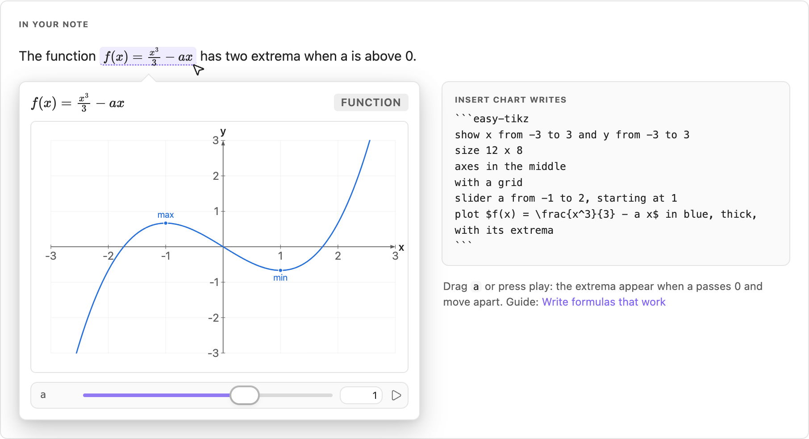
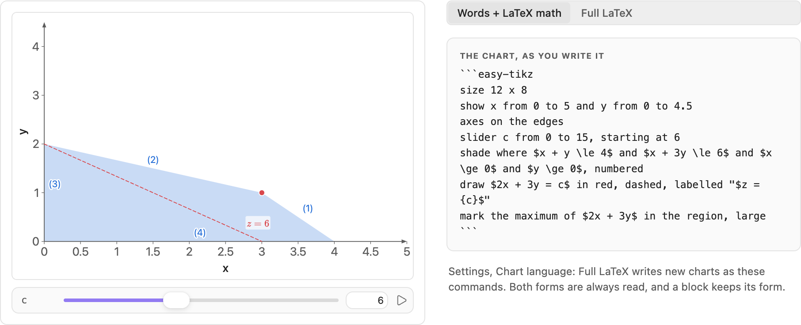
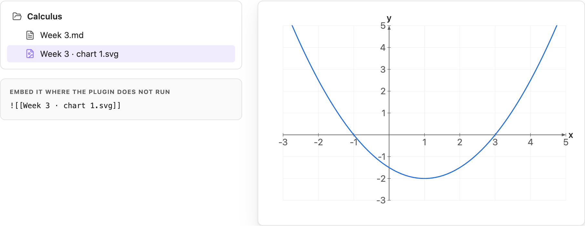

  

<h3 align="center">Every formula in your notes is a chart.</h3>

Easy TikZ is an Obsidian plugin for math charts. Rest the pointer on a formula, or write a chart in LaTeX. It draws on phones too, and exports pgfplots code that compiles with pdflatex.

### Write charts in LaTeX

Formulas are LaTeX in dollars, as in your notes. Or write whole charts as LaTeX commands, as in pgfplots.

### Sliders that move together

Any number can be a slider. Sliders with the same name move together in all charts of a note.

### Charts as SVG files

Every chart can also be an SVG file in your vault, so Obsidian Publish and GitHub show it.

---

**24 step-by-step guides** in the Help tab and [on GitHub](docs/guides/README.md) · [What's new in 5.0](docs/whats-new.md) · [Reference](docs/reference.md) · [Changelog](CHANGELOG.md)

**Privacy:** nothing goes to the internet, and there is no telemetry. AI access (off by default) answers on `127.0.0.1` only, with your token. [All details](docs/reference.md#privacy-and-permissions)

[MIT](LICENSE.md) · [Developing Easy TikZ](docs/development.md)
