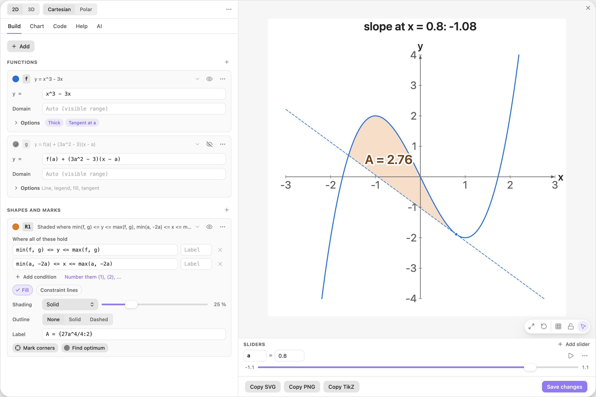
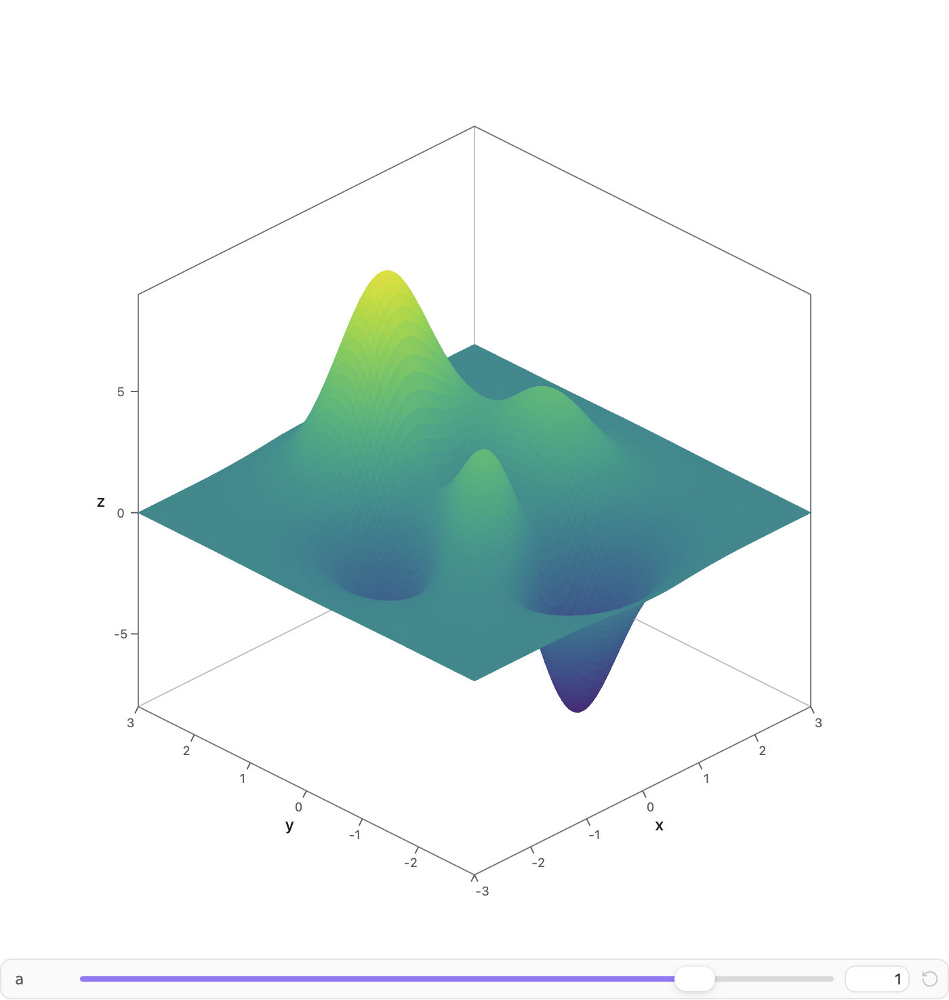
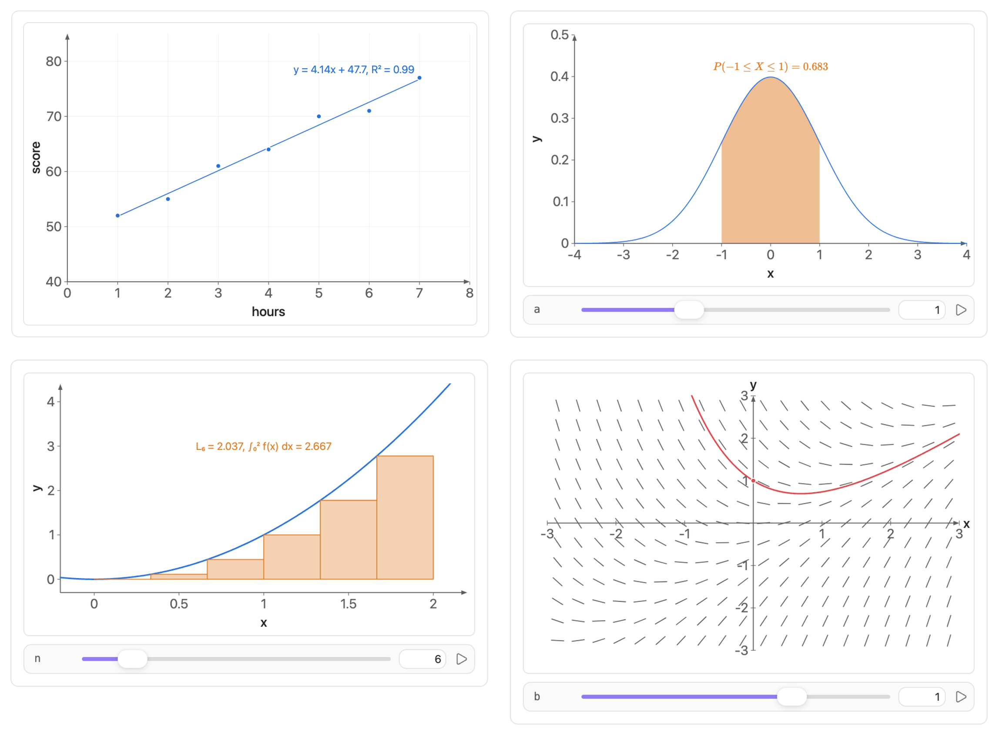

<video src="https://github.com/user-attachments/assets/4cd1bfb8-1e34-4add-86e7-ff72c2ec2e62" controls muted width="100%"></video>

<h3 align="center">Every formula in your notes is a chart.</h3>

Easy Graphs Charts and TikZ is an Obsidian plugin for math charts. Rest the pointer on a formula, or write a chart in LaTeX. It draws on phones too, and exports pgfplots code that compiles with pdflatex.

### A complete editor

Click any chart to open it. Everything is connected: drag a line, a point or a label in the preview and its formula follows, drag a 3D chart to turn it, scroll to zoom. No fiddling with code or camera angles. A card for each object, sliders with play, and the pgfplots code ready to copy.

**+ Add** holds a wide range of ready-made parts, sorted into groups and found by search: regions, curves and lines, crossings, corners and the optimum of a region, arrows and braces, data with a regression line, probability, Riemann sums, slope fields, labels, sliders and templates.

### Write charts in LaTeX

Formulas are LaTeX in dollars, as in your notes. Or write whole charts as LaTeX commands, as in pgfplots.

### Sliders that move together

Any number can be a slider. Sliders with the same name move together in all charts of a note.

### Fast 3D

Solid surfaces, coloured by height, turn under your pointer and follow their sliders: about 60 frames per second for a typical surface, above 30 with 14,400 polygons. The PDF draws the same picture.

### Data, probability and calculus

Points from a Markdown table with their regression line, distributions with a shaded probability, Riemann sums, and slope fields with their solutions.

### Charts as SVG files

Every chart can also be an SVG file in your vault, so Obsidian Publish and GitHub show it.

### Learn it step by step

The Help tab is a gallery of 39 short guides. Each step shows its chart live with its sliders, and the lines it adds to the chart, so you learn the chart language while you build.

---

**39 step-by-step guides** in the Help tab and [on GitHub](docs/guides/README.md) · [What's new in 5.0](docs/whats-new.md) · [Make charts with AI](docs/ai.md) · [Reference](docs/reference.md) · [Changelog](CHANGELOG.md)

**Privacy:** nothing goes to the internet, and there is no telemetry. AI access (off by default) answers on `127.0.0.1` only, with your token. [All details](docs/reference.md#privacy-and-permissions)

[MIT](LICENSE.md) · [Developing Easy Graphs Charts and TikZ](docs/development.md)
