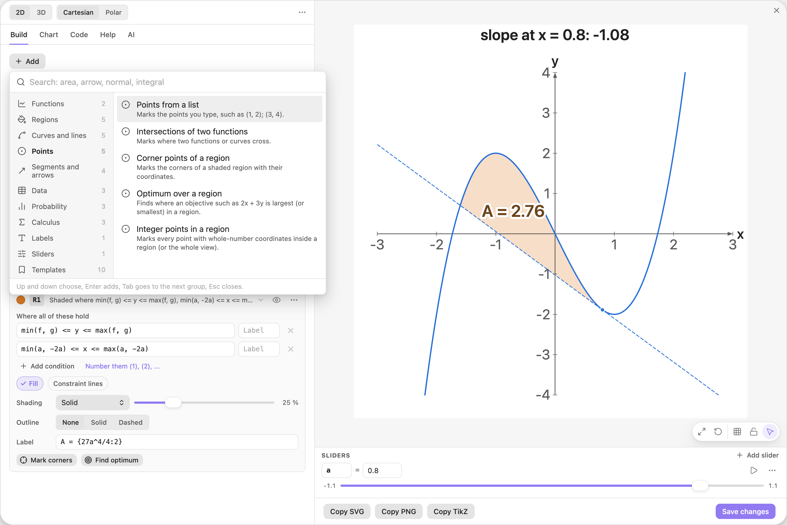
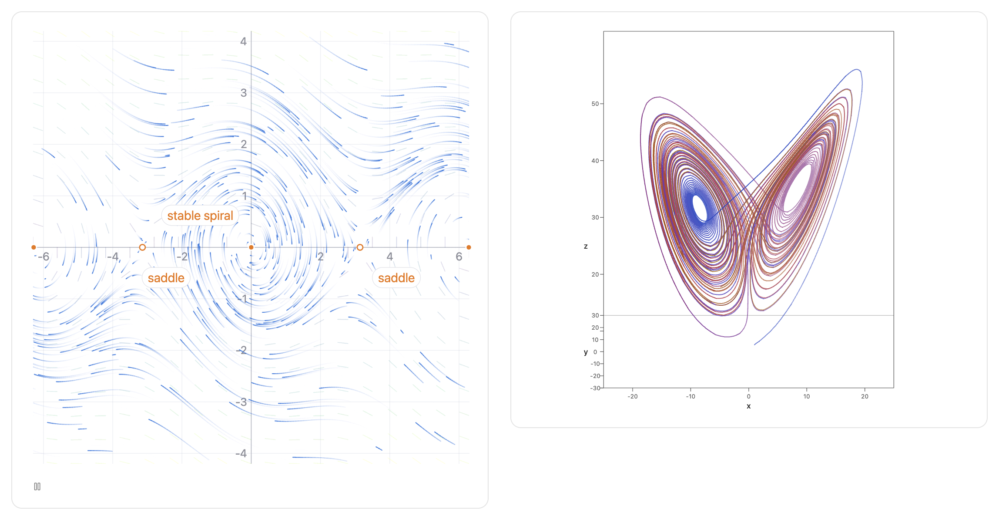
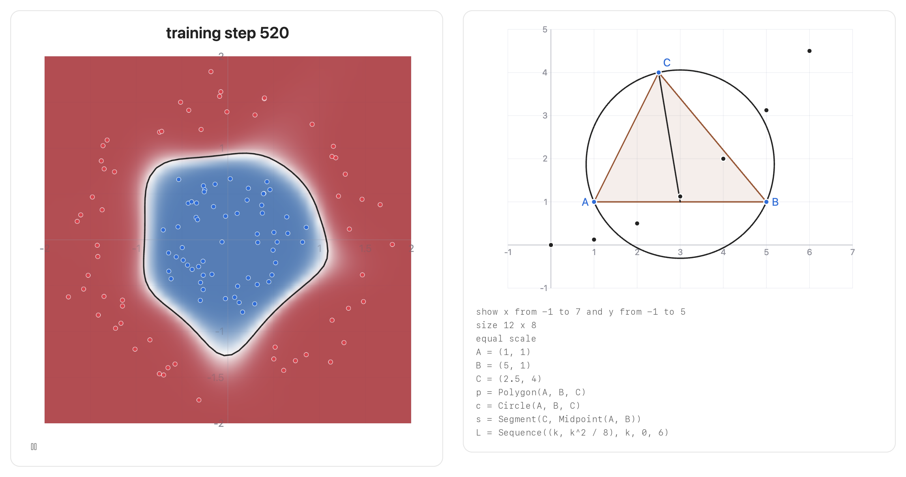
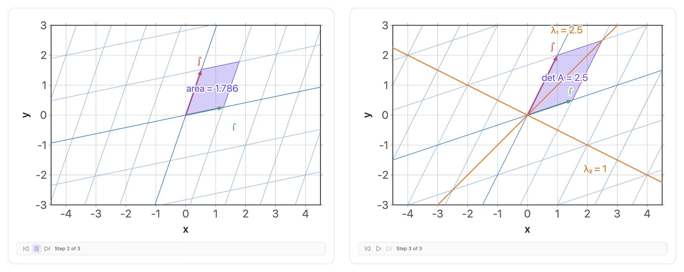
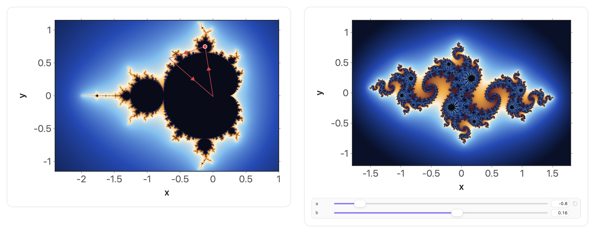
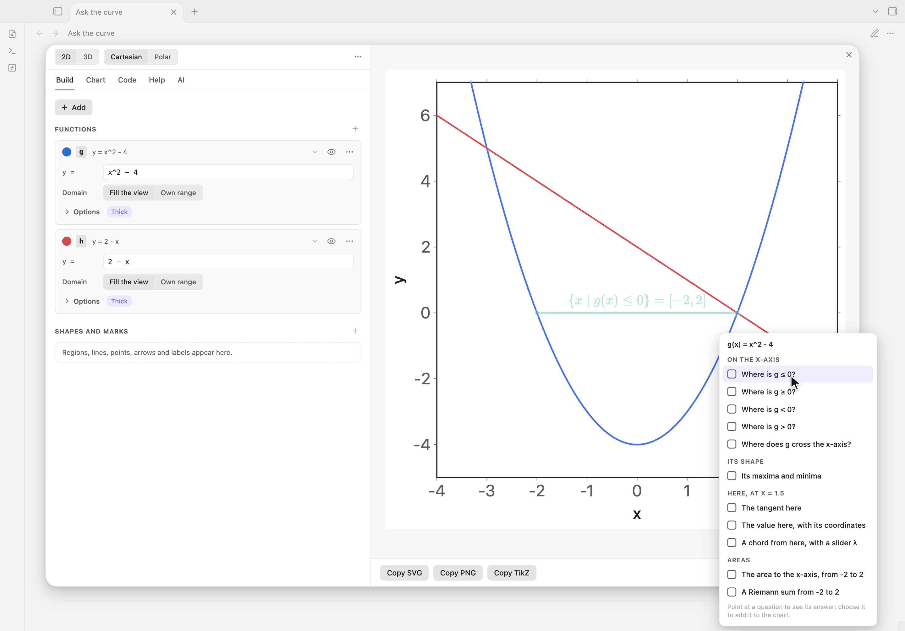
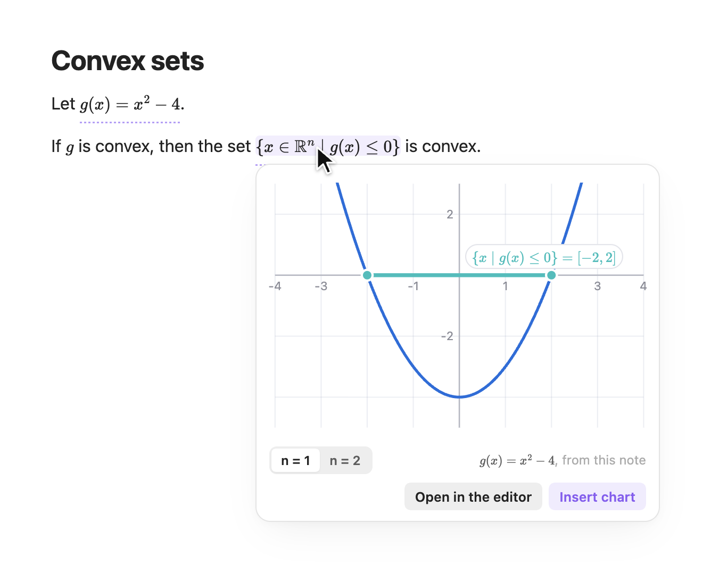
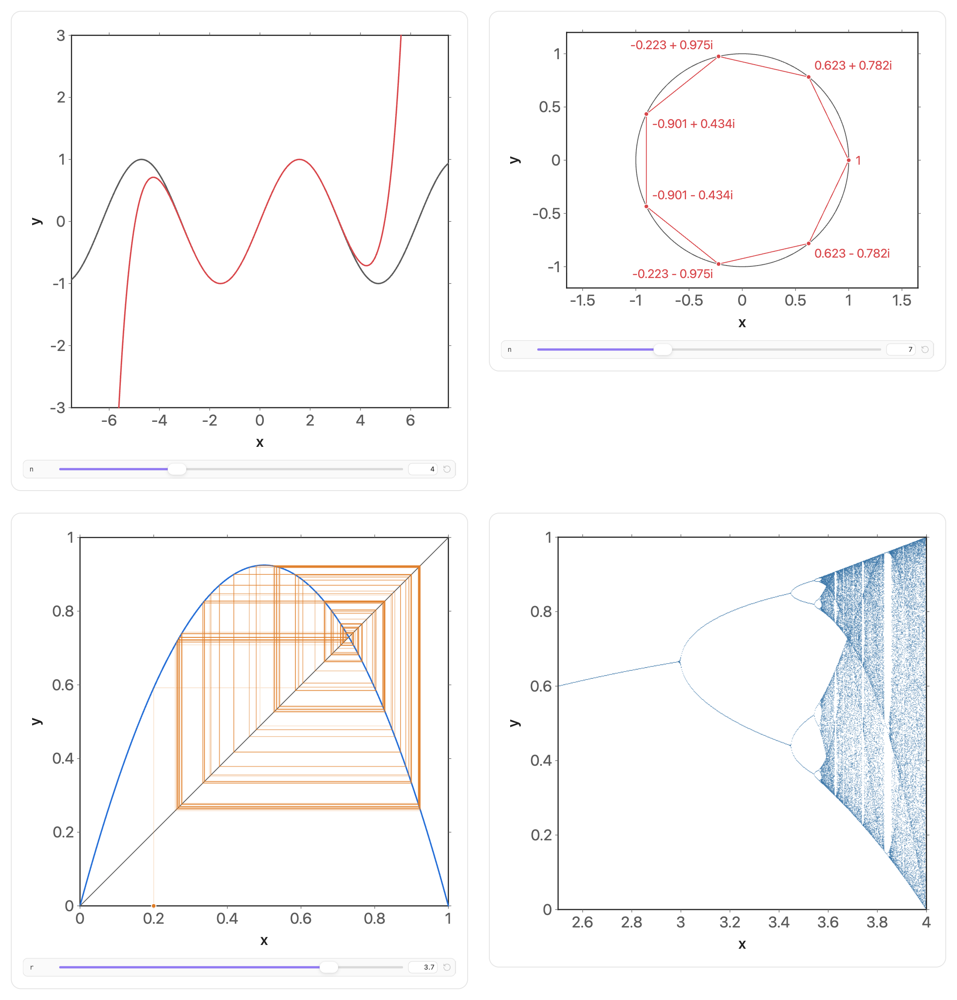
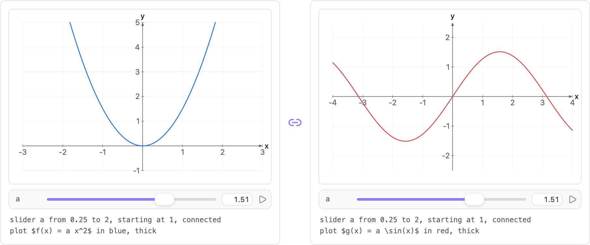
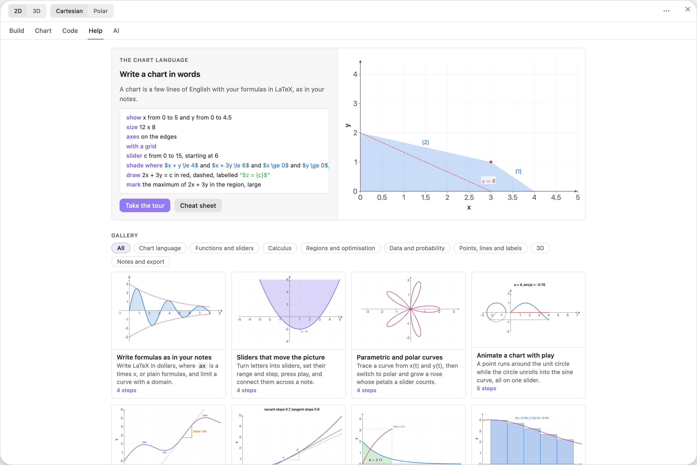

<video src="https://github.com/user-attachments/assets/5451e9d3-ed46-4a01-ae7f-18da5dd030a5" controls width="100%"></video>

<a href="https://www.youtube.com/watch?v=X--vCnK-u7Q">Watch the 6.0 film on YouTube</a>

<h3 align="center">Every idea deserves a picture.</h3>

Easy Graphs Charts and TikZ is an Obsidian plugin for math charts. Rest the pointer on a formula, or write a chart in LaTeX, Python or GeoGebra: functions, fractals, matrices that move the plane, vector fields, machine learning, and charts that answer your questions. It draws on phones too, and exports pgfplots code that compiles with pdflatex.

<b><a href="https://community.obsidian.md/plugins/easy-tikz">Get it in Obsidian</a></b>: Settings › Community plugins › Browse, search "Easy Graphs". Free and open source.

### A complete editor

Click any chart to open it. Everything is connected: drag a line, a point or a label in the preview and its formula follows, drag a 3D chart to turn it, scroll to zoom. No fiddling with code or camera angles. A card for each object, sliders with play, and the pgfplots code ready to copy.

**+ Add** holds a wide range of ready-made parts, sorted into groups and found by search: regions, curves and lines, crossings, corners and the optimum of a region, arrows and braces, data with a regression line, probability, Riemann sums, slope fields, values and vectors, linear algebra, motion, iterations, coloured planes, labels, sliders and templates.

### Charts that move

Vector fields with moving particles and their rest points, solutions of systems in 2D and 3D, and charts that play in steps.

### Write it in Python or GeoGebra

A Python block with NumPy and matplotlib draws in the chart and can play over time, so a network learns while you watch. GeoGebra lines paste as they are. Or [ask any chatbot](docs/ai.md) to write the chart.

### A matrix moves the plane

Draw the grid and î, ĵ, then transform the plane by a matrix or by z ↦ z². Press Play and the plane moves, with det A and the eigenvectors.

### Fractals, live

A formula colours the plane: the Mandelbrot set, Julia sets on sliders, Newton basins and complex functions. The GPU paints it while you drag.

### Ask the curve

Click a curve and ask: where is f ≤ 0, where do f and g cross, the tangent here, the area between them. The answer becomes a line of the chart.

### Notes that read sets and maps

Sets, maps, intervals, inequalities, matrices, recurrences and sums in your notes open a chart too, with g taken from the note.

### Values, sums and iterations

Complex numbers, vectors, matrices and sums in every formula; orbits, cobwebs, bifurcation diagrams, Newton's method and Fourier circles.

### Write charts in LaTeX

Formulas are LaTeX in dollars, as in your notes. Or write whole charts as LaTeX commands, as in pgfplots.

### Sliders that move together

Any number can be a slider. Sliders with the same name move together in all charts of a note.

### Fast 3D

Solid surfaces, coloured by height, turn under your pointer and follow their sliders: about 60 frames per second for a typical surface, above 30 with 14,400 polygons. The PDF draws the same picture.

### Data, probability and calculus

Points from a Markdown table with their regression line, distributions with a shaded probability, Riemann sums, and slope fields with their solutions.

### Charts as SVG files

Every chart can also be an SVG file in your vault, so Obsidian Publish and GitHub show it.

### Learn it step by step

The Help tab starts with Start here and New in 6, then 79 short guides by topic. Each step shows its chart live with its sliders, and the lines it adds to the chart, so you learn the chart language while you build.

---

[Plugin page in Obsidian](https://community.obsidian.md/plugins/easy-tikz) · **79 step-by-step guides** in the Help tab and [on GitHub](docs/guides/README.md) · [What's new in 6.0](docs/whats-new.md) · [Make charts with AI](docs/ai.md) · [Reference](docs/reference.md) · [Changelog](CHANGELOG.md)

**Privacy:** nothing goes to the internet, and there is no telemetry. The one exception: the 6.0 film in What's new loads from YouTube (`youtube-nocookie.com`) when you press Play, and not before. AI access (off by default) answers on `127.0.0.1` only, with your token. [All details](docs/reference.md#privacy-and-permissions)

[MIT](LICENSE.md) · [Developing Easy Graphs Charts and TikZ](docs/development.md)
