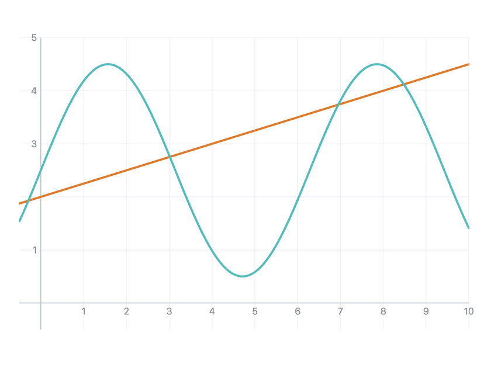
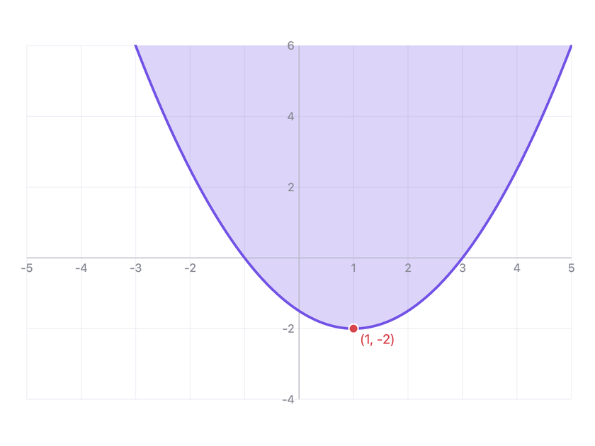
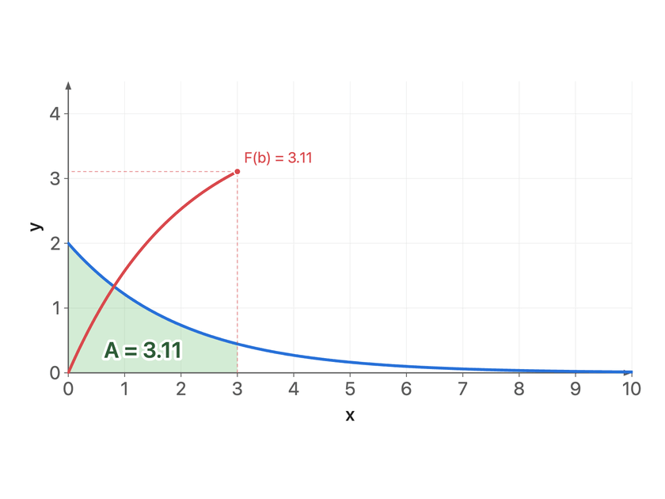
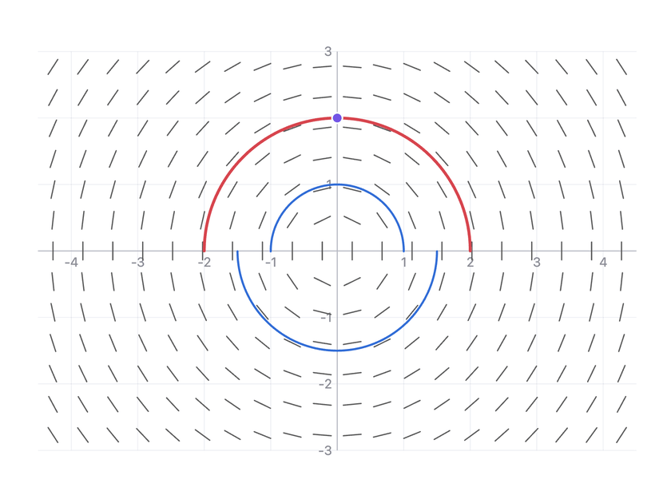
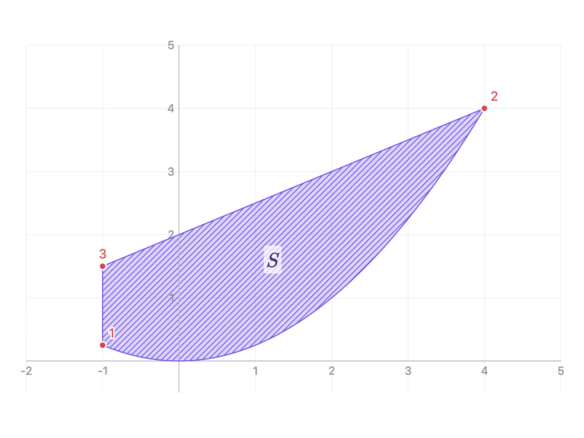
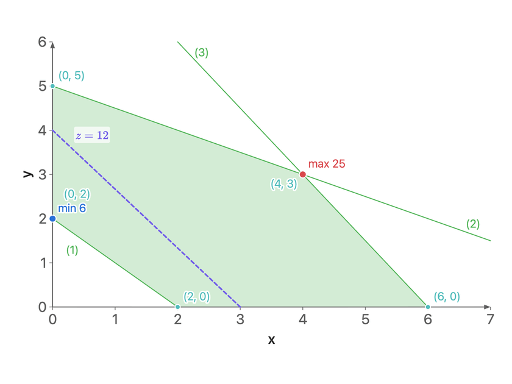
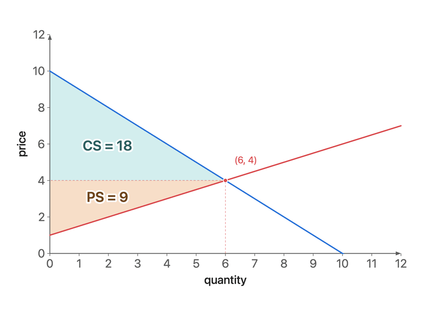
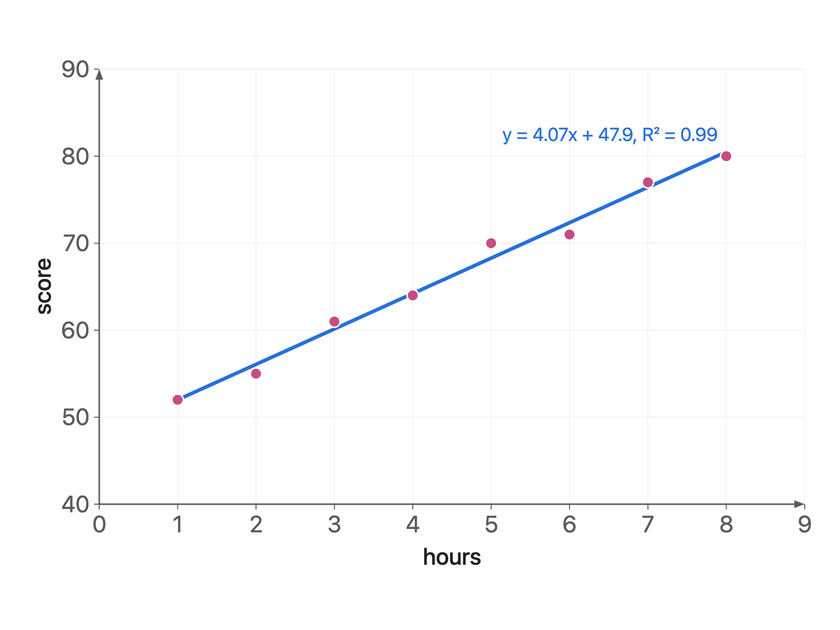
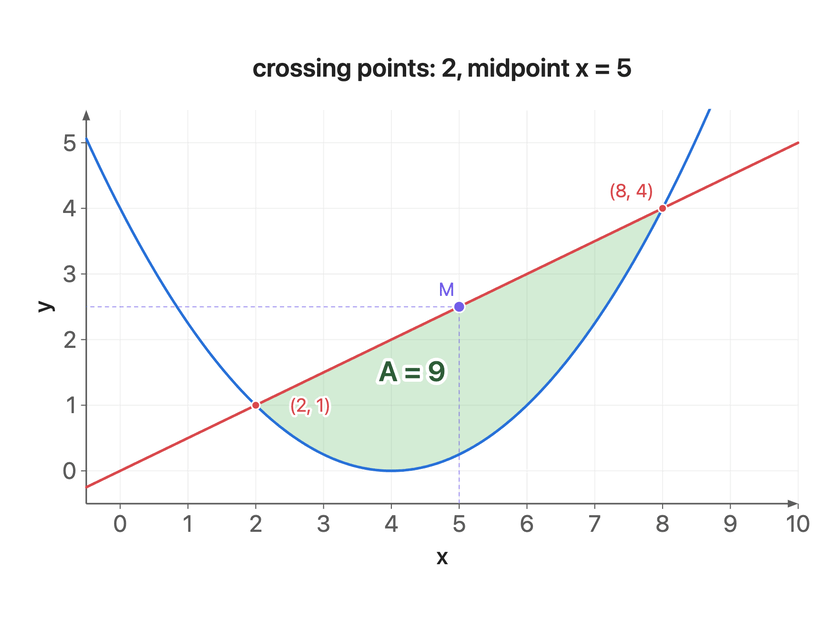
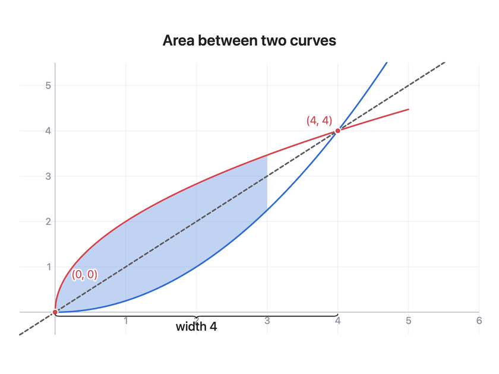

<!-- Generated by scripts/media/build-guides.mjs from src/guides. Do not edit. -->

# Easy Graphs Charts and TikZ guides

31 step-by-step guides (141 steps) for Easy Graphs Charts and TikZ. Every picture is a screenshot of the plugin running in Obsidian, every step shows the lines it adds to the chart, and every guide ends with its finished chart as a block you can paste into a note.

The same guides are in the editor: open the Help tab. There each step shows a live chart with its sliders, the chart in words, and a button that loads the step into the editor.

## Getting started

| Finished chart | Guide |
| --- | --- |
|  | **[Your first chart](first-chart.md)** Open the editor, plot two formulas, give them colours, a legend and a grid, and insert the chart. Start here · 3 min · 5 steps |
|  | **[Every formula is a chart](notes-formulas.md)** Rest the pointer on a formula in a note: its chart opens in a card, with sliders, ready to insert. Start here · 3 min · 5 steps |
|  | **[Drag shapes to edit them](drag-to-edit.md)** Grab a line or a curve in the preview and its numbers follow: move, turn, stretch, undo. Start here · 3 min · 4 steps |

## Chart language

| Finished chart | Guide |
| --- | --- |
|  | **[Write a chart in words](chart-language.md)** Build a linear program line by line: the window, a region, a slider, a moving line and the best point. Start here · 3 min · 6 steps |
|  | **[Write formulas as in your notes](formulas.md)** Write LaTeX in dollars, where `ax` is a times x, or plain formulas, and limit a curve with a domain. Start here · 3 min · 4 steps |

## Functions and sliders

| Finished chart | Guide |
| --- | --- |
|  | **[Sliders that move the picture](sliders.md)** Turn letters into sliders, set their range and step, press play, and connect them across a note. Core · 3 min · 4 steps |
|  | **[Parametric and polar curves](parametric-polar.md)** Trace a curve from x(t) and y(t), then switch to polar and grow a rose whose petals a slider counts. Core · 3 min · 4 steps |
|  | **[Animate a chart with play](animate-play.md)** A point runs around the unit circle while the circle unrolls into the sine curve, all on one slider. Core · 3 min · 5 steps |

## Calculus

| Finished chart | Guide |
| --- | --- |
|  | **[Tangents and extrema](tangents-extrema.md)** Mark the turning points of a curve, roll a tangent along it with a slider and print its slope. Core · 3 min · 4 steps |
|  | **[From secant to tangent](secant-tangent.md)** Shrink the gap h between two points of a curve and watch the secant through them turn into the tangent. Core · 3 min · 5 steps |
|  | **[An area that grows with a slider](area-accumulation.md)** Shade the area under a curve up to a slider and draw the function that adds it up. Core · 3 min · 4 steps |
|  | **[Estimate an area with Riemann sums](riemann-sums.md)** Fill an area with rectangles, watch their sum approach the integral, then try trapezoids and middle sums. Core · 3 min · 5 steps |
|  | **[Slope fields and solutions](slope-fields.md)** Draw the slope field of a differential equation and the solution through a point you move. Advanced · 3 min · 4 steps |

## Regions and optimisation

| Finished chart | Guide |
| --- | --- |
|  | **[Shade a region with inequalities](regions.md)** Shade where conditions hold, between two curves and cut by a third, then number its corners and hatch it. Core · 3 min · 5 steps |
|  | **[Shade the areas between two curves](areas-between.md)** Two waves, the areas between them split where they cross, each in its own colour and labelled. Core · 3 min · 4 steps |
|  | **[Shade between a curve and its tangent](tangent-area.md)** Write the tangent at a slider point as a function and shade the area it encloses with the curve. Advanced · 4 min · 5 steps |
|  | **[Solve a linear program in a picture](linear-program.md)** Constraint lines, the feasible region and its corners, an objective line on a slider, the maximum and the minimum. Core · 3 min · 5 steps |
|  | **[Compare an integer program with its relaxation](integer-program.md)** The integer points of a region, the best of them, and the gap to the optimum without whole numbers. Advanced · 3 min · 5 steps |
|  | **[Find a nonlinear optimum with level curves](level-curves.md)** Circles of equal distance as level curves, and the closest point of a region, where one of them touches. Advanced · 3 min · 5 steps |
|  | **[Draw a market with surplus areas](supply-demand.md)** Demand and supply, the equilibrium with lines to the axes, and both surpluses following a demand slider. Core · 3 min · 5 steps |

## Data and probability

| Finished chart | Guide |
| --- | --- |
|  | **[Data and a regression line](data-regression.md)** Plot data points, fit a regression line and print its equation and R² beside it. Core · 3 min · 4 steps |
|  | **[Normal and binomial probabilities](probability.md)** Shade a probability under the normal curve with a slider, then compare binomial bars with a normal curve. Core · 3 min · 4 steps |

## Points, lines and labels

| Finished chart | Guide |
| --- | --- |
|  | **[Points and live labels](points-labels.md)** Mark points from a list or from a formula, name them in LaTeX and print their values in labels. Core · 3 min · 4 steps |
|  | **[Segments, arrows and braces](arrows-braces.md)** Draw a slope triangle: a path for the run and the rise, braces with live labels and an arrow. Core · 3 min · 5 steps |
|  | **[Calculate with computed points](computed-values.md)** Use what crossing points publish, their count and coordinates, in a title, a new point and an area. Core · 4 min · 5 steps |

## 3D

| Finished chart | Guide |
| --- | --- |
|  | **[Surfaces, planes and points in 3D](surfaces-3d.md)** Plot a surface coloured by height in a cube, turn it, and cut it with a plane on a slider. Core · 3 min · 5 steps |

## Notes and export

| Finished chart | Guide |
| --- | --- |
|  | **[Charts in your notes](charts-in-notes.md)** Insert a chart into a note, edit it again, and move its sliders there, also across charts. Start here · 3 min · 4 steps |
|  | **[Charts as SVG files](svg-files.md)** Keep every chart of a note as an SVG file too, for Obsidian Publish, GitHub and other apps. Core · 2 min · 4 steps |
|  | **[Export to LaTeX](export-latex.md)** Copy a chart as pgfplots code, compile it with pdflatex, or take only the picture for your document. Core · 3 min · 4 steps |

## Reference

| Finished chart | Guide |
| --- | --- |
|  | **[Coming from 3.x](from-3x.md)** What happens to your 3.x charts, where the old tabs and tools went, and what sliders add. Core · 2 min · 4 steps |
|  | **[Keyboard shortcuts](shortcuts.md)** The keys of the editor: insert, undo, move shapes and the view, and move between tabs. Start here · 3 min · 5 steps |
