<!-- Generated by scripts/media/build-guides.mjs from src/guides. Do not edit. -->

# Easy TikZ guides

20 step-by-step guides (142 steps) for Easy TikZ 4. Every picture is a screenshot of the plugin running in Obsidian, and every guide ends with its finished chart as a block you can paste into a note.

The same guides are in the editor: open the Help tab. There each step shows a live chart and has a button that loads the step into the editor.

## Getting started

| Finished chart | Guide |
| --- | --- |
|  | **[Your first chart](first-chart.md)** From an empty editor to a chart in your note: type a formula, style it, set the ranges and insert it. Start here · 5 min · 8 steps |
| <a href="formulas.md">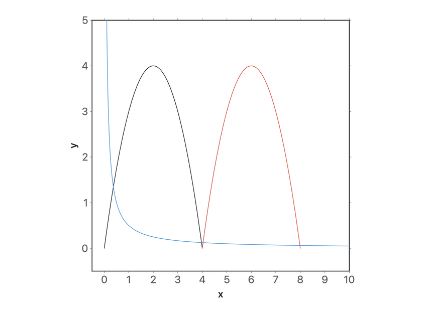</a> | **[Write formulas that work](formulas.md)** Leave out the multiplication sign safely, avoid the traps ax and 1/2x, call functions by name and limit them with a domain. Start here · 6 min · 6 steps |
|  | **[Drag shapes to edit them](drag-to-edit.md)** Grab a line or a curve in the preview and its numbers follow: move, turn, stretch, undo. Start here · 7 min · 8 steps |

## Functions and sliders

| Finished chart | Guide |
| --- | --- |
|  | **[Sliders that move the picture](sliders.md)** Turn a letter in a formula into a slider, set its range, play it and print its value in the chart. Core · 6 min · 7 steps |
| <a href="tangents-extrema.md">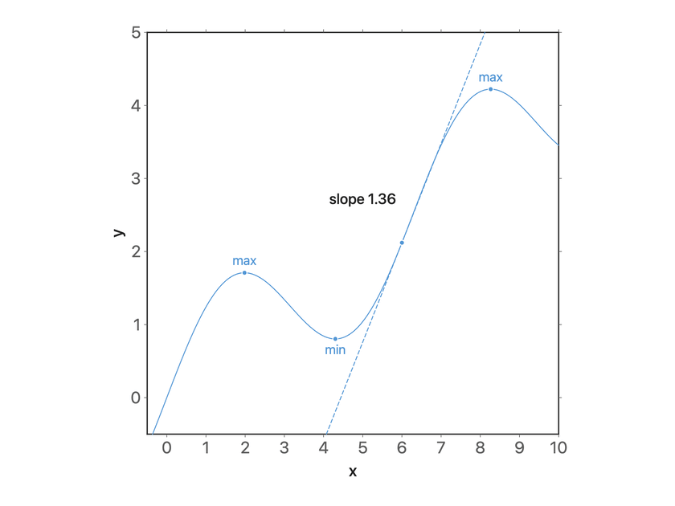</a> | **[Tangents and extrema](tangents-extrema.md)** Mark the turning points of a function, add a tangent, slide it along the curve and label its slope. Core · 7 min · 7 steps |
| <a href="parametric-polar.md">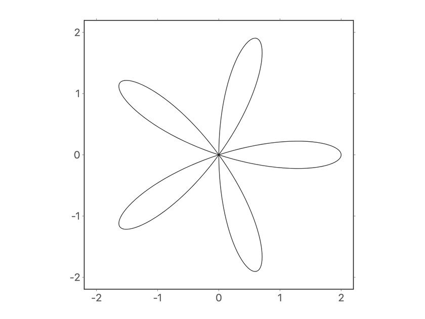</a> | **[Parametric and polar curves](parametric-polar.md)** Draw a curve from x(t) and y(t), then switch a chart to polar and grow a rose from r(θ). Core · 7 min · 8 steps |

## Regions and optimisation

| Finished chart | Guide |
| --- | --- |
| <a href="regions.md">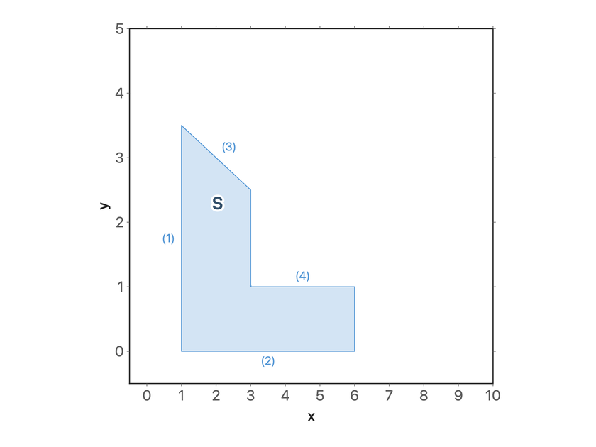</a> | **[Shade a region with inequalities](regions.md)** Shade the set where inequalities hold: one condition per row, chains, alternatives with or, and labels for the rows and the region. Core · 6 min · 7 steps |
|  | **[Shade the areas between two curves](areas-between.md)** Two curves, the areas between them in two colours, and their crossing points as the limits of the shading. Core · 7 min · 7 steps |
| <a href="tangent-area.md">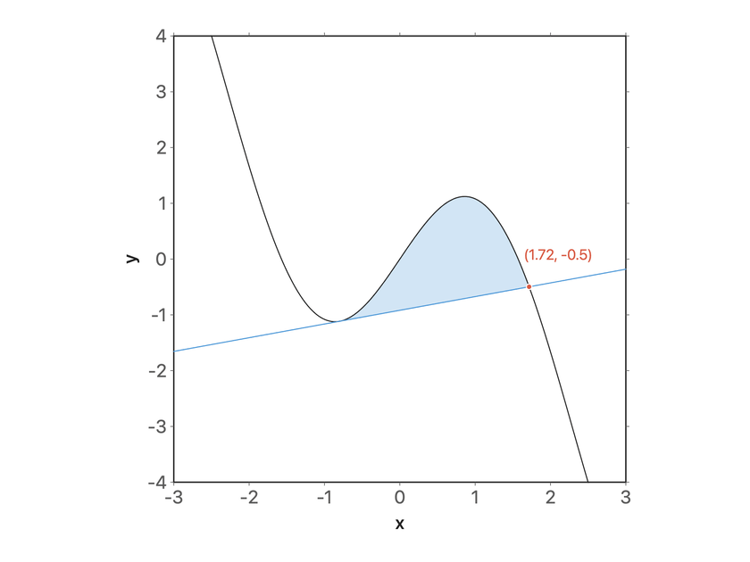</a> | **[Shade between a curve and its tangent](tangent-area.md)** Write the tangent at a slider point as a function, shade the area it encloses with the curve, and make it work for any curve. Advanced · 10 min · 8 steps |
|  | **[Solve a linear program in a picture](linear-program.md)** Feasible region, labelled constraint lines, an objective line on a slider, the optimum, the corners, and a sensitivity test by dragging. Core · 10 min · 8 steps |
|  | **[Compare an integer program with its relaxation](integer-program.md)** Integer points inside a feasible region, the best integer point, and how far it is from the optimum of the relaxed linear program. Advanced · 8 min · 6 steps |
|  | **[Find a nonlinear optimum with level curves](level-curves.md)** Level curves of an objective, a constraint region, the best point on its edge, and the level curve that touches it there. Advanced · 8 min · 6 steps |
|  | **[Draw a market with surplus areas](supply-demand.md)** Demand and supply, their equilibrium with guide lines, and consumer and producer surplus that follow a slider. Core · 9 min · 8 steps |

## Points, lines and labels

| Finished chart | Guide |
| --- | --- |
| <a href="points-labels.md">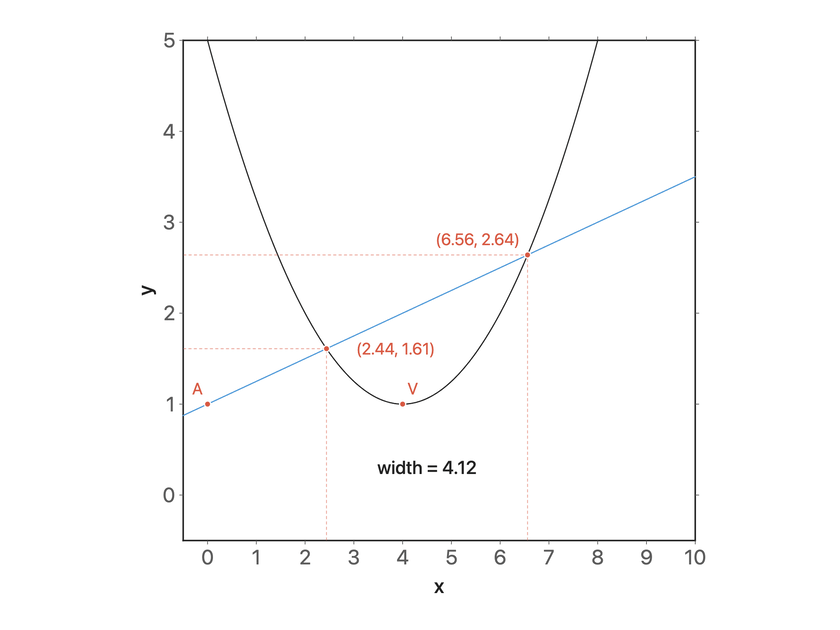</a> | **[Points, intersections and live labels](points-labels.md)** Mark points from a list, find where two curves cross, and print values that update when a slider moves. Core · 10 min · 7 steps |
| <a href="arrows-braces.md">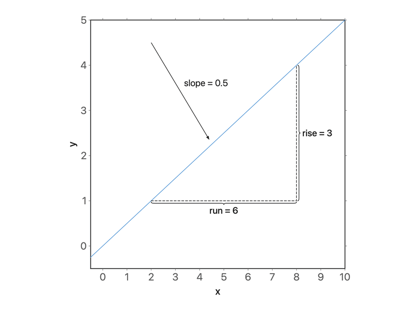</a> | **[Segments, arrows and braces](arrows-braces.md)** Draw a slope triangle on a line: a polyline for run and rise, two braces with labels and an arrow that points at the line. Core · 10 min · 7 steps |

## 3D

| Finished chart | Guide |
| --- | --- |
| <a href="surfaces-3d.md">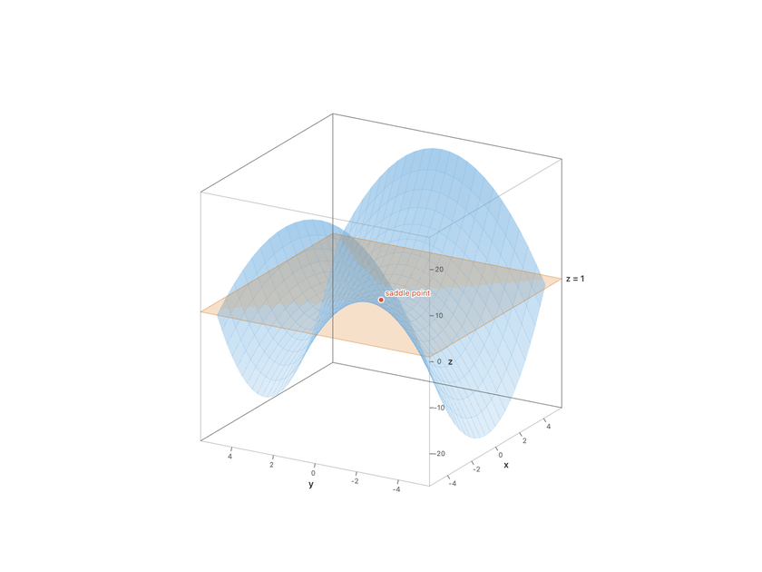</a> | **[Surfaces, planes and points in 3D](surfaces-3d.md)** Plot a surface z = f(x, y), fix the shape of the box, turn the view, and cut the surface with a plane on a slider. Core · 10 min · 7 steps |

## Notes and export

| Finished chart | Guide |
| --- | --- |
|  | **[Charts in your notes](charts-in-notes.md)** Insert a chart into a note, play with its sliders there, set its width and alignment, and open it again to change it. Start here · 8 min · 7 steps |
| <a href="export-latex.md">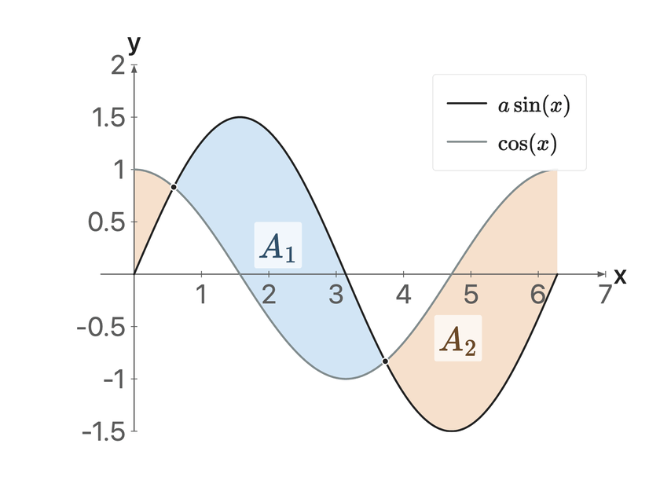</a> | **[Export to LaTeX](export-latex.md)** Get pgfplots code that compiles with pdflatex: as a standalone document or as a snippet, at the size you need, in the colours of the preview. Core · 10 min · 7 steps |

## Reference

| Finished chart | Guide |
| --- | --- |
| <a href="from-3x.md">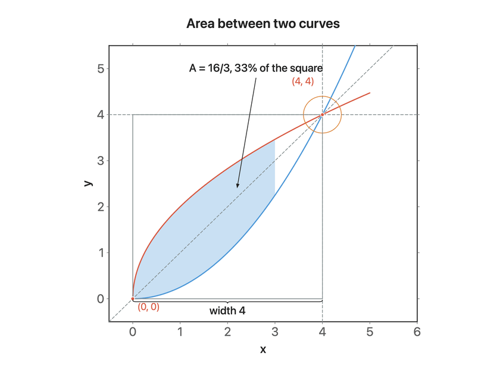</a> | **[Coming from 3.x](from-3x.md)** What happens to your old charts, where the eight tabs went, and which new tool replaces each old one. Core · 8 min · 6 steps |
| <a href="shortcuts.md">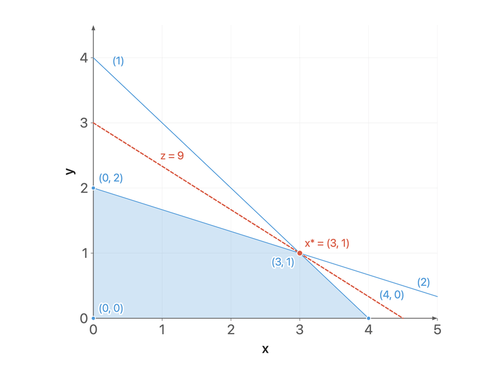</a> | **[Keyboard, mouse and troubleshooting](shortcuts.md)** Every shortcut of the editor, what the mouse does in the preview, and fixes for the usual problems. Start here · 7 min · 7 steps |
