<!-- Generated by scripts/media/build-guides.mjs from src/guides. Do not edit. -->

# Easy Graphs Charts and TikZ guides

79 step-by-step guides (335 steps) for Easy Graphs Charts and TikZ. Every picture is a screenshot of the plugin running in Obsidian, every step shows the lines it adds to the chart, and every guide ends with its finished chart as a block you can paste into a note.

The same guides are in the editor: open the Help tab. There each step shows a live chart with its sliders, the chart in words, and a button that loads the step into the editor.

## Getting started

| Finished chart | Guide |
| --- | --- |
| <a href="first-chart.md">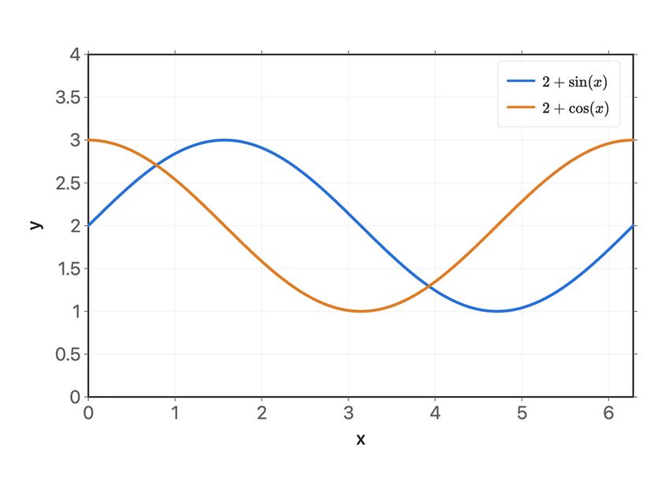</a> | **[Your first chart](first-chart.md)** Open the editor, plot two formulas, give them colours, a legend and a grid, and insert the chart. Start here · 3 min · 5 steps |
| <a href="notes-formulas.md">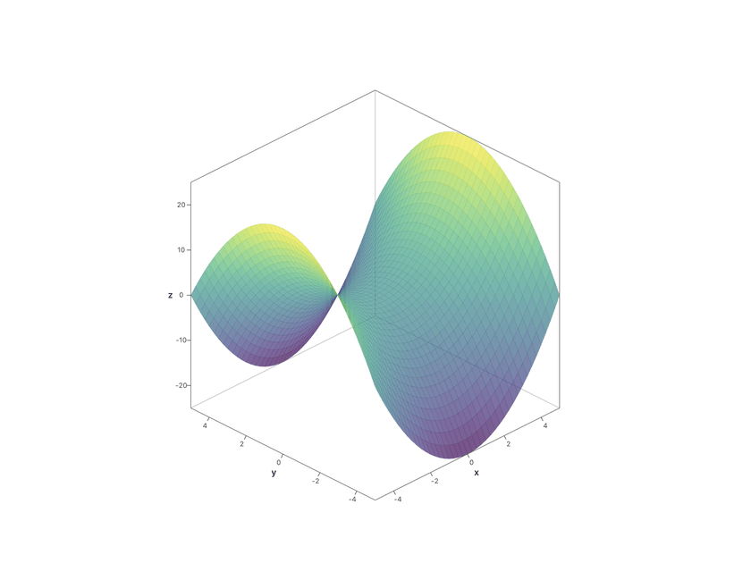</a> | **[Every formula is a chart](notes-formulas.md)** Rest the pointer on a formula in a note: its chart opens in a card, with sliders, ready to insert. Start here · 3 min · 5 steps |
|  | **[Drag shapes to edit them](drag-to-edit.md)** Grab a line or a curve in the preview and its numbers follow: move, turn, stretch, undo. Start here · 3 min · 4 steps |
| <a href="ask-curve.md">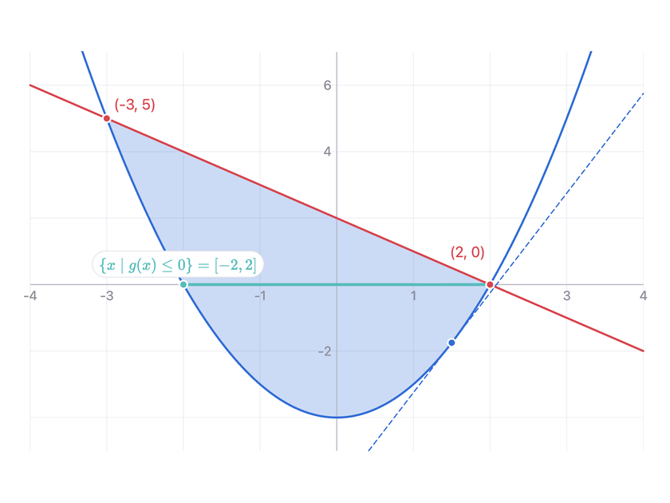</a> | **[Ask the curve](ask-curve.md)** Click a curve in the preview and choose a question: its answer, a set, a crossing or an area, joins the chart. Start here · 2 min · 5 steps |

## Chart language

| Finished chart | Guide |
| --- | --- |
| <a href="chart-language.md">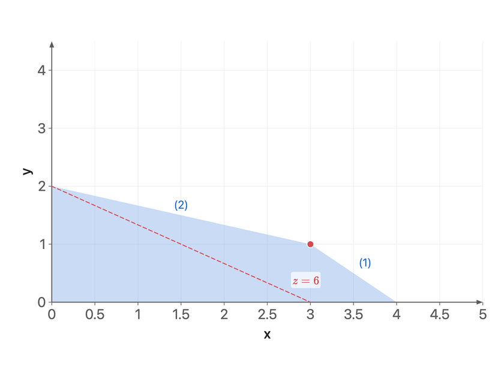</a> | **[Write a chart in words](chart-language.md)** Build a linear program line by line: the window, a region, a slider, a moving line and the best point. Start here · 3 min · 6 steps |
| <a href="formulas.md">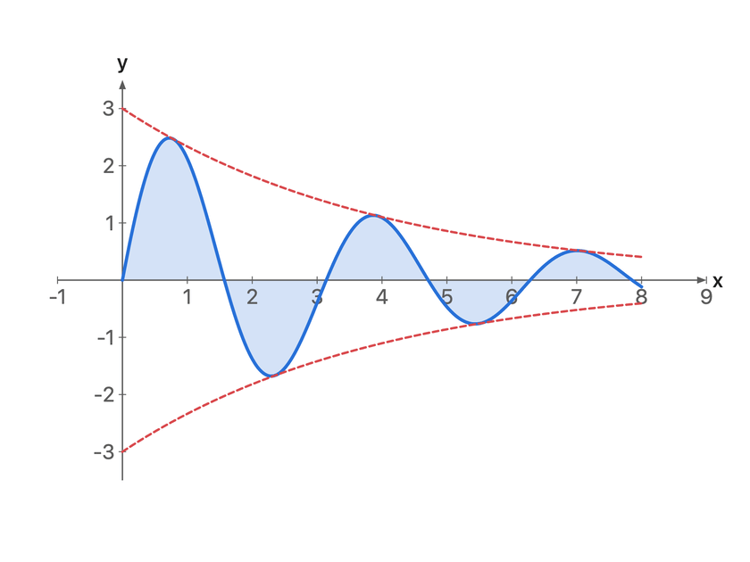</a> | **[Write formulas as in your notes](formulas.md)** Write LaTeX in dollars, where `ax` is a times x, or plain formulas, and limit a curve with a domain. Start here · 3 min · 4 steps |
| <a href="values-let.md">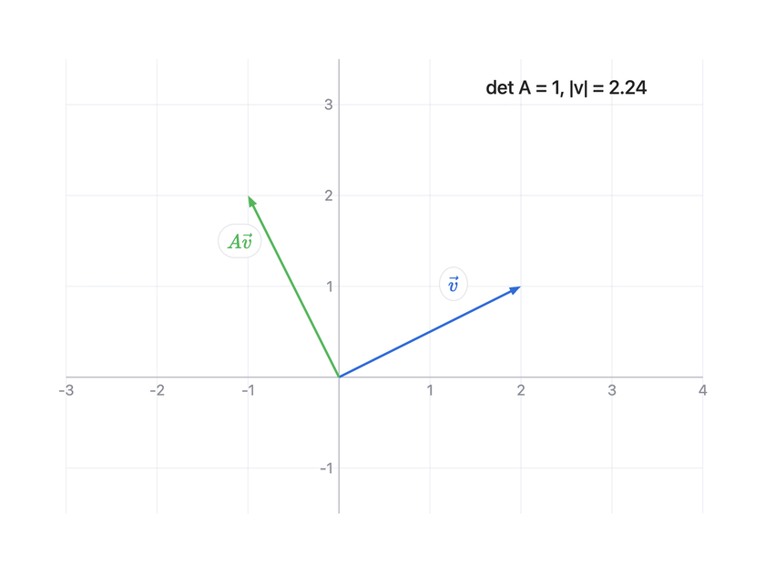</a> | **[Vectors, matrices and complex numbers](values-let.md)** Give a vector, a matrix or a complex number a name with let, and use it in every line and label. Core · 3 min · 4 steps |
| <a href="geogebra-commands.md">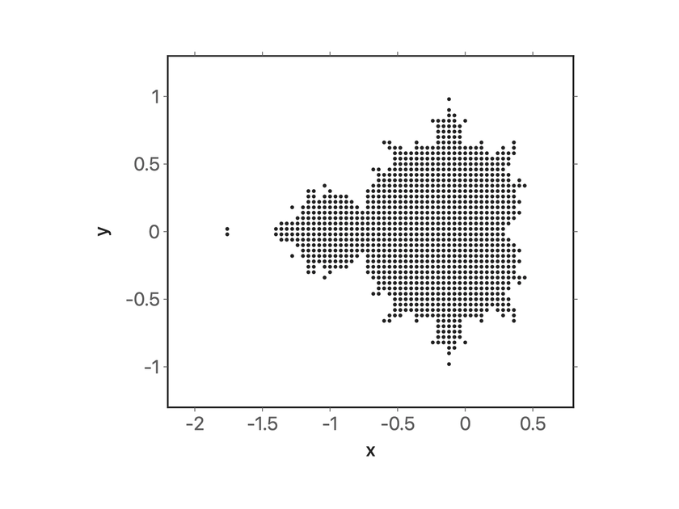</a> | **[GeoGebra commands](geogebra-commands.md)** Paste GeoGebra input lines as they are: points, circles and polygons, lists from Sequence, sliders, orbits and the Mandelbrot set. Core · 4 min · 6 steps |
| <a href="python-chart.md">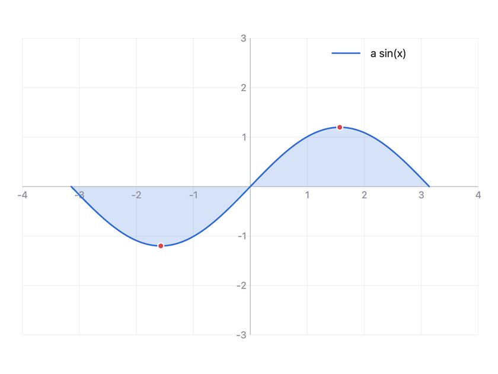</a> | **[Python in a chart](python-chart.md)** Write NumPy and matplotlib in a python block: its names are values of the chart, sliders are its variables, frame(t) moves. Core · 5 min · 5 steps |

## Showcase

| Finished chart | Guide |
| --- | --- |
| <a href="lorenz-butterfly.md">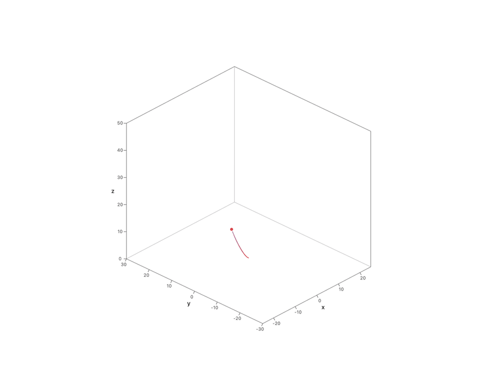</a> | **[Two paths of the Lorenz system](lorenz-butterfly.md)** Start the Lorenz system twice, a thousandth apart: the two paths draw themselves together for a while, then part for good. Advanced · 2 min · 3 steps |
| <a href="optimizer-race.md">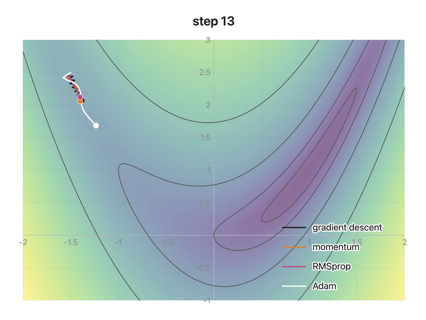</a> | **[The optimizer race](optimizer-race.md)** Gradient descent, momentum, RMSprop and Adam start together on a curved valley and race to the minimum, 40 steps a second. Advanced · 2 min · 3 steps |
| <a href="network-learns.md">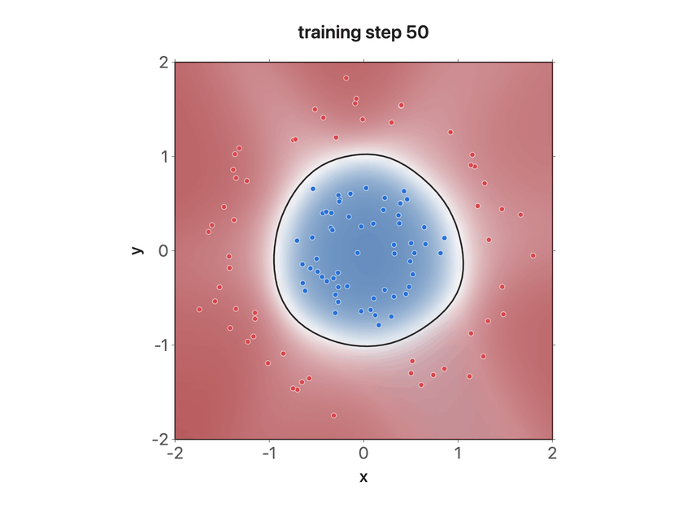</a> | **[A network learns](network-learns.md)** Watch a small neural network learn: its probability picture and boundary change step by step, first on four clouds, then on two rings. Advanced · 2 min · 3 steps |
| <a href="complex-two-ways.md">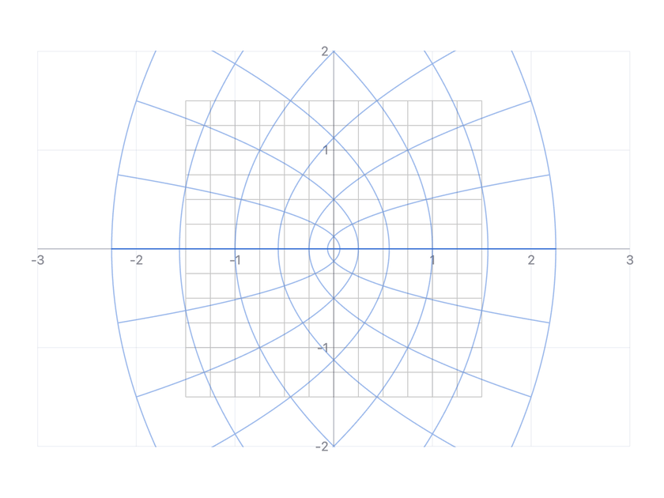</a> | **[Complex functions, seen two ways](complex-two-ways.md)** A function of z bends a grid in a step you can play, and colours the plane: z², 1/z and e^z, each both ways. Advanced · 3 min · 6 steps |
| <a href="fourier-circles.md">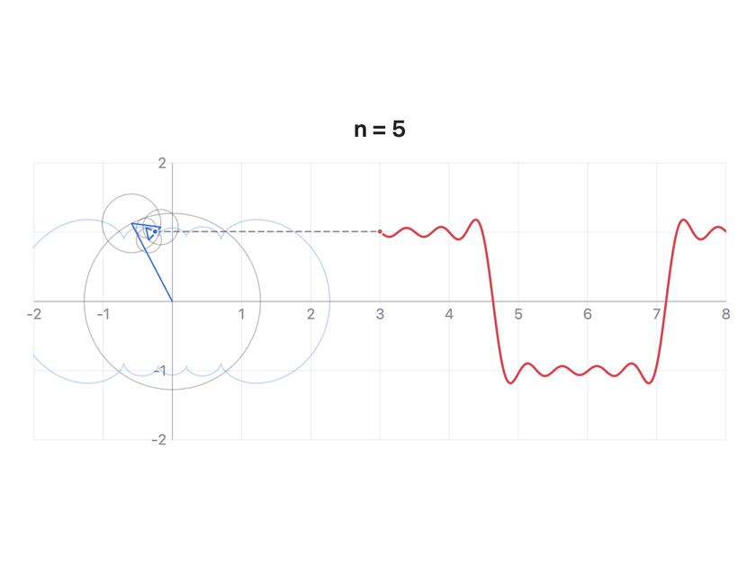</a> | **[Circles that draw square and sawtooth waves](fourier-circles.md)** Circles turn on each other: the tip of the last draws a wave. More circles make it more square, other circles draw a sawtooth. Core · 2 min · 4 steps |
| <a href="two-valleys.md">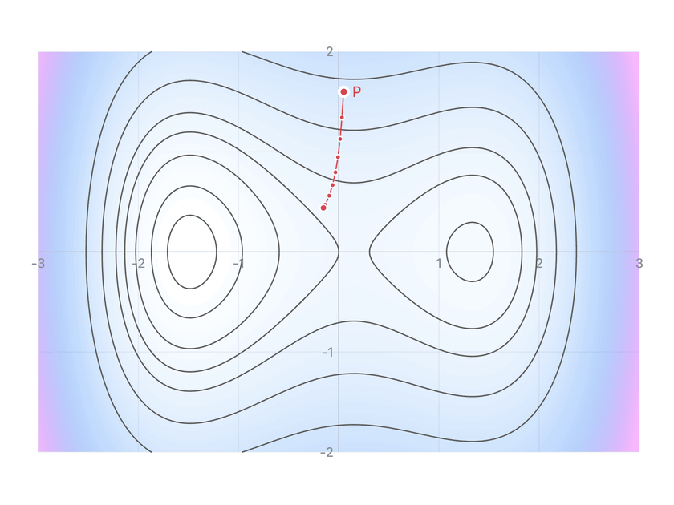</a> | **[Gradient descent in a bowl and two valleys](two-valleys.md)** Walk downhill with the step size on a slider: a step too large zigzags away, and the start picks the valley you end in. Advanced · 3 min · 5 steps |
| <a href="mandelbrot-orbit.md">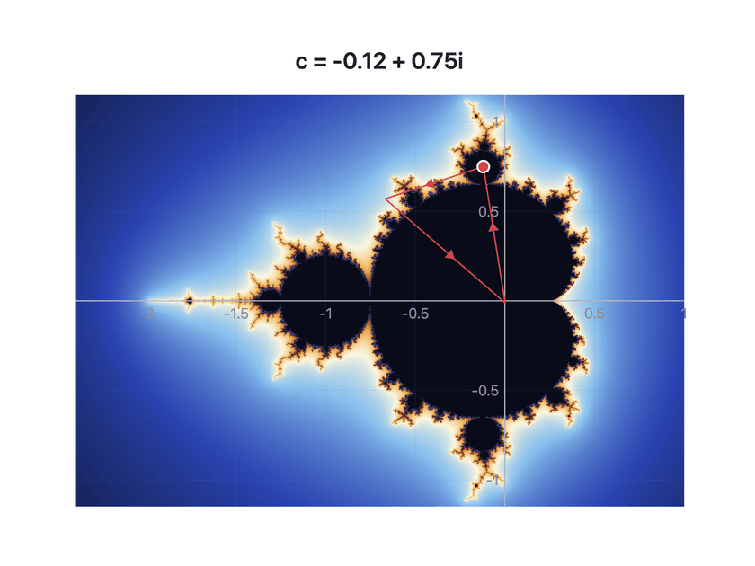</a> | **[The orbit of a point in the Mandelbrot set](mandelbrot-orbit.md)** Move c with two sliders over the Mandelbrot set: its orbit goes round inside the set and flies off outside it. Core · 2 min · 3 steps |
| <a href="pendulum-field.md">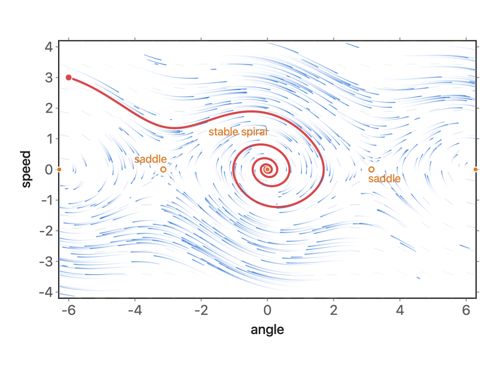</a> | **[A pendulum as a vector field](pendulum-field.md)** The angle and the speed of a pendulum as a field with flowing particles: push it with a slider until it swings over the top. Core · 2 min · 4 steps |
| <a href="julia-newton.md">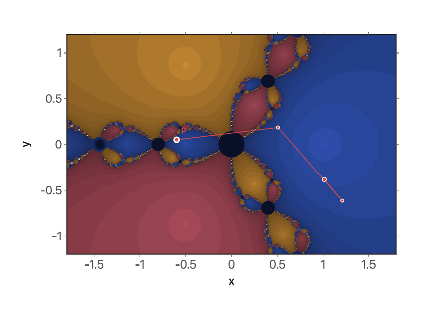</a> | **[Julia sets and Newton basins](julia-newton.md)** Put c of a Julia set on two sliders, then colour the plane by Newton's method and watch one point find its root. Advanced · 3 min · 5 steps |
| <a href="matrix-grid.md">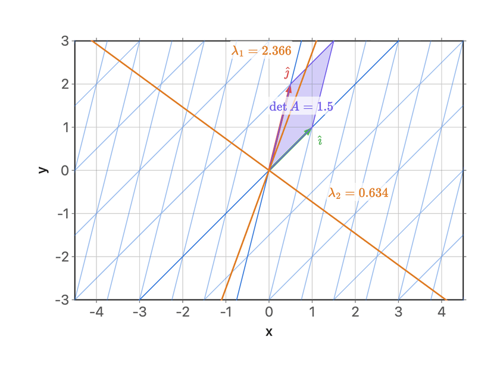</a> | **[A matrix with a slider moves the grid](matrix-grid.md)** A slider changes one number of a matrix: the moved grid, the eigenvectors and the determinant follow it. Core · 2 min · 4 steps |
| <a href="logistic-map.md">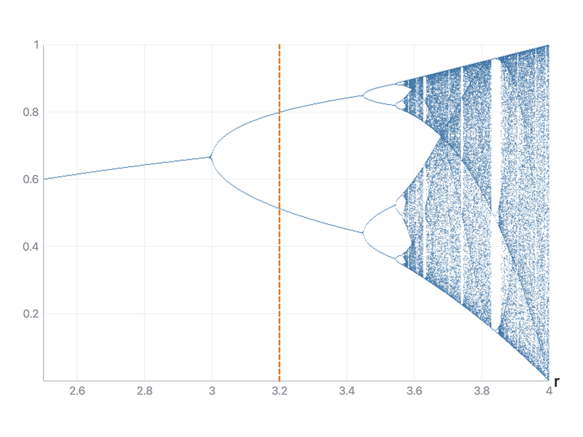</a> | **[The logistic map: bifurcation and cobweb](logistic-map.md)** x ↦ r x (1 - x) for every r at once, then for one r on a slider: it settles, swaps between two values, four, and turns chaotic. Advanced · 3 min · 5 steps |
| <a href="domain-colouring.md">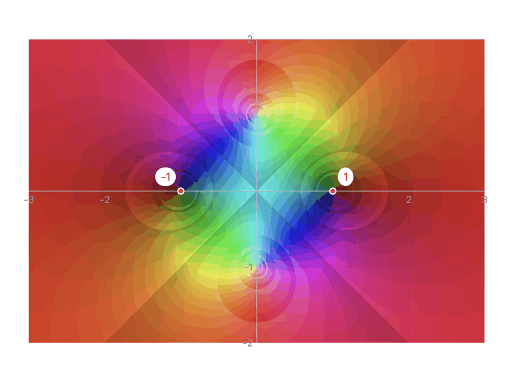</a> | **[Colour the plane by a complex function](domain-colouring.md)** Each point z takes the colour of f(z): find the zeros and the poles, then move two zeros with a slider. Advanced · 2 min · 3 steps |
| <a href="unity-roots.md">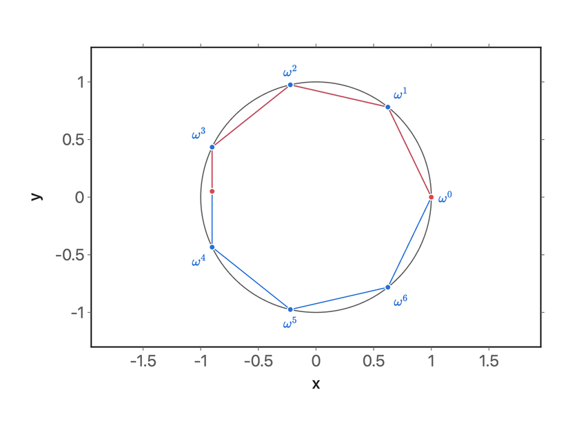</a> | **[Roots of unity on a slider](unity-roots.md)** The n numbers with zⁿ = 1 make a regular polygon on the unit circle, and multiplying by ω turns each one to the next. Core · 2 min · 4 steps |
| <a href="tangent-triangle.md">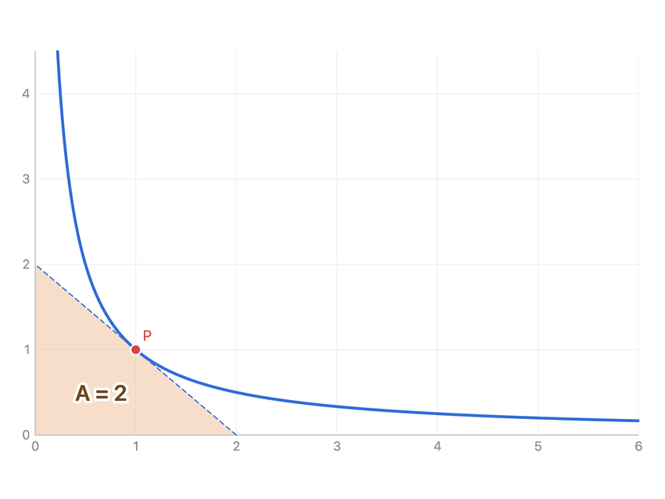</a> | **[Shade under a tangent](tangent-triangle.md)** The tangent to 1/x cuts a triangle from the corner of the axes; drag the point and its area stays 2. Core · 2 min · 4 steps |
| <a href="largest-rectangle.md">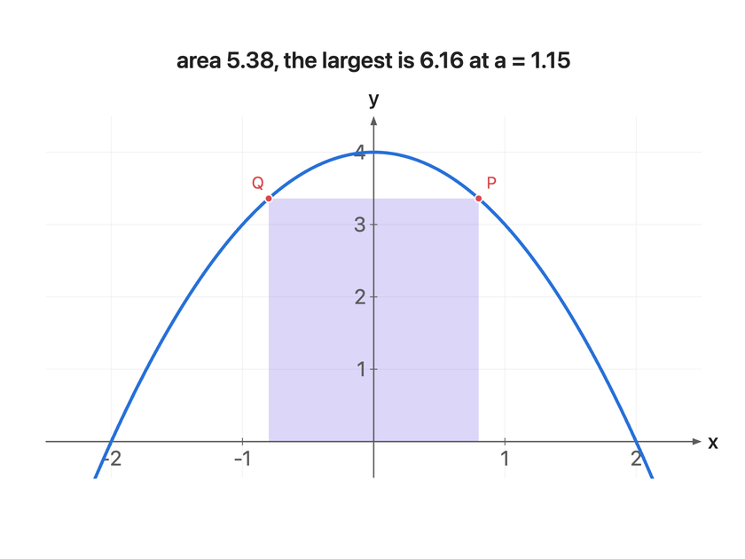</a> | **[The largest rectangle under a parabola](largest-rectangle.md)** A rectangle whose corners sit on the parabola: drag its corner and find where its area is largest. Core · 2 min · 4 steps |
| <a href="mean-value.md">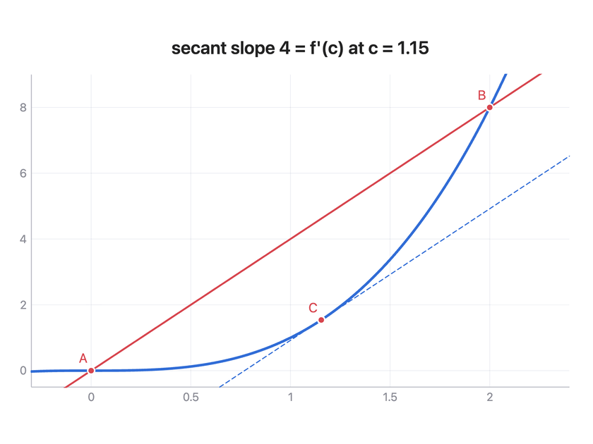</a> | **[The mean value theorem](mean-value.md)** Between A and B a tangent runs parallel to the secant; drag B and the point C follows. Advanced · 3 min · 4 steps |
| <a href="taylor-sine.md">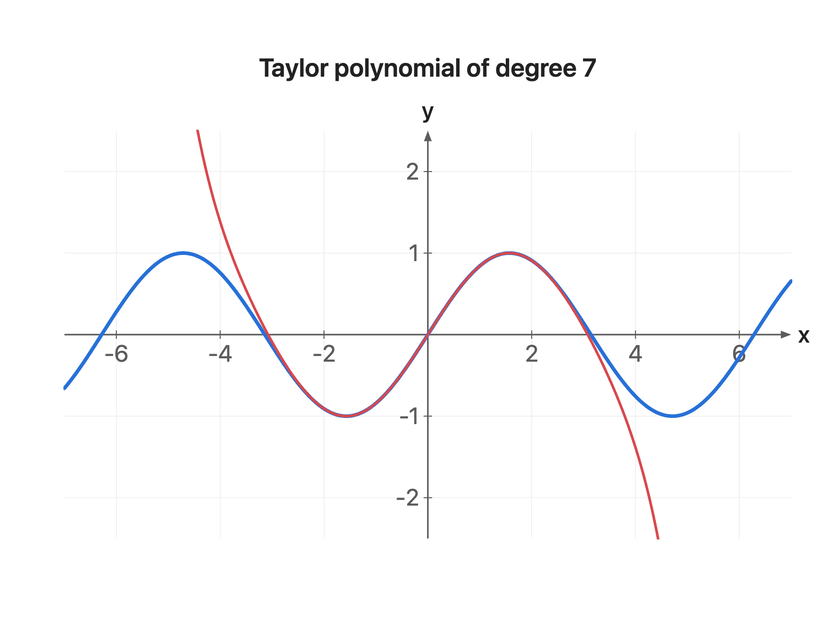</a> | **[Taylor polynomials of sin(x)](taylor-sine.md)** Raise the degree with a slider and watch the polynomial hug the sine over a wider and wider range. Advanced · 2 min · 3 steps |
| <a href="gradient-levels.md">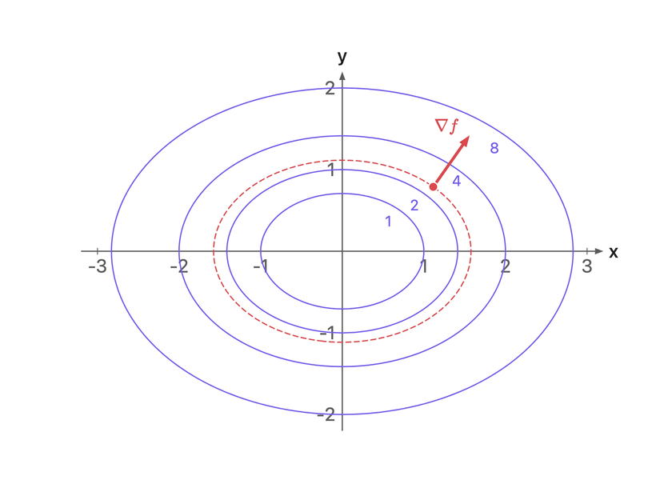</a> | **[A gradient on level curves](gradient-levels.md)** A point moves around the level curves; the level through it and its gradient arrow move along. Advanced · 3 min · 4 steps |
| <a href="crossing-lines.md">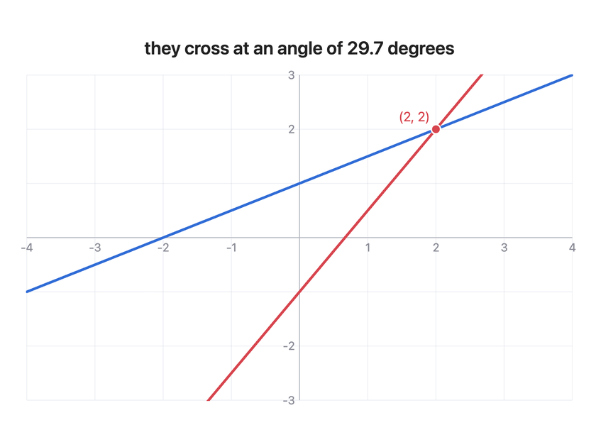</a> | **[Two lines and their crossing](crossing-lines.md)** Turn one line with a slider; the crossing point and the angle between the lines follow. Start here · 2 min · 4 steps |
| <a href="sliding-ladder.md">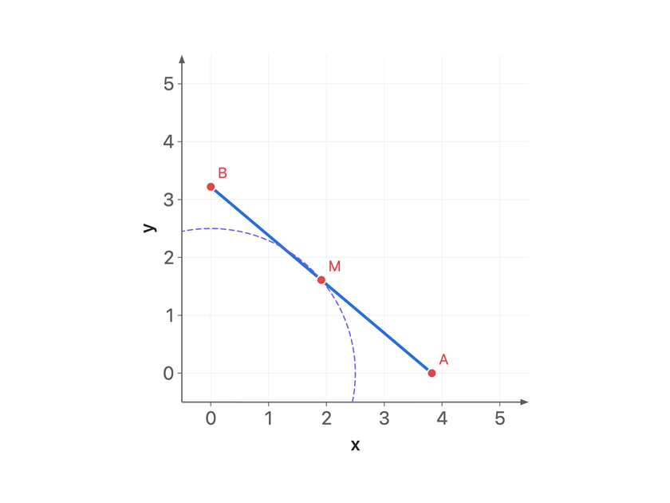</a> | **[A ladder sliding down a wall](sliding-ladder.md)** The foot of a ladder slides away from the wall; its middle point moves on a quarter circle. Core · 2 min · 4 steps |
| <a href="throw-angle.md">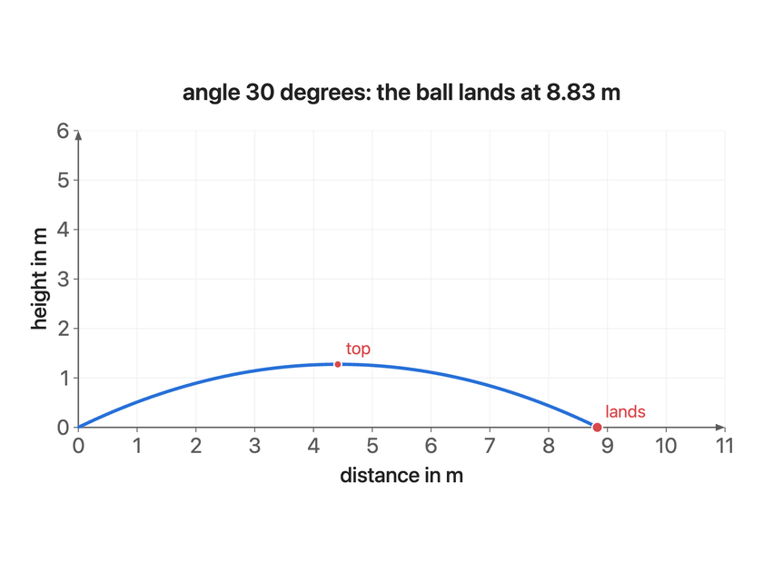</a> | **[A throw at an angle](throw-angle.md)** Throw a ball at 10 m/s and change the angle: the path, its top and where it lands move together. Core · 2 min · 4 steps |
| <a href="python-heart.md">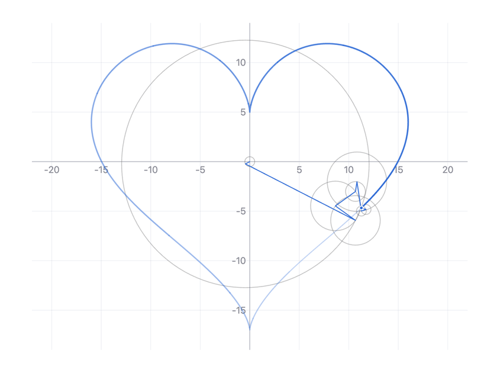</a> | **[A heart drawn by turning circles](python-heart.md)** A Python script takes the FFT of a heart; each coefficient is a circle turning on the one before, and their tip draws the heart. Core · 3 min · 4 steps |
| <a href="python-plot.md">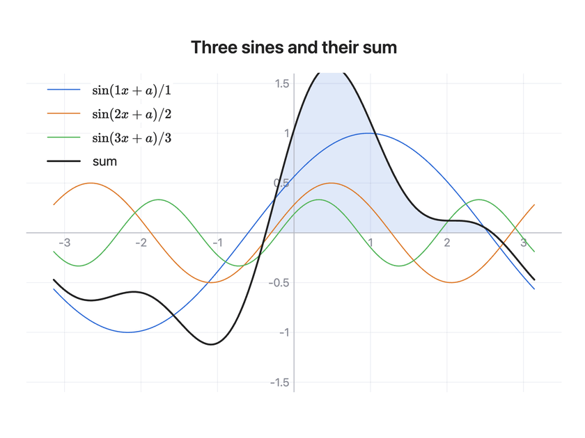</a> | **[A matplotlib plot with a slider](python-plot.md)** Lines, a legend and a fill written as in matplotlib, drawn in the chart; the phase a is a slider the script reads. Core · 3 min · 3 steps |
| <a href="python-wave.md">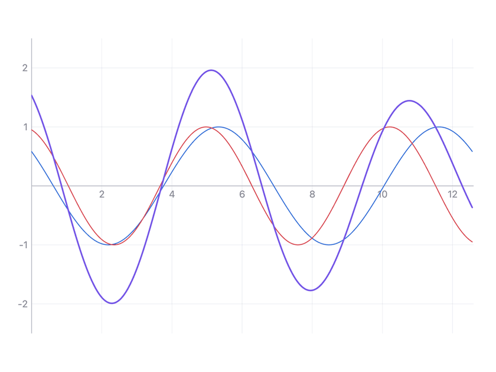</a> | **[Two waves that move in Python](python-wave.md)** A script with frame(t) draws on the chart's clock: two waves run against each other, and their sum beats. Core · 2 min · 3 steps |

## Functions and sliders

| Finished chart | Guide |
| --- | --- |
|  | **[Sliders that move the picture](sliders.md)** Turn letters into sliders, set their range and step, press play, and connect them across a note. Core · 3 min · 4 steps |
| <a href="parametric-polar.md">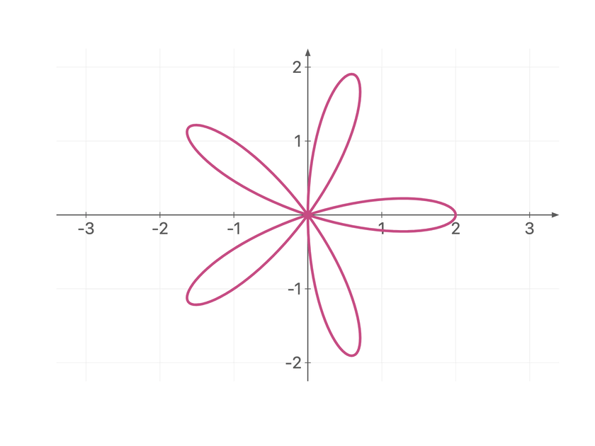</a> | **[Parametric and polar curves](parametric-polar.md)** Trace a curve from x(t) and y(t), then switch to polar and grow a rose whose petals a slider counts. Core · 3 min · 4 steps |
| <a href="animate-play.md">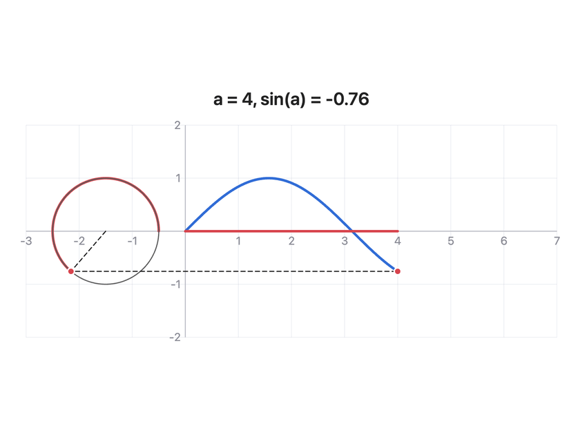</a> | **[Animate a chart with play](animate-play.md)** A point runs around the unit circle while the circle unrolls into the sine curve, all on one slider. Core · 3 min · 5 steps |

## Calculus

| Finished chart | Guide |
| --- | --- |
| <a href="tangents-extrema.md">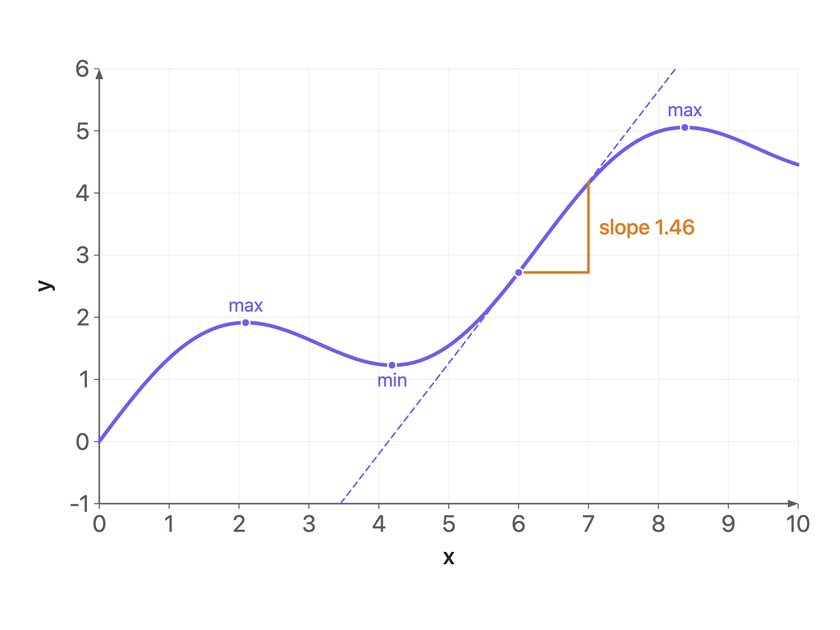</a> | **[Tangents and extrema](tangents-extrema.md)** Mark the turning points of a curve, roll a tangent along it with a slider and print its slope. Core · 3 min · 4 steps |
| <a href="secant-tangent.md">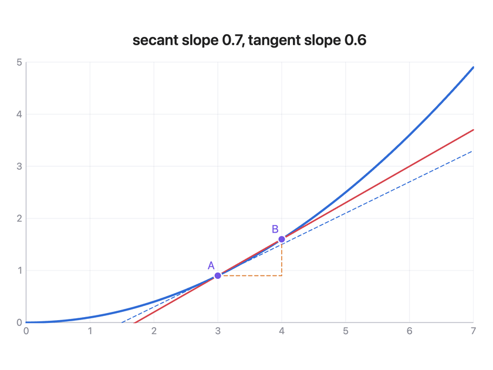</a> | **[From secant to tangent](secant-tangent.md)** Shrink the gap h between two points of a curve and watch the secant through them turn into the tangent. Core · 3 min · 5 steps |
|  | **[An area that grows with a slider](area-accumulation.md)** Shade the area under a curve up to a slider and draw the function that adds it up. Core · 3 min · 4 steps |
| <a href="riemann-sums.md">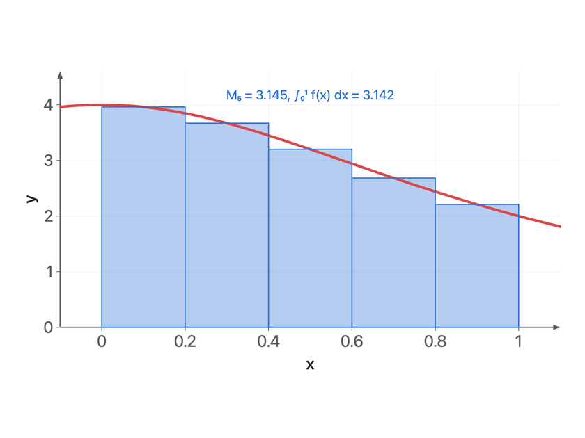</a> | **[Estimate an area with Riemann sums](riemann-sums.md)** Fill an area with rectangles, watch their sum approach the integral, then try trapezoids and middle sums. Core · 3 min · 5 steps |
|  | **[Slope fields and solutions](slope-fields.md)** Draw the slope field of a differential equation and the solution through a point you move. Advanced · 3 min · 4 steps |
| <a href="sums-series.md">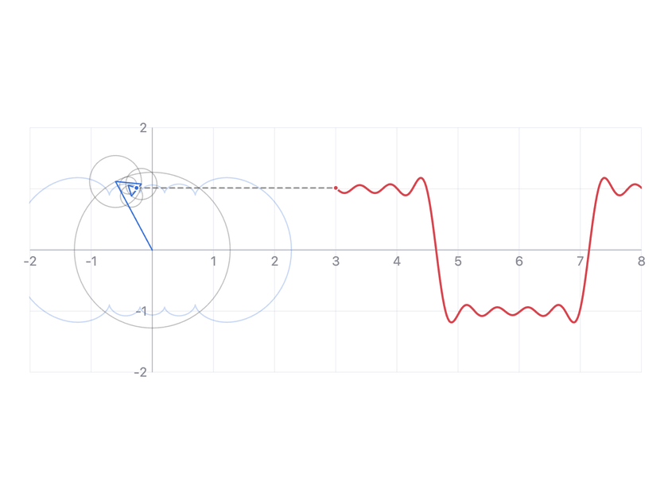</a> | **[Sums: Taylor and Fourier series](sums-series.md)** Write a sum with a slider in its bound: a Taylor polynomial hugs the sine, and turning circles draw a square wave. Core · 3 min · 4 steps |

## Regions and optimisation

| Finished chart | Guide |
| --- | --- |
|  | **[Shade a region with inequalities](regions.md)** Shade where conditions hold, between two curves and cut by a third, then number its corners and hatch it. Core · 3 min · 5 steps |
| <a href="areas-between.md">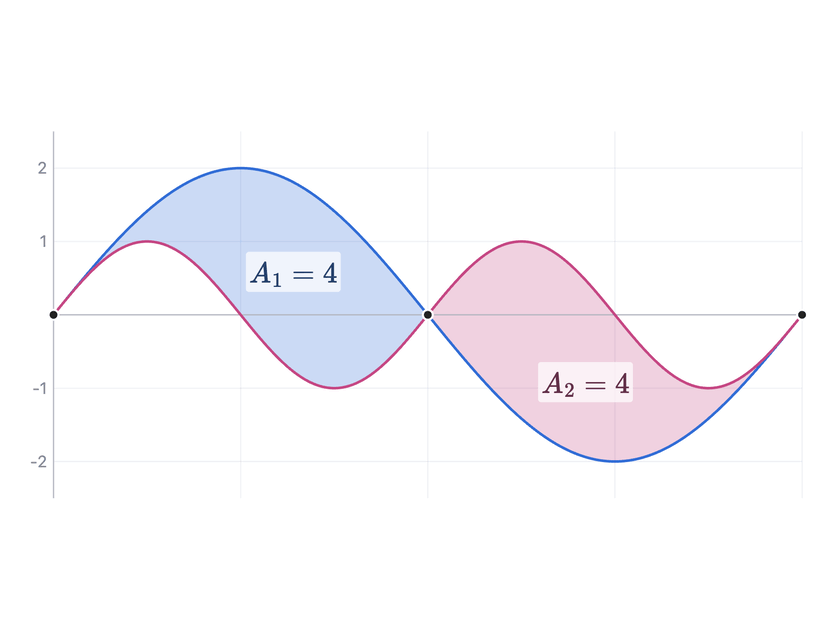</a> | **[Shade the areas between two curves](areas-between.md)** Two waves, the areas between them split where they cross, each in its own colour and labelled. Core · 3 min · 4 steps |
| <a href="tangent-area.md">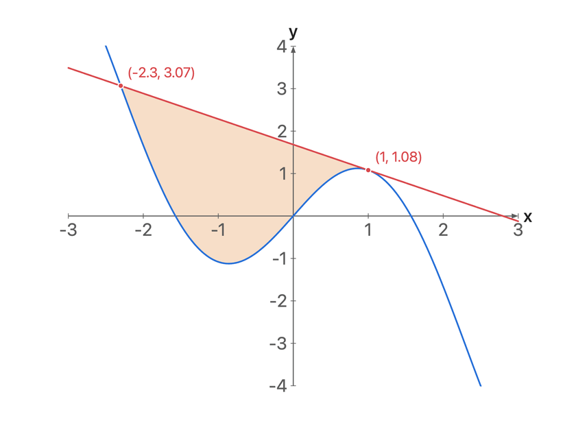</a> | **[Shade between a curve and its tangent](tangent-area.md)** Write the tangent at a slider point as a function and shade the area it encloses with the curve. Advanced · 4 min · 5 steps |
|  | **[Solve a linear program in a picture](linear-program.md)** Constraint lines, the feasible region and its corners, an objective line on a slider, the maximum and the minimum. Core · 3 min · 5 steps |
| <a href="integer-program.md">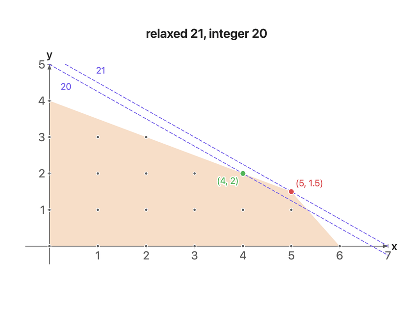</a> | **[Compare an integer program with its relaxation](integer-program.md)** The integer points of a region, the best of them, and the gap to the optimum without whole numbers. Advanced · 3 min · 5 steps |
| <a href="level-curves.md">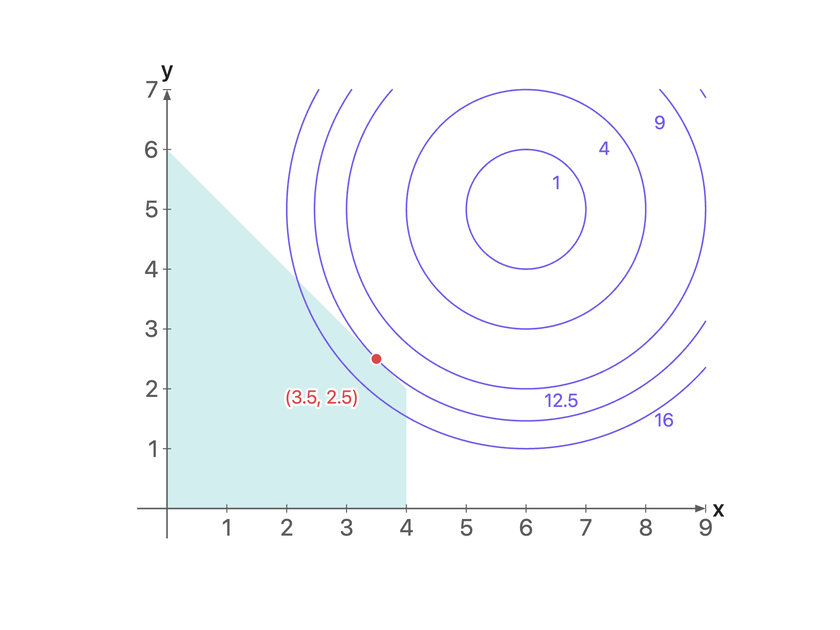</a> | **[Find a nonlinear optimum with level curves](level-curves.md)** Circles of equal distance as level curves, and the closest point of a region, where one of them touches. Advanced · 3 min · 5 steps |
|  | **[Draw a market with surplus areas](supply-demand.md)** Demand and supply, the equilibrium with lines to the axes, and both surpluses following a demand slider. Core · 3 min · 5 steps |
| <a href="sets-convexity.md">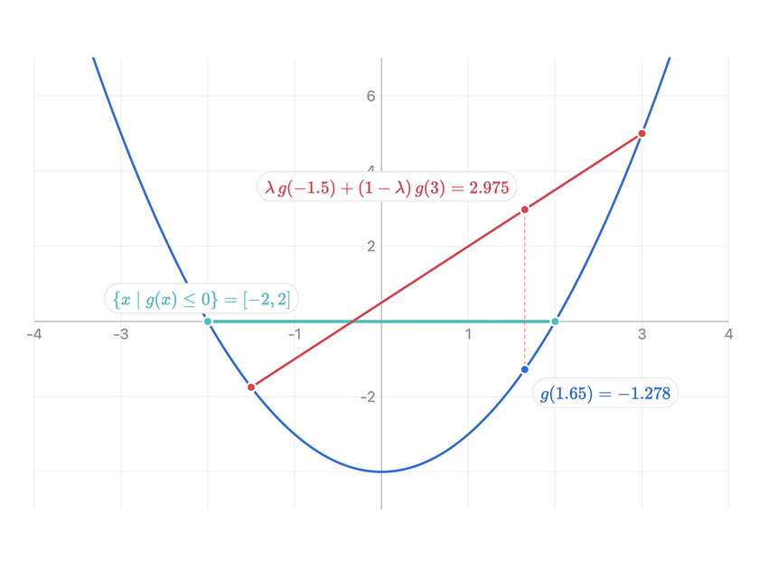</a> | **[Sets and convex functions](sets-convexity.md)** Mark where g(x) ≤ 0 on the x-axis, read the set as intervals and test convexity with a chord. Core · 3 min · 4 steps |
| <a href="descent-newton.md">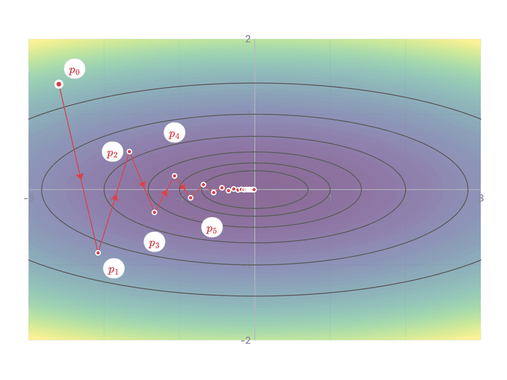</a> | **[Gradient descent and Newton's method](descent-newton.md)** Walk downhill on level curves with gradient descent, take steps that are too long, and find a root with Newton's method. Advanced · 4 min · 5 steps |

## Linear algebra and complex numbers

| Finished chart | Guide |
| --- | --- |
| <a href="vectors-arrows.md">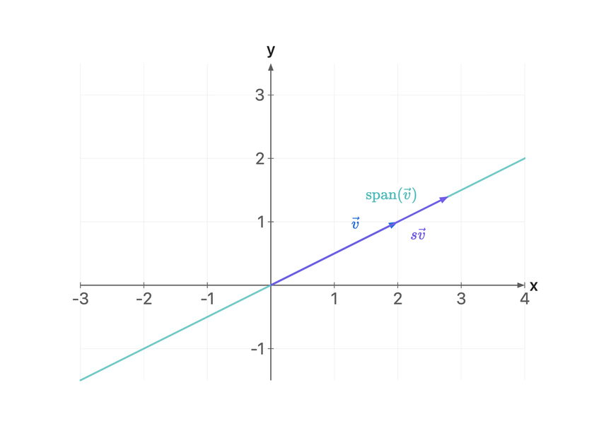</a> | **[Vectors and arrows](vectors-arrows.md)** Name vectors with let, draw them as arrows, add them tip to tail and scale one with a slider. Start here · 2 min · 4 steps |
| <a href="matrix-plane.md">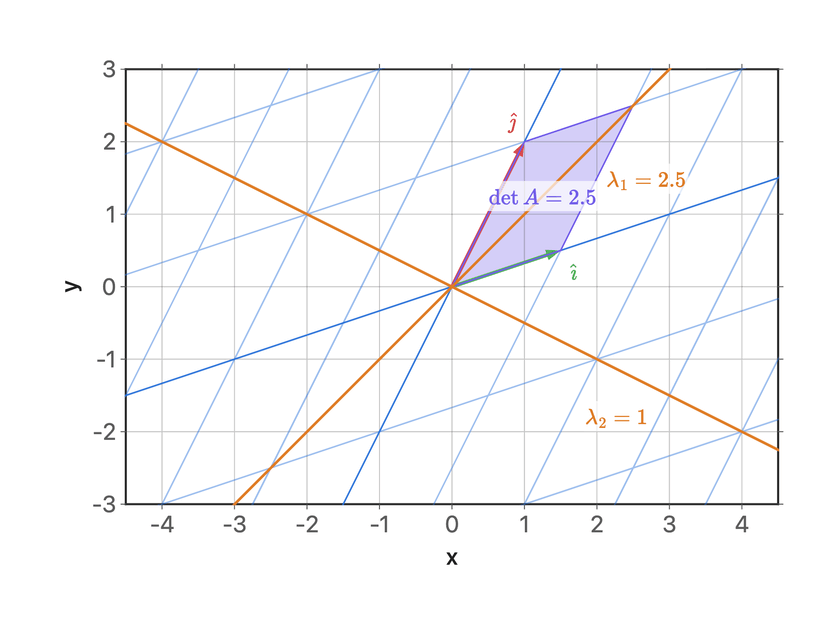</a> | **[A matrix moves the plane](matrix-plane.md)** Draw the grid and the basis vectors, then let a matrix move the whole plane in a step you can play. Core · 3 min · 4 steps |
|  | **[Complex numbers and maps](complex-maps.md)** Mark complex numbers as points, bend a grid with z ↦ z² and colour the plane by a complex function. Advanced · 3 min · 4 steps |

## Dynamics and fractals

| Finished chart | Guide |
| --- | --- |
| <a href="fractals.md">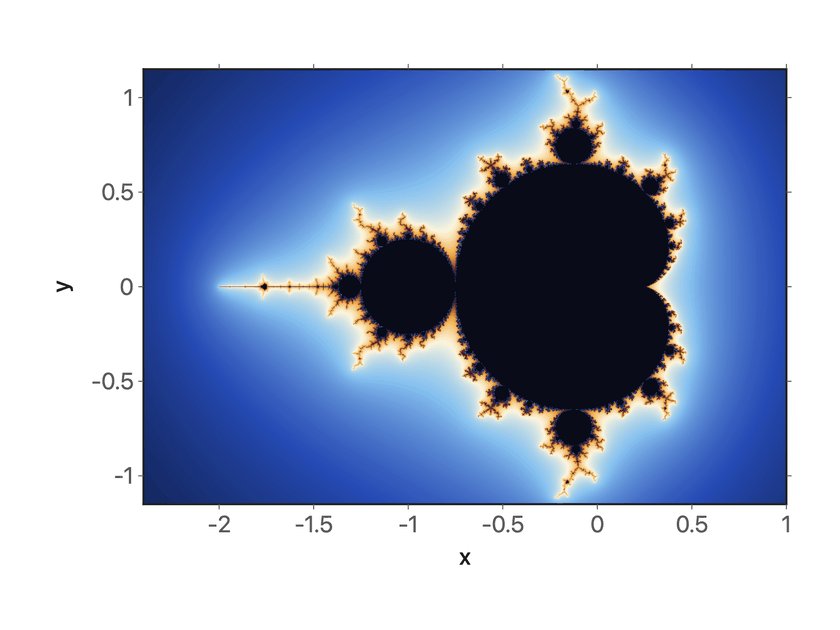</a> | **[Fractals: Mandelbrot, Julia and Newton](fractals.md)** Colour every point of the plane by its orbit: the Mandelbrot set, Julia sets on sliders and the basins of Newton's method. Core · 3 min · 4 steps |
| <a href="orbits-cobwebs.md">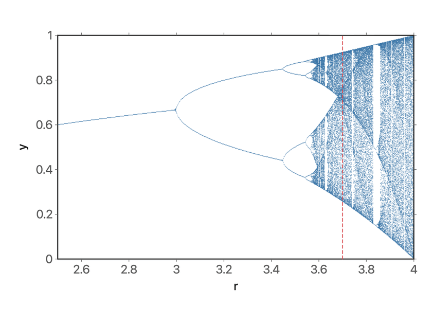</a> | **[Orbits, cobwebs and bifurcation](orbits-cobwebs.md)** Follow x ↦ r x (1 - x) step by step on a cobweb, over time, and for every r at once in the bifurcation diagram. Advanced · 4 min · 5 steps |
| <a href="vector-fields.md">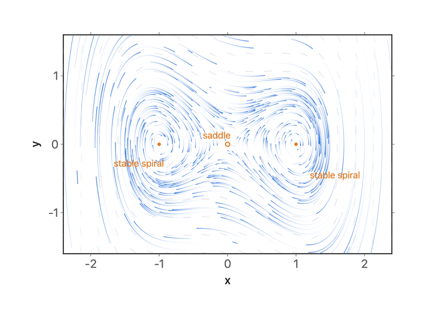</a> | **[Vector fields and rest points](vector-fields.md)** Draw a vector field, colour it by length, mark its rest points and set particles flowing along it. Core · 3 min · 5 steps |
| <a href="systems.md">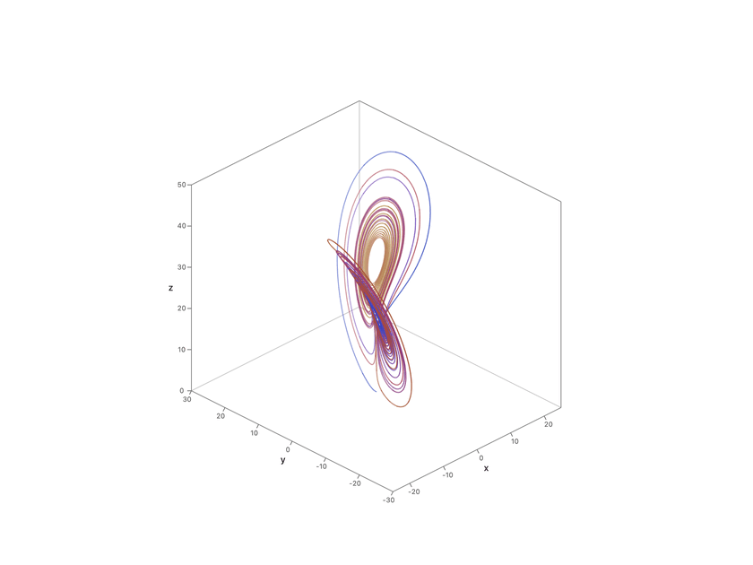</a> | **[Solutions of systems in 2D and 3D](systems.md)** Draw the path a system of equations takes from a point: predators and prey in the plane, then the Lorenz system in space. Advanced · 3 min · 4 steps |

## Data and probability

| Finished chart | Guide |
| --- | --- |
|  | **[Data and a regression line](data-regression.md)** Plot data points, fit a regression line and print its equation and R² beside it. Core · 3 min · 4 steps |
|  | **[Normal and binomial probabilities](probability.md)** Shade a probability under the normal curve with a slider, then compare binomial bars with a normal curve. Core · 3 min · 4 steps |
|  | **[Activation functions and softmax](ml-activations.md)** Write σ, tanh and ReLU as in your notes, use GELU and softplus by name, and turn the temperature of a softmax with a slider. Start here · 3 min · 4 steps |
|  | **[Optimizers on a loss surface](ml-optimizers.md)** Gradient descent, momentum and Adam walk down the same curved valley: one zigzags and crawls, the others glide to the minimum. Advanced · 4 min · 4 steps |
|  | **[Logistic regression](ml-logistic.md)** Train a classifier by gradient descent in a script: the probability as a picture, the line where it is one half, and a slider for the steps. Core · 3 min · 4 steps |
|  | **[A neural network that learns](ml-network.md)** Points no straight line can split, a small network trained in NumPy, and frame(t) playing its training as a moving picture. Advanced · 3 min · 3 steps |
|  | **[k-means step by step](ml-kmeans.md)** Three groups of points, three centres: each point joins its nearest centre, each centre moves to the middle of its points, again and again. Core · 3 min · 4 steps |
|  | **[Principal components](ml-pca.md)** The SVD of a cloud of points gives its principal directions; a slider turns a line and shows the variance along it peak at the first one. Core · 3 min · 3 steps |
|  | **[Overfitting and regularisation](ml-overfitting.md)** A polynomial with the degree on a slider fits 14 noisy points better and better, and new points worse and worse, until ridge holds it back. Core · 3 min · 4 steps |
|  | **[A loss landscape in 3D](ml-landscape.md)** A loss with two valleys as a surface, and gradient descent as a ball that rolls down it, from a start on two sliders. Advanced · 3 min · 3 steps |

## Points, lines and labels

| Finished chart | Guide |
| --- | --- |
|  | **[Points and live labels](points-labels.md)** Mark points from a list or from a formula, name them in LaTeX and print their values in labels. Core · 3 min · 4 steps |
|  | **[Segments, arrows and braces](arrows-braces.md)** Draw a slope triangle: a path for the run and the rise, braces with live labels and an arrow. Core · 3 min · 5 steps |
|  | **[Calculate with computed points](computed-values.md)** Use what crossing points publish, their count and coordinates, in a title, a new point and an area. Core · 4 min · 5 steps |

## 3D

| Finished chart | Guide |
| --- | --- |
|  | **[Surfaces, planes and points in 3D](surfaces-3d.md)** Plot a surface coloured by height in a cube, turn it, and cut it with a plane on a slider. Core · 3 min · 5 steps |

## Notes and export

| Finished chart | Guide |
| --- | --- |
|  | **[Charts in your notes](charts-in-notes.md)** Insert a chart into a note, edit it again, and move its sliders there, also across charts. Start here · 3 min · 4 steps |
|  | **[Charts as SVG files](svg-files.md)** Keep every chart of a note as an SVG file too, for Obsidian Publish, GitHub and other apps. Core · 2 min · 4 steps |
|  | **[Export to LaTeX](export-latex.md)** Copy a chart as pgfplots code, compile it with pdflatex, or take only the picture for your document. Core · 3 min · 4 steps |
|  | **[Cards of sets, matrices and sums](formula-cards.md)** Rest the pointer on a set, a matrix, a recurrence or a sum in a note: its card draws it, with the names of the note. Core · 3 min · 5 steps |
|  | **[Steps you can play](steps-frames.md)** Start a step with then: the chart shows its lines a step at a time, plays in notes and exports every step as frames. Core · 2 min · 4 steps |

## Reference

| Finished chart | Guide |
| --- | --- |
|  | **[Coming from 3.x](from-3x.md)** What happens to your 3.x charts, where the old tabs and tools went, and what sliders add. Core · 2 min · 4 steps |
|  | **[Keyboard shortcuts](shortcuts.md)** The keys of the editor: insert, undo, move shapes and the view, and move between tabs. Start here · 3 min · 5 steps |
