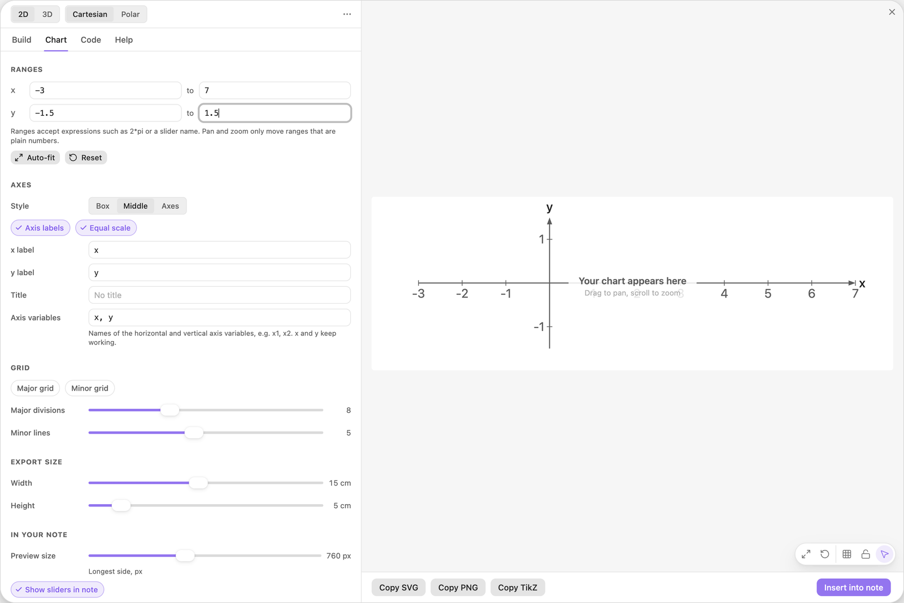
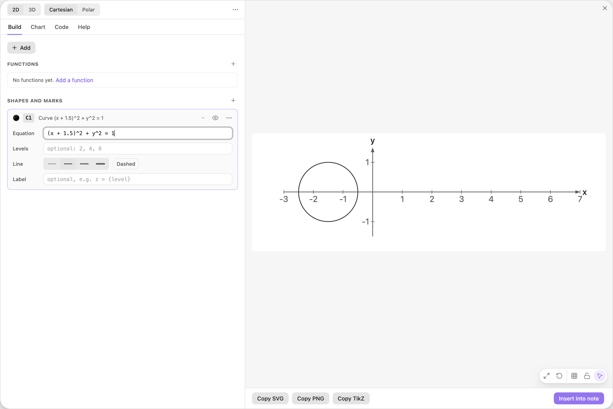
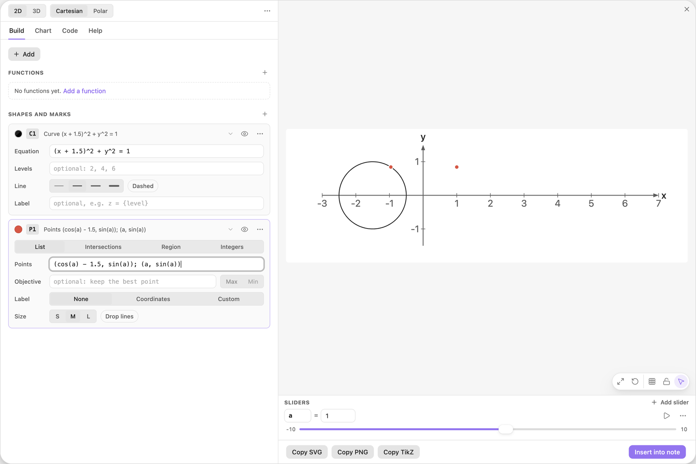
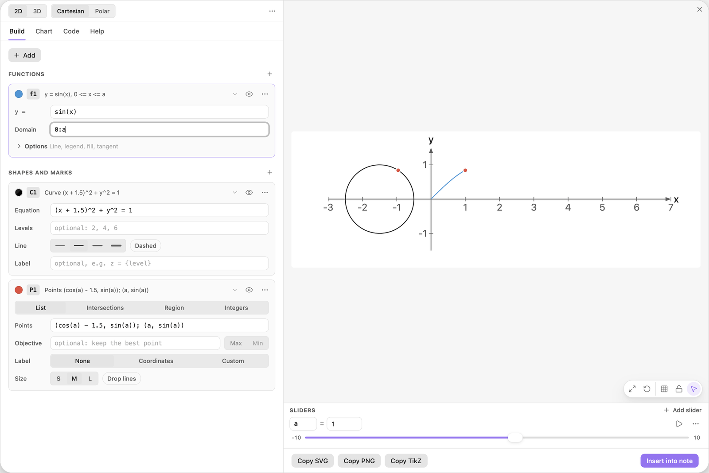
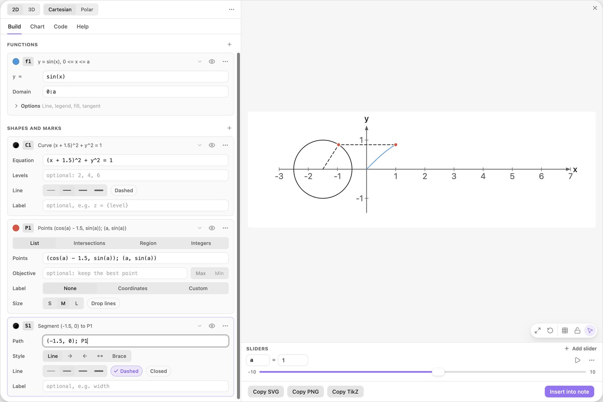
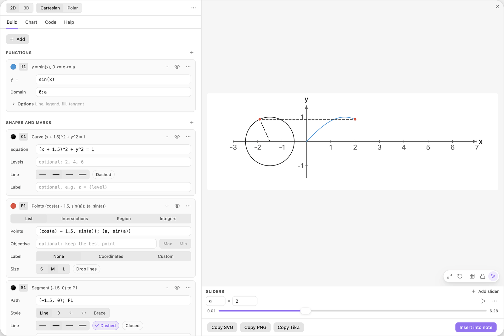
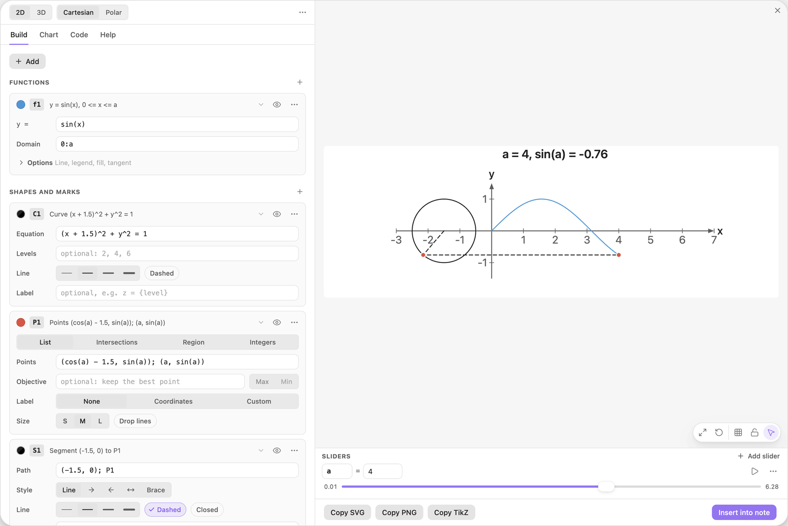

<!-- Generated by scripts/media/build-guides.mjs from src/guides. Do not edit. -->

# Animate a chart with play

[All guides](README.md) · Functions and sliders · Core · about 8 minutes

A point runs around the unit circle while the sine curve draws itself behind it: one slider in points, a domain, a path and the title, then press play.

<p align="center"></p>

**What you can do afterwards**

- Move points, a domain and a path with one slider
- Choose the range and the step of a slider for an animation
- Play a slider and print live values in the title

**Read first:** [Sliders that move the picture](sliders.md)

## 1. Set up a wide view

Start with a new chart and open the Chart tab. Under Ranges set x from -3 to 7 and y from -1.5 to 1.5. Under Axes choose the style Middle and switch on Equal scale. Under Export size drag Width to 15 cm and Height to 5 cm.

The picture will hold a circle on the left and one period of a sine wave on the right. Equal scale keeps the circle round, and the wide export size gives the long x range the room it needs.

| Where | Type |
| --- | --- |
| Chart \> Ranges, x from | `-3` |
| Chart \> Ranges, x to | `7` |
| Chart \> Ranges, y from | `-1.5` |
| Chart \> Ranges, y to | `1.5` |



*Ranges, the Middle axis style, Equal scale and a wide export size, all in the Chart tab.*

> **Tip:** With Equal scale on, one unit has the same length on both axes, and the part of the canvas the plot does not need stays empty. An export size of about the same shape as the ranges keeps that empty part small.

## 2. Draw the unit circle

Go back to the Build tab, click + Add and choose Circle in the group Curves and lines. Replace the equation of the new card C1 with the one below.

It is the circle of radius 1 around (-1.5, 0). It sits left of the y-axis, so the sine wave has the right half of the picture to itself.

| Where | Type |
| --- | --- |
| C1, Equation | `(x + 1.5)^2 + y^2 = 1` |



*The unit circle, moved 1.5 to the left.*

## 3. Put two points on a slider

Click + Add and choose Points from a list. Replace the sample points with the two below. The name `a` is unknown, so a button Add slider a appears under the field. Click it. The slider starts at 1.

The first point is `(cos(a), sin(a))` moved 1.5 to the left: the point of the circle at the angle a, measured in radians. The second point has the same height, sin(a), but sits at x = a. That is where the sine curve will end.

| Where | Type |
| --- | --- |
| P1, Points | `(cos(a) - 1.5, sin(a)); (a, sin(a))` |



*Two points computed from the slider a: one on the circle, one at the same height at x = a.*

> **Tip:** Points from a list take formulas. Anything that gives a number works inside the brackets, sliders included.

## 4. Draw the sine curve up to a

Click + Add and choose Function y = f(x). Type `sin(x)` into the new card f1 and `0:a` into its Domain field. Click the colour swatch on the card and pick Blue.

The curve is drawn from x = 0 to x = a only, so it ends exactly at the second point. When a grows, the curve grows with it.

| Where | Type |
| --- | --- |
| f1, y = | `sin(x)` |
| f1, Domain | `0:a` |



*The domain 0:a stops the curve at the second point.*

> **Tip:** A domain needs its end after its start. At a = 0 the domain `0:a` is empty and the card reports an error, which is why a stays above 0 later on.

## 5. Join the points with one path

Click + Add and choose Line segment. Replace the path of the card S1 with the one below and switch on Dashed in the Line row.

A path entry can be the name of a points card: `P1` stands for its two points, in order. So the path runs from the centre of the circle to the point on the circle, which draws the radius, and on to the end of the curve at the same height.

| Where | Type |
| --- | --- |
| S1, Path | `(-1.5, 0); P1` |



*One path through the centre, the point on the circle and the end of the curve.*

> **Tip:** The path follows P1 by itself. Every point the card computes is part of the path, wherever it moves.

## 6. Give a a range and a step

In the Sliders dock, open the menu behind the three dots on the row of a and set Min to 0.01, Max to 6.28 and Step to 0.01. Then drag a to 2.

The range is one full turn, since 6.28 is about 2π. It starts just above 0, because the domain `0:a` needs some length. The step is the grid the slider stops on: with 0.01 you can stop at 3.14, half a turn.

| Where | Type |
| --- | --- |
| Sliders, a: Min | `0.01` |
| Sliders, a: Max | `6.28` |
| Sliders, a: Step | `0.01` |



*a = 2: the point has gone a third of the way round, and the curve has grown with it.*

> **Tip:** The small numbers at the two ends of a slider are its Min and Max as well. Click one and type to change it.

## 7. Press play and print the values

Open the Chart tab and type the title below. Back in the Build tab, click the play button on the row of a.

The point runs around the circle, the dashed path follows, and the sine curve grows behind the second point: one turn in about four seconds, then back again. The title prints the angle and its sine on every frame. Click the button again to stop, for example near a = 4.

A step of 0.01 is already fine enough for smooth motion, so play moves a from one step to the next. With a coarse step such as 0.5, play moves on a finer grid while it runs and puts a back onto the step when you stop. A whole-number step such as 1 stays whole while it plays, so a count never turns into a fraction.

| Where | Type |
| --- | --- |
| Chart \> Axes, Title | `a = {a:2}, sin(a) = {sin(a):2}` |



*Stopped at a = 4: past half a turn, the point is below the axis and the sine is negative.*

> **Tip:** A sweep takes about four seconds whatever the range. In a note, the slider strip under the chart has no play button: drag a there instead.

## The finished chart

Paste this block into a note to get the finished chart of this guide. Click the chart in the note to open it in the editor.

<details>
<summary>The chart as an easy-tikz block</summary>

```easy-tikz
{
  "v": 4,
  "dimension": false,
  "documentSetup": true,
  "title": "a = {a:2}, sin(a) = {sin(a):2}",
  "size_x_cm": 15,
  "size_y_cm": 5,
  "show_axis_label": true,
  "axis_label_x": "x",
  "axis_label_y": "y",
  "showAxis": true,
  "showLargeGrid": false,
  "showSmallGrid": false,
  "gridSize": 5,
  "majorTickNum": 8,
  "xmin": "-3",
  "xmax": "7",
  "ymin": "-1.5",
  "ymax": "1.5",
  "zmin": "-5",
  "zmax": "5",
  "axis_style": "middle",
  "coordinateSystem": "cartesian",
  "axis_label_x_polar": "",
  "axis_label_y_polar": "",
  "axis_label_z": "z",
  "rotationX": 30,
  "rotationZ": 45,
  "zoom3D": 1,
  "boxAspect": "true",
  "previewSize": 760,
  "functions": [
    {
      "expression": "sin(x)",
      "domain": "0:a",
      "showLegend": false,
      "fill": false,
      "fillOpacity": 0.2,
      "fillPattern": "solid",
      "tangent": false,
      "color": "blue",
      "dashed": false,
      "tangentPoint": "",
      "extrema": false,
      "thickness": "thin",
      "parametric": false,
      "expressionY": "",
      "name": "f1"
    }
  ],
  "functions3D": [],
  "tools": [
    {
      "type": "curve",
      "color": "black",
      "equation": "(x + 1.5)^2 + y^2 = 1",
      "levels": "",
      "thickness": "thin",
      "dashed": false,
      "label": "",
      "id": "t0",
      "name": "C1"
    },
    {
      "type": "points",
      "color": "red",
      "dim": 2,
      "source": "list",
      "points": "(cos(a) - 1.5, sin(a)); (a, sin(a))",
      "ref1": "",
      "ref2": "",
      "regionName": "",
      "objective": "",
      "sense": "max",
      "label": "",
      "dropLines": false,
      "size": "normal",
      "id": "t1",
      "name": "P1"
    },
    {
      "type": "segment",
      "color": "black",
      "dim": 2,
      "path": "(-1.5, 0); P1",
      "closed": false,
      "style": "line",
      "thickness": "thin",
      "dashed": true,
      "label": "",
      "id": "t2",
      "name": "S1"
    }
  ],
  "annotations": [],
  "parameters": [
    {
      "name": "a",
      "value": 4,
      "min": 0.01,
      "max": 6.28,
      "step": 0.01
    }
  ],
  "variables": "x, y",
  "equalScale": true,
  "showSlidersInNote": true
}
```

</details>

## Next guides

- [From secant to tangent](secant-tangent.md): Draw the secant through two points of a curve, shrink their distance h with a slider and watch its slope approach the slope of the tangent.
- [An area that grows with a slider](area-accumulation.md): Shade the area under a curve from 0 to a slider b, print its size, and draw the function that adds it up, so the height of one curve shows the area under the other.
- [Charts in your notes](charts-in-notes.md): Insert a chart into a note, play with its sliders there, set its width and alignment, and open it again to change it.

[All guides](README.md)
