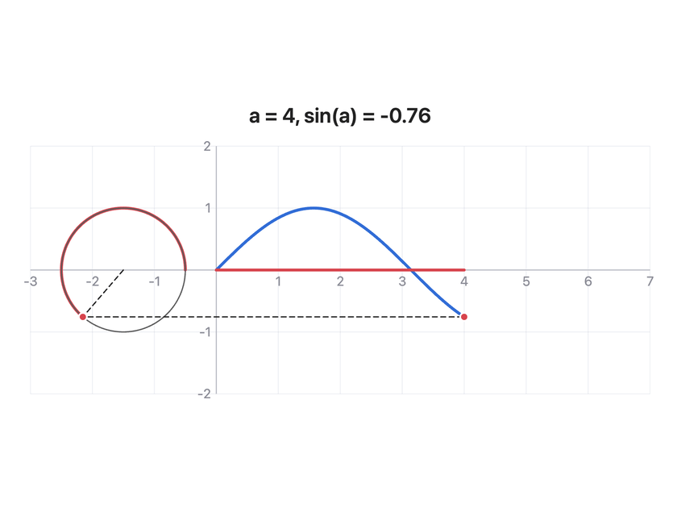
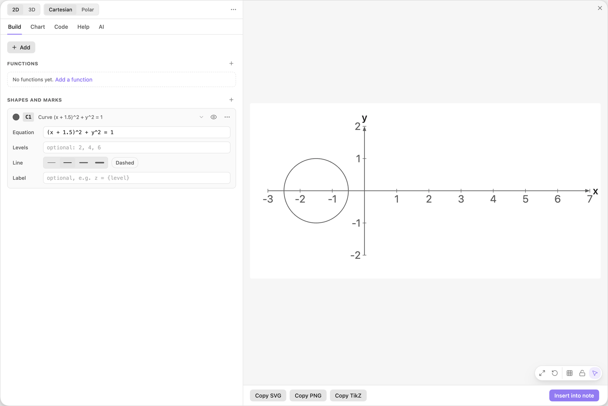
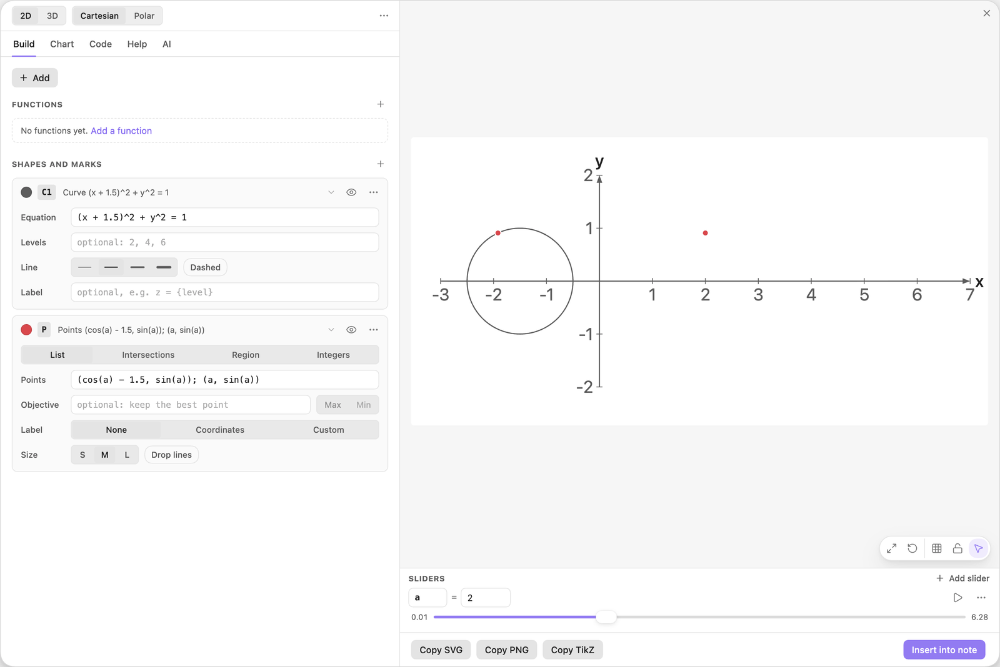
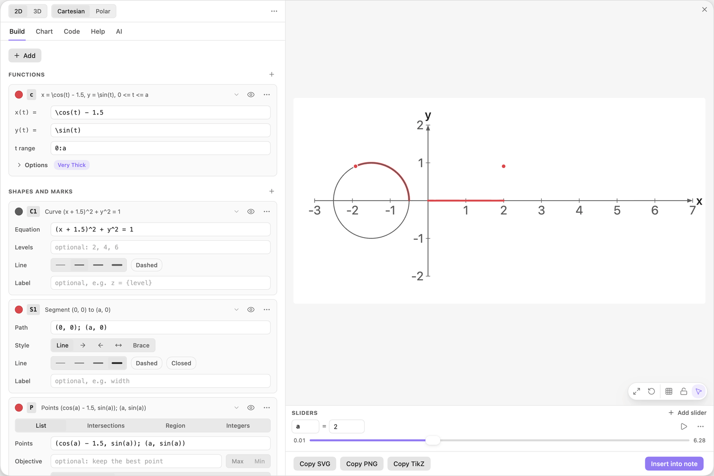
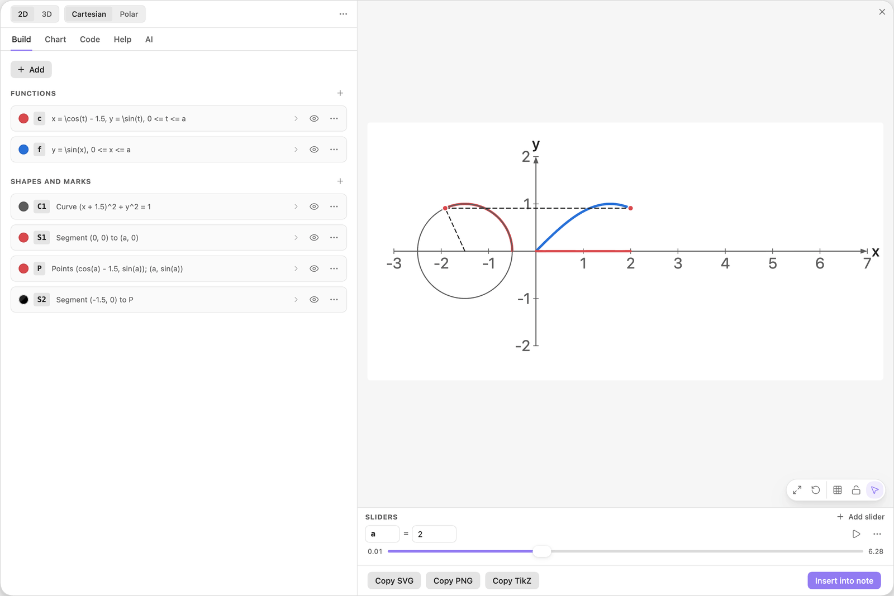
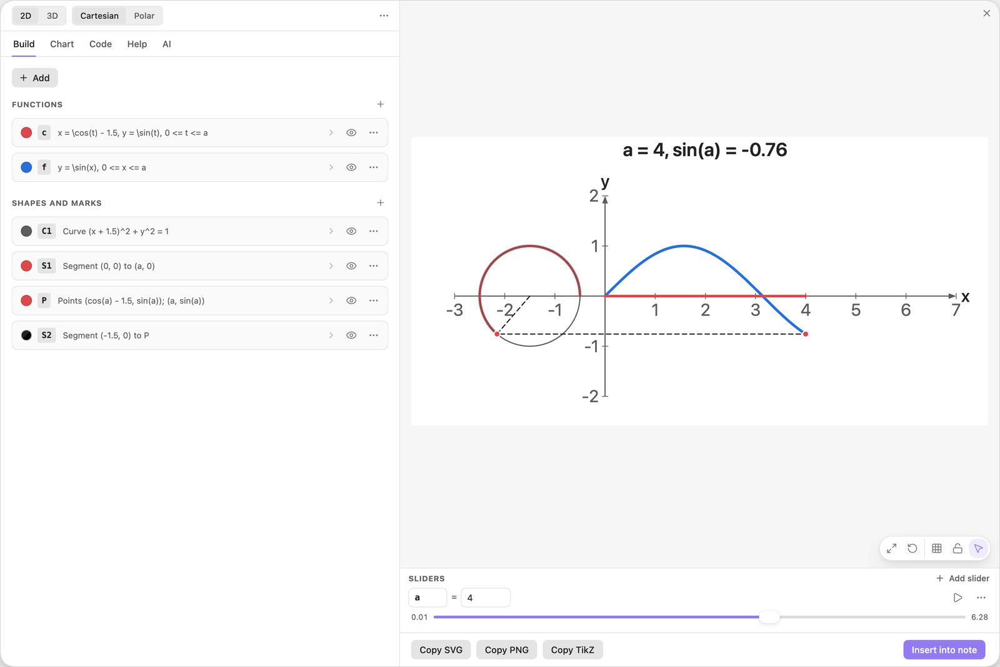

<!-- Generated by scripts/media/build-guides.mjs from src/guides. Do not edit. -->

# Animate a chart with play

[All guides](README.md) · Functions and sliders · Core · about 3 minutes

A point runs around the unit circle while the circle unrolls into the sine curve, all on one slider.

<p align="center"></p>

**What you can do afterwards**

- Move points, arcs and curves with one slider
- Give a slider one turn and a fine step
- Play it and print live values in the title

**Read first:** [Sliders that move the picture](sliders.md)

## 1. Draw the unit circle

A wide window with `equal scale` keeps the circle round. The circle of radius 1 sits left of the y-axis, so the sine gets the right side.

The chart in words:

```easy-tikz
show x from -3 to 7 and y from -2 to 2
size 12 x 6
equal scale
axes in the middle
draw (x + 1.5)^2 + y^2 = 1 in gray
```



## 2. Run a point around it

The slider `a` from 0.01 to 6.28 is one turn. The point `(cos(a) - 1.5, sin(a))` sits on the circle at the angle a, a second one at `(a, sin(a))`.

The chart gets these lines:

```easy-tikz
slider a from 0.01 to 6.28, starting at 2, in steps of 0.01
P: mark (cos(a) - 1.5, sin(a)) and (a, sin(a))
```



> **Tip:** The slider starts just above 0: a curve from 0 to a needs some length.

## 3. Unroll the arc onto the axis

The red arc runs from the angle 0 to a, so its length is a. The red segment from 0 to a on the x-axis has the same length: the circle unrolled.

The chart gets these lines:

```easy-tikz
plot $c(t) = (\cos(t) - 1.5, \sin(t))$ for t from 0 to a in red, very thick
draw a line from (0, 0) to (a, 0) in red, very thick
```



## 4. Draw the sine up to a

`from x = 0 to a` stops the sine at the second point. The dashed path joins the centre, the point on the circle and the end of the curve.

The chart gets these lines:

```easy-tikz
plot $f(x) = \sin(x)$ from x = 0 to a in blue, very thick
draw a line from (-1.5, 0) to P, dashed
```



## 5. Press play

Press play on `a`: the point runs around, the arc unrolls and the sine grows behind it. The title prints the angle and its sine, here at 4, past half a turn.

The chart gets these lines:

```easy-tikz
title $a = {a:2}$, $\sin(a) = {sin(a):2}$
slider a from 0.01 to 6.28, starting at 4, in steps of 0.01
```



> **Tip:** In a note the slider strip has no play button: drag `a` there instead.

## The finished chart

Paste this block into a note to get the finished chart of this guide. Click the chart in the note to open it in the editor.

<details>
<summary>The chart as an easy-tikz block</summary>

```easy-tikz
show x from -3 to 7 and y from -2 to 2
size 12 x 6
equal scale
axes in the middle
title $a = {a:2}$, $\sin(a) = {sin(a):2}$
slider a from 0.01 to 6.28, starting at 4, in steps of 0.01
plot $c(t) = (\cos(t) - 1.5, \sin(t))$ for t from 0 to a in red, very thick
plot $f(x) = \sin(x)$ from x = 0 to a in blue, very thick
draw (x + 1.5)^2 + y^2 = 1 in gray
draw a line from (0, 0) to (a, 0) in red, very thick
P: mark (cos(a) - 1.5, sin(a)) and (a, sin(a))
draw a line from (-1.5, 0) to P, dashed
```

</details>

## Next guides

- [From secant to tangent](secant-tangent.md): Shrink the gap h between two points of a curve and watch the secant through them turn into the tangent.
- [An area that grows with a slider](area-accumulation.md): Shade the area under a curve up to a slider and draw the function that adds it up.
- [Parametric and polar curves](parametric-polar.md): Trace a curve from x(t) and y(t), then switch to polar and grow a rose whose petals a slider counts.

[All guides](README.md)
