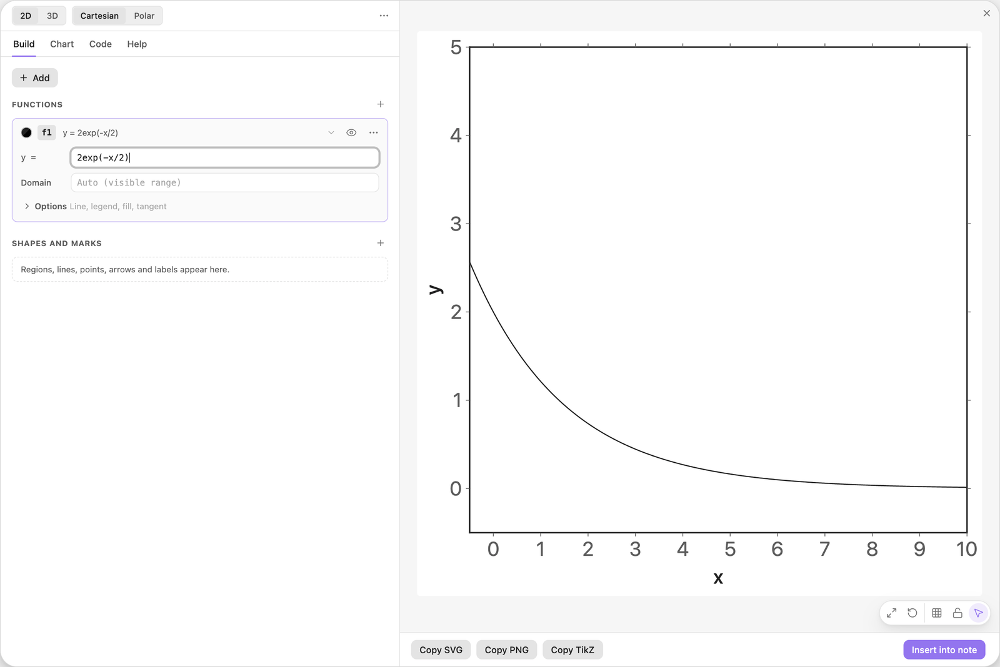
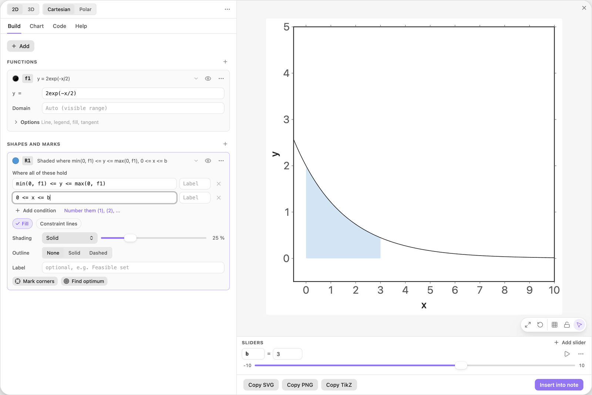
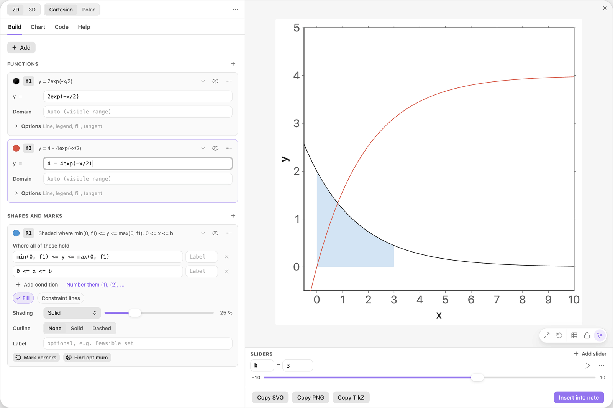
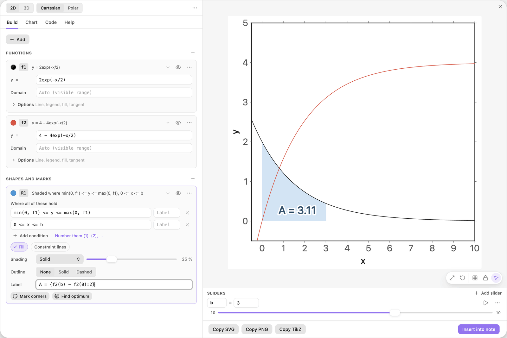
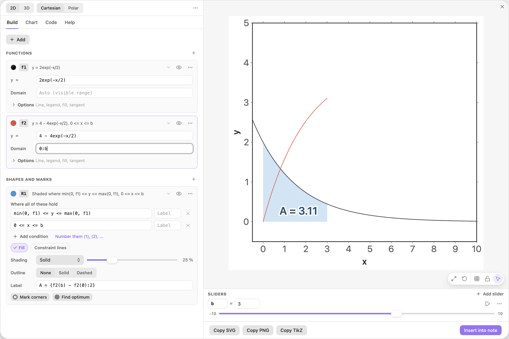
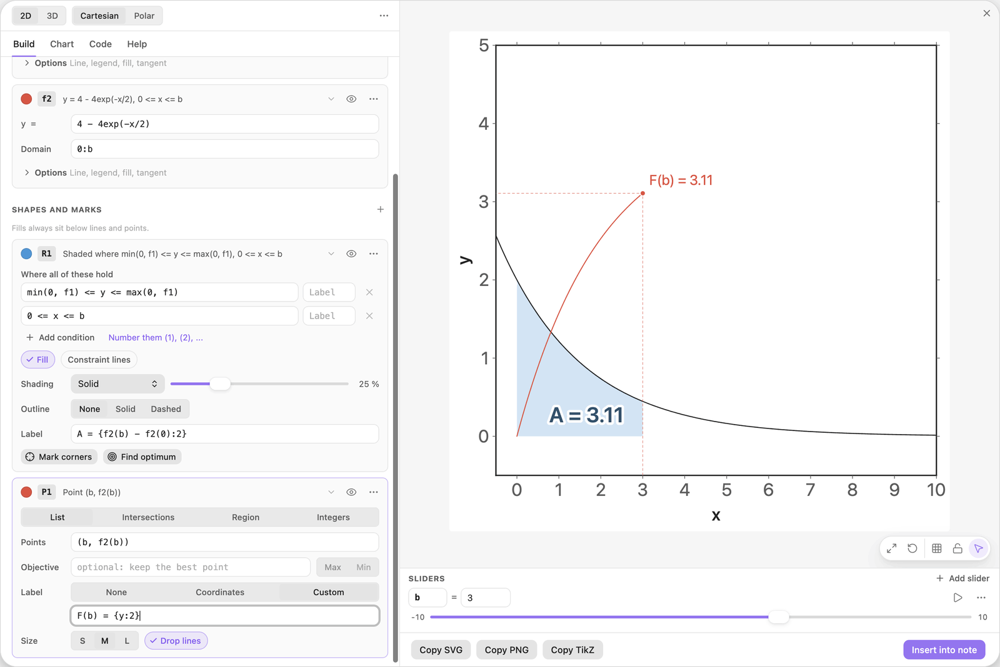
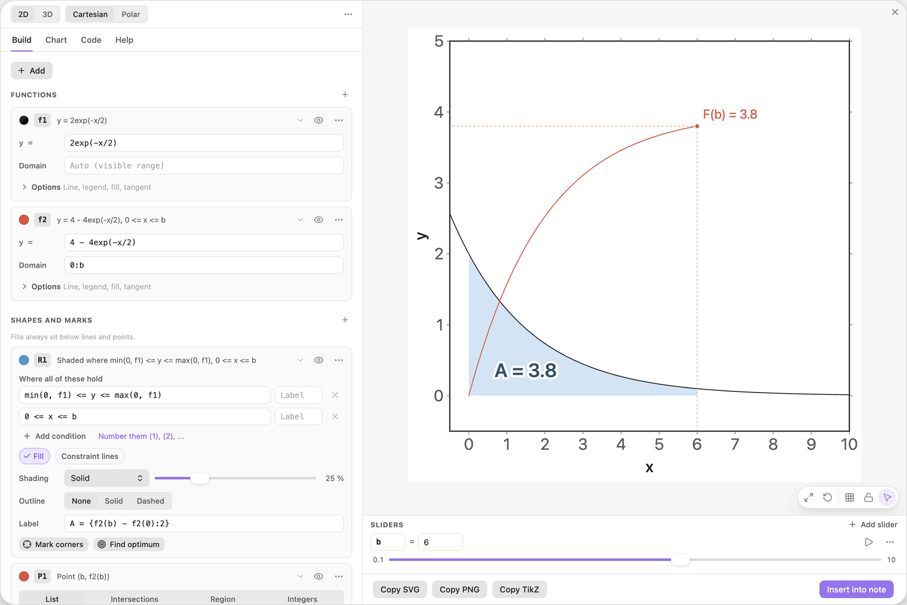

<!-- Generated by scripts/media/build-guides.mjs from src/guides. Do not edit. -->

# An area that grows with a slider

[All guides](README.md) · Functions and sliders · Core · about 8 minutes

Shade the area under a curve from 0 to a slider b, print its size, and draw the function that adds it up, so the height of one curve shows the area under the other.

<p align="center"></p>

**What you can do afterwards**

- End a shaded area at a slider and print its size
- Draw a function only up to a slider with its domain
- Mark a point that rides on the end of a curve
- Play the slider and watch the area and the height grow together

**Read first:** [Sliders that move the picture](sliders.md)

## 1. Draw the curve

Start with a new chart. Click + Add, choose Function y = f(x) and type the formula below into the card f1.

The curve starts at a height of 2 and falls towards 0. The area under all of it, from 0 to infinity, is exactly 4.

| Where | Type |
| --- | --- |
| f1, y = | `2exp(-x/2)` |



*f1 falls from 2 towards 0.*

> **Tip:** `exp(x)` is e to the power x, and `2exp(-x/2)` is 2 times it: no star needed after a number.

## 2. Shade the area from 0 to b

Click + Add and choose Area under a function. The card R1 has two rows. The first, `min(0, f1) <= y <= max(0, f1)`, shades between f1 and the x-axis; the second limits x. Replace the second row with the one below and click Add slider b.

Then type 3 into the value of b. The area now runs from x = 0 to x = 3.

| Where | Type |
| --- | --- |
| R1, condition 2 | `0 <= x <= b` |
| Sliders, b: value | `3` |



*The area under f1 from 0 to the slider b.*

> **Tip:** The first row works below the axis too: `min` and `max` put f1 and 0 in the right order wherever f1 is negative.

## 3. Type the function that adds it up

Click + Add, choose Function y = f(x) and type the formula below into the card f2. Click its colour swatch and pick Red.

This is F, the antiderivative of f1 that starts at 0: its slope at every x is f1(x), and F(0) = 0. Easy TikZ shades areas but does not integrate formulas, so F is typed by hand. The red curve rises from 0 towards 4.

| Where | Type |
| --- | --- |
| f2, y = | `4 - 4exp(-x/2)` |



*F in red: it starts at 0 and climbs towards 4.*

> **Tip:** Not sure about F? Differentiate it: the derivative of 4 - 4exp(-x/2) is 2exp(-x/2), which is f1.

## 4. Print the area in the region

Type the label below into the field Label of R1. By the fundamental theorem of calculus, `f2(b) - f2(0)` is the area under f1 from 0 to b. The `:2` keeps up to two decimals.

The label sits in the middle of the shaded area and reads A = 3.11.

| Where | Type |
| --- | --- |
| R1, Label | `A = {f2(b) - f2(0):2}` |



*The region prints its own area, computed from F.*

## 5. Draw F only up to b

Type `0:b` into the Domain field of the card f2. The red curve now ends at x = b, right above the right edge of the shaded area.

A domain with a slider in it grows and shrinks with the slider, so the curve draws itself further when b moves.

| Where | Type |
| --- | --- |
| f2, Domain | `0:b` |



*With the domain 0:b, F stops where the shaded area stops.*

> **Tip:** A domain needs its end after its start: `0:b` reports an error while b is 0 or less. The last step keeps b above 0.

## 6. Mark the end of the curve

Click + Add and choose Points from a list. Replace the sample points with the point below. Set Label to Custom, type the label below and switch on Drop lines.

The point rides on the end of the red curve. Its height, F(b) = 3.11, is the same number as the area: the height of F at b measures the area under f1 up to b. The drop line carries that height over to the y-axis.

| Where | Type |
| --- | --- |
| P1, Points | `(b, f2(b))` |
| P1, Label text | `F(b) = {y:2}` |



*The height of F at b and the area under f1 up to b: the same number.*

> **Tip:** In a points label, `{x}` and `{y}` are the coordinates of the point itself, so the label always matches its point.

## 7. Play b

Open the menu behind the three dots on the row of b and set Min to 0.1 and Max to 10. Then click the play button.

The shaded area widens, the red curve draws itself behind the point, and the label and the point print the same growing number. Both level off near 4, the area under all of f1, while f1 itself sinks towards 0. Stop near b = 6 to see A = 3.8.

| Where | Type |
| --- | --- |
| Sliders, b: Min | `0.1` |
| Sliders, b: Max | `10` |



*At b = 6 the area is 3.8, close to its limit 4.*

> **Tip:** Try another pair: `1/(1 + x)` for f1 and `ln(1 + x)` for f2. Label and point still agree, and this time they keep growing: the area under 1/(1 + x) has no limit.

## The finished chart

Paste this block into a note to get the finished chart of this guide. Click the chart in the note to open it in the editor.

<details>
<summary>The chart as an easy-tikz block</summary>

```easy-tikz
{
  "v": 4,
  "dimension": false,
  "documentSetup": true,
  "title": "",
  "size_x_cm": 10,
  "size_y_cm": 10,
  "show_axis_label": true,
  "axis_label_x": "x",
  "axis_label_y": "y",
  "showAxis": true,
  "showLargeGrid": false,
  "showSmallGrid": false,
  "gridSize": 5,
  "majorTickNum": 8,
  "xmin": "-0.5",
  "xmax": "10",
  "ymin": "-0.5",
  "ymax": "5",
  "zmin": "-5",
  "zmax": "5",
  "axis_style": "box",
  "coordinateSystem": "cartesian",
  "axis_label_x_polar": "",
  "axis_label_y_polar": "",
  "axis_label_z": "z",
  "rotationX": 30,
  "rotationZ": 45,
  "zoom3D": 1,
  "boxAspect": "true",
  "previewSize": 760,
  "functions": [
    {
      "expression": "2exp(-x/2)",
      "domain": "",
      "showLegend": false,
      "fill": false,
      "fillOpacity": 0.2,
      "fillPattern": "solid",
      "tangent": false,
      "color": "black",
      "dashed": false,
      "tangentPoint": "",
      "extrema": false,
      "thickness": "thin",
      "parametric": false,
      "expressionY": "",
      "name": "f1"
    },
    {
      "expression": "4 - 4exp(-x/2)",
      "domain": "0:b",
      "showLegend": false,
      "fill": false,
      "fillOpacity": 0.2,
      "fillPattern": "solid",
      "tangent": false,
      "color": "red",
      "dashed": false,
      "tangentPoint": "",
      "extrema": false,
      "thickness": "thin",
      "parametric": false,
      "expressionY": "",
      "name": "f2"
    }
  ],
  "functions3D": [],
  "tools": [
    {
      "type": "region",
      "color": "blue",
      "conditions": [
        "min(0, f1) <= y <= max(0, f1)",
        "0 <= x <= b"
      ],
      "conditionLabels": [
        "",
        ""
      ],
      "fill": true,
      "fillOpacity": 0.25,
      "fillPattern": "solid",
      "outline": "none",
      "thickness": "thin",
      "constraintLines": false,
      "label": "A = {f2(b) - f2(0):2}",
      "id": "t0",
      "name": "R1"
    },
    {
      "type": "points",
      "color": "red",
      "dim": 2,
      "source": "list",
      "points": "(b, f2(b))",
      "ref1": "",
      "ref2": "",
      "regionName": "",
      "objective": "",
      "sense": "max",
      "label": "F(b) = {y:2}",
      "dropLines": true,
      "size": "normal",
      "id": "t1",
      "name": "P1"
    }
  ],
  "annotations": [],
  "parameters": [
    {
      "name": "b",
      "value": 6,
      "min": 0.1,
      "max": 10,
      "step": 0.1
    }
  ],
  "variables": "x, y",
  "equalScale": false,
  "showSlidersInNote": true
}
```

</details>

## Next guides

- [Shade the areas between two curves](areas-between.md): Two curves, the areas between them in two colours, and their crossing points as the limits of the shading.
- [Calculate with computed points](computed-values.md): Crossing points publish their coordinates and their count: use them in the title, in a new point and in an area formula, and see what they do while a slider plays.
- [Export to LaTeX](export-latex.md): Get pgfplots code that compiles with pdflatex: as a standalone document or as a snippet, at the size you need, in the colours of the preview.

[All guides](README.md)
