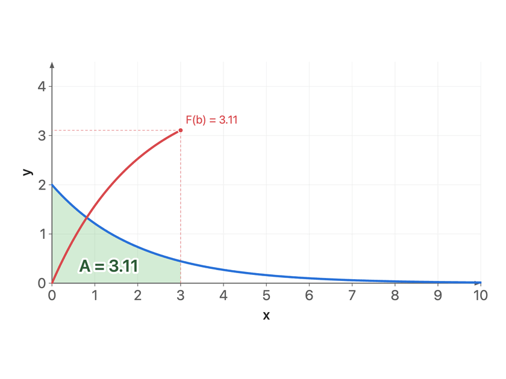
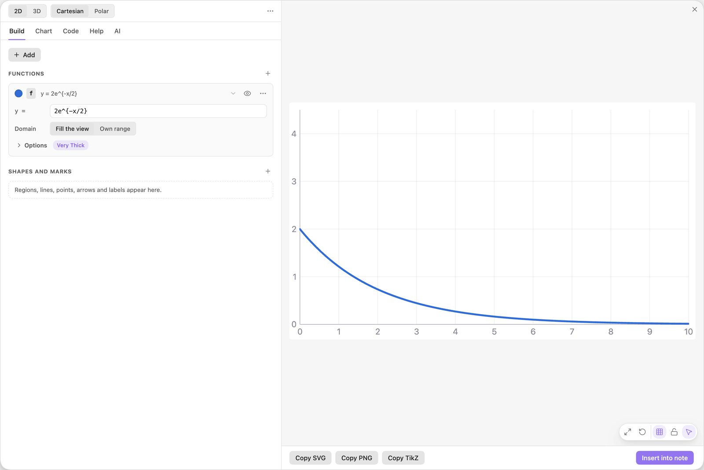
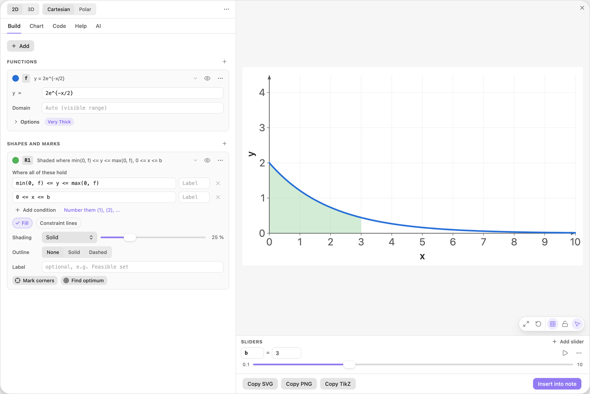
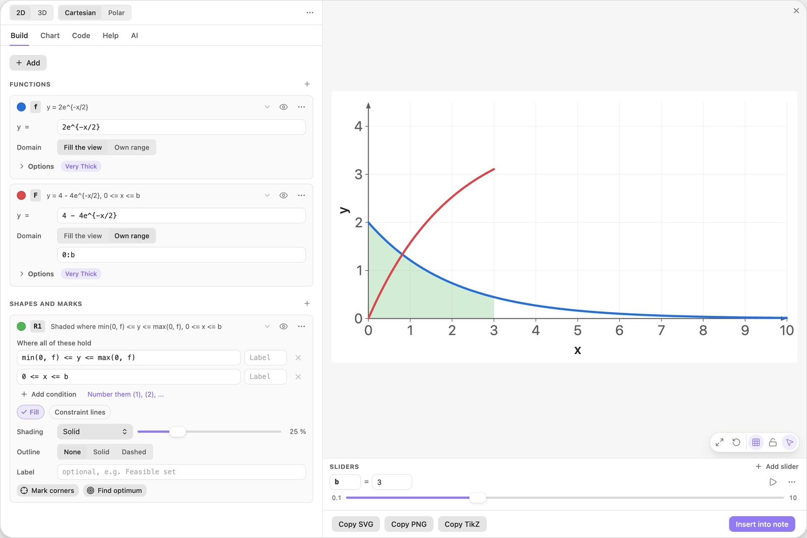
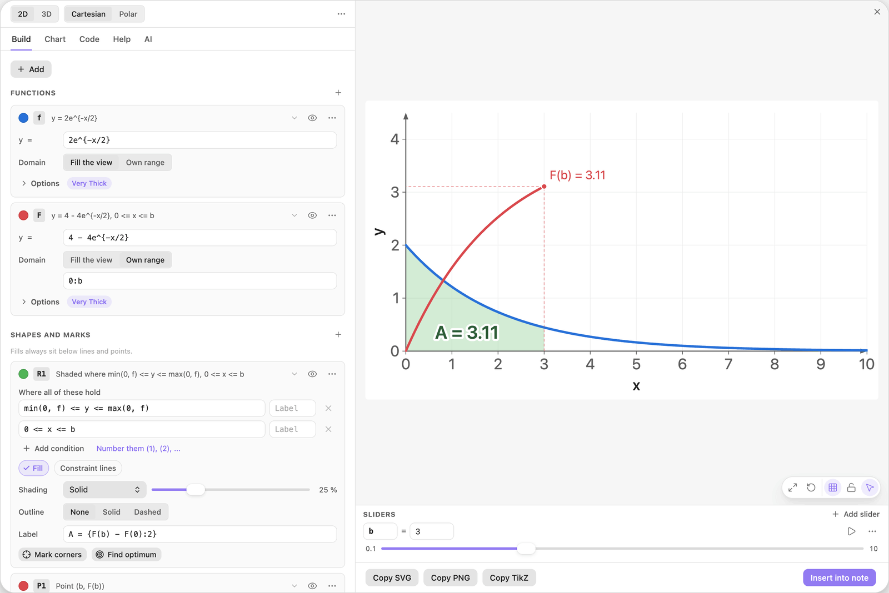

<!-- Generated by scripts/media/build-guides.mjs from src/guides. Do not edit. -->

# An area that grows with a slider

[All guides](README.md) · Calculus · Core · about 3 minutes

Shade the area under a curve up to a slider and draw the function that adds it up.

<p align="center"></p>

**What you can do afterwards**

- Shade an area up to a slider
- Draw a function only up to a slider
- See that F(b) is the area under f

**Read first:** [Sliders that move the picture](sliders.md)

## 1. Plot the curve

The curve starts at 2 and falls towards 0. The whole area under it, from 0 to infinity, is exactly 4.

The chart in words:

```easy-tikz
show x from 0 to 10 and y from 0 to 4.5
size 12 x 7
axes on the edges
with a grid
plot $f(x) = 2e^{-x/2}$ in blue, very thick
```



## 2. Shade the area from 0 to b

`shade under f from x = 0 to b` fills the area between f and the x-axis, up to the slider `b`.

The chart gets these lines:

```easy-tikz
slider b from 0.1 to 10, starting at 3
shade under f from x = 0 to b in green
```



## 3. Draw the function that adds it up

F has the slope f and starts at 0, so its height at b is the area up to b. `from x = 0 to b` ends it at the slider.

The chart gets these lines:

```easy-tikz
plot $F(x) = 4 - 4e^{-x/2}$ from x = 0 to b in red, very thick
```



> **Tip:** The chart does not integrate: type F yourself, and check that its derivative is f.

## 4. Label the area and its height

The area prints `F(b) - F(0)` and the point on F prints its height: the same number. Press play and both grow towards 4.

The chart gets these lines:

```easy-tikz
shade under f from x = 0 to b in green, labelled "A = {F(b) - F(0):2}"
mark (b, F(b)), with lines to the axes, labelled "F(b) = {y:2}"
```



## The finished chart

Paste this block into a note to get the finished chart of this guide. Click the chart in the note to open it in the editor.

<details>
<summary>The chart as an easy-tikz block</summary>

```easy-tikz
show x from 0 to 10 and y from 0 to 4.5
size 12 x 7
axes on the edges
with a grid
slider b from 0.1 to 10, starting at 3
plot $f(x) = 2e^{-x/2}$ in blue, very thick
plot $F(x) = 4 - 4e^{-x/2}$ from x = 0 to b in red, very thick
shade under f from x = 0 to b in green, labelled "A = {F(b) - F(0):2}"
mark (b, F(b)), with lines to the axes, labelled "F(b) = {y:2}"
```

</details>

## Next guides

- [Estimate an area with Riemann sums](riemann-sums.md): Fill an area with rectangles, watch their sum approach the integral, then try trapezoids and middle sums.
- [Shade the areas between two curves](areas-between.md): Two waves, the areas between them split where they cross, each in its own colour and labelled.

[All guides](README.md)
