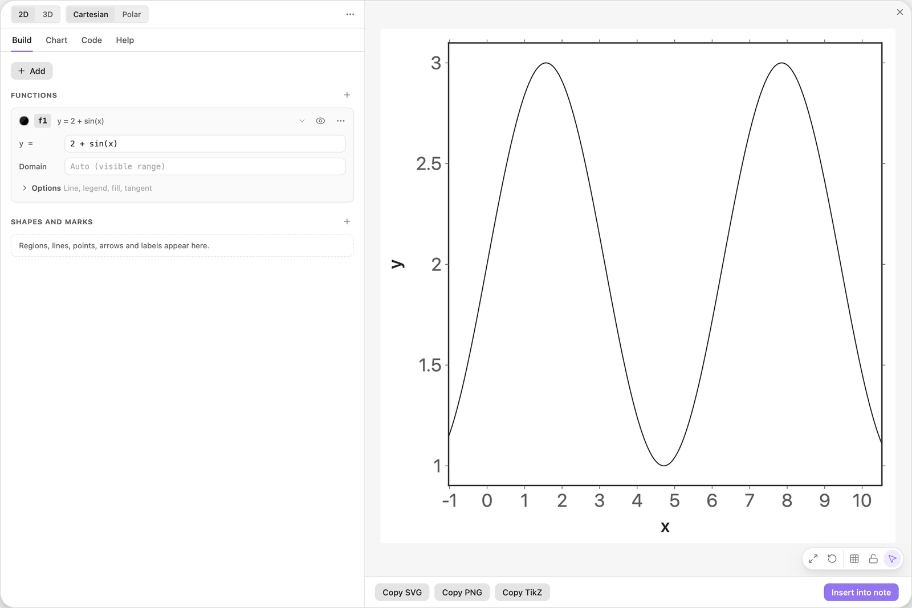
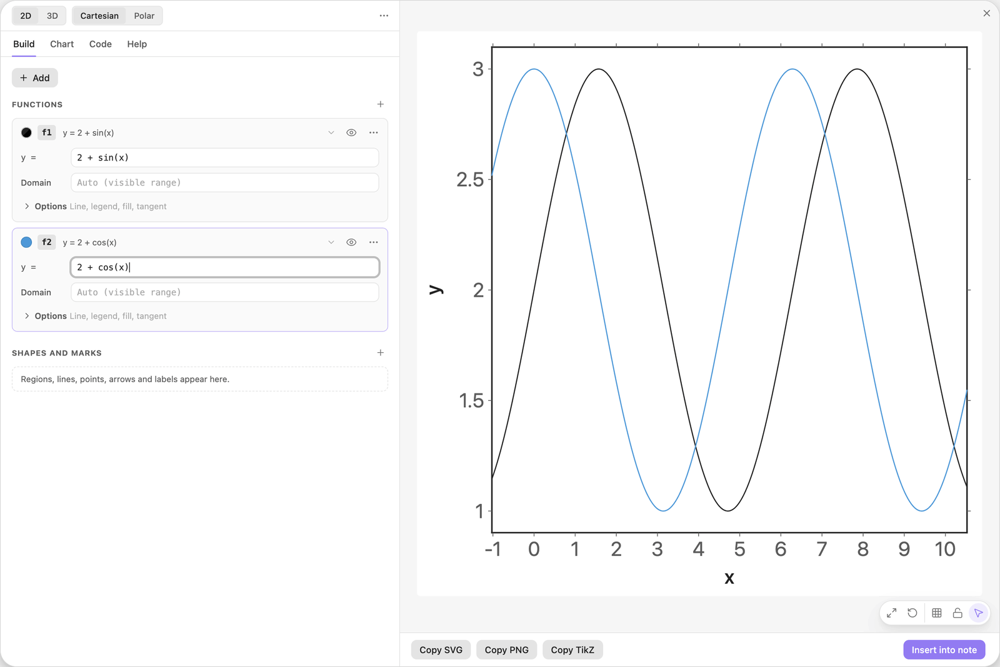
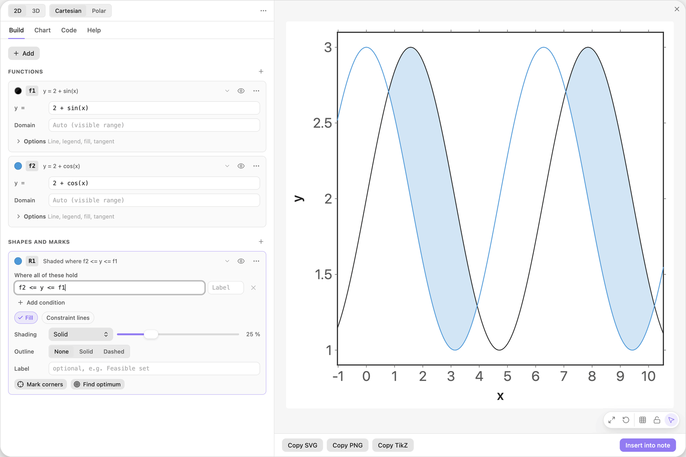
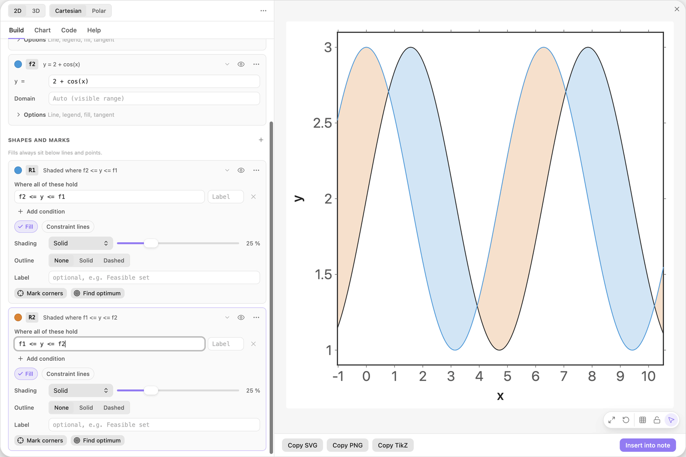
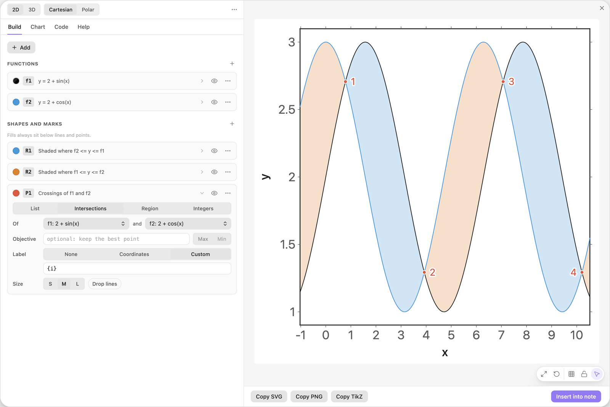
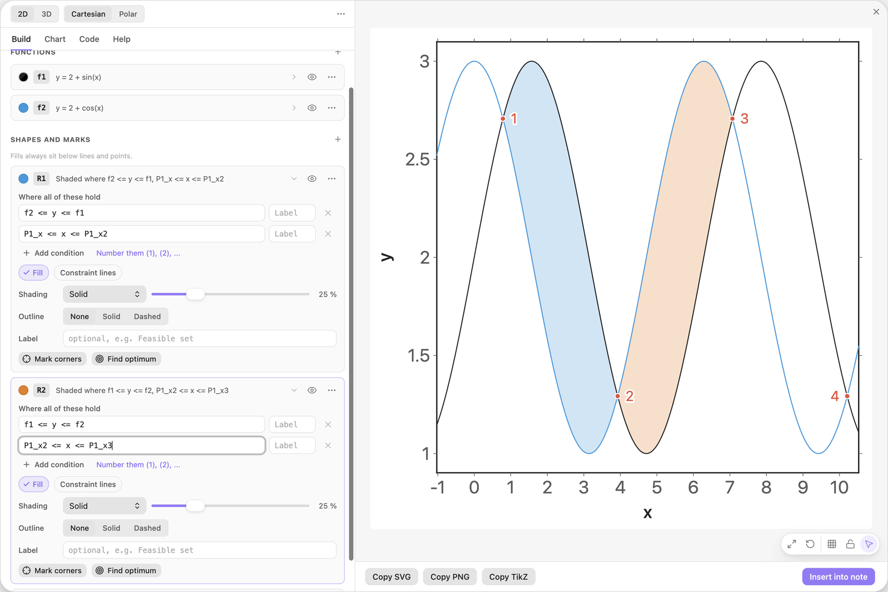
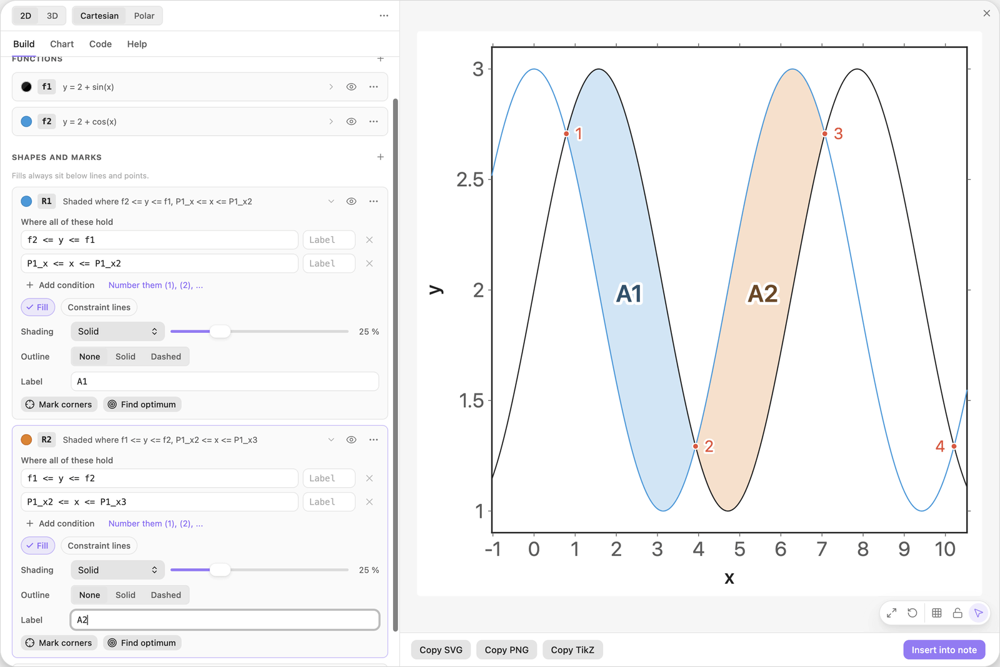

<!-- Generated by scripts/media/build-guides.mjs from src/guides. Do not edit. -->

# Shade the areas between two curves

[All guides](README.md) · Regions and optimisation · Core · about 7 minutes

Two curves, the areas between them in two colours, and their crossing points as the limits of the shading.

<p align="center"></p>

**What you can do afterwards**

- Shade the area where one function lies above another
- Give each area its own colour and label
- Mark the crossing points and use them as limits

**Read first:** [Your first chart](first-chart.md)

## 1. Type the first curve

Start with a new chart. The Build tab shows Start a chart. Click its formula field if the cursor is not in it yet, type the formula below and press Enter.

A card f1 appears under Functions and the preview draws the wave. The ranges fit themselves to the curve, because they were still the defaults.

| Where | Type |
| --- | --- |
| Start a chart | `2 + sin(x)` |



*The first formula becomes the function f1, and the view fits it.*

> **Tip:** Functions need brackets: write `sin(x)`, not `sin x`.

## 2. Add the second curve

Click + Add and choose Function y = f(x). Type the formula below into the new card f2. It gets the next free colour, blue.

The two curves cross several times. Between two crossings one of them is on top, and those are the pieces the next steps shade.

| Where | Type |
| --- | --- |
| f2, y = | `2 + cos(x)` |



*Two functions with the names f1 and f2. The names are what regions refer to.*

> **Tip:** Click the name badge on a card to rename a function. Every formula that uses the name is updated.

## 3. Shade where f1 is on top

Click + Add and choose Area between two functions. The new card R1 already holds the condition `f2 <= y <= f1`, built from your first two functions.

Read it as: y is at least f2 and at most f1. That is only possible where f1 lies above f2, so the preview shades exactly those pieces. A function name without brackets stands for its value at the current x.



*One condition shades every piece where the black curve lies above the blue one.*

> **Tip:** The order matters: `f2 <= y <= f1` shades nothing where f2 is on top. For both sides at once, write `min(f1, f2) <= y <= max(f1, f2)`.

## 4. Shade the other side in orange

Add a second Area between two functions in the same way. The card R2 gets the next colour, orange, and the same condition. Swap the two names so that it reads as below.

Now the pieces where f2 is on top are shaded too, in their own colour. Two regions, one per sign, are the usual way to show that the areas count with opposite signs in an integral.

| Where | Type |
| --- | --- |
| R2, condition 1 | `f1 <= y <= f2` |



*A second region with the names swapped shades the remaining pieces.*

> **Tip:** New regions take the next free colour by themselves. Click the colour swatch on a card to choose another one.

## 5. Mark the crossings

Click + Add and choose Intersections of two functions. The card P1 picks f1 and f2 by itself, marks every crossing in the view and labels it with its coordinates.

The coordinates are long and the waves leave little room, so number the crossings instead: on the card P1 set Label to Custom and type the text below. `{i}` prints 1 for the first crossing from the left, 2 for the second, and so on.

P1 also publishes what it found under names that every other field can use: `P1_x` and `P1_y` for crossing 1, `P1_x2` and `P1_y2` for crossing 2, `P1_x3` for crossing 3, and so on.

| Where | Type |
| --- | --- |
| P1, Label | `{i}` |



*Intersections are computed points, numbered here. Their coordinates are available as P1\_x, P1\_x2, P1\_x3, ...*

> **Tip:** No labels at all? Set Label to None on the P1 card. The points and their names stay.

## 6. Stop the shading at the crossings

Give each region a second row. On the card R1 click Add condition and type the first chain below. Do the same on R2 with the second chain.

R1 now keeps only the piece between the first and the second crossing, and R2 the piece between the second and the third. The limits are computed, so they stay right when you change one of the formulas.

| Where | Type |
| --- | --- |
| R1, condition 2 | `P1_x <= x <= P1_x2` |
| R2, condition 2 | `P1_x2 <= x <= P1_x3` |



*Each region ends at computed crossings instead of typed numbers.*

> **Tip:** Plain numbers work as well: `0 <= x <= 2pi` limits a region to one period.

## 7. Label the two areas

Type a name into the field Label of each region card.

Each name is printed in bold in the middle of its area, in the colour of the region. The chart is ready for Insert into note.

| Where | Type |
| --- | --- |
| R1, Label | `A1` |
| R2, Label | `A2` |



*Two areas, two colours, two labels.*

> **Tip:** A label can show a value: `A1 = {P1_x2 - P1_x:2}` prints the width of the first area with two decimals.

## The finished chart

Paste this block into a note to get the finished chart of this guide. Click the chart in the note to open it in the editor.

<details>
<summary>The chart as an easy-tikz block</summary>

```easy-tikz
{
  "v": 4,
  "dimension": false,
  "documentSetup": true,
  "title": "",
  "size_x_cm": 10,
  "size_y_cm": 10,
  "show_axis_label": true,
  "axis_label_x": "x",
  "axis_label_y": "y",
  "showAxis": true,
  "showLargeGrid": false,
  "showSmallGrid": false,
  "gridSize": 5,
  "majorTickNum": 8,
  "xmin": "-1.025",
  "xmax": "10.525",
  "ymin": "0.902",
  "ymax": "3.099",
  "zmin": "-5",
  "zmax": "5",
  "axis_style": "box",
  "coordinateSystem": "cartesian",
  "axis_label_x_polar": "",
  "axis_label_y_polar": "",
  "axis_label_z": "z",
  "rotationX": 30,
  "rotationZ": 45,
  "zoom3D": 1,
  "boxAspect": "true",
  "previewSize": 760,
  "functions": [
    {
      "expression": "2 + sin(x)",
      "domain": "",
      "showLegend": false,
      "fill": false,
      "fillOpacity": 0.2,
      "fillPattern": "solid",
      "tangent": false,
      "color": "black",
      "dashed": false,
      "tangentPoint": "",
      "extrema": false,
      "thickness": "thin",
      "parametric": false,
      "expressionY": "",
      "name": "f1"
    },
    {
      "expression": "2 + cos(x)",
      "domain": "",
      "showLegend": false,
      "fill": false,
      "fillOpacity": 0.2,
      "fillPattern": "solid",
      "tangent": false,
      "color": "blue",
      "dashed": false,
      "tangentPoint": "",
      "extrema": false,
      "thickness": "thin",
      "parametric": false,
      "expressionY": "",
      "name": "f2"
    }
  ],
  "functions3D": [],
  "tools": [
    {
      "type": "region",
      "color": "blue",
      "conditions": [
        "f2 <= y <= f1",
        "P1_x <= x <= P1_x2"
      ],
      "conditionLabels": [
        "",
        ""
      ],
      "fill": true,
      "fillOpacity": 0.25,
      "fillPattern": "solid",
      "outline": "none",
      "thickness": "thin",
      "constraintLines": false,
      "label": "A1",
      "id": "t0",
      "name": "R1"
    },
    {
      "type": "region",
      "color": "orange",
      "conditions": [
        "f1 <= y <= f2",
        "P1_x2 <= x <= P1_x3"
      ],
      "conditionLabels": [
        "",
        ""
      ],
      "fill": true,
      "fillOpacity": 0.25,
      "fillPattern": "solid",
      "outline": "none",
      "thickness": "thin",
      "constraintLines": false,
      "label": "A2",
      "id": "t1",
      "name": "R2"
    },
    {
      "type": "points",
      "color": "red",
      "dim": 2,
      "source": "intersections",
      "points": "",
      "ref1": "f1",
      "ref2": "f2",
      "regionName": "",
      "objective": "",
      "sense": "max",
      "label": "{i}",
      "dropLines": false,
      "size": "normal",
      "id": "t2",
      "name": "P1"
    }
  ],
  "annotations": [],
  "parameters": [],
  "variables": "x, y",
  "equalScale": false,
  "showSlidersInNote": true
}
```

</details>

## Next guides

- [Shade between a curve and its tangent](tangent-area.md): Write the tangent at a slider point as a function, shade the area it encloses with the curve, and make it work for any curve.
- [An area that grows with a slider](area-accumulation.md): Shade the area under a curve from 0 to a slider b, print its size, and draw the function that adds it up, so the height of one curve shows the area under the other.
- [Draw a market with surplus areas](supply-demand.md): Demand and supply, their equilibrium with guide lines, and consumer and producer surplus that follow a slider.
- [Points, intersections and live labels](points-labels.md): Mark points from a list, find where two curves cross, and print values that update when a slider moves.

[All guides](README.md)
