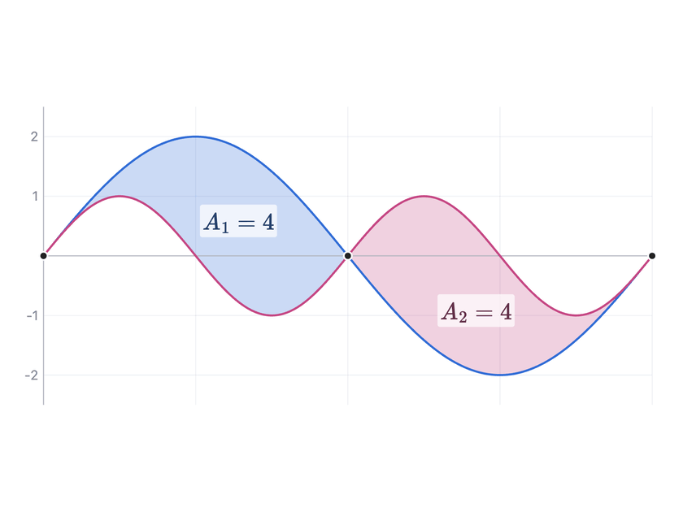
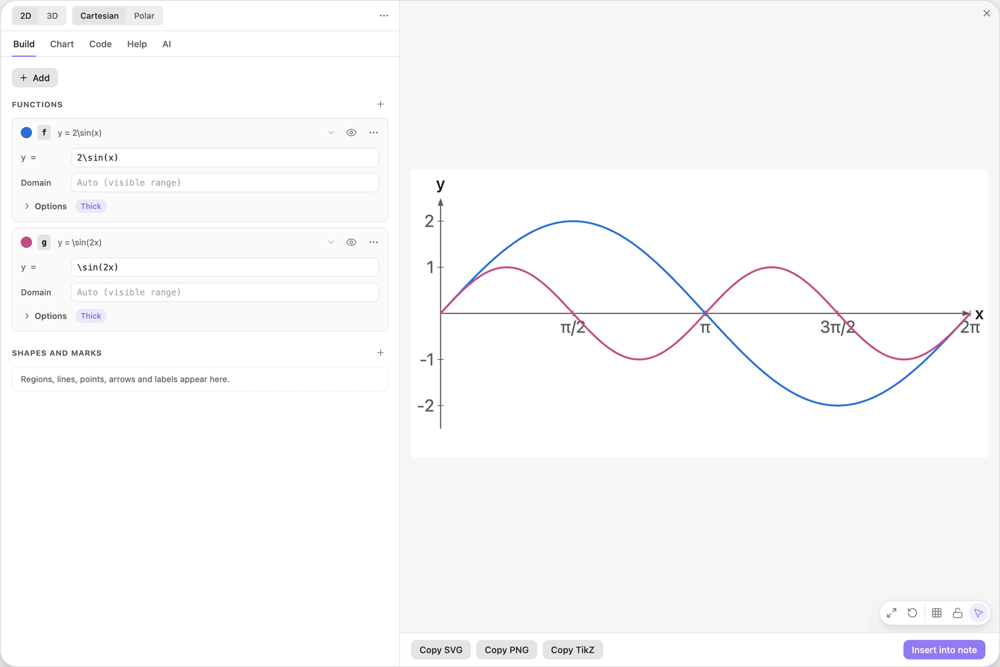
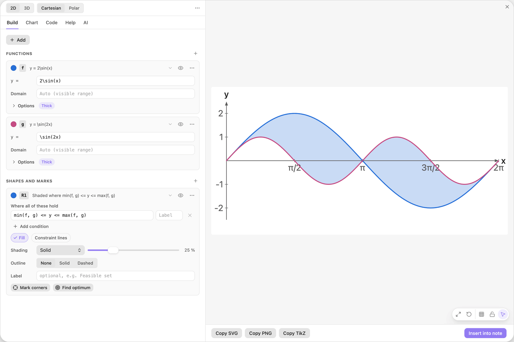
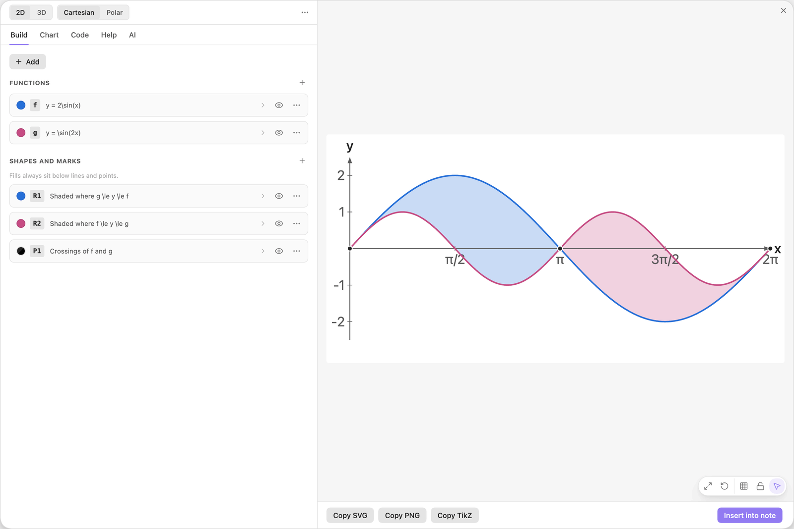

<!-- Generated by scripts/media/build-guides.mjs from src/guides. Do not edit. -->

# Shade the areas between two curves

[All guides](README.md) · Regions and optimisation · Core · about 3 minutes

Two waves, the areas between them split where they cross, each in its own colour and labelled.

<p align="center"></p>

**What you can do afterwards**

- Shade the area between two curves
- Give each side its own colour with a chain
- Label an area with math in dollars

**Read first:** [Shade a region with inequalities](regions.md)

## 1. Draw the two curves

Give each curve a name, `f` and `g`, so other lines can use it. `x numbers every pi/2` numbers the x axis in steps of π/2.

The chart in words:

```easy-tikz
show x from 0 to 2pi and y from -2.5 to 2.5
size 12 x 6
axes in the middle
x numbers every pi/2
plot $f(x) = 2\sin(x)$ in blue, thick
plot $g(x) = \sin(2x)$ in magenta, thick
```



## 2. Shade between them

`shade between f and g` fills every gap between the two curves, whichever lies on top. It is one region in one colour.

The chart gets these lines:

```easy-tikz
shade between f and g
```



## 3. Split the area where they cross

The chain `$g \le y \le f$` holds only where `f` lies above `g`. Write it both ways, each in its own colour, and mark where the curves cross.

The chart gets these lines:

```easy-tikz
shade where $g \le y \le f$
shade where $f \le y \le g$ in magenta
mark where f and g cross in black
```



> **Tip:** In a condition, a function name without brackets is its value at each x.

## 4. Label each area

`labelled` writes a label in the middle of each area. Both areas are 4: the integral of `2\sin(x) - \sin(2x)` from 0 to π gives the first.

The chart gets these lines:

```easy-tikz
shade where $g \le y \le f$, labelled "$A_1 = 4$"
shade where $f \le y \le g$ in magenta, labelled "$A_2 = 4$"
```


> **Tip:** Text between dollars in a label is set as math: `$A_1$` prints A with a small 1.

## The finished chart

Paste this block into a note to get the finished chart of this guide. Click the chart in the note to open it in the editor.

<details>
<summary>The chart as an easy-tikz block</summary>

```easy-tikz
show x from 0 to 2pi and y from -2.5 to 2.5
size 12 x 6
axes in the middle
x numbers every pi/2
plot $f(x) = 2\sin(x)$ in blue, thick
plot $g(x) = \sin(2x)$ in magenta, thick
shade where $g \le y \le f$, labelled "$A_1 = 4$"
shade where $f \le y \le g$ in magenta, labelled "$A_2 = 4$"
mark where f and g cross in black
```

</details>

## Next guides

- [Shade between a curve and its tangent](tangent-area.md): Write the tangent at a slider point as a function and shade the area it encloses with the curve.
- [Draw a market with surplus areas](supply-demand.md): Demand and supply, the equilibrium with lines to the axes, and both surpluses following a demand slider.

[All guides](README.md)
