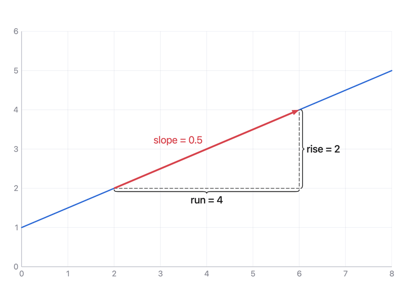
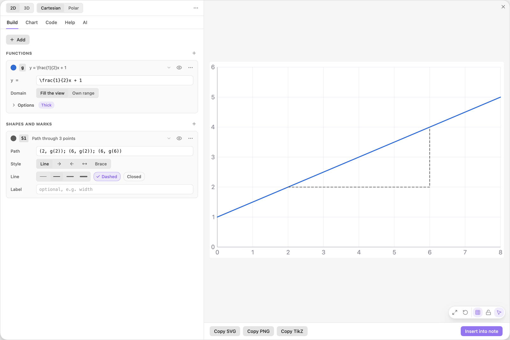
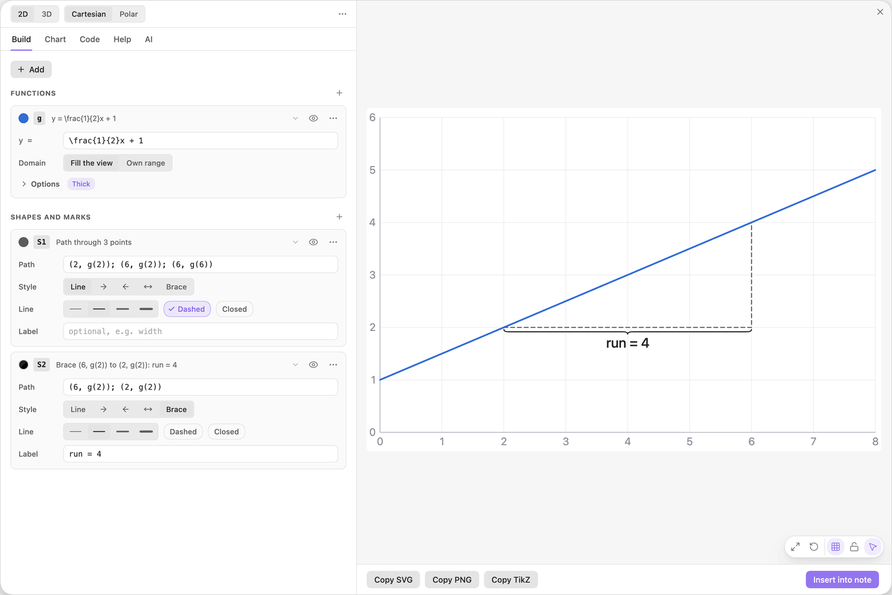
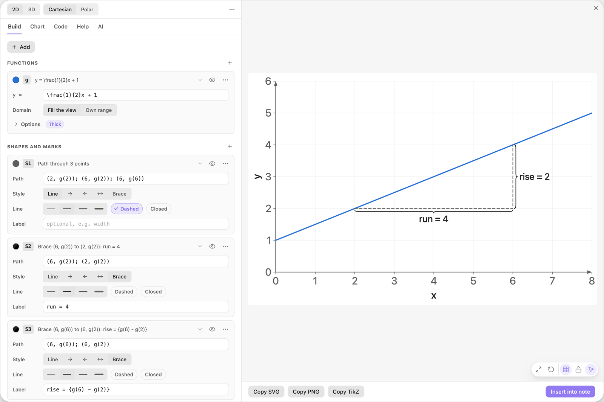
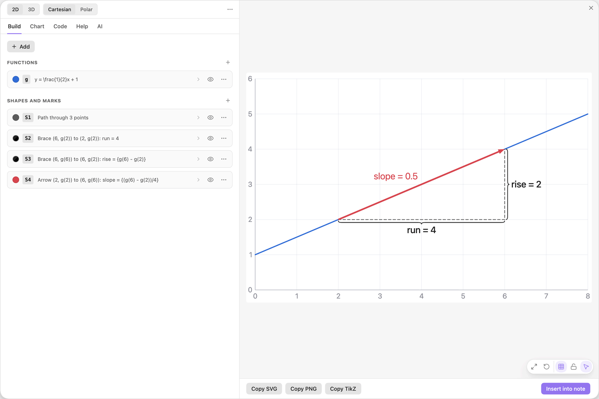
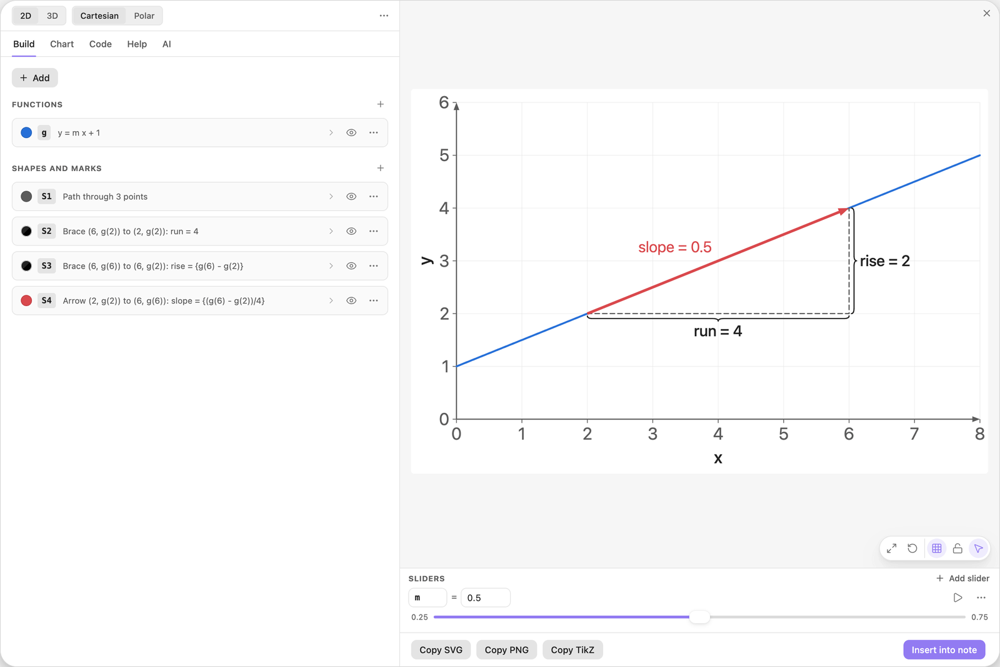

<!-- Generated by scripts/media/build-guides.mjs from src/guides. Do not edit. -->

# Segments, arrows and braces

[All guides](README.md) · Points, lines and labels · Core · about 3 minutes

Draw a slope triangle: a path for the run and the rise, braces with live labels and an arrow.

<p align="center"></p>

**What you can do afterwards**

- Draw paths, arrows and braces through points
- Label a brace with a value computed from a function
- Read a slope as rise over run

**Read first:** [Write a chart in words](chart-language.md)

## 1. Draw a path through points

`draw a line from A to B to C` joins the points. This one runs 4 across from the line, then up to it again: the run and the rise.

The chart in words:

```easy-tikz
show x from 0 to 8 and y from 0 to 6
size 12 x 8
axes on the edges
with a grid
plot $g(x) = \frac{1}{2}x + 1$ in blue, thick
draw a line from (2, g(2)) to (6, g(2)) to (6, g(6)) in gray, dashed
```



## 2. Label the run with a brace

A brace spans two points and carries a label. It bulges to the left of its direction, so drawn from right to left it hangs below.

The chart gets these lines:

```easy-tikz
draw a brace from (6, g(2)) to (2, g(2)), labelled "run = 4"
```



> **Tip:** Swap the two points to flip a brace to the other side.

## 3. Print the rise as a value

Curly brackets in a label compute: `{g(6) - g(2)}` reads the rise off the line, so the label stays right when the line changes.

The chart gets these lines:

```easy-tikz
draw a brace from (6, g(6)) to (6, g(2)), labelled "rise = {g(6) - g(2)}"
```



## 4. Draw the slope as an arrow

An arrow is a vector from its tail to its head: here 4 across and 2 up. Its label divides the rise by the run: the slope.

The chart gets these lines:

```easy-tikz
draw an arrow from (2, g(2)) to (6, g(6)) in red, very thick, labelled "slope = {(g(6) - g(2))/4}"
```



> **Tip:** `draw a double arrow from A to B` puts a head at both ends.

## 5. Turn the line with a slider

Make the slope a slider `m`. Drag it: the line turns, and the rise, its brace and the arrow follow.

The chart gets these lines:

```easy-tikz
slider m from 0.25 to 0.75, starting at 0.5
plot g(x) = m x + 1 in blue, thick
```



## The finished chart

Paste this block into a note to get the finished chart of this guide. Click the chart in the note to open it in the editor.

<details>
<summary>The chart as an easy-tikz block</summary>

```easy-tikz
show x from 0 to 8 and y from 0 to 6
size 12 x 8
axes on the edges
with a grid
slider m from 0.25 to 0.75, starting at 0.5
plot g(x) = m x + 1 in blue, thick
draw a line from (2, g(2)) to (6, g(2)) to (6, g(6)) in gray, dashed
draw a brace from (6, g(2)) to (2, g(2)), labelled "run = 4"
draw a brace from (6, g(6)) to (6, g(2)), labelled "rise = {g(6) - g(2)}"
draw an arrow from (2, g(2)) to (6, g(6)) in red, very thick, labelled "slope = {(g(6) - g(2))/4}"
```

</details>

## Next guides

- [Calculate with computed points](computed-values.md): Use what crossing points publish, their count and coordinates, in a title, a new point and an area.
- [Points and live labels](points-labels.md): Mark points from a list or from a formula, name them in LaTeX and print their values in labels.

[All guides](README.md)
