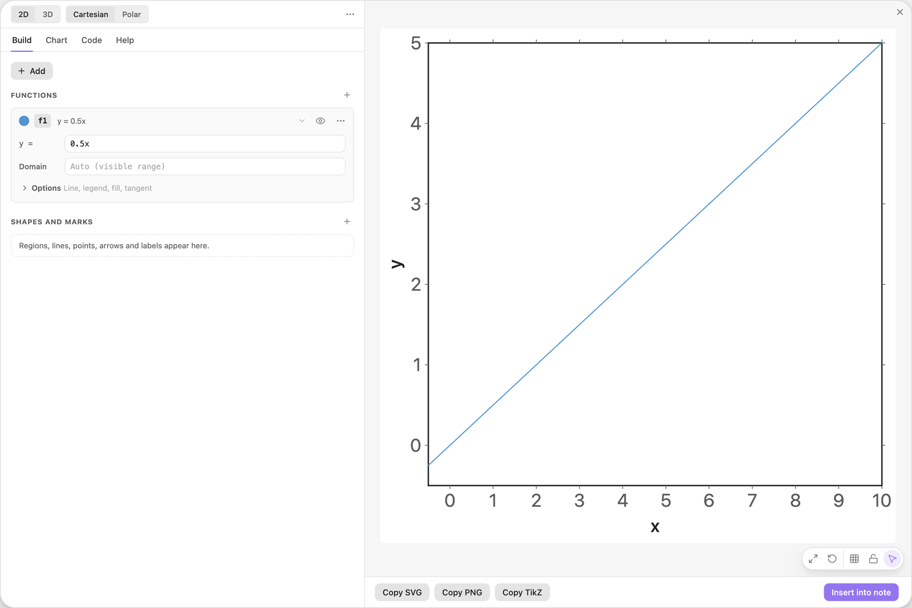
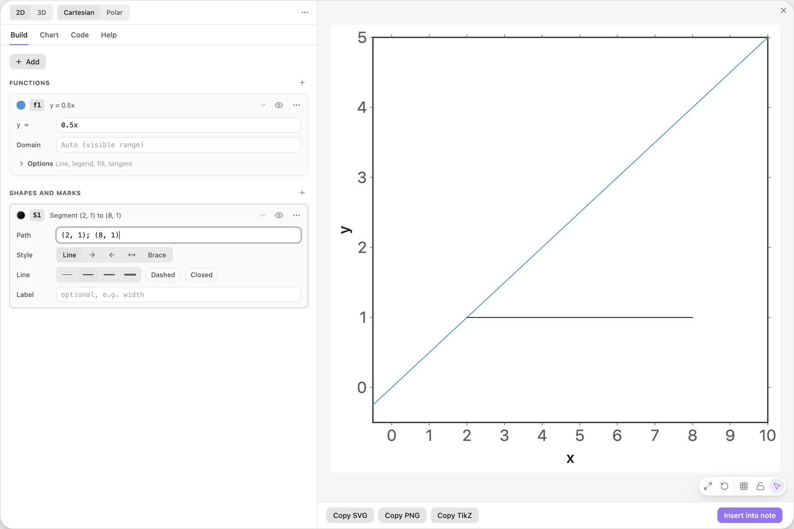
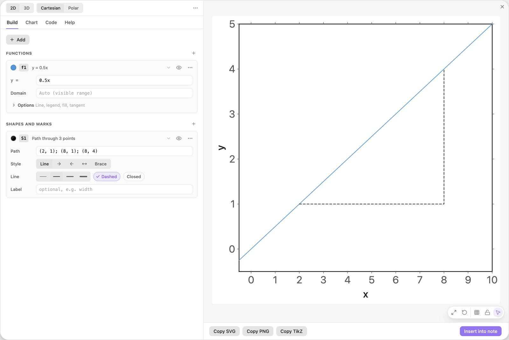
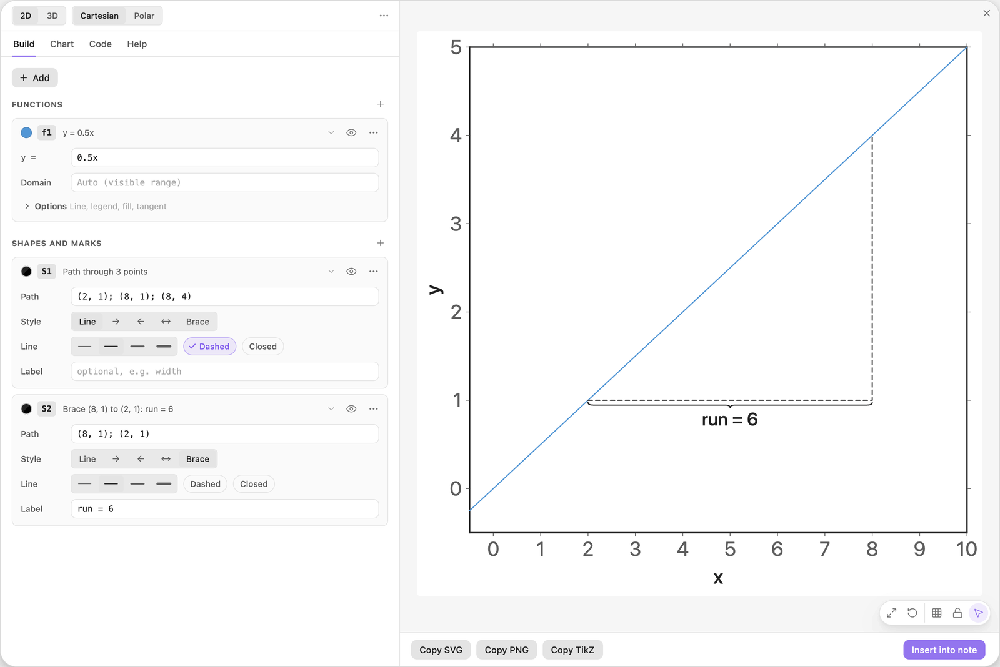
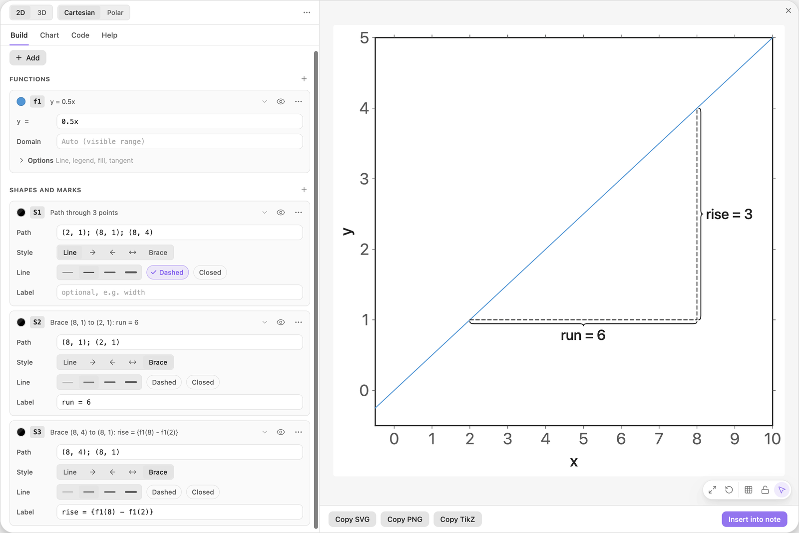
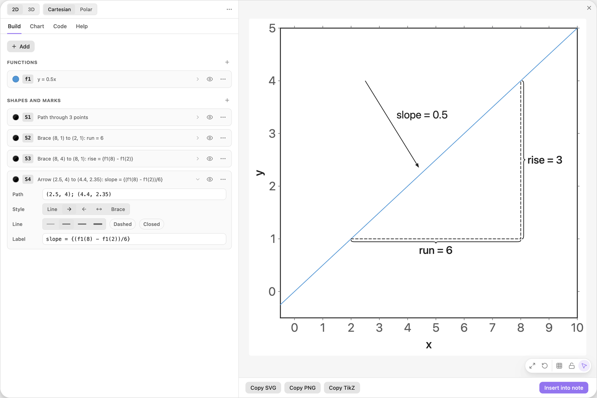
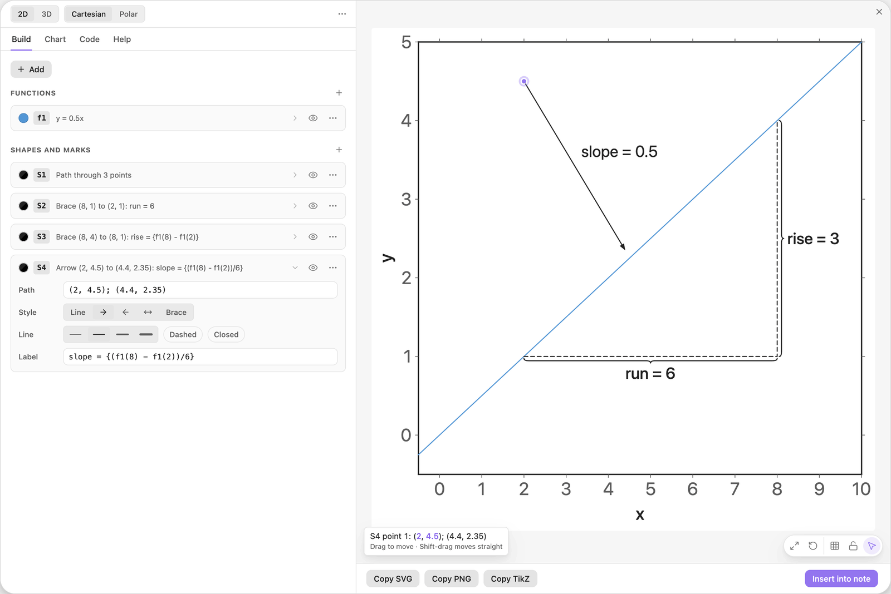

<!-- Generated by scripts/media/build-guides.mjs from src/guides. Do not edit. -->

# Segments, arrows and braces

[All guides](README.md) · Points, lines and labels · Core · about 10 minutes

Draw a slope triangle on a line: a polyline for run and rise, two braces with labels and an arrow that points at the line.

<p align="center"></p>

**What you can do afterwards**

- Draw segments and polylines through points you type
- Add braces with labels and flip them to the other side
- Point at things with arrows and adjust their ends by dragging

**Read first:** [Your first chart](first-chart.md)

## 1. Start with a line

Open the editor on an empty chart. Click + Add and choose Function y = f(x), then type the formula into the `y =` field of the card f1.

Click the round colour swatch at the left of the card and pick Blue. The annotations you add next are black, so the line stays easy to tell apart.

| Where | Type |
| --- | --- |
| f1, y = | `0.5x` |



*The line y = 0.5x in the default view.*

> **Tip:** Typing the first formula into Start a chart also fits the view to it. Reset ranges (the round arrow in the action pill of the preview) brings back the default view this guide uses.

## 2. Draw a line segment

Click + Add and choose Line segment. The card S1 starts with a sample path. Replace it with the path below.

A path is a list of points separated by `;`. Two points make a straight segment: here the horizontal run from x = 2 to x = 8, starting on the line.

| Where | Type |
| --- | --- |
| S1, Path | `(2, 1); (8, 1)` |



*S1 is a segment between two typed points.*

> **Tip:** Coordinates are formulas, not just numbers. `(2, f1(2)); (8, f1(2))` draws the same segment and keeps it on the line when you change f1.

## 3. Extend it to a polyline

Add a third point to the path, then switch on Dashed in the Line row. The path now turns the corner and climbs back to the line: first the run, then the rise. The summary on the card changes to Path through 3 points.

| Where | Type |
| --- | --- |
| S1, Path | `(2, 1); (8, 1); (8, 4)` |



*Three points make a polyline: run, then rise.*

> **Tip:** Closed (next to Dashed) joins the last point back to the first and turns the path into a polygon outline.

## 4. Label the run with a brace

Click + Add and choose Brace with label. In the card S2, type the path and the label below.

A brace spans the first two points of its path and carries its label at its tip.

| Where | Type |
| --- | --- |
| S2, Path | `(8, 1); (2, 1)` |
| S2, Label | `run = 6` |



*A brace under the run. Its path is written from right to left.*

> **Tip:** A brace bulges to the left of the direction from its first point to its second. Written from right to left, as here, it hangs below the segment. Swap the two points to flip it.

## 5. Label the rise with a live value

Add a second brace: + Add, then Brace with label. This one runs from top to bottom, so it bulges to the right, away from the triangle.

Its label is a template. The part in braces is computed: `f1(8) - f1(2)` is how far the line rises over the run, so the label reads rise = 3 and stays correct when you change the formula of f1.

| Where | Type |
| --- | --- |
| S3, Path | `(8, 4); (8, 1)` |
| S3, Label | `rise = {f1(8) - f1(2)}` |



*The second brace prints a value computed from the line.*

> **Tip:** A number after a colon limits the decimals: `{f1(8) - f1(2):1}` prints at most one. Without it, a value prints with up to three decimals.

## 6. Point at the line with an arrow

Click + Add and choose Arrow. In the card S4, type the path and the label below. The arrow starts in the empty space above the line and ends just above it.

In the Style row, the button with the head at the end is selected. The buttons next to it put the head at the start or at both ends.

| Where | Type |
| --- | --- |
| S4, Path | `(2.5, 4); (4.4, 2.35)` |
| S4, Label | `slope = {(f1(8) - f1(2))/6}` |



*An arrow with a computed label points at the line.*

> **Tip:** With an arrow style, a path through more than two points gets a head on every leg.

## 7. Drag an end to fine-tune

In the preview, grab the tail of the arrow and drag it up and to the left, to about (2, 4.5). The numbers of that point in Path follow the pointer, rounded to what the screen can show (hundredths at this zoom), so yours may read (2.05, 4.47). Close to a grid point the end snaps onto it.

Grab the arrow by its shaft instead and the whole arrow moves.



*The tail of the arrow after the drag. The Path field shows the new numbers.*

> **Tip:** Hold Shift while you drag an end and it moves straight: horizontally, vertically or diagonally.

## The finished chart

Paste this block into a note to get the finished chart of this guide. Click the chart in the note to open it in the editor.

<details>
<summary>The chart as an easy-tikz block</summary>

```easy-tikz
{
  "v": 4,
  "dimension": false,
  "documentSetup": true,
  "title": "",
  "size_x_cm": 10,
  "size_y_cm": 10,
  "show_axis_label": true,
  "axis_label_x": "x",
  "axis_label_y": "y",
  "showAxis": true,
  "showLargeGrid": false,
  "showSmallGrid": false,
  "gridSize": 5,
  "majorTickNum": 8,
  "xmin": "-0.5",
  "xmax": "10",
  "ymin": "-0.5",
  "ymax": "5",
  "zmin": "-5",
  "zmax": "5",
  "axis_style": "box",
  "coordinateSystem": "cartesian",
  "axis_label_x_polar": "",
  "axis_label_y_polar": "",
  "axis_label_z": "z",
  "rotationX": 30,
  "rotationZ": 45,
  "zoom3D": 1,
  "boxAspect": "true",
  "previewSize": 760,
  "functions": [
    {
      "expression": "0.5x",
      "domain": "",
      "showLegend": false,
      "fill": false,
      "fillOpacity": 0.2,
      "fillPattern": "solid",
      "tangent": false,
      "color": "blue",
      "dashed": false,
      "tangentPoint": "",
      "extrema": false,
      "thickness": "thin",
      "parametric": false,
      "expressionY": "",
      "name": "f1"
    }
  ],
  "functions3D": [],
  "tools": [
    {
      "type": "segment",
      "color": "black",
      "dim": 2,
      "path": "(2, 1); (8, 1); (8, 4)",
      "closed": false,
      "style": "line",
      "thickness": "thin",
      "dashed": true,
      "label": "",
      "id": "t0",
      "name": "S1"
    },
    {
      "type": "segment",
      "color": "black",
      "dim": 2,
      "path": "(8, 1); (2, 1)",
      "closed": false,
      "style": "brace",
      "thickness": "thin",
      "dashed": false,
      "label": "run = 6",
      "id": "t1",
      "name": "S2"
    },
    {
      "type": "segment",
      "color": "black",
      "dim": 2,
      "path": "(8, 4); (8, 1)",
      "closed": false,
      "style": "brace",
      "thickness": "thin",
      "dashed": false,
      "label": "rise = {f1(8) - f1(2)}",
      "id": "t2",
      "name": "S3"
    },
    {
      "type": "segment",
      "color": "black",
      "dim": 2,
      "path": "(2, 4.5); (4.4, 2.35)",
      "closed": false,
      "style": "forward",
      "thickness": "thin",
      "dashed": false,
      "label": "slope = {(f1(8) - f1(2))/6}",
      "id": "t3",
      "name": "S4"
    }
  ],
  "annotations": [],
  "parameters": [],
  "variables": "x, y",
  "equalScale": false,
  "showSlidersInNote": true
}
```

</details>

## Next guides

- [Points, intersections and live labels](points-labels.md): Mark points from a list, find where two curves cross, and print values that update when a slider moves.
- [Drag shapes to edit them](drag-to-edit.md): Grab a line or a curve in the preview and its numbers follow: move, turn, stretch, undo.
- [Tangents and extrema](tangents-extrema.md): Mark the turning points of a function, add a tangent, slide it along the curve and label its slope.

[All guides](README.md)
