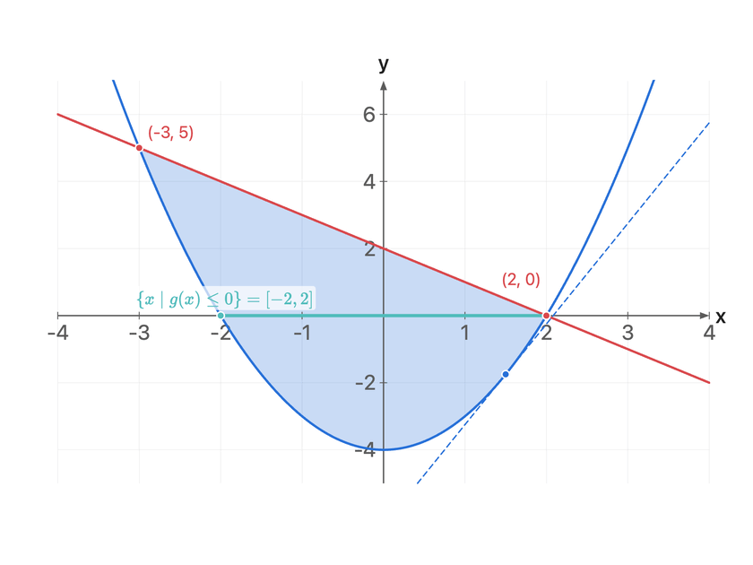
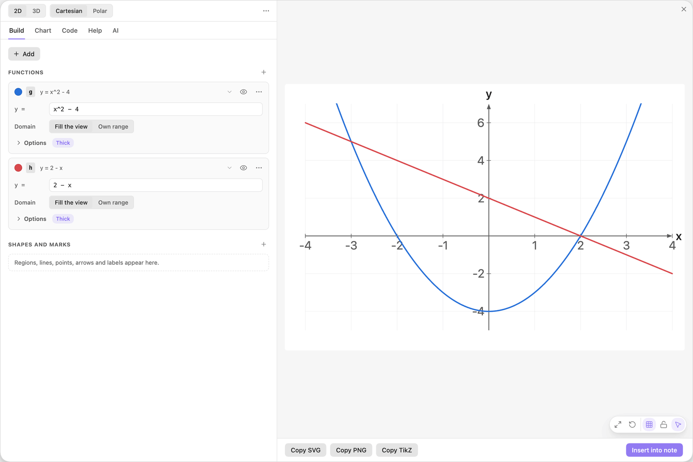
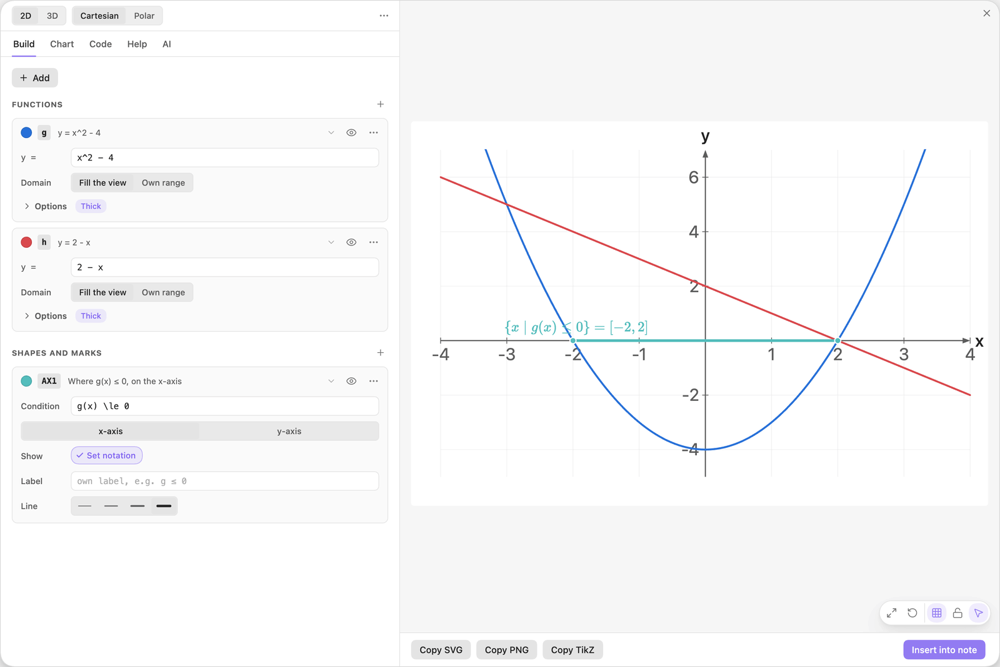
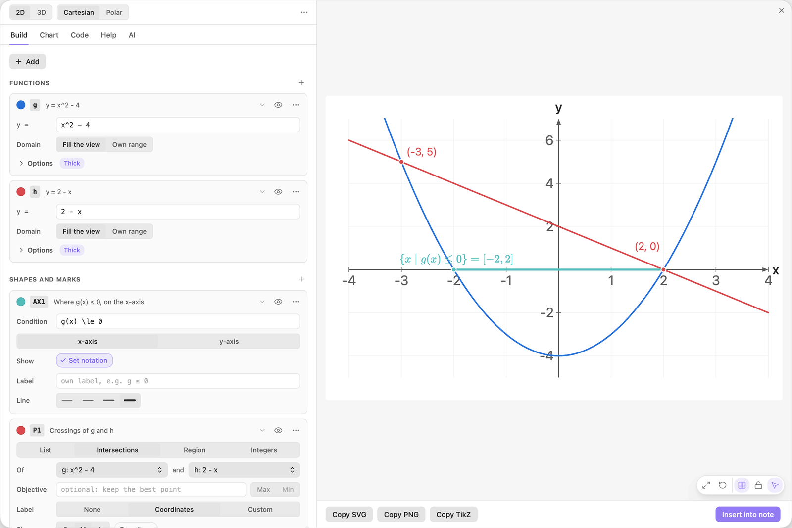
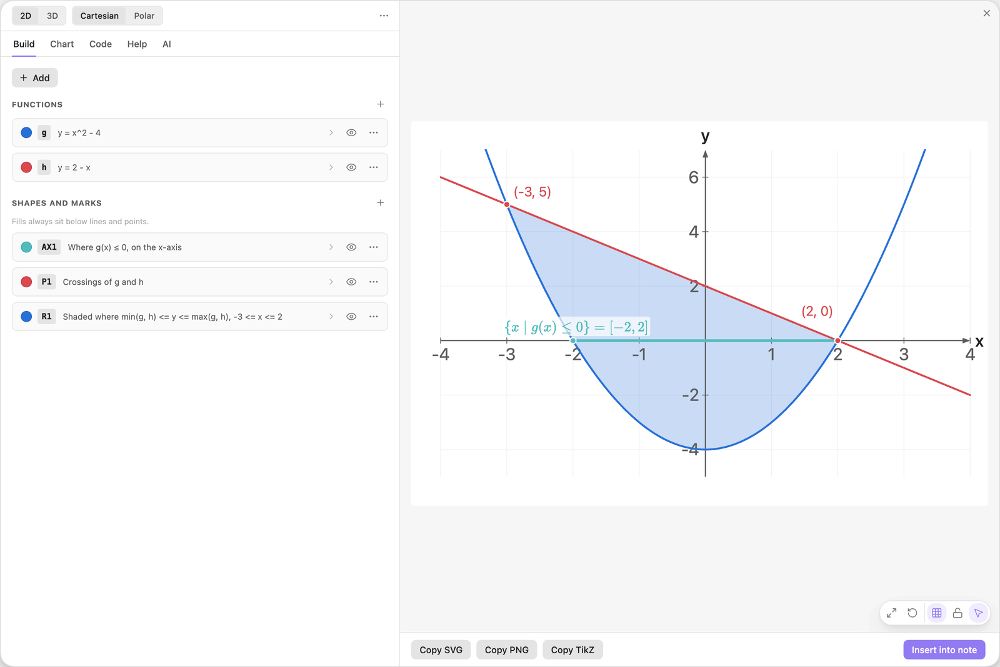

<!-- Generated by scripts/media/build-guides.mjs from src/guides. Do not edit. -->

# Ask the curve

[All guides](README.md) · Getting started · Start here · about 2 minutes

Click a curve in the preview and choose a question: its answer, a set, a crossing or an area, joins the chart.

<p align="center"></p>

**What you can do afterwards**

- Open the questions of a curve
- Add an answer to the chart
- Take an answer away again

**Read first:** [Your first chart](first-chart.md)

## 1. Click a curve

Plot two functions. In the preview of the editor, click the curve g: a menu of questions about g opens. Point at a question to see its answer faintly.

The chart in words:

```easy-tikz
show x from -4 to 4 and y from -5 to 7
size 12 x 8
axes in the middle
with a grid
plot g(x) = x^2 - 4 in blue, thick
plot h(x) = 2 - x in red, thick
```



> **Tip:** Press `?` on the preview to ask from the keyboard. A chart under a block in a note asks too.

## 2. Ask where g ≤ 0

Choose "Where is g ≤ 0?". The answer is a new line: the set on the x-axis, with its interval.

The chart gets these lines:

```easy-tikz
mark where $g(x) \le 0$ on the x-axis, labelled
```



## 3. Ask where g and h cross

The questions under "With h" are about both curves. "Where do g and h cross?" marks the crossings with their coordinates.

The chart gets these lines:

```easy-tikz
mark where g and h cross, with coordinates
```



## 4. Ask for the area between them

"The area between g and h" shades the area between the two crossings around the point you clicked.

The chart gets these lines:

```easy-tikz
shade between g and h from x = -3 to 2
```



## 5. Ask for the tangent here

"The tangent here" puts the tangent where you clicked, at x = 1.5. An answered question has a tick: choose it again to take its line away.

The chart gets these lines:

```easy-tikz
plot g(x) = x^2 - 4 in blue, thick, with its tangent at 1.5
```


## The finished chart

Paste this block into a note to get the finished chart of this guide. Click the chart in the note to open it in the editor.

<details>
<summary>The chart as an easy-tikz block</summary>

```easy-tikz
show x from -4 to 4 and y from -5 to 7
size 12 x 8
axes in the middle
with a grid
plot g(x) = x^2 - 4 in blue, thick, with its tangent at 1.5
plot h(x) = 2 - x in red, thick
mark where $g(x) \le 0$ on the x-axis, labelled
mark where g and h cross, with coordinates
shade between g and h from x = -3 to 2
```

</details>

## Next guides

- [Sets and convex functions](sets-convexity.md): Mark where g(x) ≤ 0 on the x-axis, read the set as intervals and test convexity with a chord.
- [Drag shapes to edit them](drag-to-edit.md): Grab a line or a curve in the preview and its numbers follow: move, turn, stretch, undo.

[All guides](README.md)
