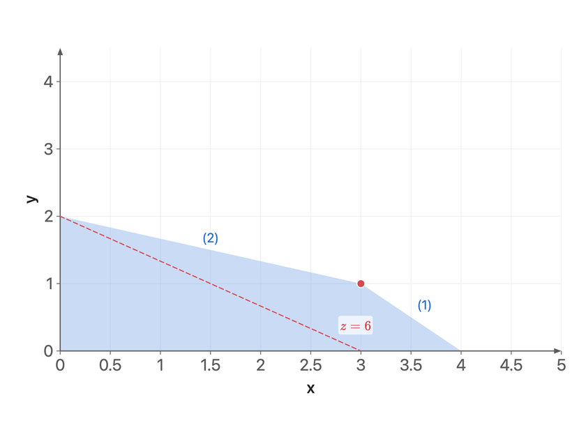
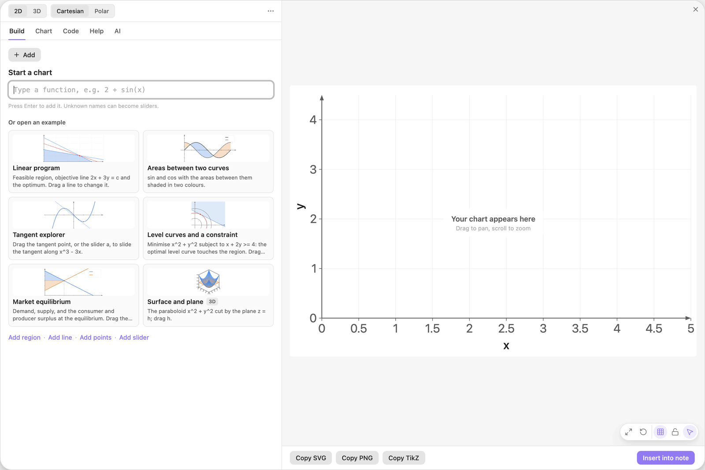
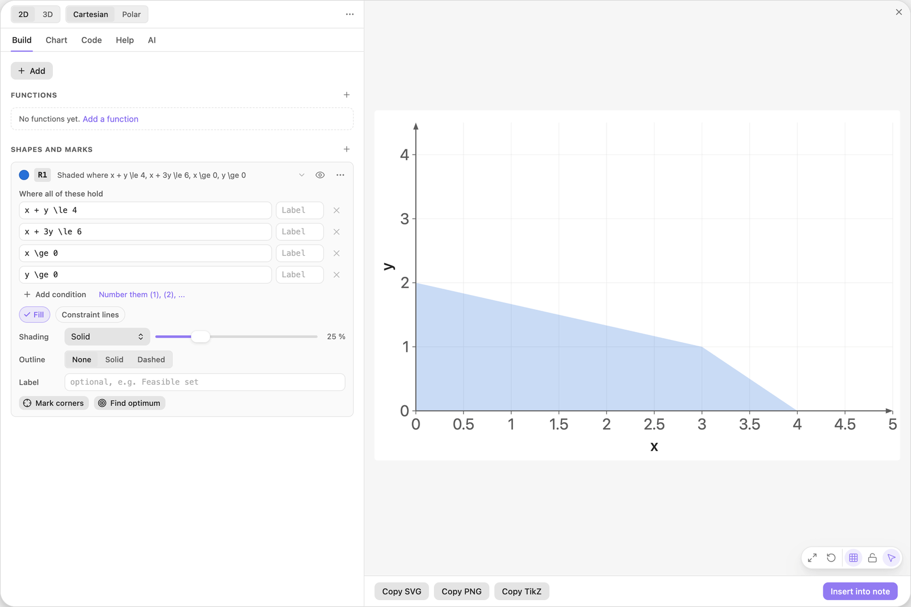
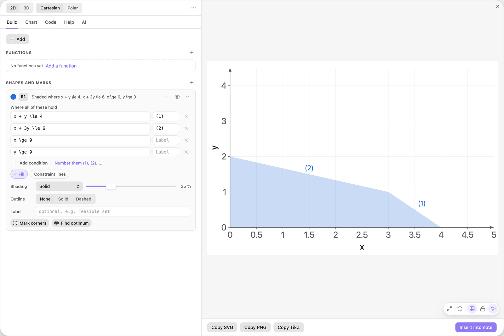
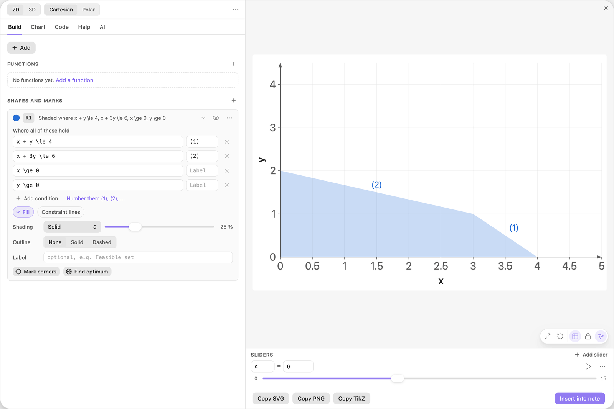
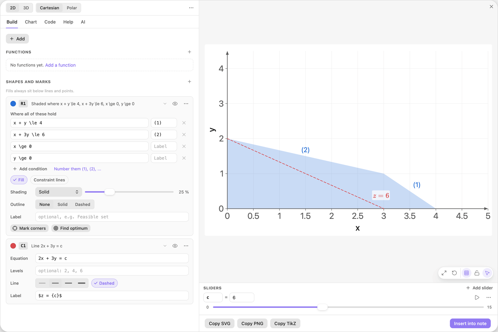
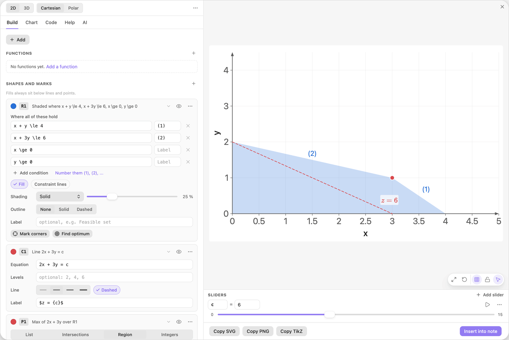

<!-- Generated by scripts/media/build-guides.mjs from src/guides. Do not edit. -->

# Write a chart in words

[All guides](README.md) · Chart language · Start here · about 3 minutes

Build a linear program line by line: the window, a region, a slider, a moving line and the best point.

<p align="center"></p>

**What you can do afterwards**

- Write a chart as lines of words
- Put formulas in `$...$`, as in your notes
- Use a slider in a formula and in a label

## 1. Say what to show

A chart starts with its window: the x and y it shows, the axes and a grid. Each line says one thing.

The chart in words:

```easy-tikz
show x from 0 to 5 and y from 0 to 4.5
size 12 x 8
axes on the edges
with a grid
```



## 2. Shade a region

Write the conditions in LaTeX between dollars, as in your notes. The chart shades where all of them hold.

The chart gets these lines:

```easy-tikz
shade where $x + y \le 4$ and $x + 3y \le 6$ and $x \ge 0$ and $y \ge 0$
```



## 3. Number the conditions

Words after a comma change how a line draws: `numbered` numbers the conditions on the edges they make.

The chart gets these lines:

```easy-tikz
shade where $x + y \le 4$ and $x + 3y \le 6$ and $x \ge 0$ and $y \ge 0$, numbered
```



## 4. Add a slider

A slider is a letter you can drag. Here `c` goes from 0 to 15 and starts at 6.

The chart gets these lines:

```easy-tikz
slider c from 0 to 15, starting at 6
```



## 5. Draw a line that moves

Use `c` in a formula and the line follows the slider. `{c}` in a label shows its value. Drag `c` now.

The chart gets these lines:

```easy-tikz
draw 2x + 3y = c in red, dashed, labelled "$z = {c}$"
```



## 6. Mark the best point

The chart finds where `2x + 3y` is largest in the region and marks it. Drag `c` until the line touches it.

The chart gets these lines:

```easy-tikz
mark the maximum of 2x + 3y in the region, large
```



> **Tip:** Open in the editor shows the same chart in the Build tab, where every line is a card.

## The finished chart

Paste this block into a note to get the finished chart of this guide. Click the chart in the note to open it in the editor.

<details>
<summary>The chart as an easy-tikz block</summary>

```easy-tikz
show x from 0 to 5 and y from 0 to 4.5
size 12 x 8
axes on the edges
with a grid
slider c from 0 to 15, starting at 6
shade where $x + y \le 4$ and $x + 3y \le 6$ and $x \ge 0$ and $y \ge 0$, numbered
draw 2x + 3y = c in red, dashed, labelled "$z = {c}$"
mark the maximum of 2x + 3y in the region, large
```

</details>

## Next guides

- [Write formulas as in your notes](formulas.md): Write LaTeX in dollars, where `ax` is a times x, or plain formulas, and limit a curve with a domain.
- [Solve a linear program in a picture](linear-program.md): Constraint lines, the feasible region and its corners, an objective line on a slider, the maximum and the minimum.

[All guides](README.md)
