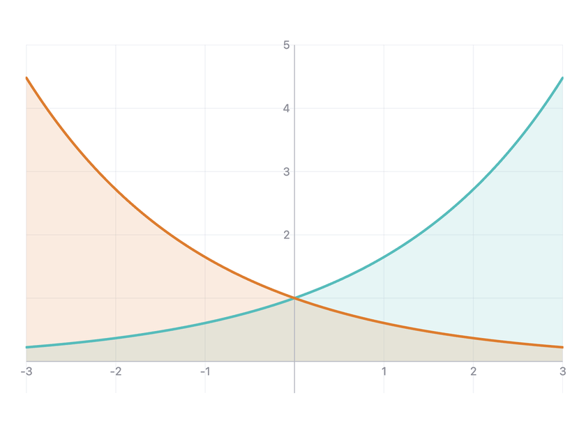
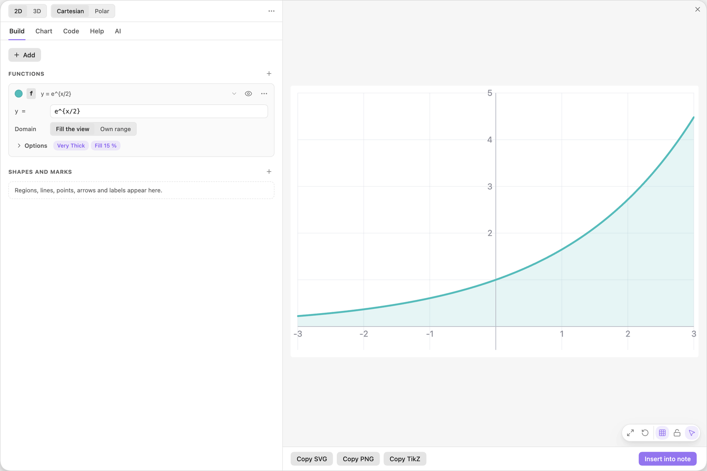
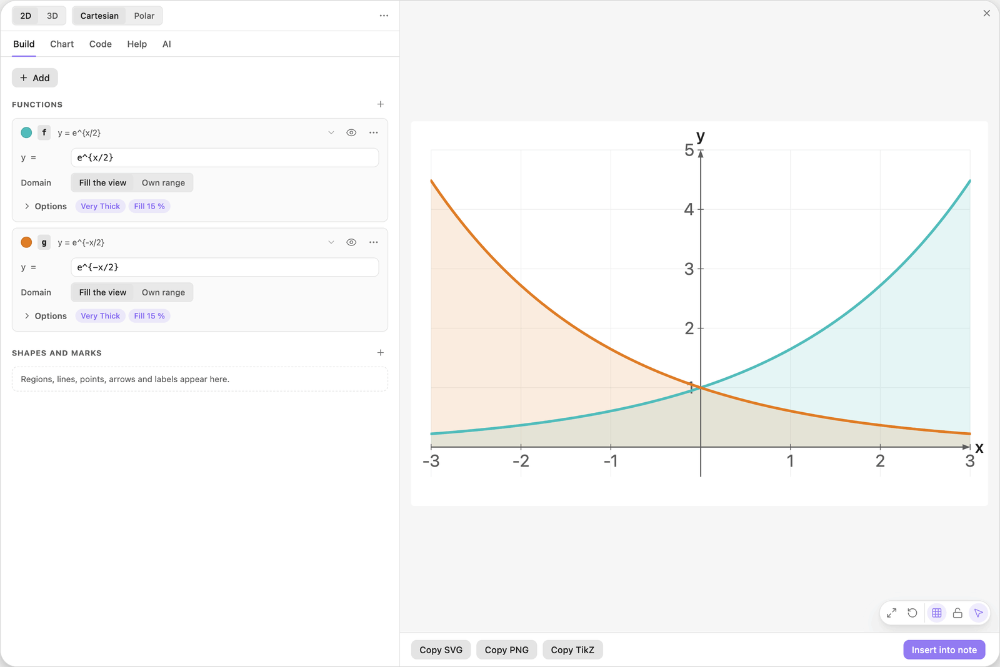
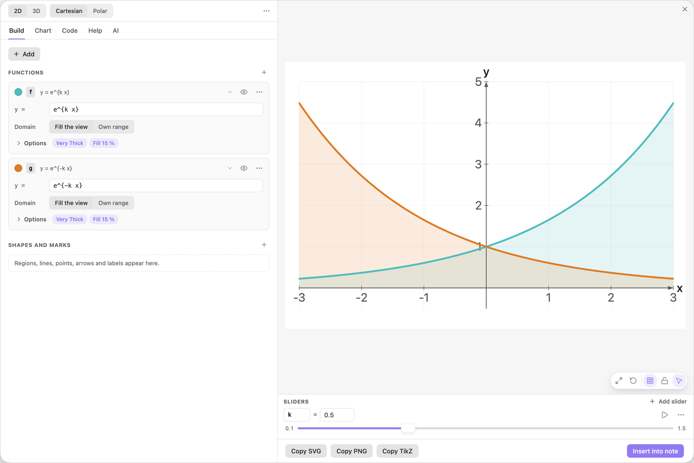

<!-- Generated by scripts/media/build-guides.mjs from src/guides. Do not edit. -->

# Charts in your notes

[All guides](README.md) · Notes and export · Start here · about 3 minutes

Insert a chart into a note, edit it again, and move its sliders there, also across charts.

<p align="center"></p>

**What you can do afterwards**

- Insert a chart and open it again from the note
- Use the sliders under a chart without changing the note
- Connect sliders of the same name across charts

**Read first:** [Your first chart](first-chart.md)

## 1. Insert a chart into a note

Put the cursor in a note and open the editor with the ribbon icon. Insert into note, or Cmd+Enter (Ctrl+Enter on Windows), writes the chart there as lines like these.

The chart in words:

```easy-tikz
show x from -3 to 3 and y from -0.5 to 5
size 12 x 8
axes in the middle
with a grid
plot $f(x) = e^{x/2}$ in teal, very thick, filled, opacity 0.15
```



> **Tip:** A formula in a note has a chart too: rest the pointer on it and click Insert chart.

## 2. Click the chart to edit it

Click the chart in the note, and the editor opens with it. Add a curve and click Save changes: the block in the note gets the new line.

The chart gets these lines:

```easy-tikz
plot $g(x) = e^{-x/2}$ in orange, very thick, filled, opacity 0.15
```



## 3. Move its slider in the note

A slider such as `k` shows under the chart in the note. Dragging it changes the picture, never the note; the round arrow goes back to the saved value.

The chart gets these lines:

```easy-tikz
slider k from 0.1 to 1.5, starting at 0.5
plot $f(x) = e^{k x}$ in teal, very thick, filled, opacity 0.15
plot $g(x) = e^{-k x}$ in orange, very thick, filled, opacity 0.15
```


## 4. Connect sliders across charts

Add `connected` to a slider here and to the slider of the same name in another chart of the note. Moving one then moves both.

The chart gets these lines:

```easy-tikz
slider k from 0.1 to 1.5, starting at 0.5, connected
```



> **Tip:** In the note, the link button at the end of a slider row switches it; in the editor, Connect with others.

## The finished chart

Paste this block into a note to get the finished chart of this guide. Click the chart in the note to open it in the editor.

<details>
<summary>The chart as an easy-tikz block</summary>

```easy-tikz
show x from -3 to 3 and y from -0.5 to 5
size 12 x 8
axes in the middle
with a grid
slider k from 0.1 to 1.5, starting at 0.5, connected
plot $f(x) = e^{k x}$ in teal, very thick, filled, opacity 0.15
plot $g(x) = e^{-k x}$ in orange, very thick, filled, opacity 0.15
```

</details>

## Next guides

- [Charts as SVG files](svg-files.md): Keep every chart of a note as an SVG file too, for Obsidian Publish, GitHub and other apps.
- [Export to LaTeX](export-latex.md): Copy a chart as pgfplots code, compile it with pdflatex, or take only the picture for your document.

[All guides](README.md)
