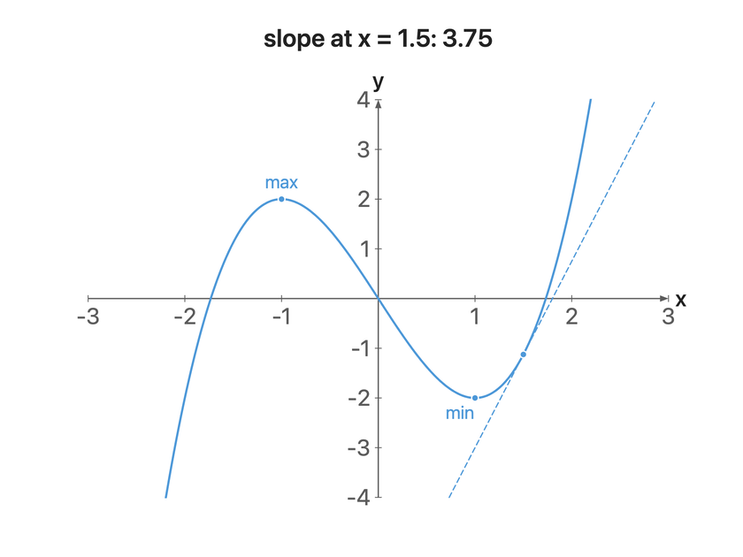
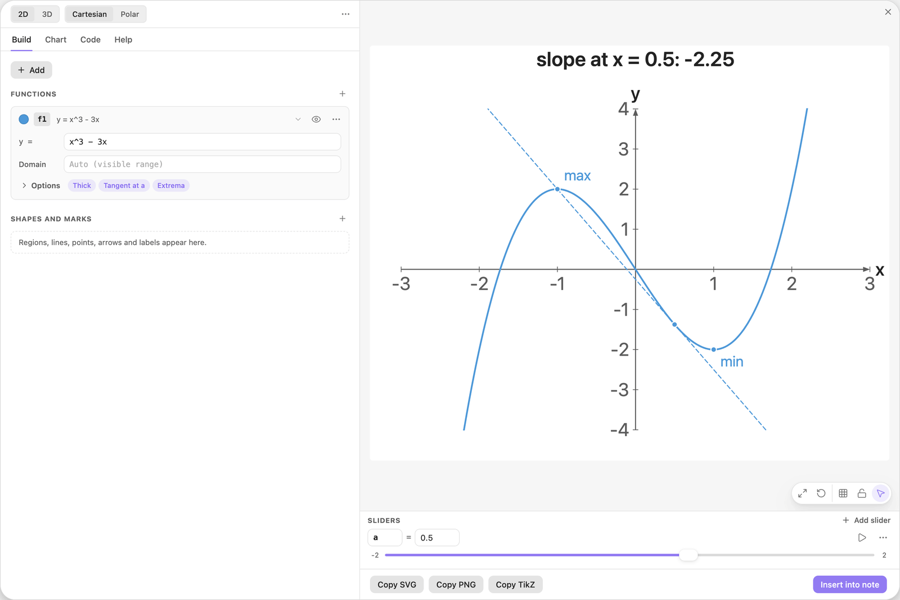
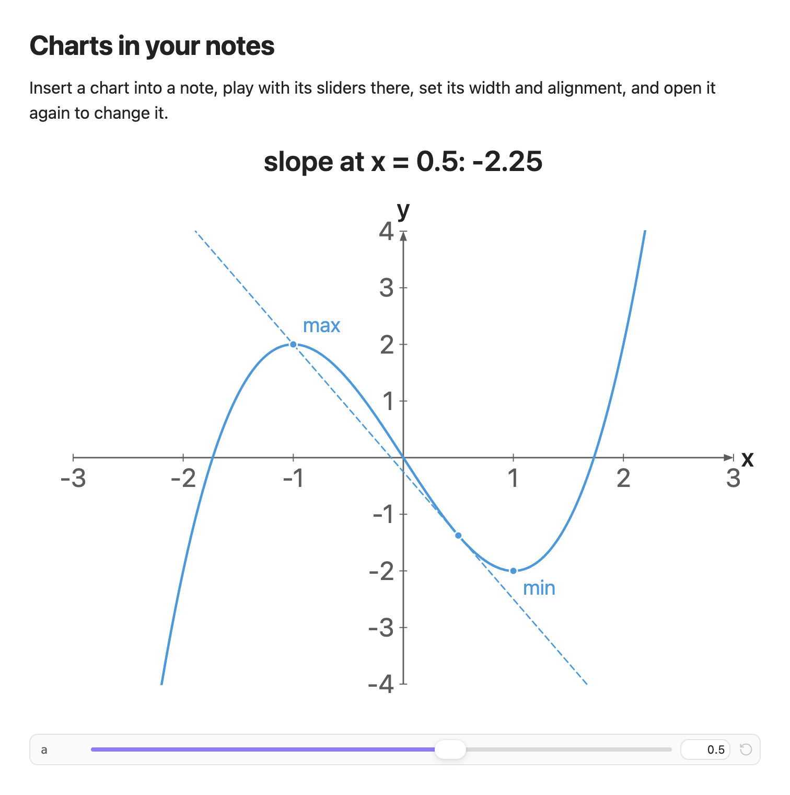
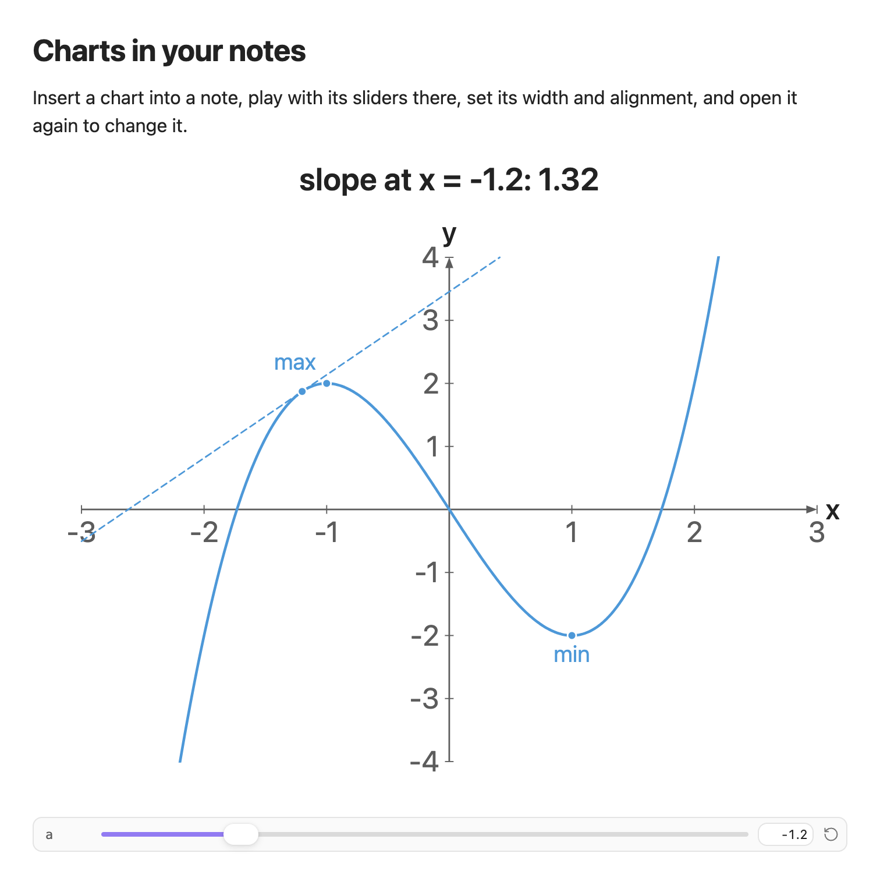
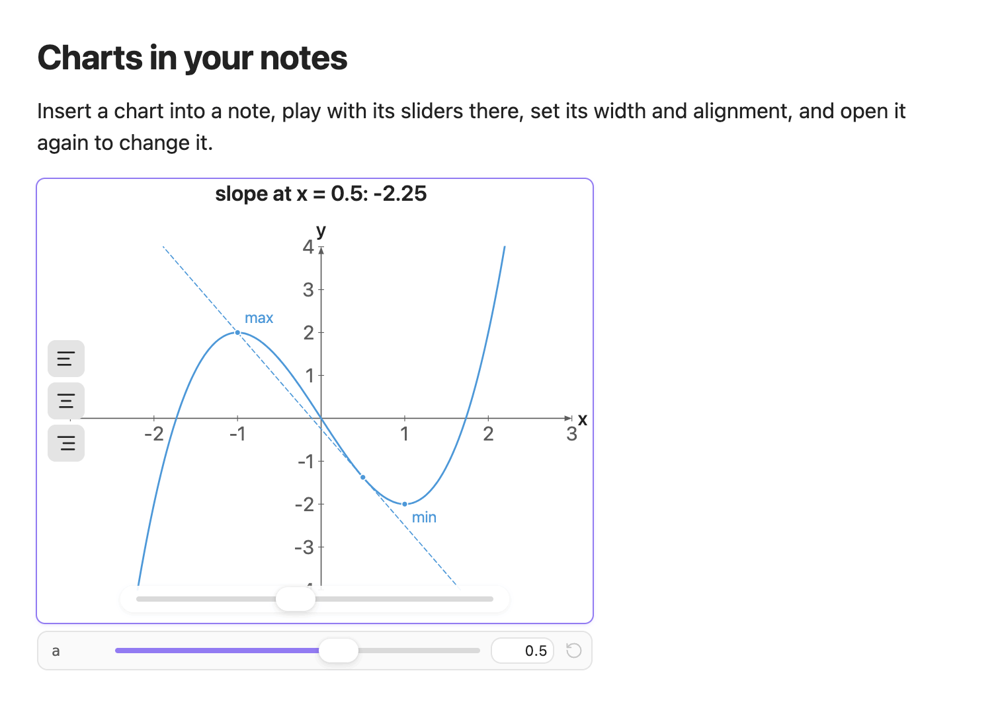
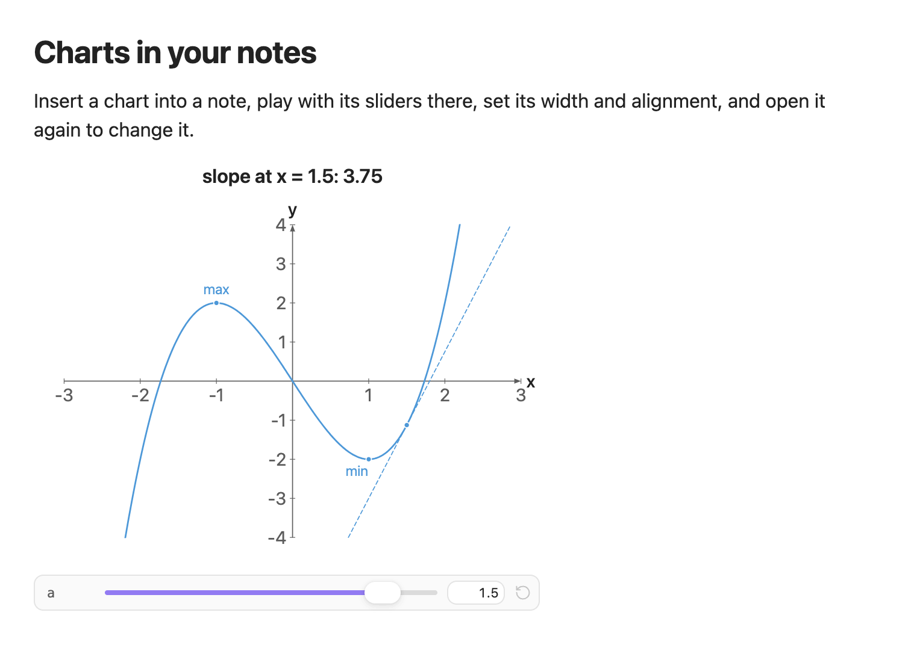
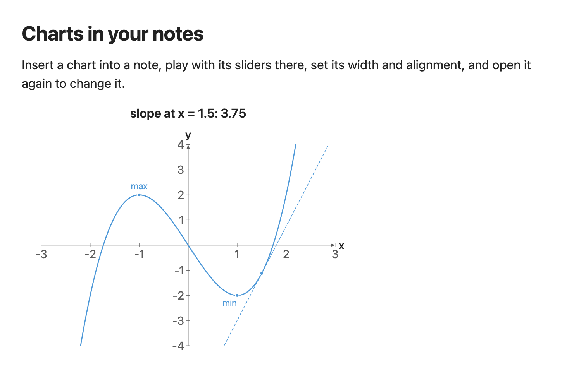

<!-- Generated by scripts/media/build-guides.mjs from src/guides. Do not edit. -->

# Charts in your notes

[All guides](README.md) · Notes and export · Start here · about 8 minutes

Insert a chart into a note, play with its sliders there, set its width and alignment, and open it again to change it.

<p align="center"></p>

**What you can do afterwards**

- Insert a chart and open it again from the note
- Use the slider strip under a chart without changing the note
- Set the width and alignment of a chart in the note

**Read first:** [Your first chart](first-chart.md)

## 1. Open a chart to insert

Put the cursor in your note where the chart should go. Open the editor from the ribbon icon or with the command `Easy TikZ: Open editor`.

Any chart works. This guide uses the example Tangent explorer, because it has a slider: click its tile under Or open an example.



*The Tangent explorer example in the editor, with its slider a in the Sliders dock.*

> **Tip:** Insert into note writes at the cursor of the active note. If no note is open, a notice says "No active note to insert into".

## 2. Insert it into the note

Click Insert into note at the bottom right, or press Cmd+Enter (Ctrl+Enter on Windows and Linux). The editor closes and the chart appears in the note, with its slider underneath.

In the file, the chart is a code block with the language `easy-tikz`: a few lines of text, one line per object, such as `f1(x) = x^3 - 3x | blue, thick, tangent at a`. Switch the note to source mode to see it. Change a number there, and the chart glides to it.



*The chart in the note, drawn by the plugin, with the slider strip under it.*

> **Tip:** The picture is drawn by the plugin itself. You need no LaTeX installation to see charts in your notes.

## 3. Move the slider in the note

Drag the slider a under the chart, or type a value into the box next to it. The tangent slides along the curve and the title above the chart shows its slope.

This changes the picture for the current session only. Nothing is written to the note. The round arrow at the end of the strip (Reset sliders to the saved values) goes back to what the note stores.



*The slider strip under the chart. Moving a slides the tangent along the curve.*

> **Tip:** A chart with more than three sliders shows three rows and a link Show 2 more (or however many are left).

## 4. Resize and align the chart

Move the pointer over the chart. Three buttons appear at its left edge (Align left, Center, Align right) and a width slider at the bottom. Drag the width slider to the left to make the chart narrower, then click Align left.



*The chart at 420 px, aligned left. The controls show while the pointer is over the chart.*

> **Tip:** Width and alignment are the only things these controls write into the note (as the lines `set displayWidth = 420` and `set displayAlign = "left"` of the block). In a callout or a `~~~` fence the block cannot be found, and a notice says the change was not saved.

## 5. Click the chart to edit it

Click the chart, or move the focus to it and press Enter. The editor opens with every setting filled in, and the button at the bottom right now reads Save changes.

In the Sliders dock, drag a to 1.5 and click Save changes. The block in the note is replaced. From now on 1.5 is the value the chart starts with and the value the reset button returns to.



*After Save changes the note shows the tangent at the new saved value a = 1.5.*

> **Tip:** Closed the editor by accident? The chart is kept as a draft. Open the editor from the same chart again and it offers Unsaved changes with Restore and Discard.

## 6. Choose what the note shows

Open the chart again and go to the Chart tab. In the group In your note, switch off Show sliders in note and click Save changes. The chart stays, the slider strip is gone.

Preview size in the same group sets how large the chart is drawn, as its longest side in pixels. A width you set in the note takes over from it.



*The same chart without the slider strip.*

> **Tip:** If part of a chart cannot be drawn, a muted line under it names the problem. The rest of the chart still shows.

## 7. Copy a chart to another note

A chart is its code block and nothing else. In source mode, select the whole block, from the line that opens the `easy-tikz` block to the three backticks that close it, copy it and paste it into any note. Each copy is a chart of its own.

> **Tip:** You can edit the lines by hand. A mistake shows under the chart with its line and column, such as Line 4, column 9: unknown option, and the rest of the chart still draws.

## The finished chart

Paste this block into a note to get the finished chart of this guide. Click the chart in the note to open it in the editor.

<details>
<summary>The chart as an easy-tikz block</summary>

```easy-tikz
{
  "v": 4,
  "dimension": false,
  "documentSetup": true,
  "title": "slope at x = {a}: {3a^2 - 3:2}",
  "size_x_cm": 10,
  "size_y_cm": 8,
  "show_axis_label": true,
  "axis_label_x": "x",
  "axis_label_y": "y",
  "showAxis": true,
  "showLargeGrid": false,
  "showSmallGrid": false,
  "gridSize": 5,
  "majorTickNum": 8,
  "xmin": "-3",
  "xmax": "3",
  "ymin": "-4",
  "ymax": "4",
  "zmin": "-5",
  "zmax": "5",
  "axis_style": "middle",
  "coordinateSystem": "cartesian",
  "axis_label_x_polar": "",
  "axis_label_y_polar": "",
  "axis_label_z": "z",
  "rotationX": 30,
  "rotationZ": 45,
  "zoom3D": 1,
  "boxAspect": "true",
  "previewSize": 760,
  "functions": [
    {
      "expression": "x^3 - 3x",
      "domain": "",
      "showLegend": false,
      "fill": false,
      "fillOpacity": 0.2,
      "fillPattern": "solid",
      "tangent": true,
      "color": "blue",
      "dashed": false,
      "tangentPoint": "a",
      "extrema": true,
      "thickness": "thick",
      "parametric": false,
      "expressionY": "",
      "name": "f1"
    }
  ],
  "functions3D": [],
  "tools": [],
  "annotations": [],
  "parameters": [
    {
      "name": "a",
      "value": 1.5,
      "min": -2,
      "max": 2,
      "step": 0.05
    }
  ],
  "variables": "x, y",
  "equalScale": false,
  "showSlidersInNote": true,
  "displayWidth": 420,
  "displayAlign": "left"
}
```

</details>

## Next guides

- [Export to LaTeX](export-latex.md): Get pgfplots code that compiles with pdflatex: as a standalone document or as a snippet, at the size you need, in the colours of the preview.
- [Sliders that move the picture](sliders.md): Turn a letter in a formula into a slider, set its range, play it and print its value in the chart.
- [Keyboard, mouse and troubleshooting](shortcuts.md): Every shortcut of the editor, what the mouse does in the preview, and fixes for the usual problems.

[All guides](README.md)
