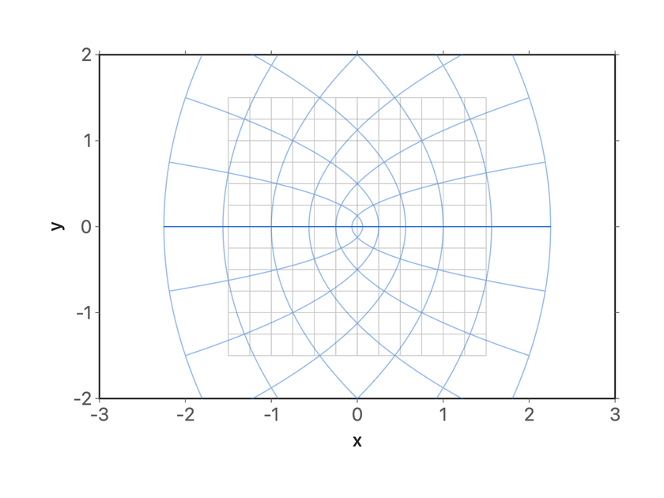
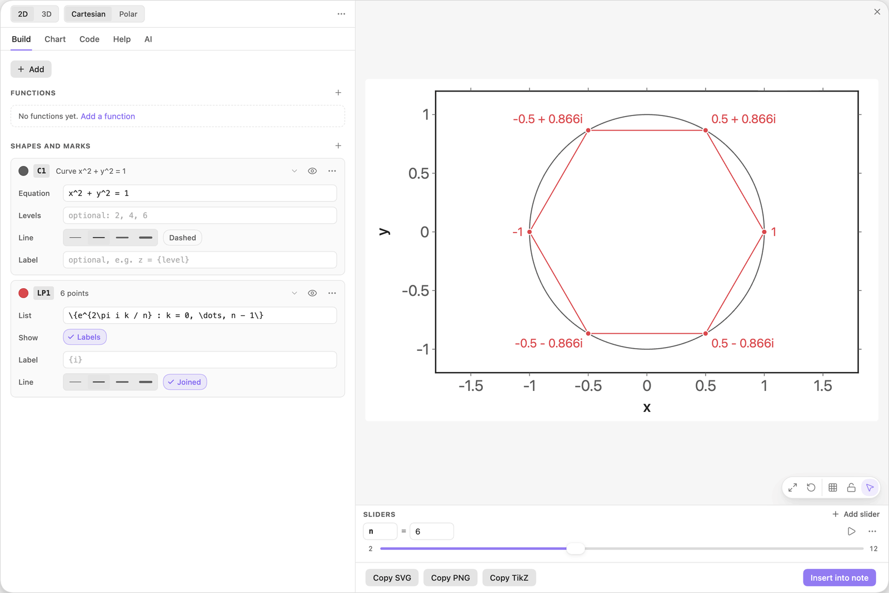
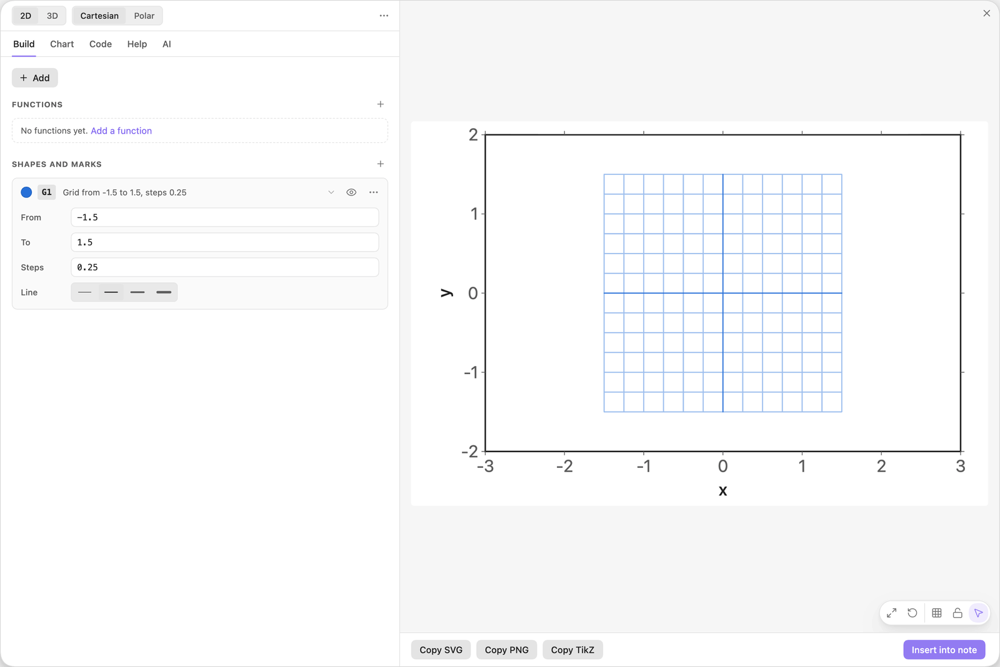
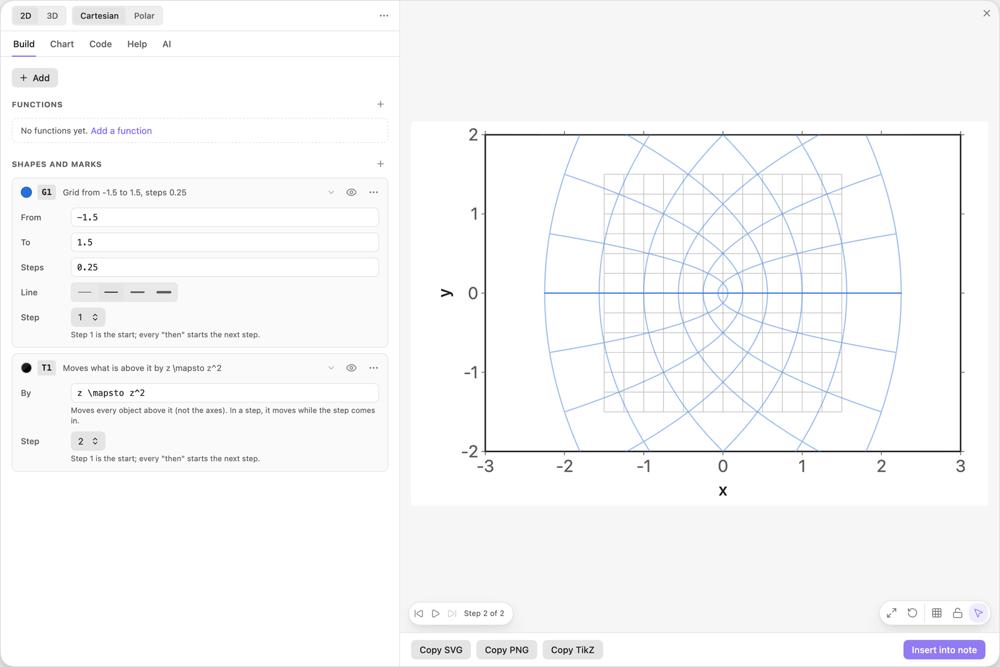
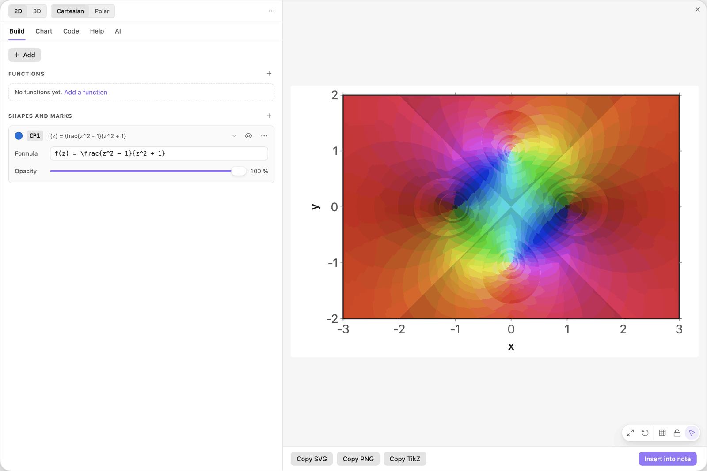

<!-- Generated by scripts/media/build-guides.mjs from src/guides. Do not edit. -->

# Complex numbers and maps

[All guides](README.md) · Linear algebra and complex numbers · Advanced · about 3 minutes

Mark complex numbers as points, bend a grid with z ↦ z² and colour the plane by a complex function.

<p align="center"></p>

**What you can do afterwards**

- Mark a list of complex numbers
- Move the plane by a map of z
- Read zeros and poles off the colours

**Read first:** [A matrix moves the plane](matrix-plane.md)

## 1. Mark the roots of unity

A complex number a + bi is the point (a, b). `mark the points` takes a list: here the n-th roots of unity for the slider `n`, joined.

The chart in words:

```easy-tikz
show x from -1.8 to 1.8 and y from -1.2 to 1.2
size 12 x 8
equal scale
slider n from 2 to 12, starting at 6, in steps of 1
draw x^2 + y^2 = 1 in gray
mark the points $\{e^{2\pi i k / n} : k = 0, \dots, n - 1\}$, joined, labelled
```



## 2. Draw a small grid

`draw the grid from -1.5 to 1.5 in steps of 0.25` draws lines that a map can move.

The chart gets these lines:

```easy-tikz
show x from -3 to 3 and y from -2 to 2
draw the grid from -1.5 to 1.5 in steps of 0.25
```



## 3. Square every point

`then transform the plane by $z \mapsto z^2$` squares every point of the grid in step 2. Press Play: the straight lines bend into parabolas.

The chart gets these lines:

```easy-tikz
then transform the plane by $z \mapsto z^2$
```



## 4. Colour the plane by f(z)

`colour the plane by` a function of z gives each point the colour of f(z): its hue is the angle, its light the size. Zeros are dark, at ±1; poles are white, at ±i.

The chart gets these lines:

```easy-tikz
colour the plane by $f(z) = \frac{z^2 - 1}{z^2 + 1}$
```



## The finished chart

Paste this block into a note to get the finished chart of this guide. Click the chart in the note to open it in the editor.

<details>
<summary>The chart as an easy-tikz block</summary>

```easy-tikz
show x from -3 to 3 and y from -2 to 2
size 12 x 8
equal scale
draw the grid from -1.5 to 1.5 in steps of 0.25
then transform the plane by $z \mapsto z^2$
```

</details>

## Next guides

- [Colour the plane by a complex function](domain-colouring.md): Each point z takes the colour of f(z): find the zeros and the poles, then move two zeros with a slider.
- [Fractals: Mandelbrot, Julia and Newton](fractals.md): Colour every point of the plane by its orbit: the Mandelbrot set, Julia sets on sliders and the basins of Newton's method.

[All guides](README.md)
