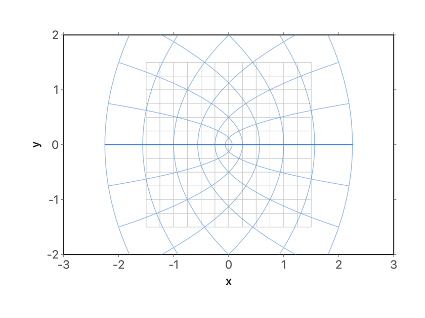
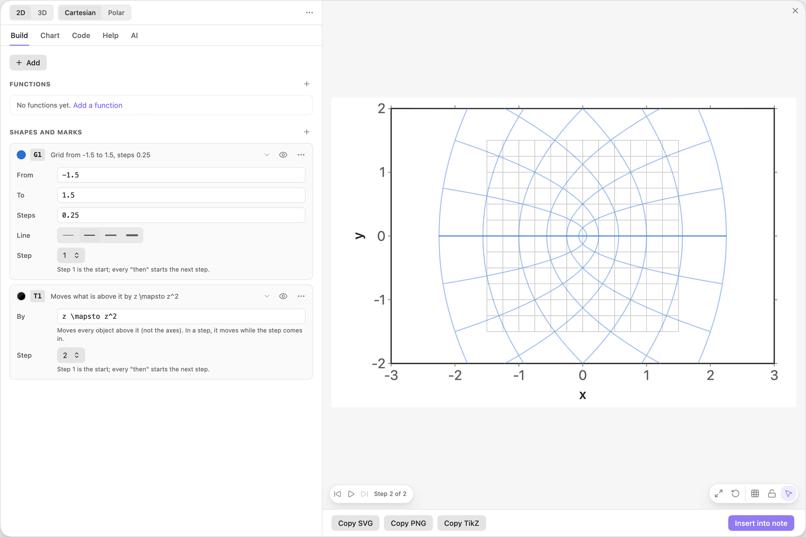
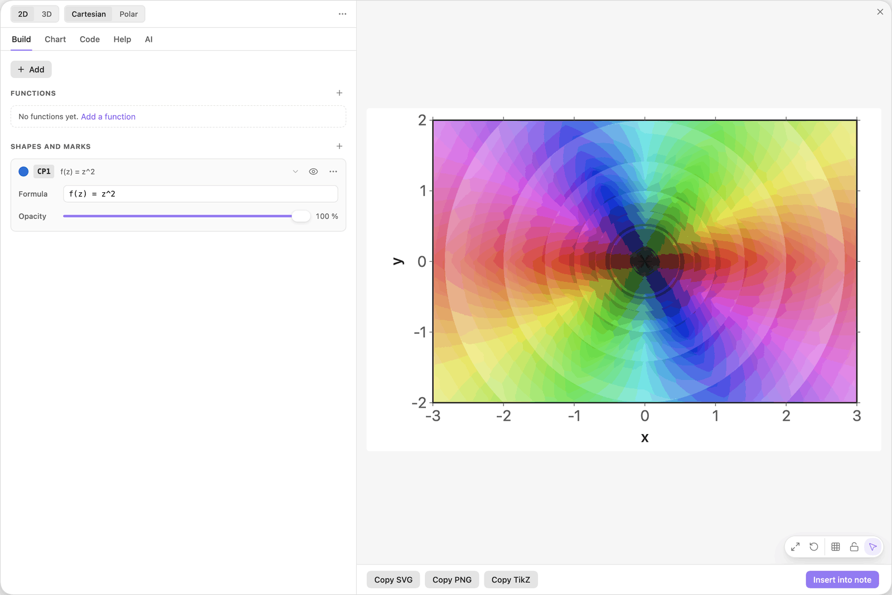
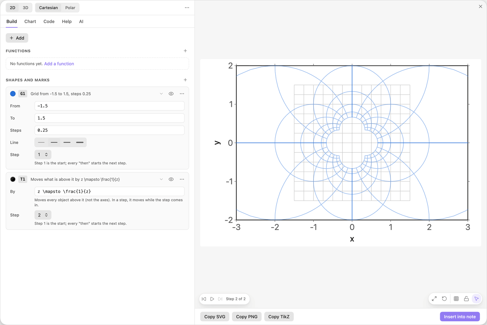
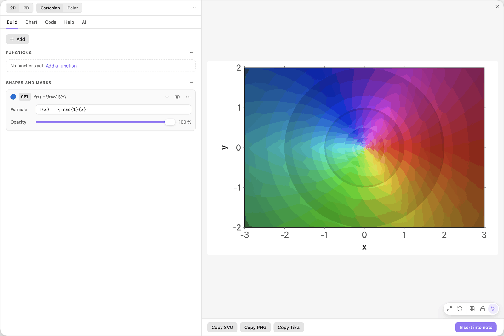
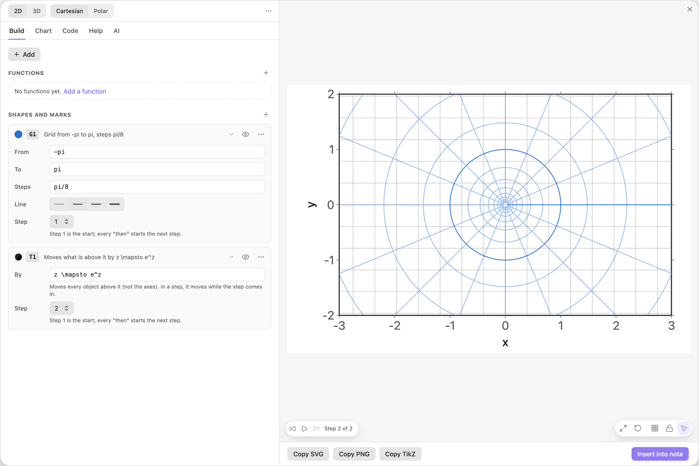
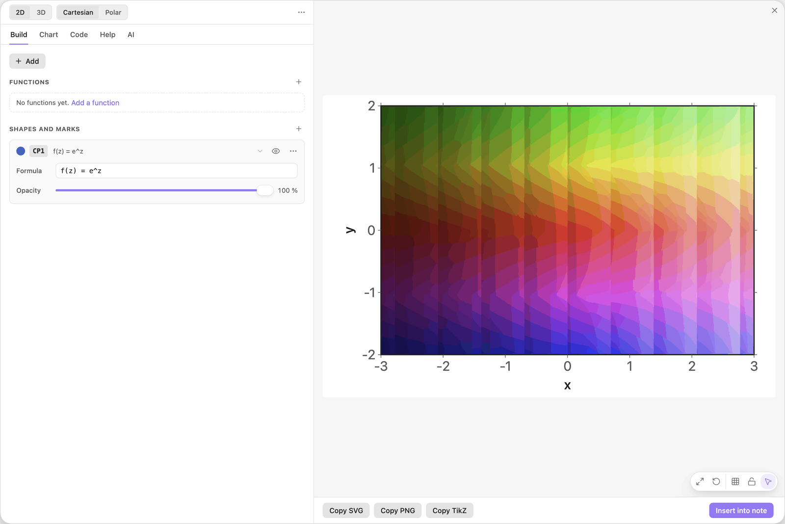

<!-- Generated by scripts/media/build-guides.mjs from src/guides. Do not edit. -->

# Complex functions, seen two ways

[All guides](README.md) · Showcase · Advanced · about 3 minutes

A function of z bends a grid in a step you can play, and colours the plane: z², 1/z and e^z, each both ways.

<p align="center"></p>

**What you can do afterwards**

- Bend a grid with a function of z
- Play the move in a step
- Colour the plane by the same function
- Find zeros and poles by their colours

## 1. Bend a grid with z²

Draw a small grid, then `then transform the plane by $z \mapsto z^2$`. Press Play: each point z slides to z². The lines bend into parabolas and still cross at right angles.

The chart in words:

```easy-tikz
show x from -3 to 3 and y from -2 to 2
size 12 x 8
equal scale
draw the grid from -1.5 to 1.5 in steps of 0.25
then transform the plane by $z \mapsto z^2$
```



## 2. Colour the plane by the same z²

Now each point z takes the colour of z². The hue is its angle, so the colours go round 0 twice: z² turns twice as fast as z. The zero at 0 is dark.

The chart gets these lines:

```easy-tikz
colour the plane by $f(z) = z^2$
```



## 3. Turn the grid inside out with 1/z

`\frac{1}{z}` sends the points near 0 far out and brings far points in. Each line that misses 0 becomes a circle through 0.

The chart gets these lines:

```easy-tikz
draw the grid from -1.5 to 1.5 in steps of 0.25
then transform the plane by $z \mapsto \frac{1}{z}$
```



## 4. Find the pole of 1/z

Coloured, 1/z turns the colours round 0 the other way, and 0 is white: a pole. Zeros are dark, poles are light.

The chart gets these lines:

```easy-tikz
colour the plane by $f(z) = \frac{1}{z}$
```



## 5. Wrap the grid round with e^z

`e^z` turns the lines up into circles round 0 and the lines across into rays from 0. This grid runs from -π to π, so it wraps once round.

The chart gets these lines:

```easy-tikz
draw the grid from -pi to pi in steps of pi/8
then transform the plane by $z \mapsto e^z$
```



## 6. Colour the plane by e^z

The colour changes only upward, as e^z has the angle y. It fades to dark on the left, but the colours never meet in a point: e^z is never 0.

The chart gets these lines:

```easy-tikz
colour the plane by $f(z) = e^z$
```



## The finished chart

Paste this block into a note to get the finished chart of this guide. Click the chart in the note to open it in the editor.

<details>
<summary>The chart as an easy-tikz block</summary>

```easy-tikz
show x from -3 to 3 and y from -2 to 2
size 12 x 8
equal scale
draw the grid from -1.5 to 1.5 in steps of 0.25
then transform the plane by $z \mapsto z^2$
```

</details>

## Next guides

- [Colour the plane by a complex function](domain-colouring.md): Each point z takes the colour of f(z): find the zeros and the poles, then move two zeros with a slider.
- [Complex numbers and maps](complex-maps.md): Mark complex numbers as points, bend a grid with z ↦ z² and colour the plane by a complex function.

[All guides](README.md)
