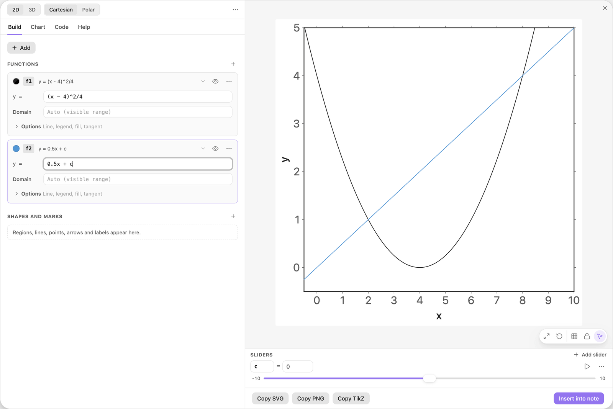
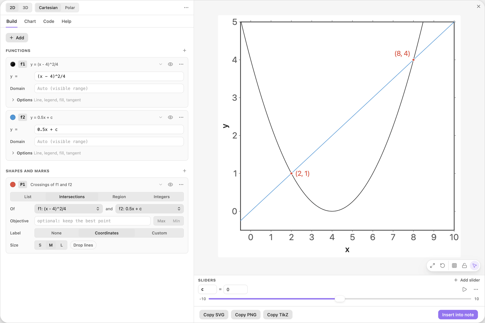
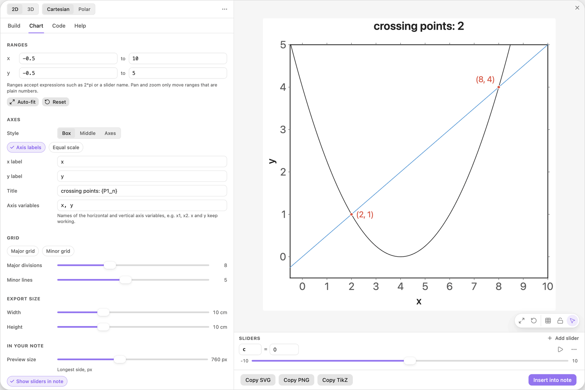
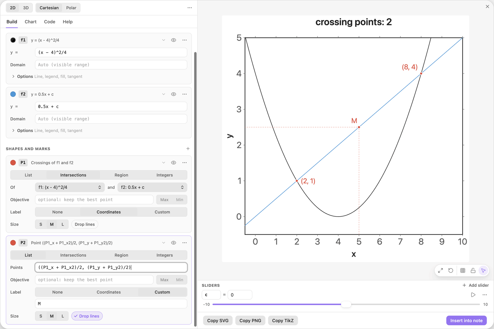
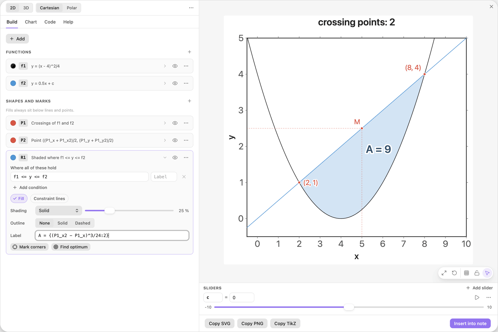
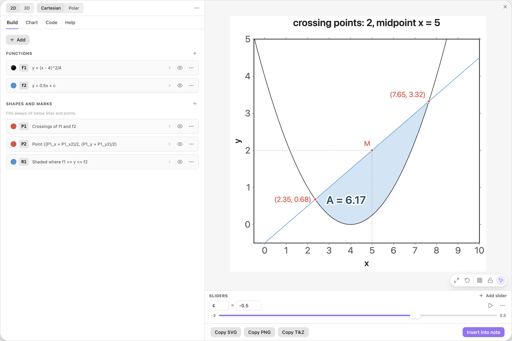
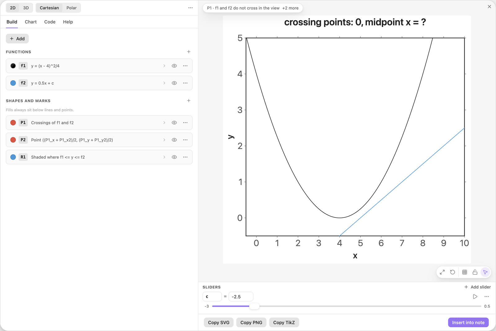

<!-- Generated by scripts/media/build-guides.mjs from src/guides. Do not edit. -->

# Calculate with computed points

[All guides](README.md) · Points, lines and labels · Core · about 9 minutes

Crossing points publish their coordinates and their count: use them in the title, in a new point and in an area formula, and see what they do while a slider plays.

<p align="center"></p>

**What you can do afterwards**

- Use the values a points card publishes: P1\_x, P1\_x2, P1\_n
- Build a new point from computed coordinates
- Print an area computed from crossing points
- Know what a value prints when the point it needs is missing

**Read first:** [Points, intersections and live labels](points-labels.md), [Sliders that move the picture](sliders.md)

## 1. Draw a parabola and a line

Start with a new chart. Click + Add, choose Function y = f(x) and type the parabola below into the card f1. Add a second function the same way and type the line into f2. Click Add slider c under it, then type 0 into the value of c.

The line has the slope 0.5. The slider c moves it up and down without turning it.

| Where | Type |
| --- | --- |
| f1, y = | `(x - 4)^2/4` |
| f2, y = | `0.5x + c` |
| Sliders, c: value | `0` |



*A parabola, and a line that the slider c moves up and down.*

## 2. Mark where they cross

Click + Add and choose Intersections of two functions. The card P1 picks f1 and f2 by itself and marks the two crossings with their coordinates: (2, 1) and (8, 4).

P1 also publishes what it found, under names that every other field can use:

- `P1_x` and `P1_y` for the first crossing from the left
- `P1_x2` and `P1_y2` for the second one
- `P1_n` for the number of crossings



*Two computed crossings. Their coordinates are now values called P1\_x, P1\_y, P1\_x2 and P1\_y2.*

> **Tip:** Crossings are searched for between the left and the right edge of the view. Widen the x range if one is missing.

## 3. Count the crossings in the title

Open the Chart tab and type the title below. `{P1_n}` prints the number of crossings, and it changes with the chart.

Try it: type -2.25 into the value of c. The line now only touches the parabola, and the title reads crossing points: 1. Type -3 and it reads 0. Then type 0 again.

| Where | Type |
| --- | --- |
| Chart \> Axes, Title | `crossing points: {P1_n}` |



*The title counts the crossings: 2.*

> **Tip:** A point where the two curves only touch counts as a crossing, so the tangent line at c = -2.25 gives 1.

## 4. Mark the midpoint of the crossings

Click + Add and choose Points from a list. Replace the sample points with the formula below: the average of the two crossings, coordinate by coordinate. Set Label to Custom, type `M` and switch on Drop lines.

The point M appears at (5, 2.5), halfway between (2, 1) and (8, 4). It is computed from P1, so it moves whenever the crossings move.

| Where | Type |
| --- | --- |
| P2, Points | `((P1_x + P1_x2)/2, (P1_y + P1_y2)/2)` |
| P2, Label text | `M` |



*M is built from the coordinates P1 publishes.*

## 5. Shade the area and print its size

Click + Add and choose Area between two functions. The card R1 starts with `f2 <= y <= f1`, which shades where the line lies below the parabola. Swap the two names so the row reads as below: now it shades the piece between the crossings, where the line is on top.

Then type the label below into the field Label of R1. For a parabola with the leading factor k, the area between it and a line that cuts it at x1 and x2 is k(x2 - x1)^3/6. Here k is 1/4, so the formula divides by 24. The label reads A = 9.

| Where | Type |
| --- | --- |
| R1, condition 1 | `f1 <= y <= f2` |
| R1, Label | `A = {(P1_x2 - P1_x)^3/24:2}` |



*The area between line and parabola, computed from the two crossings.*

> **Tip:** The area formula is yours: a region does not publish its own size. The crossings it uses are computed, so the number stays right when c moves.

## 6. Play c and watch the midpoint

Click the small numbers at the two ends of the slider c and type -3 and 0.5. Add the midpoint to the title as below, then press play on c.

The line sweeps up and down. The crossings slide along the parabola and the area grows and shrinks. M moves too, but only up and down: as long as the line cuts the parabola twice, its drop line stays at x = 5 and the title keeps printing 5. Below c = -2.25 the line misses, and the next step shows what prints then.

That is a property of every parabola: the midpoints of parallel chords lie on one vertical line, through the point where the parabola has the slope of the chords. Here the slope of the parabola, (x - 4)/2, is 0.5 at x = 5.

| Where | Type |
| --- | --- |
| Sliders, c: minimum | `-3` |
| Sliders, c: maximum | `0.5` |
| Chart \> Axes, Title | `crossing points: {P1_n}, midpoint x = {P2_x:2}` |



*At c = -0.5: new crossings, a smaller area, and M still above x = 5.*

## 7. Let the line miss the parabola

Stop playing and type -2.5 into the value of c. The line now passes below the parabola. There are no crossings, so the title reads crossing points: 0 and midpoint x = ?.

A value that cannot be computed prints a question mark, and whatever needs it is not drawn: no M and no shaded area. The status chip at the top left of the preview lists the reasons. Move c back above -2.25 and everything returns.

| Where | Type |
| --- | --- |
| Sliders, c: value | `-2.5` |



*At c = -2.5 the line misses: the count is 0, the midpoint prints a question mark.*

> **Tip:** Nothing is broken here: the chip only reports. If a label must never show a question mark, give the slider a range in which the points always exist.

## The finished chart

Paste this block into a note to get the finished chart of this guide. Click the chart in the note to open it in the editor.

<details>
<summary>The chart as an easy-tikz block</summary>

```easy-tikz
title crossing points: {P1_n}, midpoint x = {P2_x:2}
slider c from -3 to 0.5, starting at -0.5, in steps of 0.1
plot f1(x) = (x - 4)^2/4
plot f2(x) = 0.5x + c in blue
P1: mark where f1 and f2 cross, with coordinates
P2: mark ((P1_x + P1_x2)/2, (P1_y + P1_y2)/2), with lines to the axes, labelled "M"
shade where f1 <= y <= f2, labelled "A = {(P1_x2 - P1_x)^3/24:2}"
```

</details>

## Next guides

- [Draw a market with surplus areas](supply-demand.md): Demand and supply, their equilibrium with guide lines, and consumer and producer surplus that follow a slider.
- [An area that grows with a slider](area-accumulation.md): Shade the area under a curve from 0 to a slider b, print its size, and draw the function that adds it up, so the height of one curve shows the area under the other.
- [Shade between a curve and its tangent](tangent-area.md): Write the tangent at a slider point as a function, shade the area it encloses with the curve, and make it work for any curve.

[All guides](README.md)
