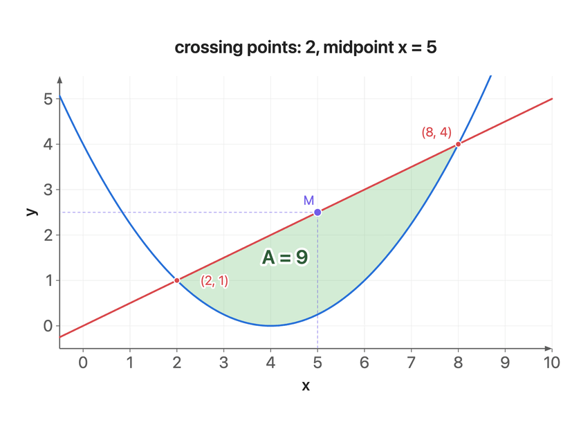
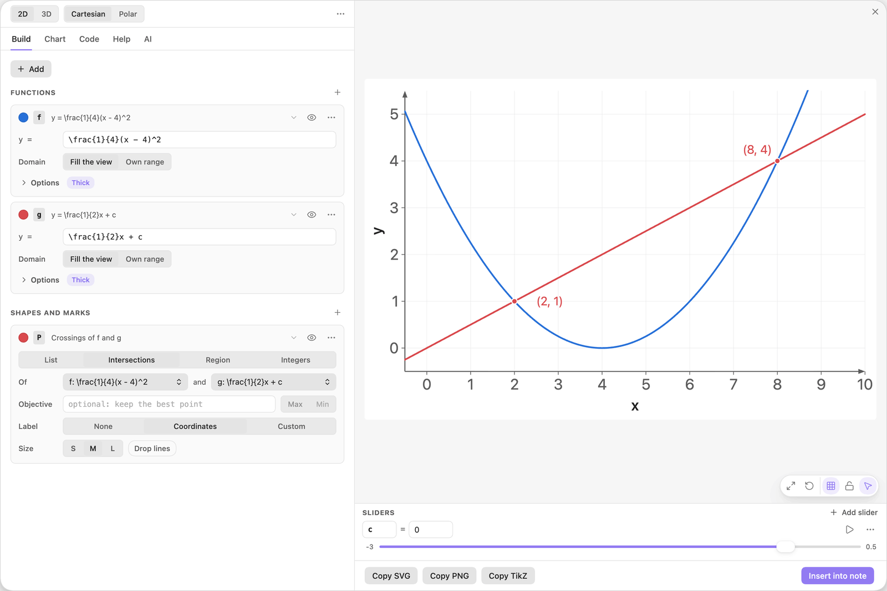
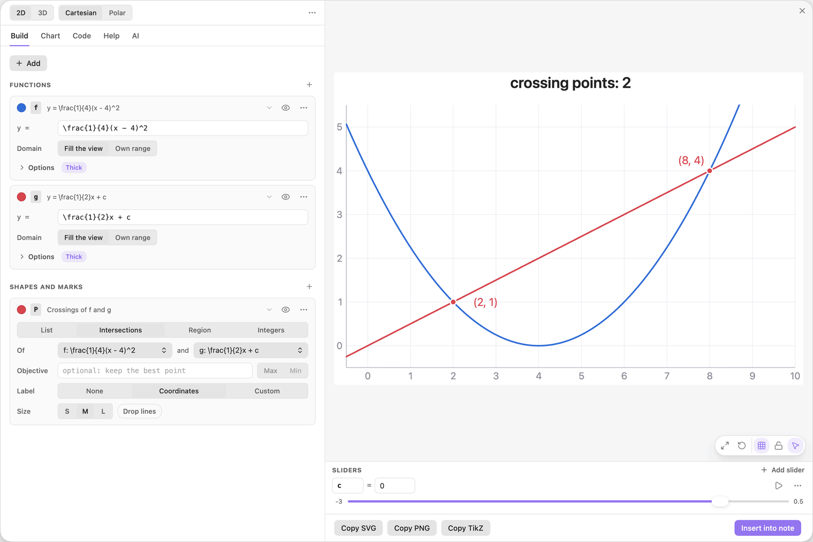
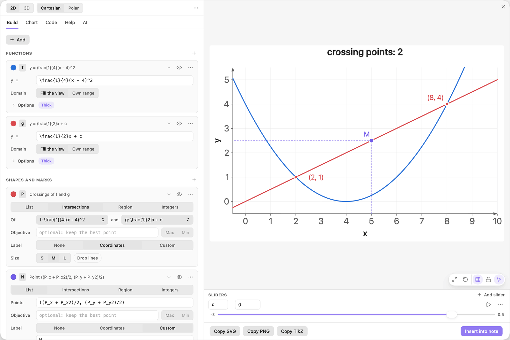
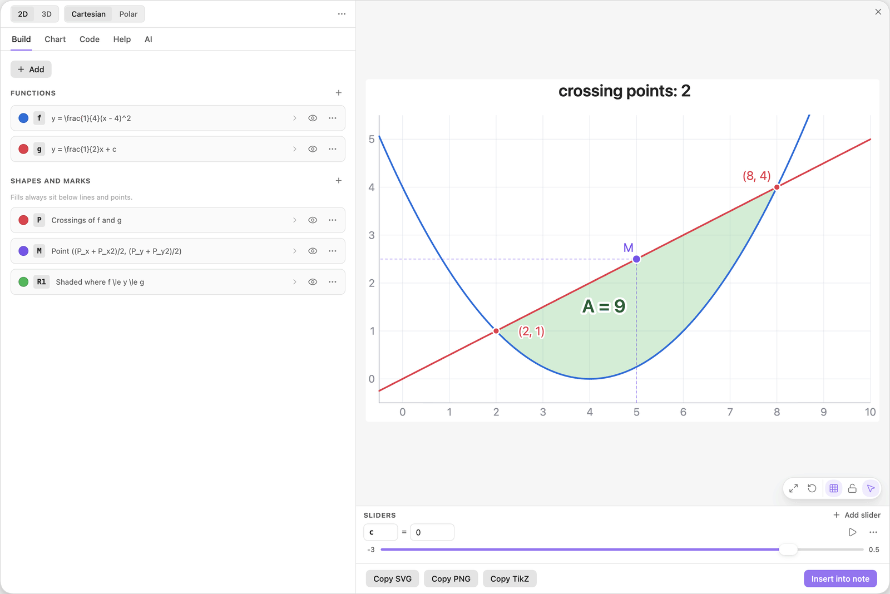
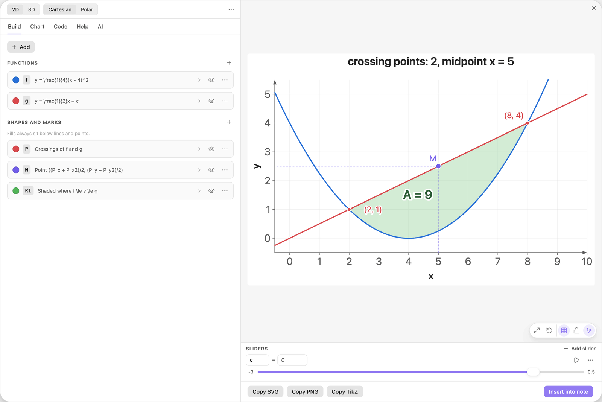

<!-- Generated by scripts/media/build-guides.mjs from src/guides. Do not edit. -->

# Calculate with computed points

[All guides](README.md) · Points, lines and labels · Core · about 4 minutes

Use what crossing points publish, their count and coordinates, in a title, a new point and an area.

<p align="center"></p>

**What you can do afterwards**

- Use the values a marked point publishes, such as `P_x` and `P_n`
- Build a new point from computed coordinates
- Print a count, a midpoint and an area that follow a slider

**Read first:** [Points and live labels](points-labels.md), [Sliders that move the picture](sliders.md)

## 1. Mark where a line cuts a parabola

`P: mark where f and g cross` marks the crossings and names them `P`. The slider `c` moves the line up and down.

The chart in words:

```easy-tikz
show x from -0.5 to 10 and y from -0.5 to 5.5
size 12 x 8
axes on the edges
with a grid
slider c from -3 to 0.5, starting at 0
plot $f(x) = \frac{1}{4}(x - 4)^2$ in blue, thick
plot $g(x) = \frac{1}{2}x + c$ in red, thick
P: mark where f and g cross, with coordinates
```



## 2. Count the crossings in the title

`P` publishes what it finds: `P_x` and `P_y` for the first crossing, `P_x2` and `P_y2` for the second, `P_n` for their count. `{P_n}` prints it.

The chart gets these lines:

```easy-tikz
title crossing points: {P_n}
```



> **Tip:** At `c = -2.25` the line only touches the parabola, and the count is 1.

## 3. Build the midpoint from the crossings

A point can use these values. `M` is the average of the two crossings, so it moves whenever they move.

The chart gets these lines:

```easy-tikz
M: mark ((P_x + P_x2)/2, (P_y + P_y2)/2) in purple, large, with lines to the axes, labelled "M"
```



## 4. Print the area between them

For this parabola, the area a line cuts off is the cube of the width between the crossings, over 24. The label computes it: `A = 9`.

The chart gets these lines:

```easy-tikz
shade where $f \le y \le g$ in green, labelled "A = {(P_x2 - P_x)^3/24:2}"
```



## 5. Play c and watch the values

Add the midpoint to the title and press play on `c`. The count, the area and `M` follow, but `M` stays above `x = 5`.

The chart gets these lines:

```easy-tikz
title crossing points: {P_n}, midpoint x = {M_x:2}
```



> **Tip:** Below `c = -2.25` the line misses: a value that cannot be computed prints `?`, and what needs it is not drawn.

## The finished chart

Paste this block into a note to get the finished chart of this guide. Click the chart in the note to open it in the editor.

<details>
<summary>The chart as an easy-tikz block</summary>

```easy-tikz
show x from -0.5 to 10 and y from -0.5 to 5.5
size 12 x 8
axes on the edges
with a grid
title crossing points: {P_n}, midpoint x = {M_x:2}
slider c from -3 to 0.5, starting at 0
plot $f(x) = \frac{1}{4}(x - 4)^2$ in blue, thick
plot $g(x) = \frac{1}{2}x + c$ in red, thick
P: mark where f and g cross, with coordinates
M: mark ((P_x + P_x2)/2, (P_y + P_y2)/2) in purple, large, with lines to the axes, labelled "M"
shade where $f \le y \le g$ in green, labelled "A = {(P_x2 - P_x)^3/24:2}"
```

</details>

## Next guides

- [Surfaces, planes and points in 3D](surfaces-3d.md): Plot a surface coloured by height in a cube, turn it, and cut it with a plane on a slider.
- [Draw a market with surplus areas](supply-demand.md): Demand and supply, the equilibrium with lines to the axes, and both surpluses following a demand slider.

[All guides](README.md)
