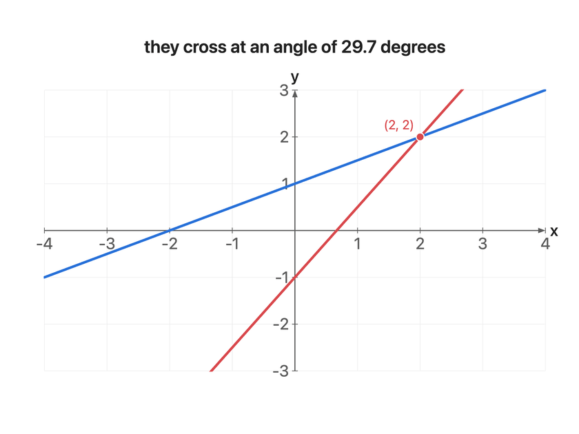
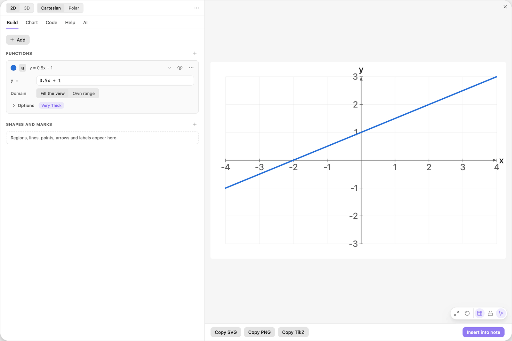
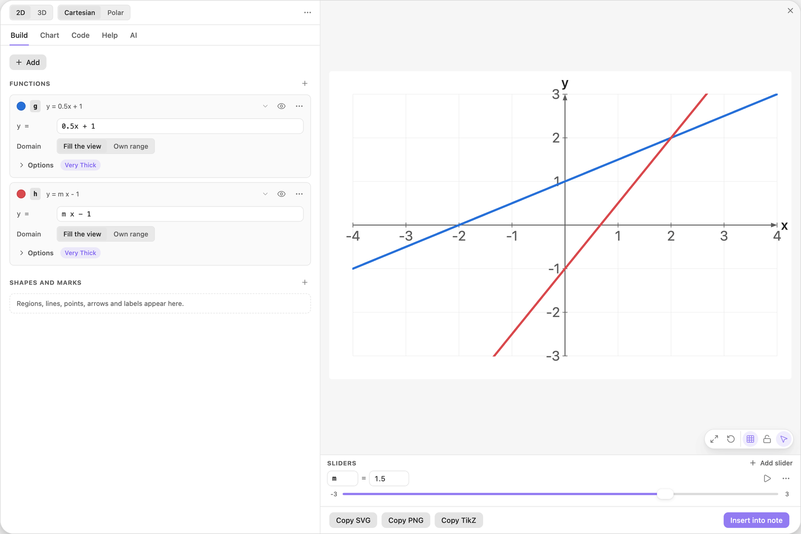
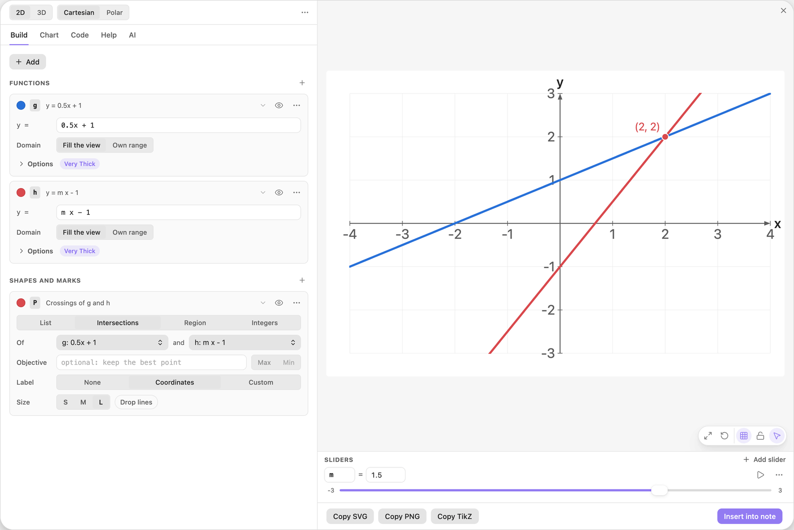
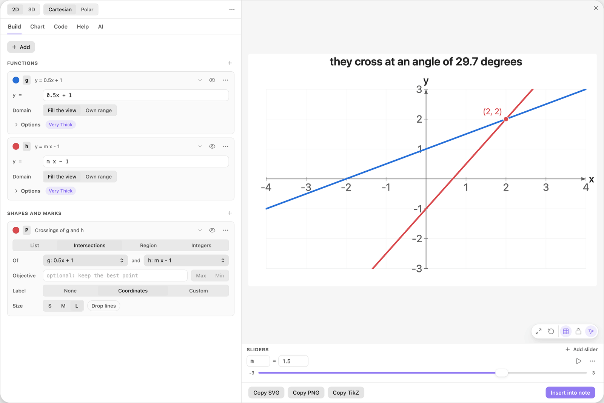

<!-- Generated by scripts/media/build-guides.mjs from src/guides. Do not edit. -->

# Two lines and their crossing

[All guides](README.md) · Showcase · Start here · about 2 minutes

Turn one line with a slider; the crossing point and the angle between the lines follow.

<p align="center"></p>

**What you can do afterwards**

- Turn a line with a slope slider
- Mark where two lines cross
- Print the angle between them

## 1. Plot a line

Start with the line `g(x) = 0.5x + 1`.

The chart in words:

```easy-tikz
show x from -4 to 4 and y from -3 to 3
size 12 x 8
axes in the middle
with a grid
plot g(x) = 0.5x + 1 in blue, very thick
```



## 2. Turn a second line

The slope of `h` is the slider `m`. Drag it and the red line turns about (0, -1).

The chart gets these lines:

```easy-tikz
slider m from -3 to 3, starting at 1.5, in steps of 0.05
plot h(x) = m x - 1 in red, very thick
```



## 3. Mark the crossing

`mark where g and h cross` finds the point and prints its coordinates. At `m = 0.5` the lines are parallel and the point goes.

The chart gets these lines:

```easy-tikz
P: mark where g and h cross, large, with coordinates
```



## 4. Print the angle

The title works out the angle between the lines from both slopes.

The chart gets these lines:

```easy-tikz
title they cross at an angle of {atan(abs((m - 0.5)/(1 + 0.5*m)))*180/pi:1} degrees
```



## The finished chart

Paste this block into a note to get the finished chart of this guide. Click the chart in the note to open it in the editor.

<details>
<summary>The chart as an easy-tikz block</summary>

```easy-tikz
show x from -4 to 4 and y from -3 to 3
size 12 x 8
axes in the middle
with a grid
title they cross at an angle of {atan(abs((m - 0.5)/(1 + 0.5*m)))*180/pi:1} degrees
slider m from -3 to 3, starting at 1.5, in steps of 0.05
plot g(x) = 0.5x + 1 in blue, very thick
plot h(x) = m x - 1 in red, very thick
P: mark where g and h cross, large, with coordinates
```

</details>

## Next guides

- [Sliders that move the picture](sliders.md): Turn letters into sliders, set their range and step, press play, and connect them across a note.

[All guides](README.md)
