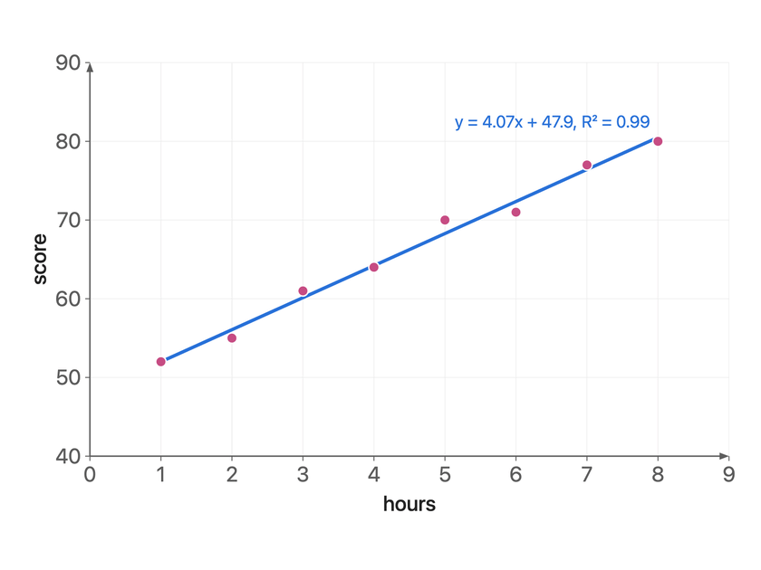
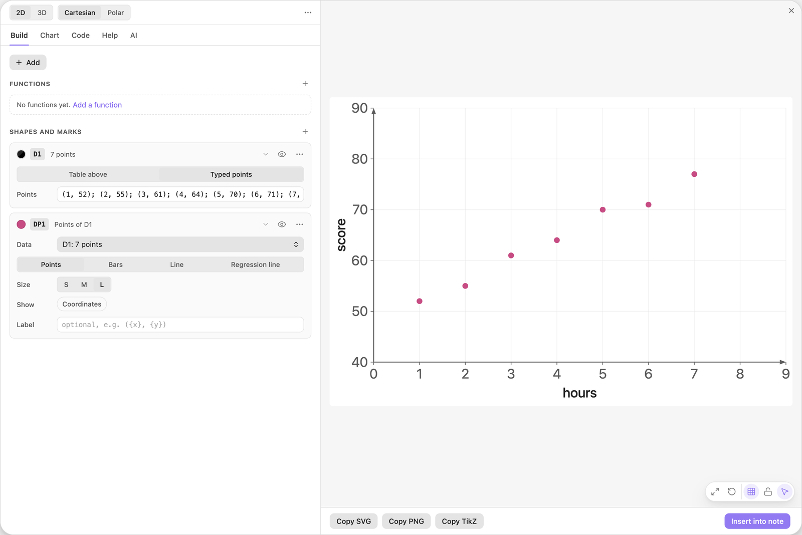
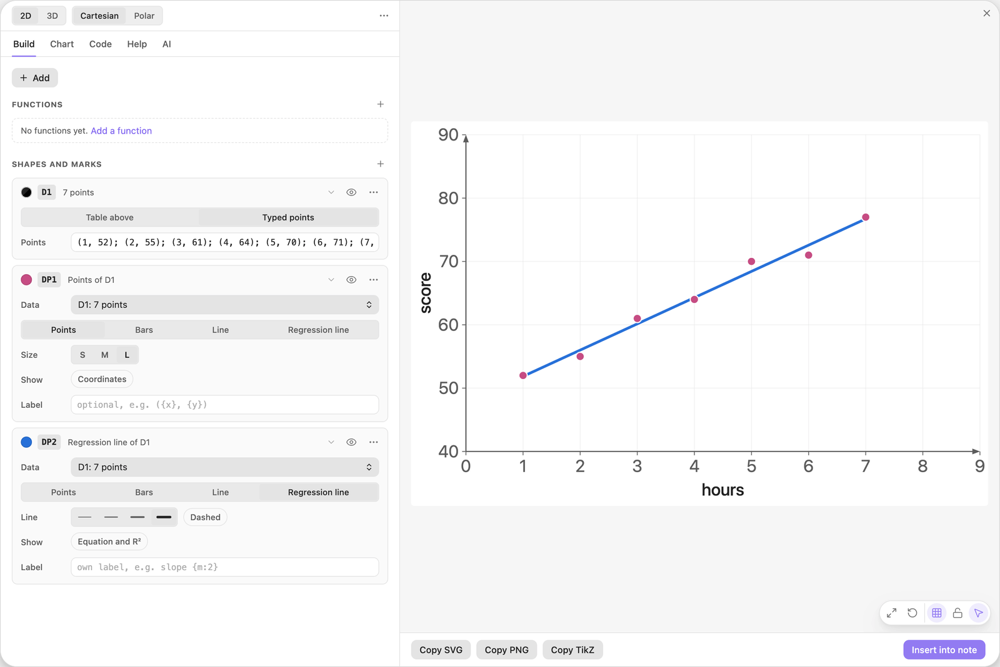
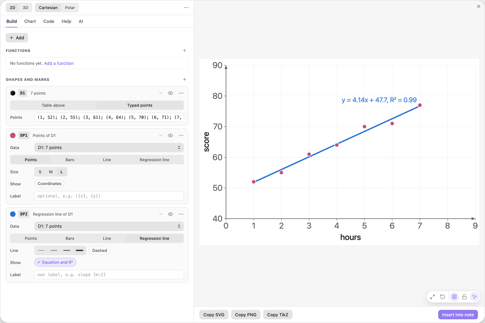
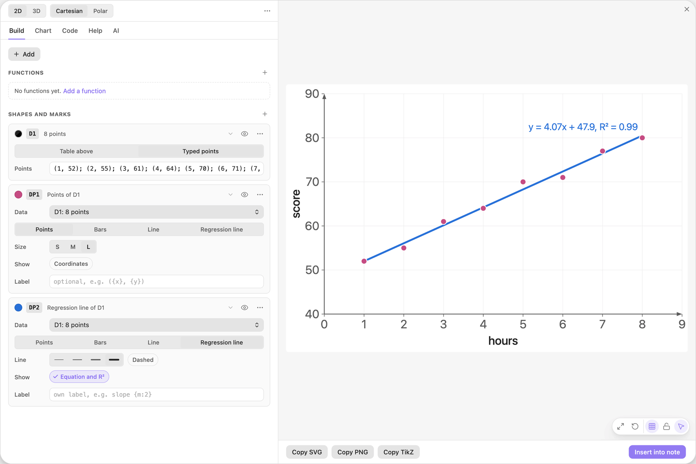

<!-- Generated by scripts/media/build-guides.mjs from src/guides. Do not edit. -->

# Data and a regression line

[All guides](README.md) · Data and probability · Core · about 3 minutes

Plot data points, fit a regression line and print its equation and R² beside it.

<p align="center"></p>

**What you can do afterwards**

- Write data points in a chart
- Fit a regression line and label it
- Read the data from a table in your note

**Read first:** [Write a chart in words](chart-language.md)

## 1. Write the data points

`data` lists the points: hours of study and the test score. `mark the data` draws them.

The chart in words:

```easy-tikz
show x from 0 to 9 and y from 40 to 90
size 12 x 8
axes on the edges
with a grid
xlabel hours
ylabel score
data (1, 52), (2, 55), (3, 61), (4, 64), (5, 70), (6, 71), (7, 77)
mark the data in magenta, large
```



## 2. Draw the regression line

`its regression line` is the straight line that fits the data best, by least squares.

The chart gets these lines:

```easy-tikz
draw its regression line, very thick
```



## 3. Print its equation and R²

`labelled` adds the equation of the line and R². The closer R² is to 1, the closer the points lie to the line.

The chart gets these lines:

```easy-tikz
draw its regression line, very thick, labelled
```



## 4. Read the table in your note

In a note, write `use the table above` instead of the `data` line: the chart reads the Markdown table above it. Add a row, and the line follows.

The chart gets these lines:

```easy-tikz
data (1, 52), (2, 55), (3, 61), (4, 64), (5, 70), (6, 71), (7, 77), (8, 80)
```



> **Tip:** `use the table above, columns hours and score` picks two columns of a wider table.

## The finished chart

Paste this block into a note to get the finished chart of this guide. Click the chart in the note to open it in the editor.

<details>
<summary>The chart as an easy-tikz block</summary>

```easy-tikz
show x from 0 to 9 and y from 40 to 90
size 12 x 8
axes on the edges
with a grid
xlabel hours
ylabel score
data (1, 52), (2, 55), (3, 61), (4, 64), (5, 70), (6, 71), (7, 77), (8, 80)
mark the data in magenta, large
draw its regression line, very thick, labelled
```

</details>

## Next guides

- [Normal and binomial probabilities](probability.md): Shade a probability under the normal curve with a slider, then compare binomial bars with a normal curve.
- [Charts in your notes](charts-in-notes.md): Insert a chart into a note, edit it again, and move its sliders there, also across charts.

[All guides](README.md)
