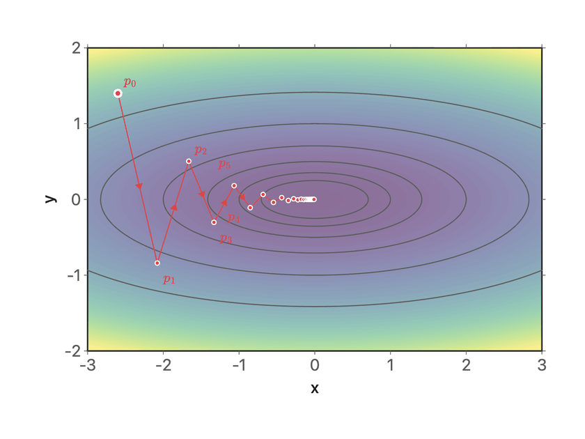
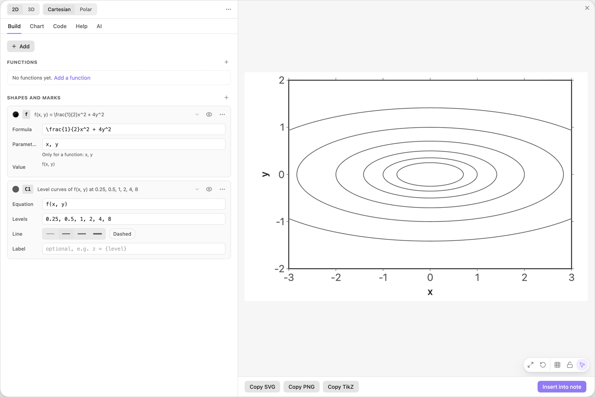
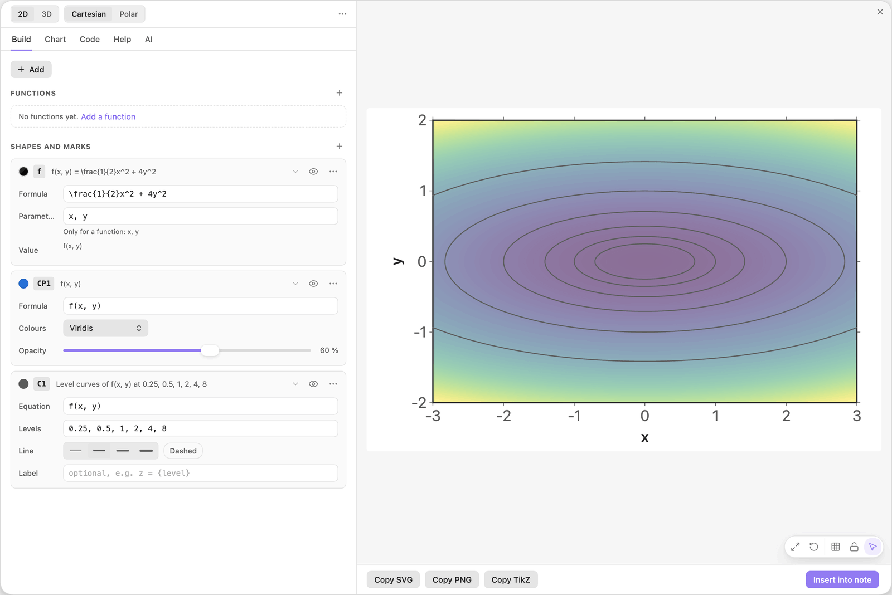
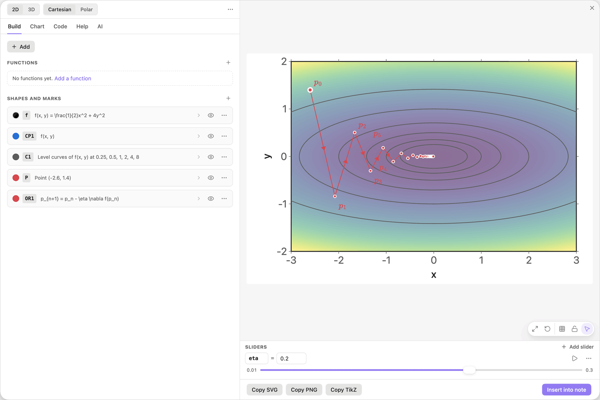
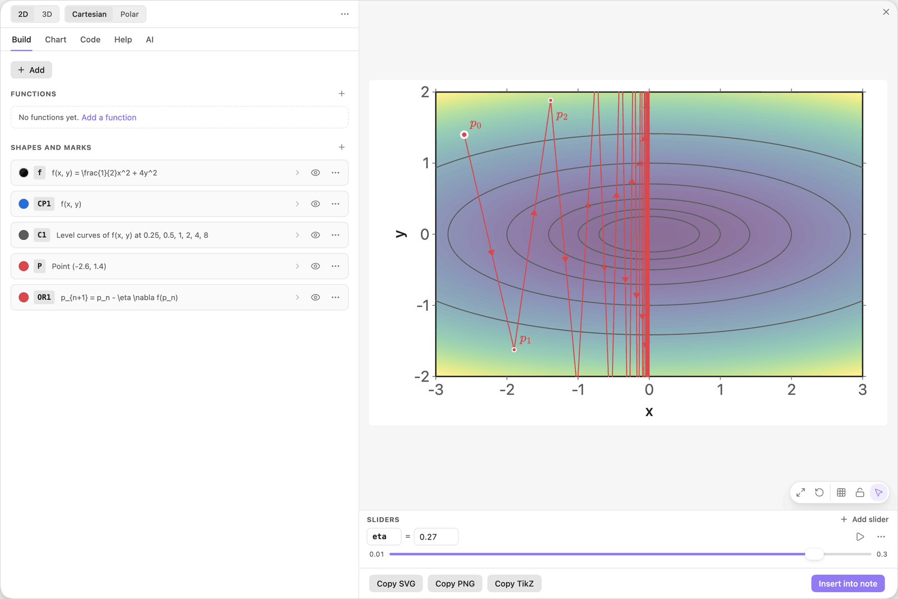
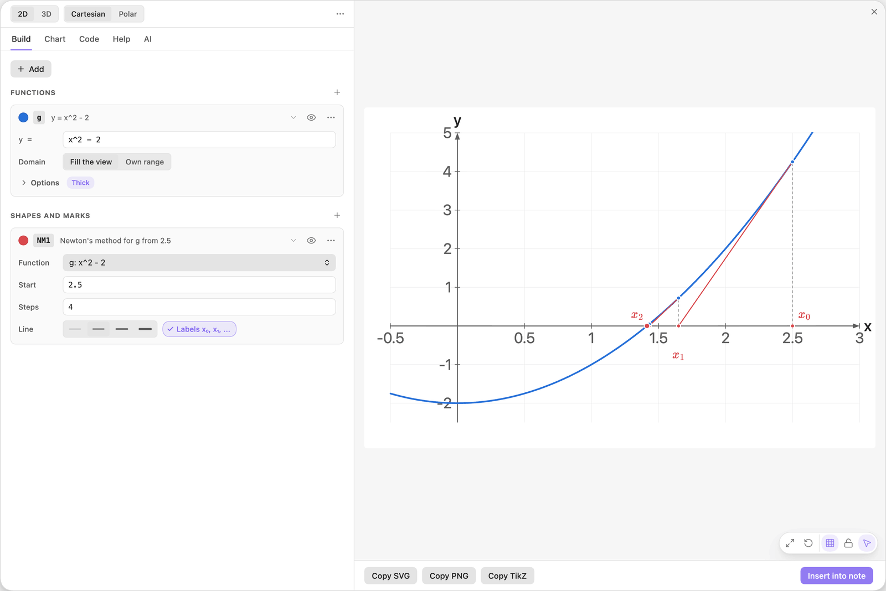

<!-- Generated by scripts/media/build-guides.mjs from src/guides. Do not edit. -->

# Gradient descent and Newton's method

[All guides](README.md) · Regions and optimisation · Advanced · about 4 minutes

Walk downhill on level curves with gradient descent, take steps that are too long, and find a root with Newton's method.

<p align="center"></p>

**What you can do afterwards**

- Name a function of x and y with let
- Draw the orbit of gradient descent
- Colour the plane by a function
- Draw Newton's method for a root

**Read first:** [Find a nonlinear optimum with level curves](level-curves.md)

## 1. Draw the level curves of f

`let` names the function f of x and y. Its level curves show a long valley: steep in y, flat in x.

The chart in words:

```easy-tikz
show x from -3 to 3 and y from -2 to 2
size 12 x 8
equal scale
let $f(x, y) = \frac{1}{2}x^2 + 4y^2$
draw the level curves of f(x, y) at 0.25, 0.5, 1, 2, 4 and 8 in gray
```



## 2. Colour the plane by f

`colour the plane by $f(x, y)$, in viridis` lays a heat map under the curves: low values purple, high ones yellow.

The chart gets these lines:

```easy-tikz
colour the plane by $f(x, y)$ in viridis, opacity 0.6
```



## 3. Walk downhill from P

Each step of the orbit goes against the gradient, `\nabla f`, times the step size `eta`. From P it zigzags across the valley to the lowest point, 0.

The chart gets these lines:

```easy-tikz
slider eta from 0.01 to 0.3, starting at 0.2
P: mark (-2.6, 1.4), large
draw the orbit of $p_{n+1} = p_n - \eta \nabla f(p_n)$, $p_0 = P$, 25 steps, labelled
```



## 4. Make the steps too long

Drag `eta` past 0.25. Each step now jumps further across the valley than the one before, and the orbit runs away.

The chart gets these lines:

```easy-tikz
slider eta from 0.01 to 0.3, starting at 0.27
```



## 5. Find a root with Newton's method

`draw Newton's method for g from 2.5` follows the tangent at each point down to the x-axis. After three steps it is at 1.414, the root √2.

The chart gets these lines:

```easy-tikz
show x from -0.5 to 3 and y from -2.5 to 5
axes in the middle
with a grid
plot g(x) = x^2 - 2 in blue, thick
draw Newton's method for g from 2.5, 4 steps, labelled
```



## The finished chart

Paste this block into a note to get the finished chart of this guide. Click the chart in the note to open it in the editor.

<details>
<summary>The chart as an easy-tikz block</summary>

```easy-tikz
show x from -3 to 3 and y from -2 to 2
size 12 x 8
equal scale
slider eta from 0.01 to 0.3, starting at 0.2
let $f(x, y) = \frac{1}{2}x^2 + 4y^2$
colour the plane by $f(x, y)$ in viridis, opacity 0.6
draw the level curves of f(x, y) at 0.25, 0.5, 1, 2, 4 and 8 in gray
P: mark (-2.6, 1.4), large
draw the orbit of $p_{n+1} = p_n - \eta \nabla f(p_n)$, $p_0 = P$, 25 steps, labelled
```

</details>

## Next guides

- [Orbits, cobwebs and bifurcation](orbits-cobwebs.md): Follow x ↦ r x (1 - x) step by step on a cobweb, over time, and for every r at once in the bifurcation diagram.
- [Fractals: Mandelbrot, Julia and Newton](fractals.md): Colour every point of the plane by its orbit: the Mandelbrot set, Julia sets on sliders and the basins of Newton's method.

[All guides](README.md)
