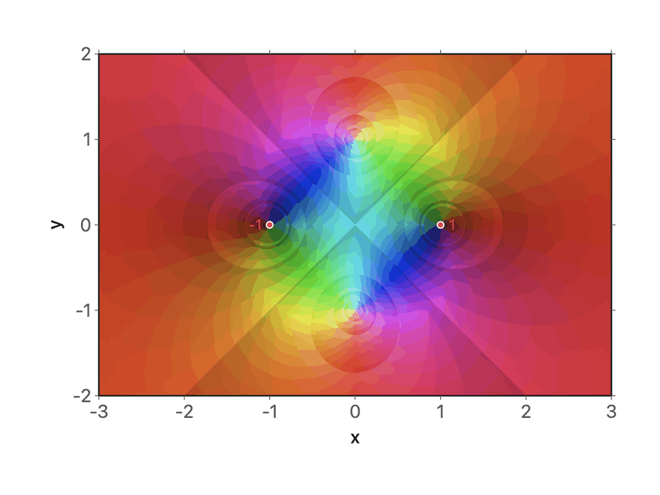
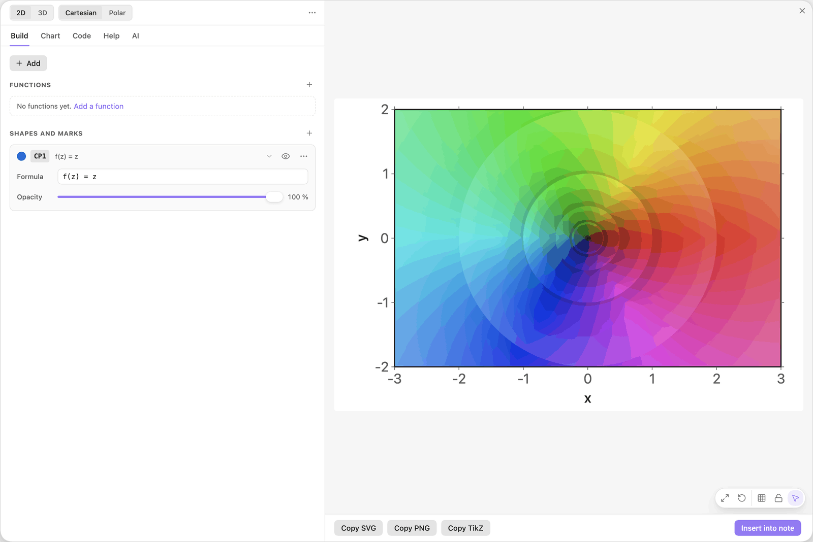
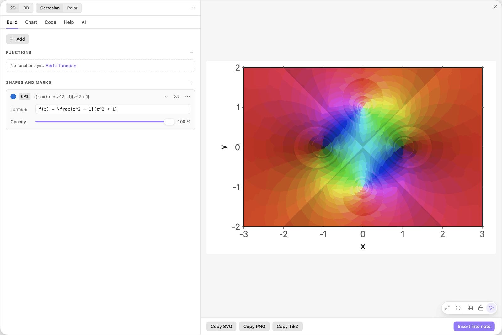
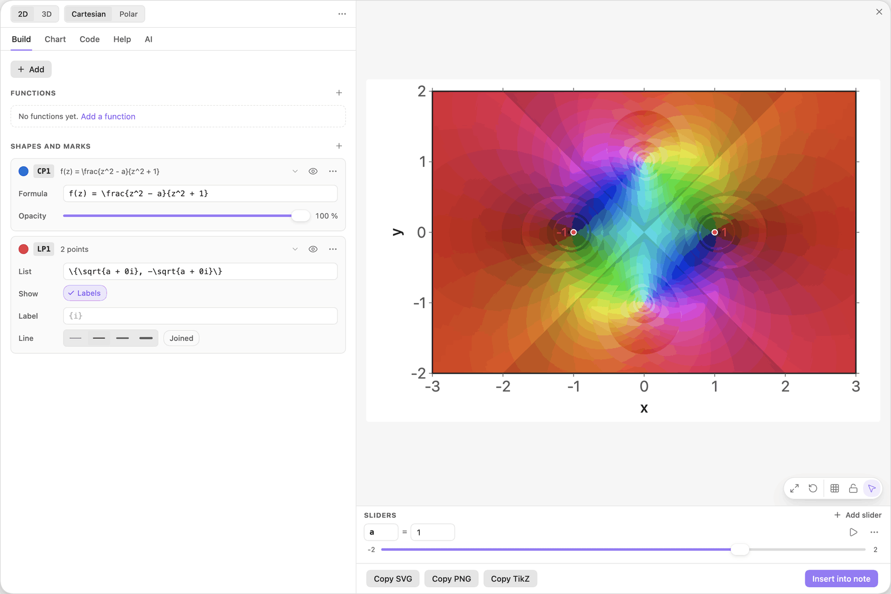

<!-- Generated by scripts/media/build-guides.mjs from src/guides. Do not edit. -->

# Colour the plane by a complex function

[All guides](README.md) · Showcase · Advanced · about 2 minutes

Each point z takes the colour of f(z): find the zeros and the poles, then move two zeros with a slider.

<p align="center"></p>

**What you can do afterwards**

- Colour the plane by f(z)
- Find zeros and poles by their colours
- Move zeros with a slider

## 1. Colour the plane by z

With f(z) = z the colour is the angle of z: red where z is a positive number, and once round the colour wheel round 0. The light grows with \|z\|.

The chart in words:

```easy-tikz
show x from -3 to 3 and y from -2 to 2
size 12 x 8
equal scale
colour the plane by $f(z) = z$
```



## 2. Find the zeros and the poles

`\frac{z^2 - 1}{z^2 + 1}` is 0 at ±1 and has poles at ±i. The colours go round each of them; zeros are dark, poles white.

The chart gets these lines:

```easy-tikz
colour the plane by $f(z) = \frac{z^2 - 1}{z^2 + 1}$
```



## 3. Move the zeros with a slider

With `a` in place of 1 the zeros are ±√a. Drag `a` below 0: they move onto the imaginary axis, and at -1 they meet the poles.

The chart gets these lines:

```easy-tikz
slider a from -2 to 2, starting at 1
colour the plane by $f(z) = \frac{z^2 - a}{z^2 + 1}$
mark the points $\{\sqrt{a + 0i}, -\sqrt{a + 0i}\}$, labelled
```



## The finished chart

Paste this block into a note to get the finished chart of this guide. Click the chart in the note to open it in the editor.

<details>
<summary>The chart as an easy-tikz block</summary>

```easy-tikz
show x from -3 to 3 and y from -2 to 2
size 12 x 8
equal scale
slider a from -2 to 2, starting at 1
colour the plane by $f(z) = \frac{z^2 - a}{z^2 + 1}$
mark the points $\{\sqrt{a + 0i}, -\sqrt{a + 0i}\}$, labelled
```

</details>

## Next guides

- [Complex numbers and maps](complex-maps.md): Mark complex numbers as points, bend a grid with z ↦ z² and colour the plane by a complex function.

[All guides](README.md)
