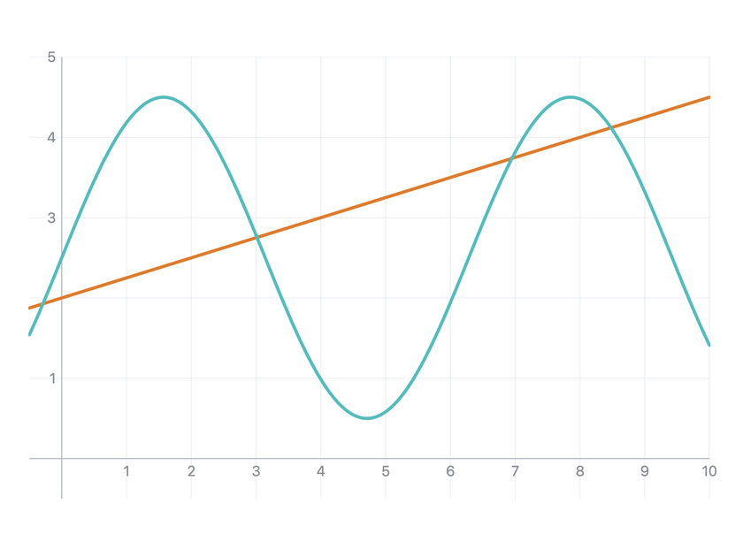
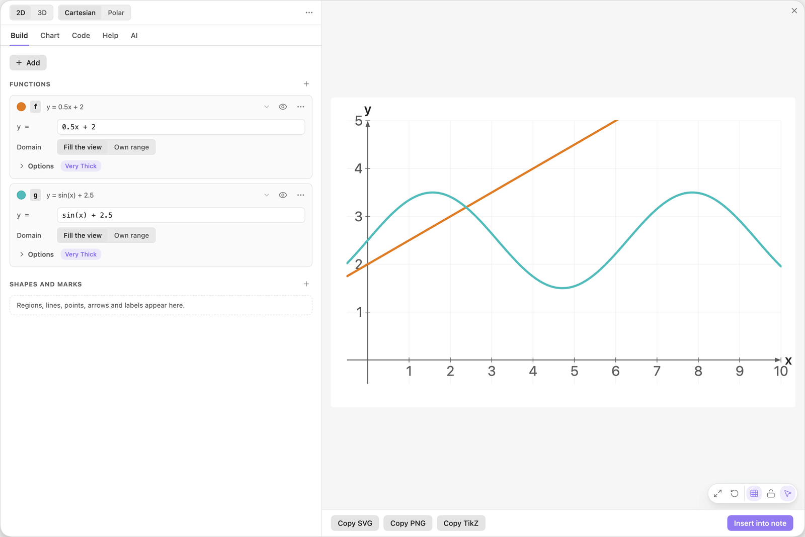
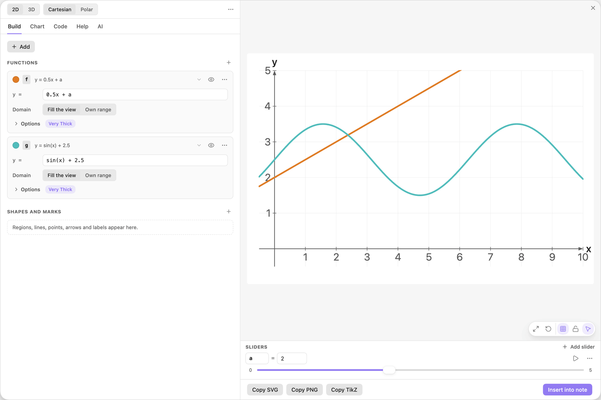
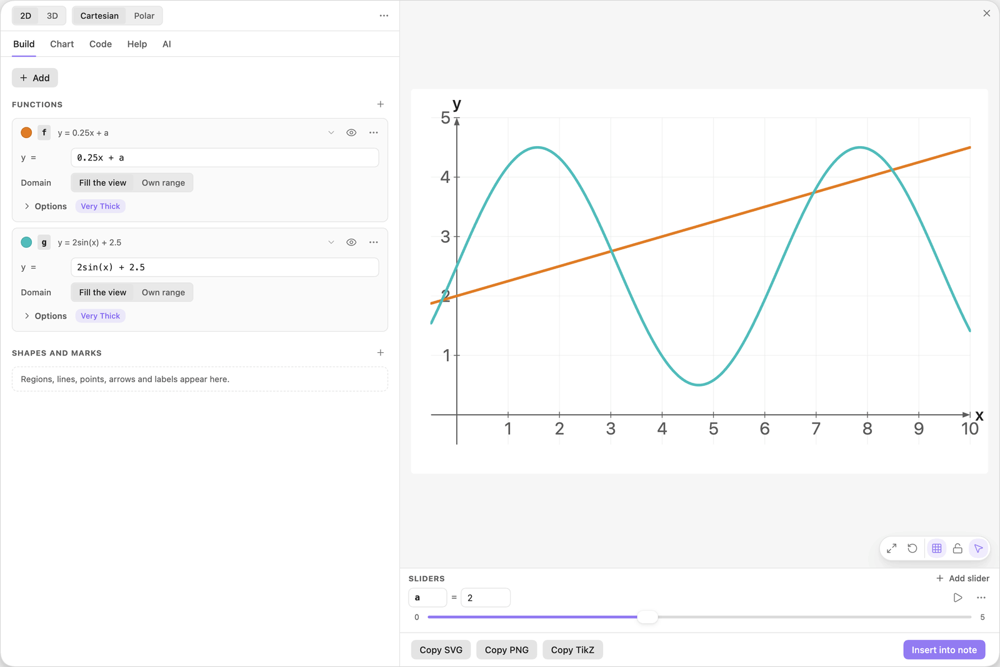

<!-- Generated by scripts/media/build-guides.mjs from src/guides. Do not edit. -->

# Drag shapes to edit them

[All guides](README.md) · Getting started · Start here · about 3 minutes

Grab a line or a curve in the preview and its numbers follow: move, turn, stretch, undo.

<p align="center"></p>

**What you can do afterwards**

- Move a line and see which number changes
- Turn a line and stretch a curve with Shift
- Keep a dragged number as a slider, or undo the drag

**Read first:** [Your first chart](first-chart.md)

## 1. Drag the line up

Plot the line `0.5x + 1` and the wave `sin(x) + 2.5`. In the preview, drag the line up one unit: the tip names the number that changes, and the line reads `0.5x + 2`.

The chart in words:

```easy-tikz
size 12 x 8
axes in the middle
with a grid
plot f(x) = 0.5x + 2 in orange, very thick
plot g(x) = sin(x) + 2.5 in teal, very thick
```



> **Tip:** A drag changes plain formulas only: a formula in LaTeX, such as `\frac{1}{2}x`, keeps its numbers.

## 2. Keep the number as a slider

For six seconds after a drag, a bar at the bottom of the left pane offers Undo and Make slider. Make slider turns the `2` into a slider `a`.

The chart gets these lines:

```easy-tikz
slider a from 0 to 5, starting at 2
plot f(x) = 0.5x + a in orange, very thick
```



> **Tip:** From now on a drag of the line moves the slider and leaves the formula alone.

## 3. Hold Shift to turn or stretch

Hold Shift over a shape: ⊕ marks the point that stays. Shift-drag the line to turn it to `0.25x + a`, and the wave's crest up to stretch it to `2sin(x) + 2.5`.

The chart gets these lines:

```easy-tikz
plot f(x) = 0.25x + a in orange, very thick
plot g(x) = 2sin(x) + 2.5 in teal, very thick
```



> **Tip:** Turns click into simple slopes unless you also hold Alt (Option on macOS) for free values.

## 4. Undo a drag

Drag the wave somewhere you did not want it, then press Cmd+Z (Ctrl+Z on Windows and Linux) or click Undo in the bar: it jumps back. Escape cancels a drag on the way.


> **Tip:** To pan instead, switch off Edit shapes by dragging: the pointer button at the bottom right of the preview.

## The finished chart

Paste this block into a note to get the finished chart of this guide. Click the chart in the note to open it in the editor.

<details>
<summary>The chart as an easy-tikz block</summary>

```easy-tikz
size 12 x 8
axes in the middle
with a grid
slider a from 0 to 5, starting at 2
plot f(x) = 0.25x + a in orange, very thick
plot g(x) = 2sin(x) + 2.5 in teal, very thick
```

</details>

## Next guides

- [Sliders that move the picture](sliders.md): Turn letters into sliders, set their range and step, press play, and connect them across a note.
- [Solve a linear program in a picture](linear-program.md): Constraint lines, the feasible region and its corners, an objective line on a slider, the maximum and the minimum.
- [Keyboard shortcuts](shortcuts.md): The keys of the editor: insert, undo, move shapes and the view, and move between tabs.

[All guides](README.md)
