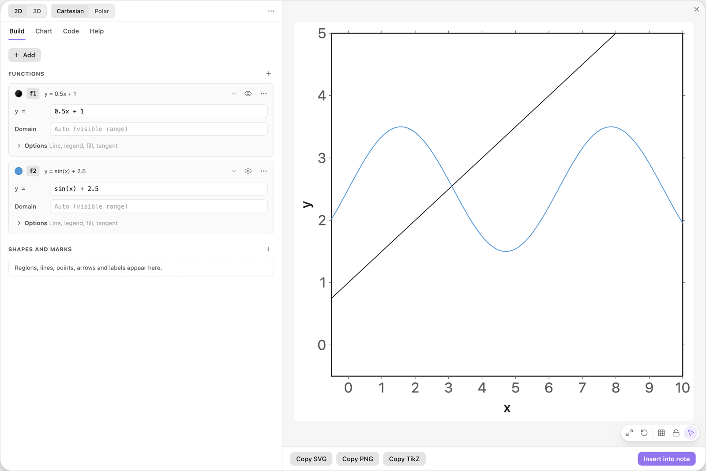
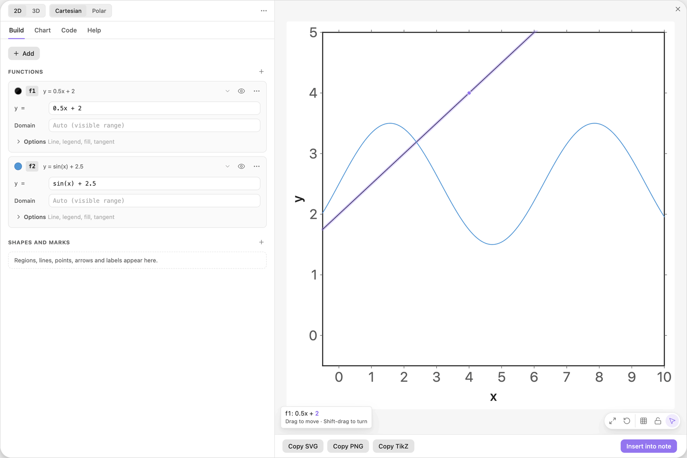
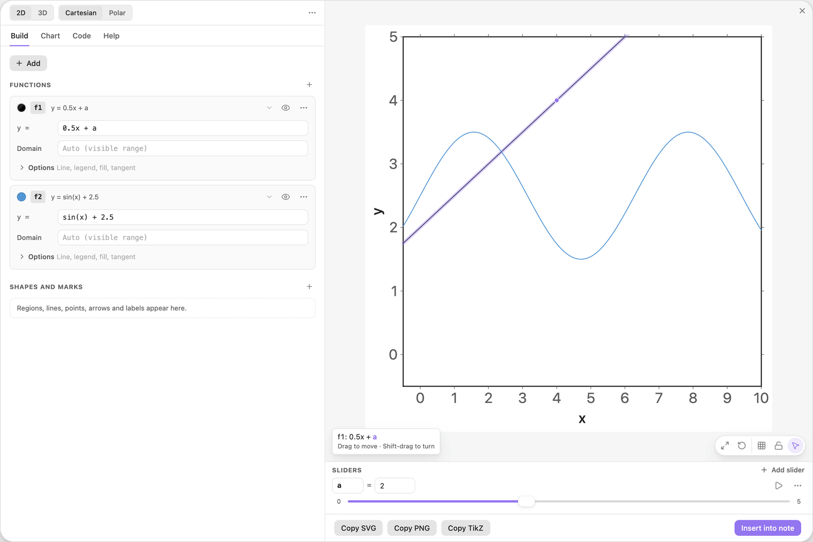
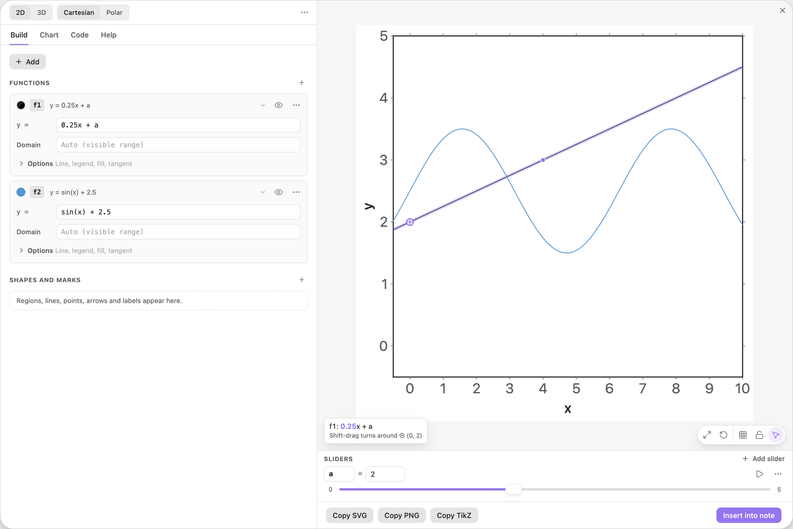
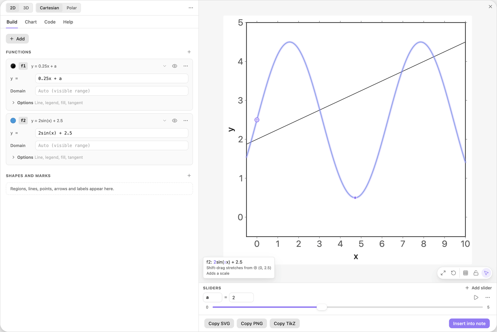
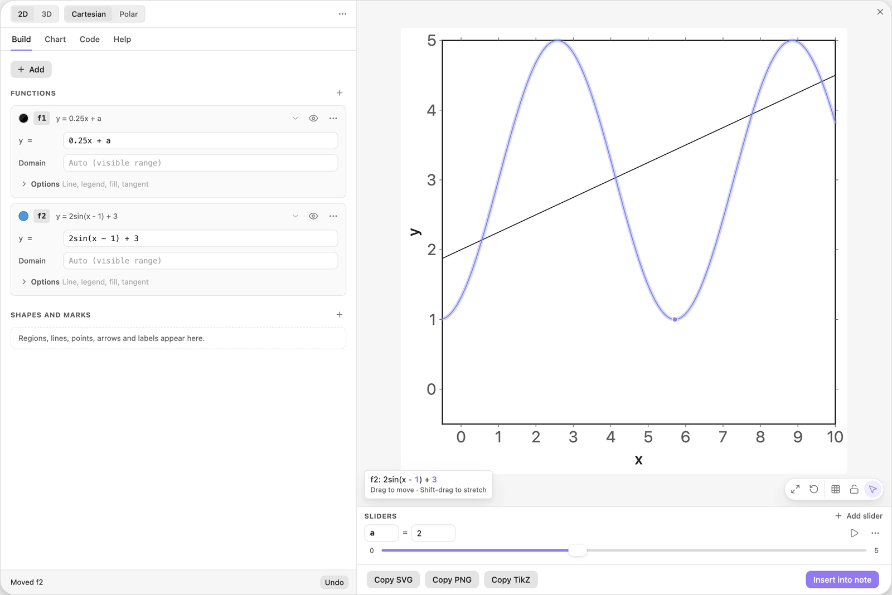
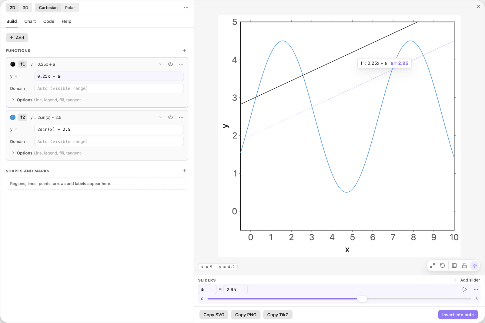
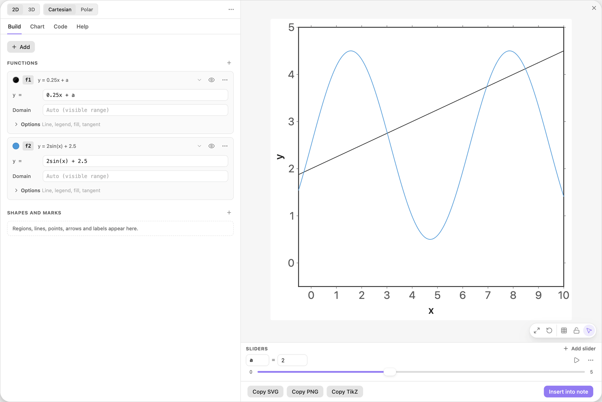

<!-- Generated by scripts/media/build-guides.mjs from src/guides. Do not edit. -->

# Drag shapes to edit them

[All guides](README.md) · Getting started · Start here · about 7 minutes

Grab a line or a curve in the preview and its numbers follow: move, turn, stretch, undo.

<p align="center"></p>

**What you can do afterwards**

- Move a shape and read the tip that says what will change
- Turn a line and stretch a curve with Shift
- Undo a drag, cancel one, or turn the dragged number into a slider
- Switch dragging off when you only want to pan

**Read first:** [Your first chart](first-chart.md)

## 1. Add a line and a wave

In a new chart, click + Add, choose Function y = f(x) and type `0.5x + 1`. Add a second function the same way and type `sin(x) + 2.5`.

These are the two shapes you are going to drag: a straight line and a curve.

| Where | Type |
| --- | --- |
| f1, y = | `0.5x + 1` |
| f2, y = | `sin(x) + 2.5` |



*A line and a wave, typed as formulas.*

## 2. Drag the line up

Rest the pointer on the line. A tip in the lower left corner of the preview shows `f1: 0.5x + 1` with the `1` highlighted: that is the number a drag will change. (The very first time, the tip explains the gestures for a few seconds instead.)

Press on the line near x = 4 and drag it up by one unit. The line follows the pointer, the card reads `0.5x + 2`, and a bar at the bottom of the left pane says Moved f1.



*After the drag the card reads 0.5x + 2. The tip marks the number the next drag would change.*

> **Tip:** Only numbers are rewritten. Your spacing and your way of writing the formula stay as typed, and dragging back restores the text exactly.

## 3. Keep the number as a slider

For 6 seconds after the drag, the bar at the bottom of the left pane offers two buttons: Undo and Make slider. Click Make slider.

The `2` you just dragged becomes a slider `a`: the formula reads `0.5x + a`, and the Sliders dock appears with `a = 2` and a range from 0 to 5. From now on a drag of the line moves the slider and leaves the formula alone, because sliders take a change first.



*The dragged number is now the slider a. The tip highlights a: the next drag moves the slider.*

> **Tip:** Bar already gone? Drag the line away and back to `0.5x + 2`. Make slider is offered after every drag that changed exactly one number you typed.

## 4. Hold Shift to turn the line

Hold Shift and rest the pointer on the line. A ring with a cross, ⊕, appears at (0, 2), and the tip says that a Shift-drag turns the line around it. Easy TikZ places ⊕ where a single number does the turn: for this line, the point on the y-axis.

Keep Shift down and drag the line from (4, 4) down to (4, 3). It turns around ⊕ and clicks into the slope 1/4. The card reads `0.25x + a`.



*Shift held over the turned line: the pivot ⊕ sits at (0, 2).*

> **Tip:** Turns click into simple slopes such as 1, 1/2 or horizontal. Hold Alt (Option on macOS) as well for a free angle and free values.

## 5. Stretch the wave with Shift

Hold Shift over the wave. Its ⊕ sits at (0, 2.5), and the tip adds the note Adds a factor and a scale: the formula has no number that could stretch it, so the drag inserts one.

Shift-drag the first crest from 3.5 up to 4.5. The wave doubles its height around ⊕, and the card reads `2sin(x) + 2.5`.



*The stretched wave. With Shift held, ⊕ marks the point that stays where it is.*

> **Tip:** Sliders change first, then the numbers you typed, and only then a number is inserted. A constant exponent, such as the 2 in `x^2`, never changes.

## 6. Undo a drag

Drag the wave somewhere you did not want it. The bar at the bottom of the left pane names the step, Moved f2, and offers Undo. Click it, or press Cmd+Z (Ctrl+Z on Windows and Linux). Inside a text field the same keys undo your typing instead.

Every finished drag is one step. Up to 50 steps can be undone while the editor stays open, and Cmd+Shift+Z redoes a step you undid with Cmd+Z. A step taken back with the Undo button in the bar leaves the history, so it cannot be redone.



*Right after an unwanted drag: the bar offers Undo for 6 seconds.*

> **Tip:** The same Undo brings back a deleted card or slider and takes back a slider change.

## 7. Cancel with Escape

Start dragging the line and, with the mouse button still down, press Escape. The line jumps back and the slider returns to its old value, as if you had never touched it.

While you drag, a dashed ghost marks where the shape started, and the tip follows the pointer with the live value.



*In the middle of a drag: the ghost shows the start, the tip the live value of a. Escape puts everything back.*

## 8. Switch dragging off

Sometimes you only want to pan. Click the pointer button, Edit shapes by dragging, in the small toolbar at the bottom right of the preview. With it off, a drag pans the view wherever it starts, and the choice is remembered.

With dragging on you can still pan: drag empty space, or hold Space and drag from anywhere.



*The pointer button at the bottom right of the preview switches drag to edit on and off.*

> **Tip:** Computed points, such as intersections or an optimum, cannot be dragged. The tip names the lines to drag instead.

## The finished chart

Paste this block into a note to get the finished chart of this guide. Click the chart in the note to open it in the editor.

<details>
<summary>The chart as an easy-tikz block</summary>

```easy-tikz
slider a from 0 to 5, starting at 2
plot f1(x) = 0.25x + a
plot f2(x) = 2sin(x) + 2.5 in blue
```

</details>

## Next guides

- [Sliders that move the picture](sliders.md): Turn a letter in a formula into a slider, set its range, play it and print its value in the chart.
- [Solve a linear program in a picture](linear-program.md): Feasible region, labelled constraint lines, an objective line on a slider, the optimum, the corners, and a sensitivity test by dragging.
- [Keyboard, mouse and troubleshooting](shortcuts.md): Every shortcut of the editor, what the mouse does in the preview, and fixes for the usual problems.

[All guides](README.md)
