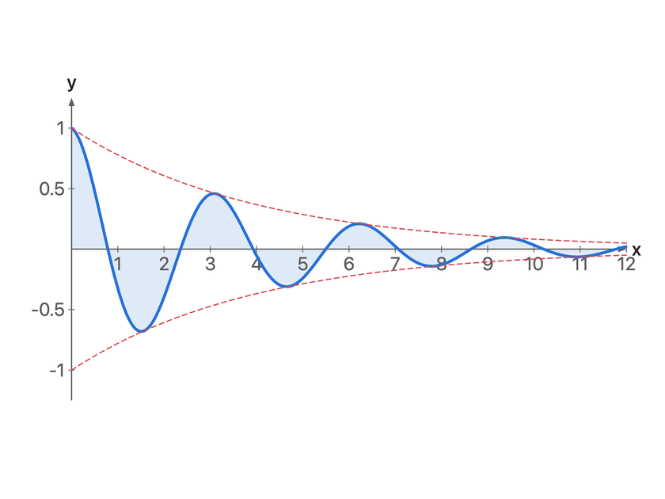
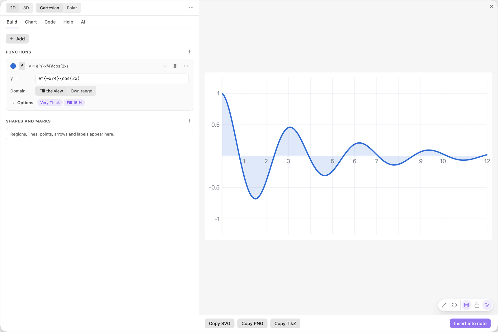
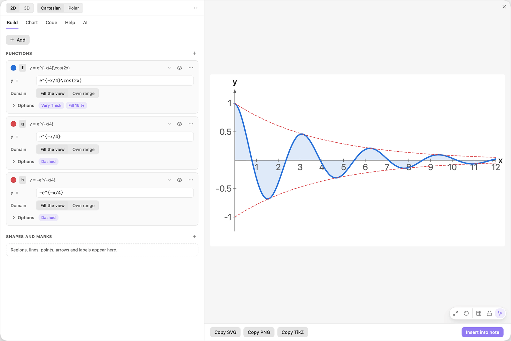
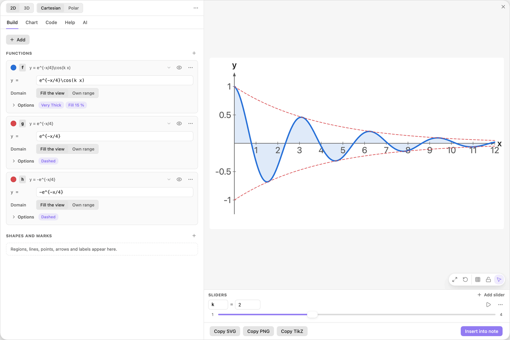

<!-- Generated by scripts/media/build-guides.mjs from src/guides. Do not edit. -->

# Export to LaTeX

[All guides](README.md) · Notes and export · Core · about 3 minutes

Copy a chart as pgfplots code, compile it with pdflatex, or take only the picture for your document.

<p align="center"></p>

**What you can do afterwards**

- Copy a chart as a LaTeX document and compile it
- Read and copy the code in the Code tab
- Get only the `tikzpicture` for your own document

**Read first:** [Your first chart](first-chart.md)

## 1. Copy the chart as TikZ

Copy TikZ, at the bottom of the editor, puts the chart on the clipboard as pgfplots code: a whole LaTeX document, in the colours of the preview.

The chart in words:

```easy-tikz
show x from 0 to 12 and y from -1.25 to 1.25
size 12 x 7
axes in the middle
plot $f(x) = e^{-x/4}\cos(2x)$ in blue, very thick, filled, opacity 0.15
```



> **Tip:** `size 12 x 7` is the size of the figure on paper, in centimetres.

## 2. Compile it with pdflatex

Paste the code into a file such as `chart.tex` and run `pdflatex chart.tex`. You get a PDF cropped to the picture.

The chart gets these lines:

```easy-tikz
plot $g(x) = e^{-x/4}$ in red, dashed
plot $h(x) = -e^{-x/4}$ in red, dashed
```



> **Tip:** It needs pgfplots, which TeX Live and MiKTeX include; charts in your notes need no LaTeX.

## 3. Read the code in the Code tab

The Code tab shows the same code for the chart as it is now. Sliders are written in at their values, so copy again after you move one.

The chart gets these lines:

```easy-tikz
slider k from 1 to 4, starting at 2, in steps of 0.5
plot $f(x) = e^{-x/4}\cos(k x)$ in blue, very thick, filled, opacity 0.15
```


## 4. Leave out the document setup

Switch off Standalone document in the Code tab to get only the `tikzpicture`. Its first lines, `% Needs:`, list what your preamble must load.

The chart gets these lines:

```easy-tikz
snippet
```



> **Tip:** In the lines of the chart, this switch is the word `snippet`.

## The finished chart

Paste this block into a note to get the finished chart of this guide. Click the chart in the note to open it in the editor.

<details>
<summary>The chart as an easy-tikz block</summary>

```easy-tikz
snippet
show x from 0 to 12 and y from -1.25 to 1.25
size 12 x 7
axes in the middle
slider k from 1 to 4, starting at 2, in steps of 0.5
plot $f(x) = e^{-x/4}\cos(k x)$ in blue, very thick, filled, opacity 0.15
plot $g(x) = e^{-x/4}$ in red, dashed
plot $h(x) = -e^{-x/4}$ in red, dashed
```

</details>

## Next guides

- [Keyboard shortcuts](shortcuts.md): The keys of the editor: insert, undo, move shapes and the view, and move between tabs.
- [Charts as SVG files](svg-files.md): Keep every chart of a note as an SVG file too, for Obsidian Publish, GitHub and other apps.

[All guides](README.md)
