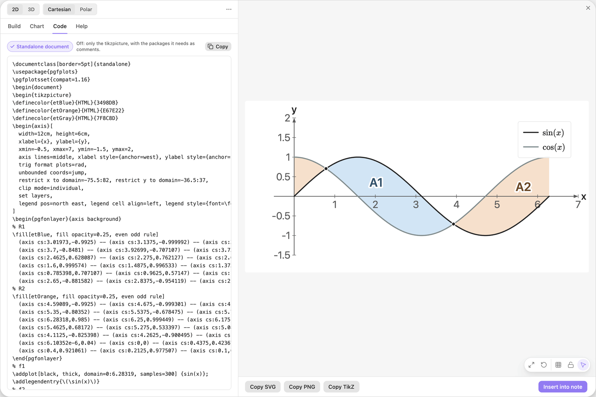
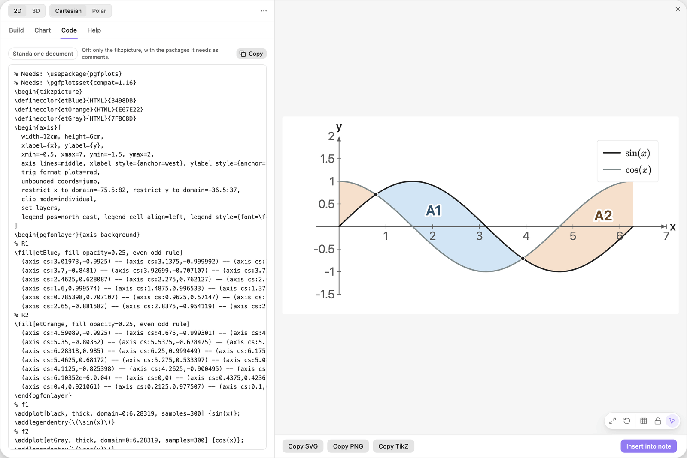
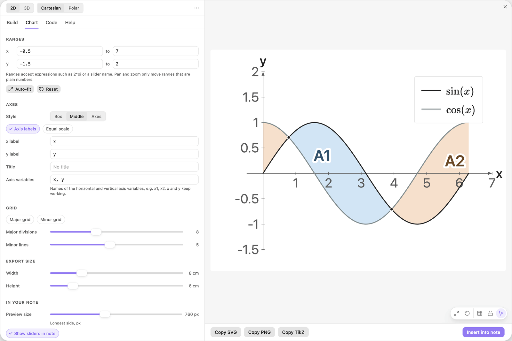
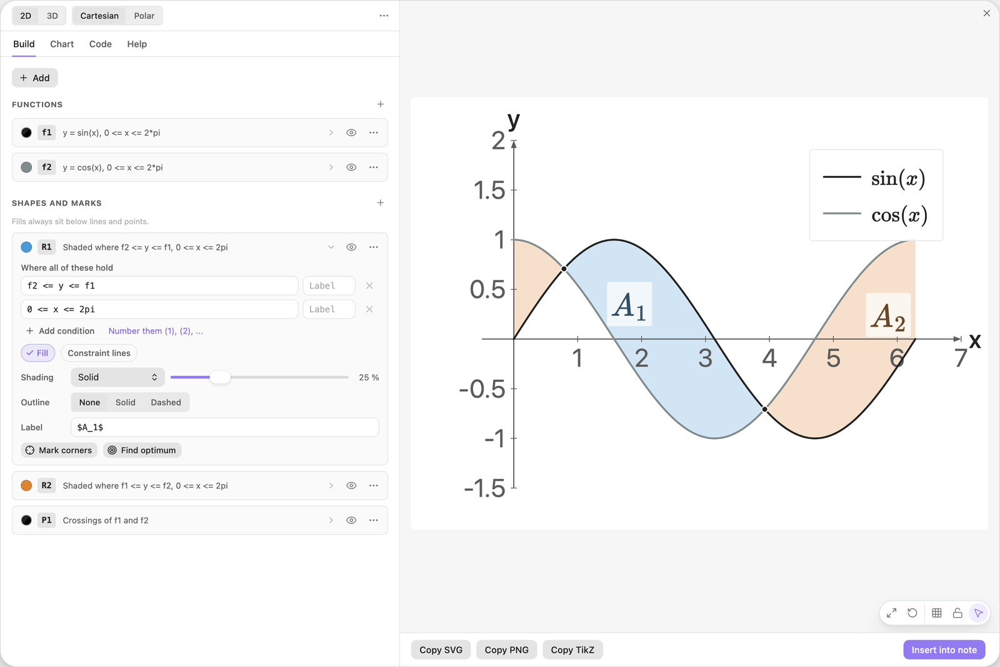
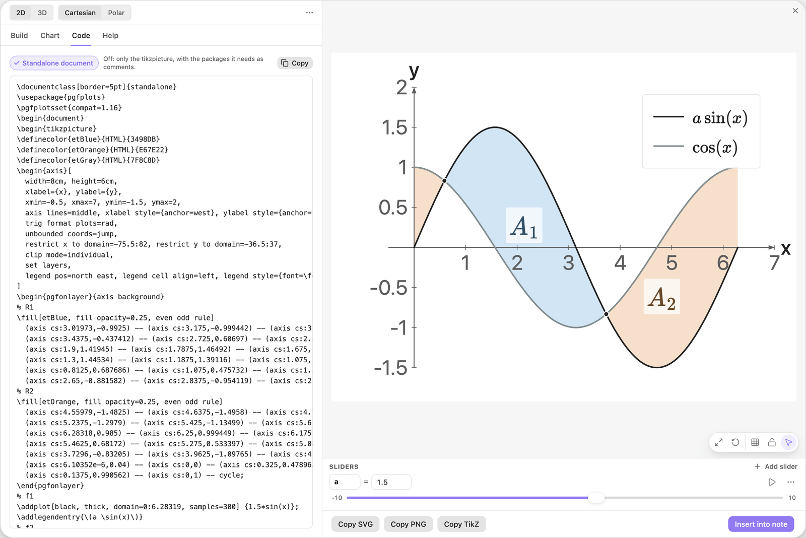

<!-- Generated by scripts/media/build-guides.mjs from src/guides. Do not edit. -->

# Export to LaTeX

[All guides](README.md) · Notes and export · Core · about 10 minutes

Get pgfplots code that compiles with pdflatex: as a standalone document or as a snippet, at the size you need, in the colours of the preview.

<p align="center"></p>

**What you can do afterwards**

- Copy a complete document or a snippet for your own preamble
- Set the size of the figure and understand the size of its text
- Know which parts are formulas and which are frozen coordinates

**Read first:** [Your first chart](first-chart.md)

## 1. Open the Code tab

Open the editor and load the example Areas between two curves: click its tile under Or open an example, or pick it from the ... menu in the header. Then click the Code tab.

The tab shows the LaTeX for the chart as a complete document. It starts with `\documentclass[border=5pt]{standalone}`, loads `pgfplots`, and ends with `\end{document}`.



*The Code tab with Standalone document switched on: a complete LaTeX file.*

> **Tip:** The Code tab always shows fresh code for the chart as it is now. The one exception is code you typed in yourself (see the last step).

## 2. Copy and compile it

Click Copy in the Code tab. Copy TikZ in the bar at the bottom does the same from any tab. Paste the code into a new file, for example `chart.tex`, and run `pdflatex chart.tex`.

The result is a PDF that is cropped to the picture, with a border of 5 pt. Include it in other documents with `\includegraphics`.

> **Tip:** Compiling needs a TeX installation with pgfplots (TeX Live and MiKTeX include it). Charts in your notes do not need one.

## 3. Switch to a snippet

To put the figure straight into your own document, switch off Standalone document in the Code tab. The code is now only the `tikzpicture`.

Its first lines start with `% Needs:` and list what your preamble must load: `\usepackage{pgfplots}` and `\pgfplotsset{compat=1.16}`.



*Standalone document off: only the tikzpicture, with the needed packages as comments.*

> **Tip:** A patterned fill or a brace needs a TikZ library as well (`patterns`, `decorations.pathreplacing`). It is listed in the same `% Needs:` lines, so copy all of them into your preamble.

## 4. Set the size on paper

Switch Standalone document back on, then open the Chart tab. Under Export size, drag Width from 12 cm to 8 cm. Height stays at 6 cm. The two set the width and height of the figure in the PDF.

The preview takes the same shape, and its text is drawn at the size it has in the PDF, so you can judge the result before you compile.



*Export size set to 8 by 6 cm. The preview follows the new proportions.*

> **Tip:** Text keeps its size in points when the figure shrinks, so a small figure has relatively large labels. If labels crowd each other, make the figure larger.

## 5. Check colours and label text

Colours: every palette colour the chart uses is defined inside the picture, for example `\definecolor{etBlue}{HTML}{3498DB}`, so the PDF shows the blue of the preview and not the blue of xcolor. The first swatch, Auto, follows your theme in Obsidian and exports as black.

Text: labels are escaped for LaTeX, so `50%` or `x_1` print as typed, and text between dollar signs is math. Try it in the Build tab: open R1 and R2 and change their labels as below. The sizes S, M and L of a text label are `\footnotesize`, `\small` and `\large`.

| Where | Type |
| --- | --- |
| R1, Label | `$A_1$` |
| R2, Label | `$A_2$` |



*Region labels written as math between dollar signs.*

> **Tip:** In a label, `{` and `}` mark a placeholder such as `{a}`. Braces right after `^`, `_` or a LaTeX command stay LaTeX, as in `$x^{2}$`. For any other LaTeX brace, type `{{` and `}}`.

## 6. See what is frozen

In the card f1, change the formula as below and click Add slider a. Drag a to 1.5 and look at the Code tab again.

Functions are exported as formulas, with the current value of every slider written in: the line for f1 now plots `1.5*sin(x)`. Regions, curves from equations, points, segments and braces are computed by the plugin and exported as coordinates. They match the preview exactly, but they do not recompute when you edit the LaTeX.

| Where | Type |
| --- | --- |
| f1, y = | `a sin(x)` |



*The value of the slider is written into the code.*

> **Tip:** The LaTeX is a snapshot. After you move a slider or change a formula, copy the code again. The legend still shows the formula as typed, with the letter a.

## 7. Edit by hand or regenerate

You can type in the Code tab. A banner then says "Edited by hand. Chart changes are not applied here." Copy now copies your edited text.

Regenerate throws your edits away and writes fresh code. Keep edits hides the banner and keeps your text. Insert into note always saves the chart settings, never this text.

> **Tip:** Keep lasting hand edits in your `.tex` file, not in the editor. They are gone as soon as you press Regenerate.

## The finished chart

Paste this block into a note to get the finished chart of this guide. Click the chart in the note to open it in the editor.

<details>
<summary>The chart as an easy-tikz block</summary>

```easy-tikz
show x from -0.5 to 7 and y from -1.5 to 2
size 8 x 6
axes in the middle
slider a from -10 to 10, starting at 1.5, in steps of 0.1
plot f1(x) = a sin(x) from x = 0 to 2*pi, thick, with a legend
plot f2(x) = cos(x) from x = 0 to 2*pi in gray, thick, with a legend
shade where f2 <= y <= f1 and 0 <= x <= 2pi, labelled "$A_1$"
shade where f1 <= y <= f2 and 0 <= x <= 2pi in orange, labelled "$A_2$"
mark where f1 and f2 cross in black
```

</details>

## Next guides

- [Charts in your notes](charts-in-notes.md): Insert a chart into a note, play with its sliders there, set its width and alignment, and open it again to change it.
- [Coming from 3.x](from-3x.md): What happens to your old charts, where the eight tabs went, and which new tool replaces each old one.
- [Keyboard, mouse and troubleshooting](shortcuts.md): Every shortcut of the editor, what the mouse does in the preview, and fixes for the usual problems.

[All guides](README.md)
