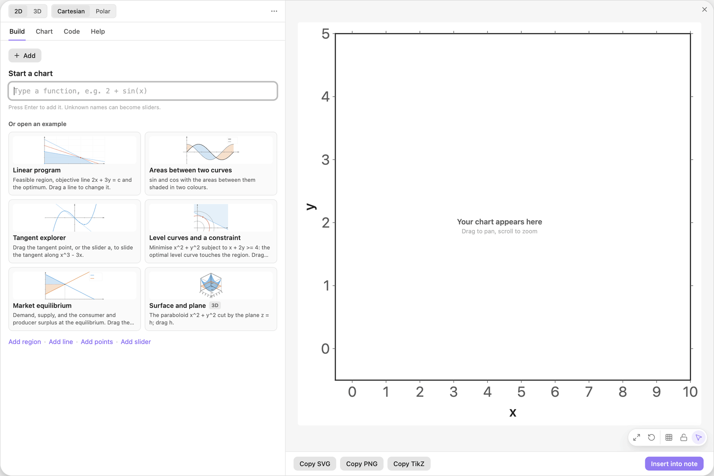
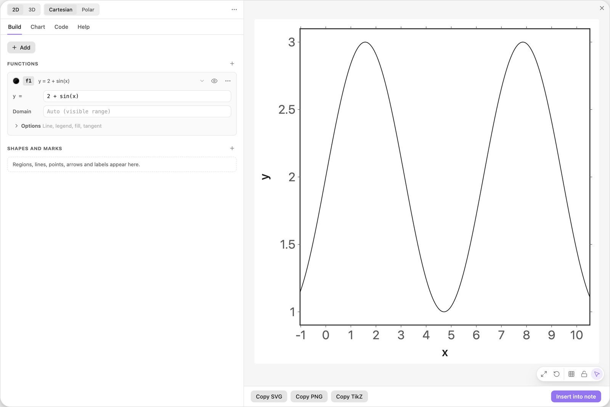
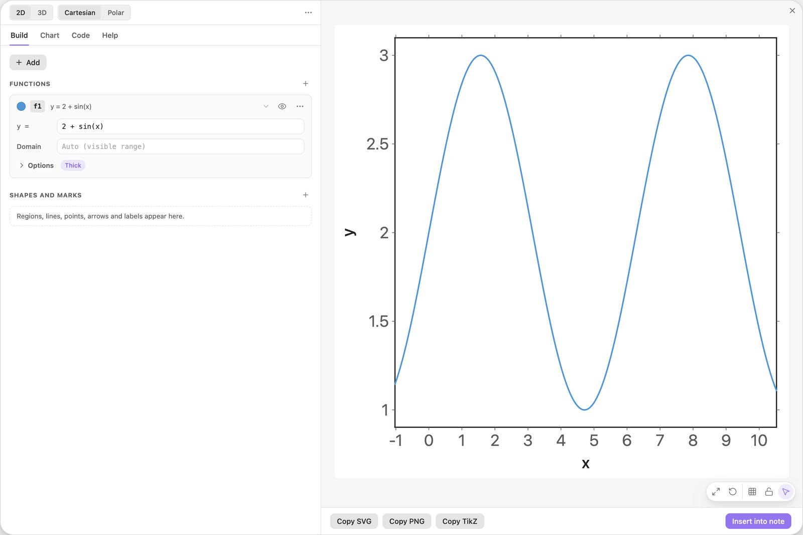
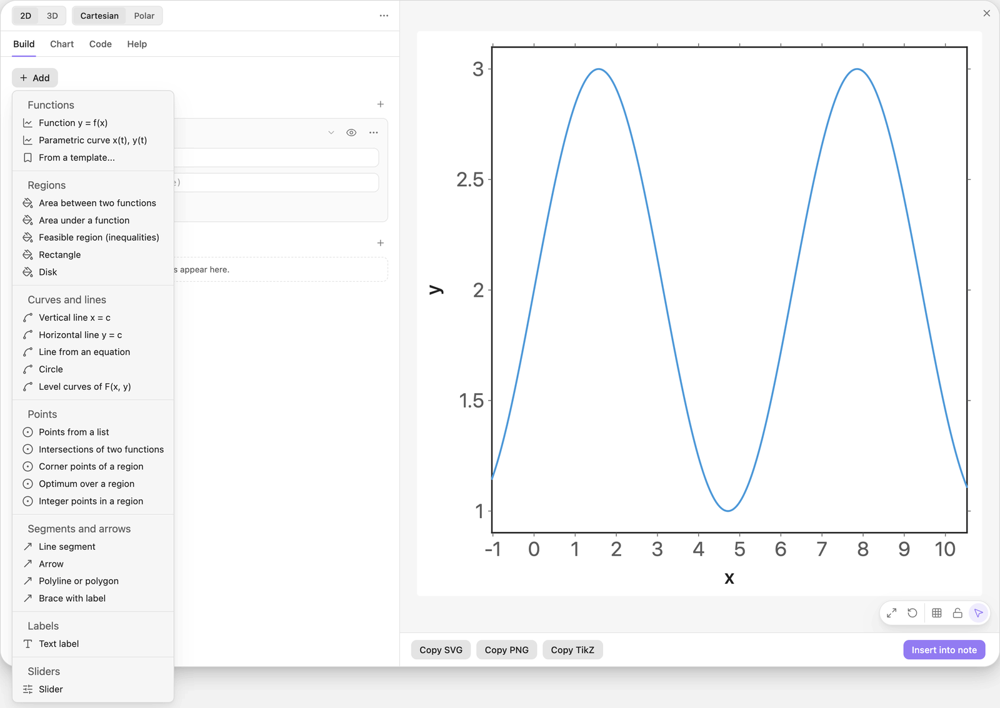
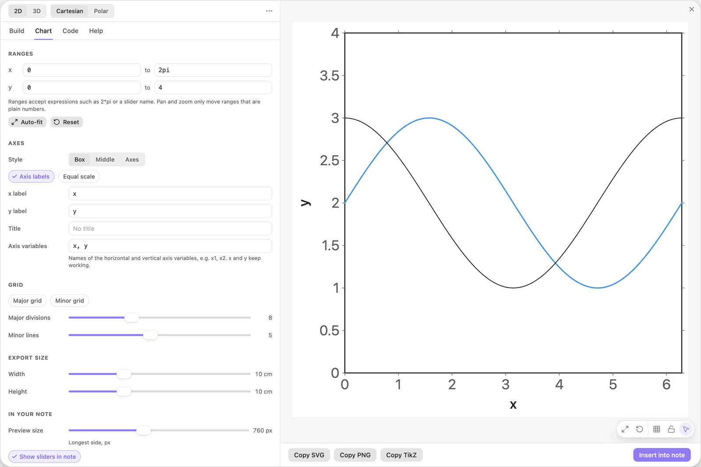
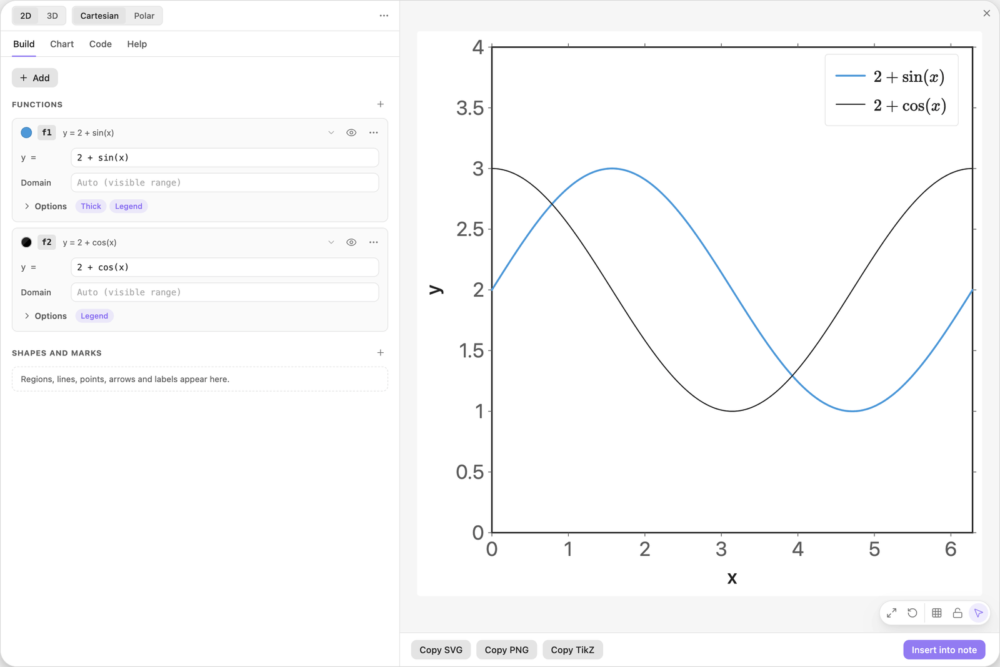
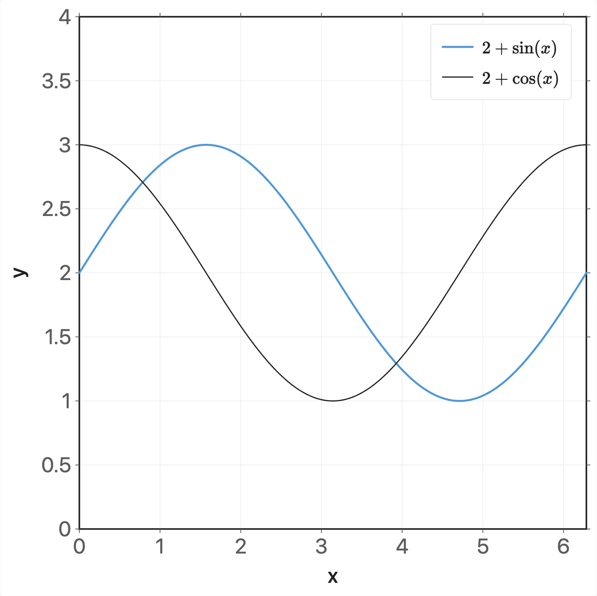
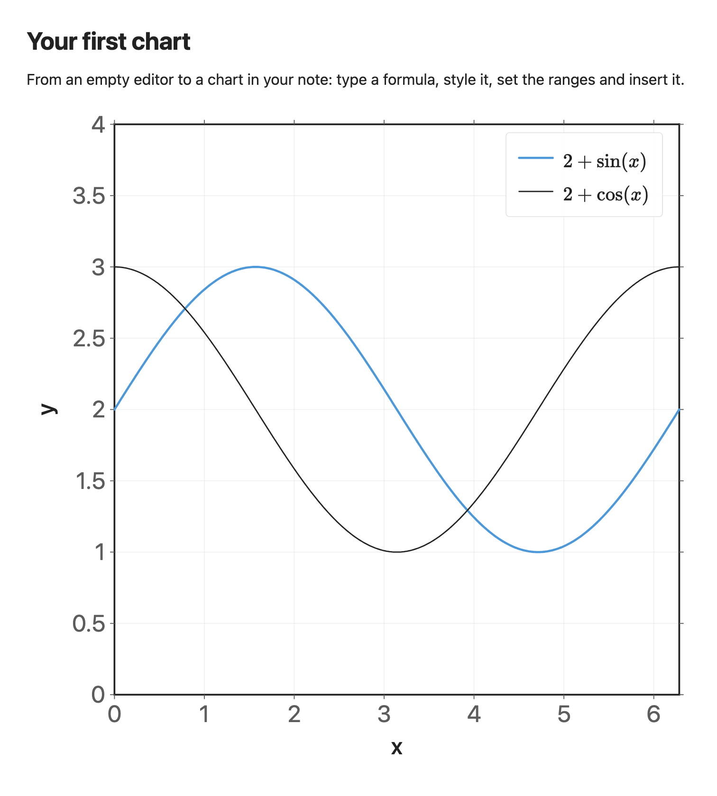

<!-- Generated by scripts/media/build-guides.mjs from src/guides. Do not edit. -->

# Your first chart

[All guides](README.md) · Getting started · Start here · about 5 minutes

From an empty editor to a chart in your note: type a formula, style it, set the ranges and insert it.

<p align="center"></p>

**What you can do afterwards**

- Open the editor and plot a formula
- Style a curve and add a second one
- Set the ranges, add a legend and switch on the grid
- Insert the chart into a note and edit it again later

## 1. Open the editor

Open a note and put the cursor where the chart should go.

Click the Easy TikZ icon in the ribbon on the left, or run `Easy TikZ: Open editor` from the command palette. The editor opens on the Build tab with the heading Start a chart. The preview on the right is still empty.



*A new chart: the Build tab on the left, the empty preview on the right.*

> **Tip:** Insert into note writes the chart at the cursor, so place the cursor before you open the editor.

## 2. Type a formula and press Enter

Type the formula into the field under Start a chart and press Enter.

A card named `f1` appears with the summary `y = 2 + sin(x)`, and the curve is drawn. Because the ranges were still the defaults, the editor fits them to the curve once. From now on the preview redraws while you type.

| Where | Type |
| --- | --- |
| Start a chart | `2 + sin(x)` |



*The first function card and its curve. The ranges were fitted to the curve.*

> **Tip:** Functions need brackets: write `sin(x)`, not `sin x`. If you forget them, the message under the field offers the button Use sin(x).

## 3. Pick a colour and a thicker line

Click the colour swatch at the left end of the `f1` card and pick Blue from the grid.

Then click Options on the card and choose the third sample in the Line row. The curve is now blue and thick. When you close Options again, a small Thick pill stays on the card, so you see what is switched on without opening it.



*The curve in blue with a thick line.*

> **Tip:** The first colour in the grid is Auto: it follows the text colour of your theme on screen and exports as black.

## 4. Add a second function

Click + Add at the top of the Build tab and choose Function y = f(x). A new card `f2` appears with the cursor in its formula field.

Type the formula. The second curve appears while you type.

| Where | Type |
| --- | --- |
| f2, y = | `2 + cos(x)` |



*The + Add menu lists everything you can draw. Function y = f(x) is its first entry.*

> **Tip:** Everything else starts at + Add as well: regions, lines, points, arrows, text labels and sliders.

## 5. Set the ranges

The automatic fit left odd bounds such as -1.025. Open the Chart tab and type your own under Ranges: x from `0` to `2pi`, y from `0` to `4`.

The preview now shows exactly one period, with room above the curves. Ranges accept formulas, so `2pi` works as typed.

| Where | Type |
| --- | --- |
| Chart \> Ranges, x from | `0` |
| Chart \> Ranges, x to | `2pi` |
| Chart \> Ranges, y from | `0` |
| Chart \> Ranges, y to | `4` |



*The Chart tab holds ranges, axes, grid and export size.*

> **Tip:** An axis whose bound is a formula stays fixed when you pan or zoom the preview. Bounds that are plain numbers move.

## 6. Show a legend

Back in the Build tab, open Options on the `f1` card and click Legend. Do the same on the `f2` card.

A legend box appears at the top right of the plot and shows each formula. To print your own words instead, type them into the Legend field that appears below the chips.



*Legend switched on for both functions.*

## 7. Switch on the grid

Click the grid button in the small toolbar at the bottom right of the preview. Grid lines appear behind the curves.

The same switch is called Major grid in the Chart tab, under Grid, next to the minor grid and the number of divisions.



*The finished chart: two curves, a legend and the major grid.*

## 8. Insert it into your note

Click Insert into note at the bottom right, or press Cmd+Enter (Ctrl+Enter on Windows and Linux). The editor closes and the chart is drawn in your note. It is stored there as an `easy-tikz` code block.

To change it later, click the chart in the note. The editor opens with every setting filled in, and the button now reads Save changes.



*The chart in the note. Click it to edit it again.*

> **Tip:** Closed the editor by accident? Nothing is lost. The next time you open it, it offers to restore the unsaved chart.

## The finished chart

Paste this block into a note to get the finished chart of this guide. Click the chart in the note to open it in the editor.

<details>
<summary>The chart as an easy-tikz block</summary>

```easy-tikz
{
  "v": 4,
  "dimension": false,
  "documentSetup": true,
  "title": "",
  "size_x_cm": 10,
  "size_y_cm": 10,
  "show_axis_label": true,
  "axis_label_x": "x",
  "axis_label_y": "y",
  "showAxis": true,
  "showLargeGrid": true,
  "showSmallGrid": false,
  "gridSize": 5,
  "majorTickNum": 8,
  "xmin": "0",
  "xmax": "2pi",
  "ymin": "0",
  "ymax": "4",
  "zmin": "-5",
  "zmax": "5",
  "axis_style": "box",
  "coordinateSystem": "cartesian",
  "axis_label_x_polar": "",
  "axis_label_y_polar": "",
  "axis_label_z": "z",
  "rotationX": 30,
  "rotationZ": 45,
  "zoom3D": 1,
  "boxAspect": "true",
  "previewSize": 760,
  "functions": [
    {
      "expression": "2 + sin(x)",
      "domain": "",
      "showLegend": true,
      "fill": false,
      "fillOpacity": 0.2,
      "fillPattern": "solid",
      "tangent": false,
      "color": "blue",
      "dashed": false,
      "tangentPoint": "",
      "extrema": false,
      "thickness": "thick",
      "parametric": false,
      "expressionY": "",
      "name": "f1"
    },
    {
      "expression": "2 + cos(x)",
      "domain": "",
      "showLegend": true,
      "fill": false,
      "fillOpacity": 0.2,
      "fillPattern": "solid",
      "tangent": false,
      "color": "black",
      "dashed": false,
      "tangentPoint": "",
      "extrema": false,
      "thickness": "thin",
      "parametric": false,
      "expressionY": "",
      "name": "f2"
    }
  ],
  "functions3D": [],
  "tools": [],
  "annotations": [],
  "parameters": [],
  "variables": "x, y",
  "equalScale": false,
  "showSlidersInNote": true
}
```

</details>

## Next guides

- [Write formulas that work](formulas.md): Leave out the multiplication sign safely, avoid the traps ax and 1/2x, call functions by name and limit them with a domain.
- [Drag shapes to edit them](drag-to-edit.md): Grab a line or a curve in the preview and its numbers follow: move, turn, stretch, undo.
- [Sliders that move the picture](sliders.md): Turn a letter in a formula into a slider, set its range, play it and print its value in the chart.

[All guides](README.md)
