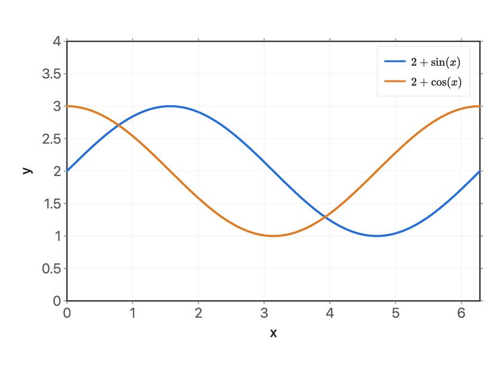
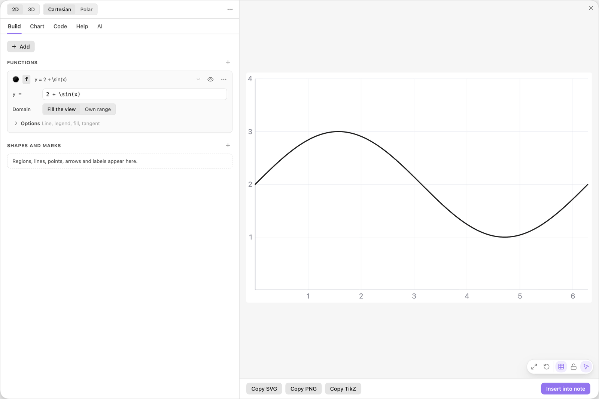
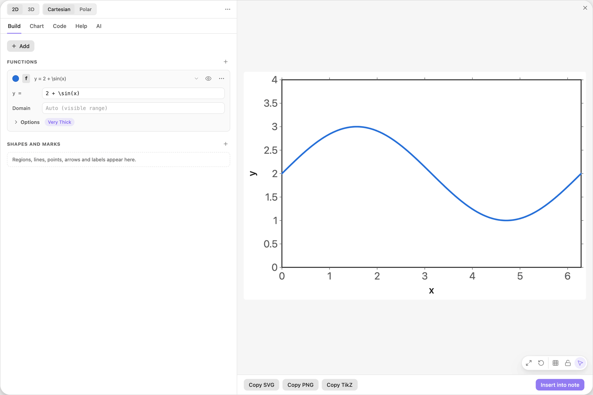
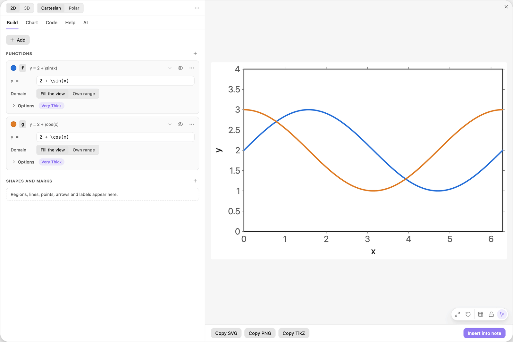
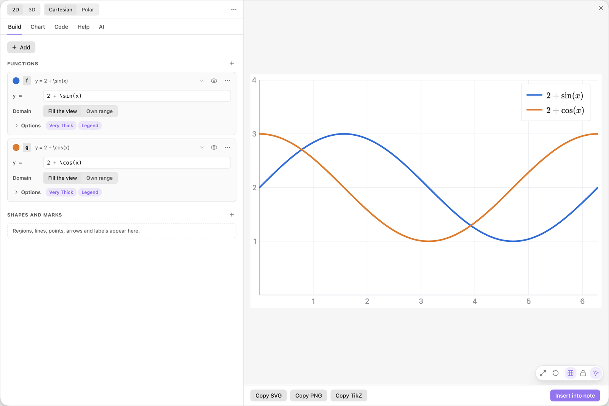

<!-- Generated by scripts/media/build-guides.mjs from src/guides. Do not edit. -->

# Your first chart

[All guides](README.md) · Getting started · Start here · about 3 minutes

Open the editor, plot two formulas, give them colours, a legend and a grid, and insert the chart.

<p align="center"></p>

**What you can do afterwards**

- Open the editor and plot a formula
- Style curves with colours, a legend and a grid
- Insert the chart into a note and edit it again

## 1. Type a formula and press Enter

Put the cursor in a note where the chart goes. Run `Easy Graphs, Charts & TikZ: Open editor` from the command palette or the ribbon, type `2 + \sin(x)` under Start a chart and press Enter.

The chart in words:

```easy-tikz
show x from 0 to 2pi and y from 0 to 4
size 12 x 8
plot $f(x) = 2 + \sin(x)$
```



> **Tip:** Formula fields take LaTeX as in your notes, or the plain form `2 + sin(x)`.

## 2. Pick a colour and a thick line

Click the colour swatch at the left of the card and pick Blue. Under Options, pick Very Thick in the Line row.

The chart gets these lines:

```easy-tikz
plot $f(x) = 2 + \sin(x)$ in blue, very thick
```



## 3. Add a second function

Click + Add, choose Function y = f(x) and type `2 + \cos(x)`. Give it Orange and Very Thick the same way.

The chart gets these lines:

```easy-tikz
plot $g(x) = 2 + \cos(x)$ in orange, very thick
```



## 4. Show a legend and a grid

Click Legend under Options on each card: a box names the curves. The Major grid button at the bottom right of the preview adds the grid.

The chart gets these lines:

```easy-tikz
with a grid
plot $f(x) = 2 + \sin(x)$ in blue, very thick, with a legend
plot $g(x) = 2 + \cos(x)$ in orange, very thick, with a legend
```



## 5. Insert it into your note

Click Insert into note or press Cmd+Enter (Ctrl+Enter on Windows and Linux). The note keeps these lines in an `easy-tikz` block, and a click on the chart edits it again.


> **Tip:** If you close the editor by accident, it offers the unsaved chart the next time it opens.

## The finished chart

Paste this block into a note to get the finished chart of this guide. Click the chart in the note to open it in the editor.

<details>
<summary>The chart as an easy-tikz block</summary>

```easy-tikz
show x from 0 to 2pi and y from 0 to 4
size 12 x 8
with a grid
plot $f(x) = 2 + \sin(x)$ in blue, very thick, with a legend
plot $g(x) = 2 + \cos(x)$ in orange, very thick, with a legend
```

</details>

## Next guides

- [Every formula is a chart](notes-formulas.md): Rest the pointer on a formula in a note: its chart opens in a card, with sliders, ready to insert.
- [Write a chart in words](chart-language.md): Build a linear program line by line: the window, a region, a slider, a moving line and the best point.
- [Sliders that move the picture](sliders.md): Turn letters into sliders, set their range and step, press play, and connect them across a note.

[All guides](README.md)
