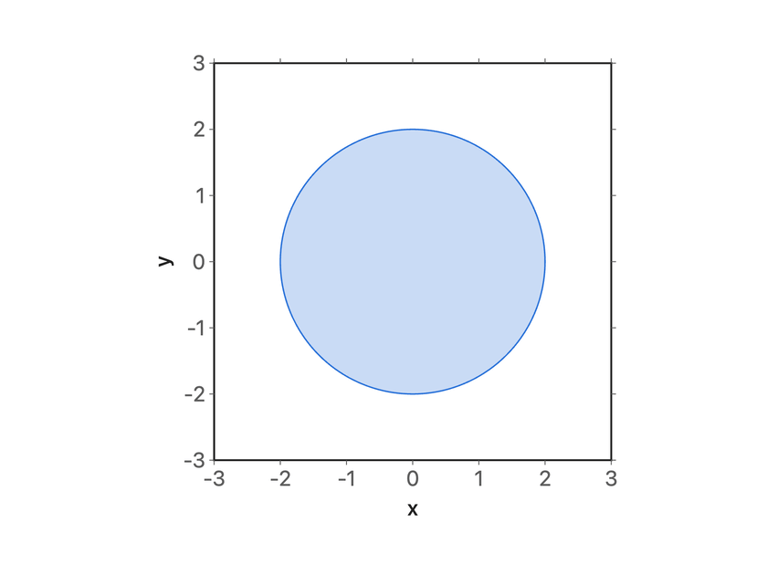
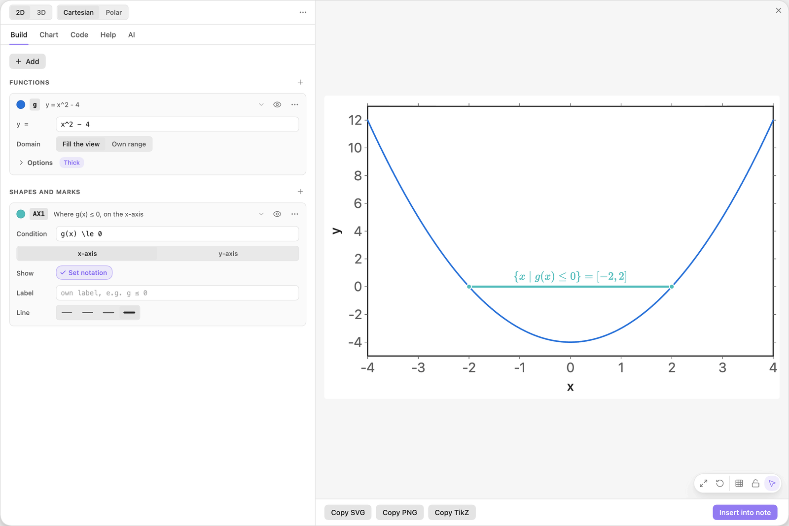
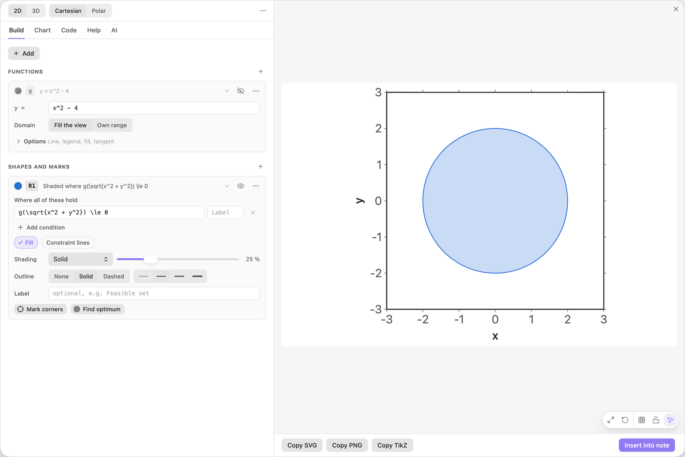
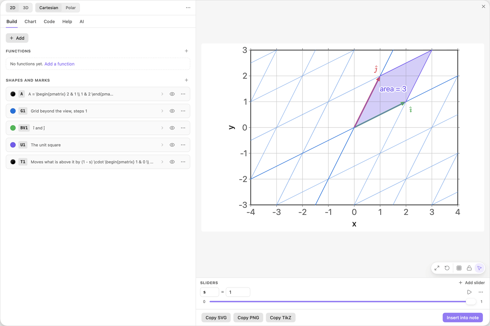
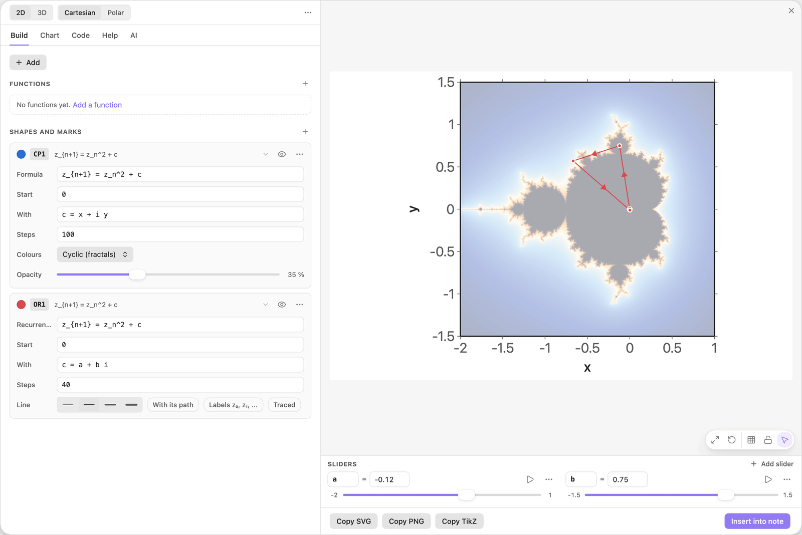
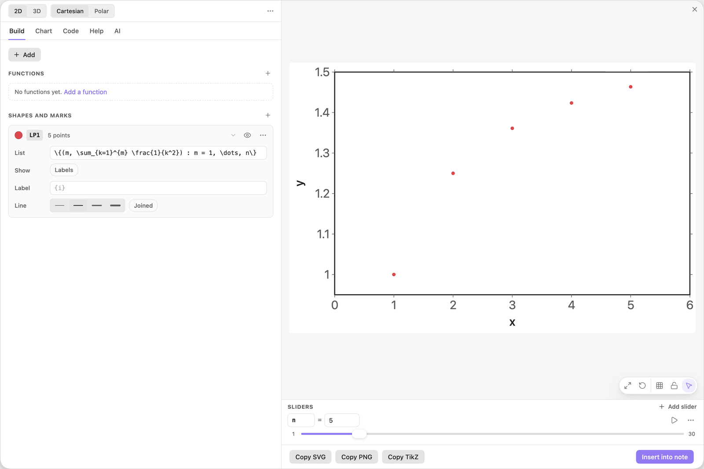

<!-- Generated by scripts/media/build-guides.mjs from src/guides. Do not edit. -->

# Cards of sets, matrices and sums

[All guides](README.md) · Notes and export · Core · about 3 minutes

Rest the pointer on a set, a matrix, a recurrence or a sum in a note: its card draws it, with the names of the note.

<p align="center"></p>

**What you can do afterwards**

- Open the card of a set and switch to n = 2
- See a matrix move the grid
- See the orbit of a recurrence and the partial sums of a sum

**Read first:** [Every formula is a chart](notes-formulas.md)

## 1. Rest the pointer on a set

A note says `$g(x) = x^2 - 4$` and later `$\{x \mid g(x) \le 0\}$`. The card of the set takes g from the note and marks the set on the x-axis.

The chart in words:

```easy-tikz
show x from -4 to 4
size 12 x 8
plot g(x) = x^2 - 4 in blue, thick
mark where $g(x) \le 0$ on the x-axis, labelled
```



> **Tip:** Without g in the note, the card uses an example and says so.

## 2. Switch to n = 2

For `$\{x \in \mathbb{R}^n \mid g(x) \le 0\}$` the card has an n = 1 / n = 2 switch. With n = 2, x is a point of the plane, and the set is a disk.

The chart gets these lines:

```easy-tikz
show x from -3 to 3 and y from -3 to 3
equal scale
plot g(x) = x^2 - 4, hidden
shade where $g(\sqrt{x^2 + y^2}) \le 0$, outlined
```



## 3. Move the grid by a matrix

The card of `$\det A$` takes A from the note and moves the grid from I to A with the slider `s`. The unit square ends with area 3, the determinant.

The chart gets these lines:

```easy-tikz
show x from -4 to 4 and y from -3 to 3
slider s from 0 to 1, starting at 1
let $A = \begin{pmatrix} 2 & 1 \\ 1 & 2 \end{pmatrix}$
draw the grid
draw the basis vectors
shade the unit square, labelled
transform the plane by $(1 - s) \cdot \begin{pmatrix} 1 & 0 \\ 0 & 1 \end{pmatrix} + s A$
```



## 4. Follow the orbit of a recurrence

`$z_{n+1} = z_n^2 + c$` draws the orbit of 0 with c = a + bi on two sliders, over a faint Mandelbrot set.

The chart gets these lines:

```easy-tikz
show x from -2 to 1 and y from -1.5 to 1.5
slider a from -2 to 1, starting at -0.12
slider b from -1.5 to 1.5, starting at 0.75
colour the plane by $z_{n+1} = z_n^2 + c$, $z_0 = 0$, $c = x + i y$, 100 steps, opacity 0.35
draw the orbit of $z_{n+1} = z_n^2 + c$, $z_0 = 0$, $c = a + b i$, 40 steps
```



## 5. Add up a sum

`$\sum_{k=1}^{n} \frac{1}{k^2}$` draws its partial sums as points for n on a slider. Insert chart writes the chart under the paragraph.

The chart gets these lines:

```easy-tikz
show x from 0 to n + 1
slider n from 1 to 30, starting at 5, in steps of 1
mark the points $\{(m, \sum_{k=1}^{m} \frac{1}{k^2}) : m = 1, \dots, n\}$
```



## The finished chart

Paste this block into a note to get the finished chart of this guide. Click the chart in the note to open it in the editor.

<details>
<summary>The chart as an easy-tikz block</summary>

```easy-tikz
show x from -3 to 3 and y from -3 to 3
size 12 x 8
equal scale
plot g(x) = x^2 - 4, hidden
shade where $g(\sqrt{x^2 + y^2}) \le 0$, outlined
```

</details>

## Next guides

- [Sets and convex functions](sets-convexity.md): Mark where g(x) ≤ 0 on the x-axis, read the set as intervals and test convexity with a chord.
- [Charts in your notes](charts-in-notes.md): Insert a chart into a note, edit it again, and move its sliders there, also across charts.

[All guides](README.md)
