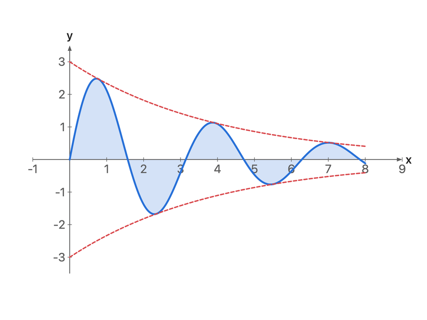
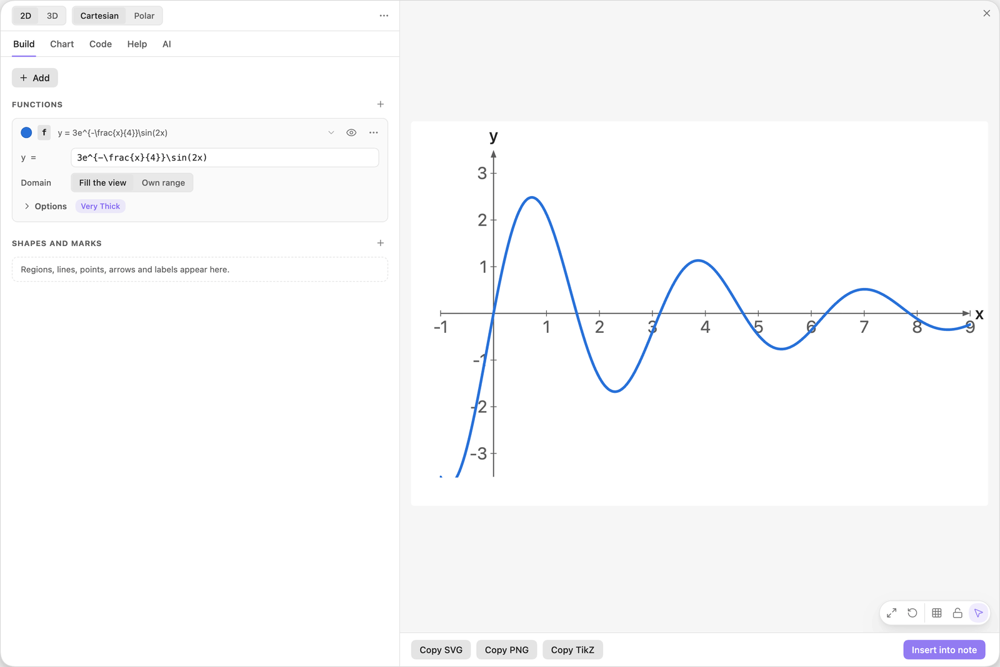
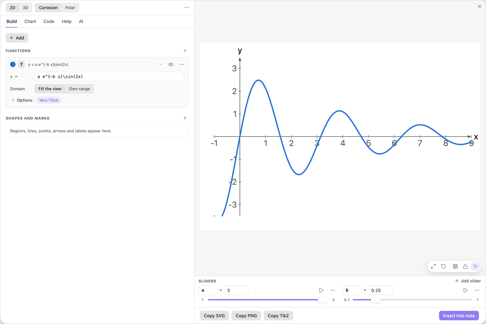
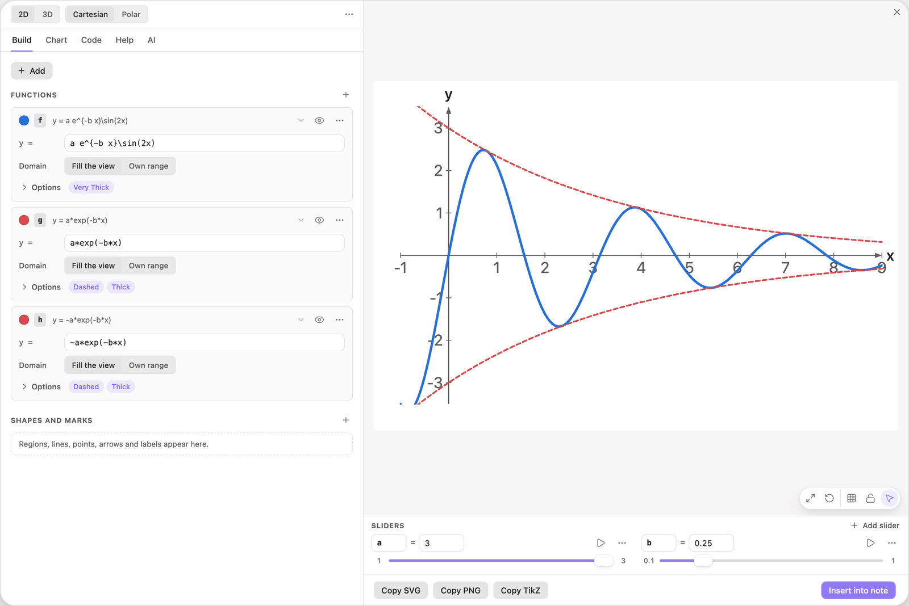
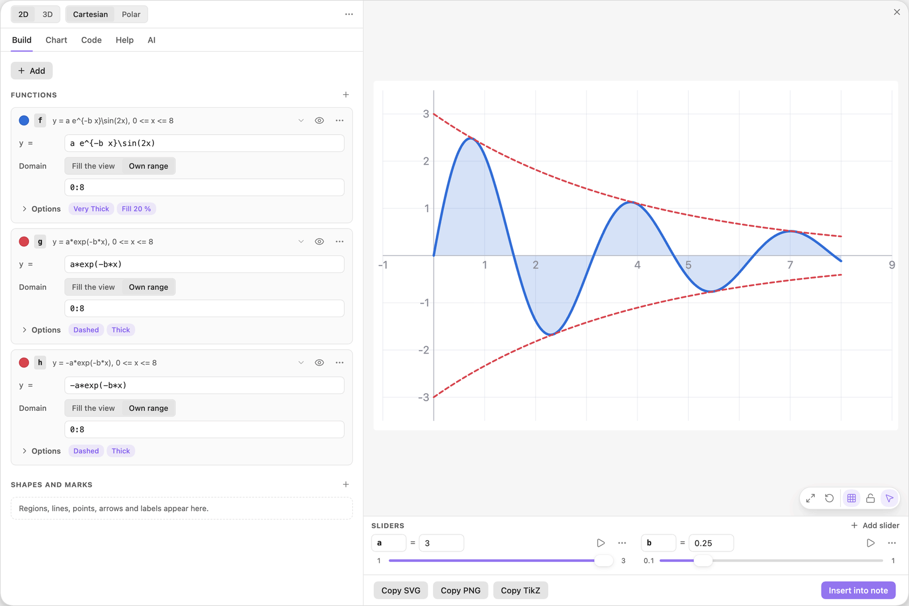

<!-- Generated by scripts/media/build-guides.mjs from src/guides. Do not edit. -->

# Write formulas as in your notes

[All guides](README.md) · Chart language · Start here · about 3 minutes

Write LaTeX in dollars, where `ax` is a times x, or plain formulas, and limit a curve with a domain.

<p align="center"></p>

**What you can do afterwards**

- Write formulas in LaTeX between dollars
- Know when letters multiply and when `ax` is one name
- Limit a function to a domain

**Read first:** [Write a chart in words](chart-language.md)

## 1. Write LaTeX between dollars

Write a formula in LaTeX between dollars, as in your notes: `\frac`, `\sqrt`, `\sin` and powers such as `e^{-x}` all work. This wave dies out as x grows.

The chart in words:

```easy-tikz
show x from -1 to 9 and y from -3.5 to 3.5
size 12 x 8
axes in the middle
plot $f(x) = 3e^{-\frac{x}{4}}\sin(2x)$ in blue, very thick
```



## 2. Let letters multiply

Inside dollars, letters side by side multiply: `ae^{-bx}` reads as `a e^{-b x}`. Give each new letter a slider line.

The chart gets these lines:

```easy-tikz
slider a from 1 to 3, starting at 3
slider b from 0.1 to 1, starting at 0.25
plot $f(x) = a e^{-b x}\sin(2x)$ in blue, very thick
```



> **Tip:** Drag `b`: the larger it is, the faster the wave dies out.

## 3. Write plain formulas without dollars

Without dollars a formula is plain, like the envelope `a*exp(-b*x)`. There functions need brackets, `sin(x)`, and `ax` is one name: write `a*x` or `a x`.

The chart gets these lines:

```easy-tikz
plot g(x) = a*exp(-b*x) in red, thick, dashed
plot h(x) = -a*exp(-b*x) in red, thick, dashed
```



> **Tip:** If you type `ax` by mistake, the message under the field offers Use a\*x.

## 4. Limit a function with a domain

`from x = 0 to 8` draws a function only there, and `filled` shades the wave down to the x-axis. It now starts at 0, like a plucked string.

The chart gets these lines:

```easy-tikz
plot $f(x) = a e^{-b x}\sin(2x)$ from x = 0 to 8 in blue, very thick, filled
plot g(x) = a*exp(-b*x) from x = 0 to 8 in red, thick, dashed
plot h(x) = -a*exp(-b*x) from x = 0 to 8 in red, thick, dashed
```



> **Tip:** Outside its domain a function has no value, so formulas that call it draw nothing there.

## The finished chart

Paste this block into a note to get the finished chart of this guide. Click the chart in the note to open it in the editor.

<details>
<summary>The chart as an easy-tikz block</summary>

```easy-tikz
show x from -1 to 9 and y from -3.5 to 3.5
size 12 x 8
axes in the middle
slider a from 1 to 3, starting at 3
slider b from 0.1 to 1, starting at 0.25
plot $f(x) = a e^{-b x}\sin(2x)$ from x = 0 to 8 in blue, very thick, filled
plot g(x) = a*exp(-b*x) from x = 0 to 8 in red, thick, dashed
plot h(x) = -a*exp(-b*x) from x = 0 to 8 in red, thick, dashed
```

</details>

## Next guides

- [Sliders that move the picture](sliders.md): Turn letters into sliders, set their range and step, press play, and connect them across a note.
- [Every formula is a chart](notes-formulas.md): Rest the pointer on a formula in a note: its chart opens in a card, with sliders, ready to insert.
- [Shade a region with inequalities](regions.md): Shade where conditions hold, between two curves and cut by a third, then number its corners and hatch it.

[All guides](README.md)
