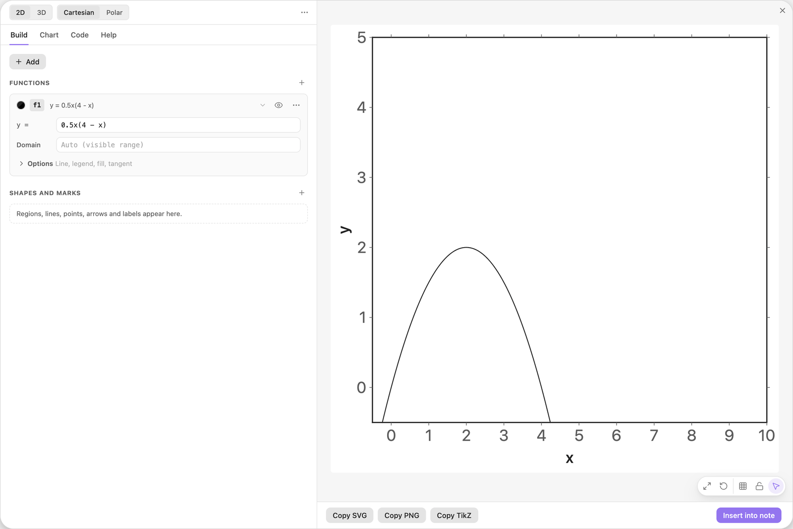
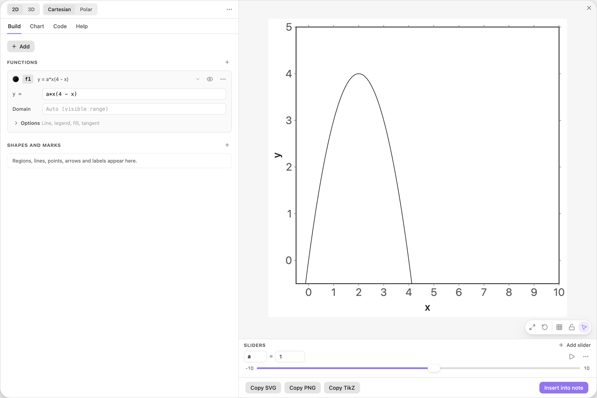
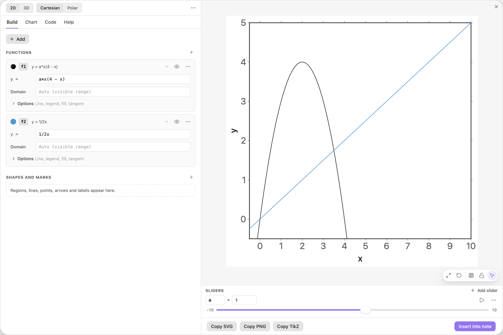
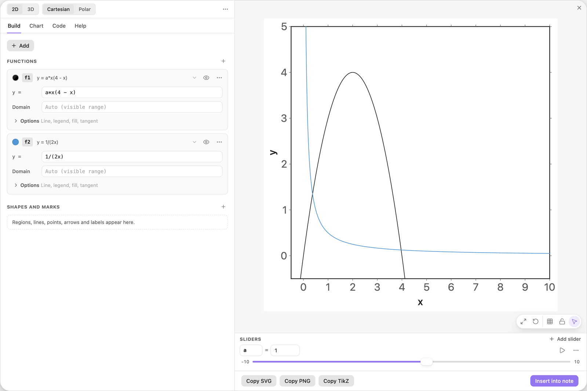
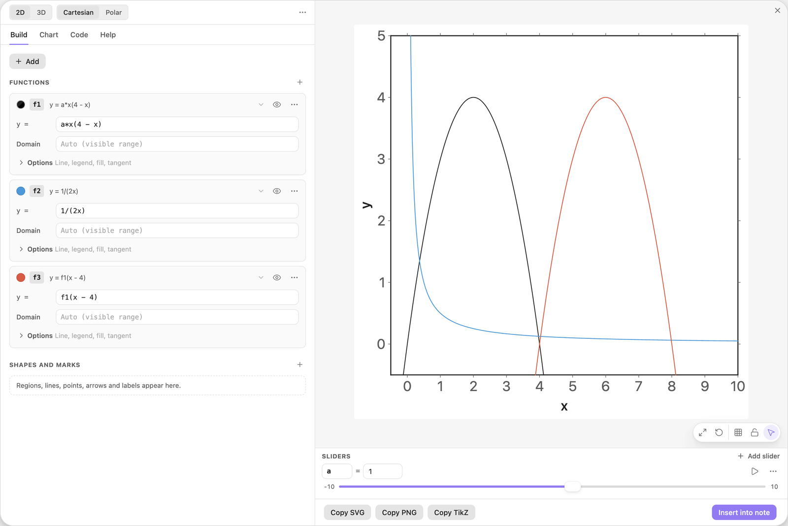
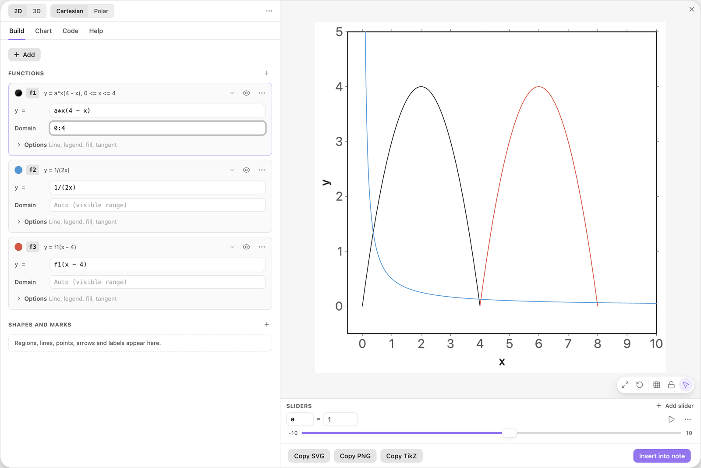

<!-- Generated by scripts/media/build-guides.mjs from src/guides. Do not edit. -->

# Write formulas that work

[All guides](README.md) · Getting started · Start here · about 6 minutes

Leave out the multiplication sign safely, avoid the traps ax and 1/2x, call functions by name and limit them with a domain.

<p align="center"></p>

**What you can do afterwards**

- Write products without a multiplication sign
- Spot the traps ax and 1/2x before they bite
- Reuse a function in another formula by its name
- Limit a curve to a domain

**Read first:** [Your first chart](first-chart.md)

## 1. Multiply without a star

In a new chart, click + Add, choose Function y = f(x) and type the formula. It means `0.5*x*(4 - x)`: an arch with zeros at 0 and 4.

You can leave out `*` between a number, a name or a bracket and whatever follows:

- `2x` and `0.5x` multiply a number and a name
- `3(x + 1)` and `(x + 1)(x - 1)` multiply with brackets
- `2 pi` and `a x` multiply two names, and those need the space

The Start a chart field would work as well, but it also fits the ranges to the curve. + Add keeps the ranges as they are.

| Where | Type |
| --- | --- |
| f1, y = | `0.5x(4 - x)` |



*A number, a name and a bracket in a row are multiplied.*

> **Tip:** Constants and functions are plain names: `pi`, `e`, `sqrt(x)`, `exp(x)`, `ln(x)`, `abs(x)`. Trigonometry works in radians.

## 2. Split a slider from x

Make the height adjustable: change the formula to `ax(4 - x)`, with the `a` right against the `x`.

After a short pause the field reports `Unknown function 'ax'. Did you mean a*x?`. A run of letters is one name, so `ax` is not `a` times `x`. Click the button `Use a*x, add slider a`. The formula becomes `a*x(4 - x)`, a slider `a` with the value 1 appears under the preview, and the arch is twice as high as before.



*After the fix: the formula multiplies a and x, and the new slider a sits under the preview.*

> **Tip:** Between a slider and x, type a space or a star: `a x` or `a*x`. Numbers do not need one: `2x`.

## 3. See what a fraction really means

Add a second function with + Add \> Function y = f(x) and type `1/2x`.

You may have meant one over 2x, but the preview draws a straight line. Division and multiplication run from left to right, so `1/2x` is `(1/2)*x`.

| Where | Type |
| --- | --- |
| f2, y = | `1/2x` |



*1/2x is half of x: a straight line.*

## 4. Bracket the denominator

Put the denominator in brackets. Now the curve is the hyperbola you meant. It breaks at x = 0, where the fraction has no value.

Whenever more than one factor belongs below the fraction line, write the brackets.

| Where | Type |
| --- | --- |
| f2, y = | `1/(2x)` |



*With brackets: one over 2x.*

## 5. Call a function by its name

Add a third function and type `f1(x - 4)`. Every function can be used in other formulas by the name on its card. The new curve is the arch of `f1` moved 4 to the right, and it follows when you change `f1` or the slider `a`.

A bare name means the function at x: `2 f1 + 1` is `2*f1(x) + 1`.

| Where | Type |
| --- | --- |
| f3, y = | `f1(x - 4)` |



*f3 reuses f1, shifted 4 to the right.*

> **Tip:** With a slider `a`, `a(x - 4)` is a product. With a function `f1`, `f1(x - 4)` is a call. A power belongs to the bracket only: `a(x - 4)^2` is `a*(x - 4)^2`.

## 6. Limit a curve with a domain

On the `f1` card, type `0:4` into the Domain field. A domain is written `min:max`, and both ends may be formulas, as in `0:2pi` or `-a:a`.

`f1` is now drawn only between its zeros. Outside its domain a function has no value, so `f3`, which calls `f1`, shrinks to one arch as well, from 4 to 8.

| Where | Type |
| --- | --- |
| f1, Domain | `0:4` |



*f1 limited to 0:4. f3 follows, because it calls f1.*

> **Tip:** An empty Domain means the visible x range. The separator is a colon: `0,4` is not accepted.

## The finished chart

Paste this block into a note to get the finished chart of this guide. Click the chart in the note to open it in the editor.

<details>
<summary>The chart as an easy-tikz block</summary>

```easy-tikz
{
  "v": 4,
  "dimension": false,
  "documentSetup": true,
  "title": "",
  "size_x_cm": 10,
  "size_y_cm": 10,
  "show_axis_label": true,
  "axis_label_x": "x",
  "axis_label_y": "y",
  "showAxis": true,
  "showLargeGrid": false,
  "showSmallGrid": false,
  "gridSize": 5,
  "majorTickNum": 8,
  "xmin": "-0.5",
  "xmax": "10",
  "ymin": "-0.5",
  "ymax": "5",
  "zmin": "-5",
  "zmax": "5",
  "axis_style": "box",
  "coordinateSystem": "cartesian",
  "axis_label_x_polar": "",
  "axis_label_y_polar": "",
  "axis_label_z": "z",
  "rotationX": 30,
  "rotationZ": 45,
  "zoom3D": 1,
  "boxAspect": "true",
  "previewSize": 760,
  "functions": [
    {
      "expression": "a*x(4 - x)",
      "domain": "0:4",
      "showLegend": false,
      "fill": false,
      "fillOpacity": 0.2,
      "fillPattern": "solid",
      "tangent": false,
      "color": "black",
      "dashed": false,
      "tangentPoint": "",
      "extrema": false,
      "thickness": "thin",
      "parametric": false,
      "expressionY": "",
      "name": "f1"
    },
    {
      "expression": "1/(2x)",
      "domain": "",
      "showLegend": false,
      "fill": false,
      "fillOpacity": 0.2,
      "fillPattern": "solid",
      "tangent": false,
      "color": "blue",
      "dashed": false,
      "tangentPoint": "",
      "extrema": false,
      "thickness": "thin",
      "parametric": false,
      "expressionY": "",
      "name": "f2"
    },
    {
      "expression": "f1(x - 4)",
      "domain": "",
      "showLegend": false,
      "fill": false,
      "fillOpacity": 0.2,
      "fillPattern": "solid",
      "tangent": false,
      "color": "red",
      "dashed": false,
      "tangentPoint": "",
      "extrema": false,
      "thickness": "thin",
      "parametric": false,
      "expressionY": "",
      "name": "f3"
    }
  ],
  "functions3D": [],
  "tools": [],
  "annotations": [],
  "parameters": [
    {
      "name": "a",
      "value": 1,
      "min": -10,
      "max": 10,
      "step": 0.1
    }
  ],
  "variables": "x, y",
  "equalScale": false,
  "showSlidersInNote": true
}
```

</details>

## Next guides

- [Sliders that move the picture](sliders.md): Turn a letter in a formula into a slider, set its range, play it and print its value in the chart.
- [Tangents and extrema](tangents-extrema.md): Mark the turning points of a function, add a tangent, slide it along the curve and label its slope.
- [Shade a region with inequalities](regions.md): Shade the set where inequalities hold: one condition per row, chains, alternatives with or, and labels for the rows and the region.

[All guides](README.md)
