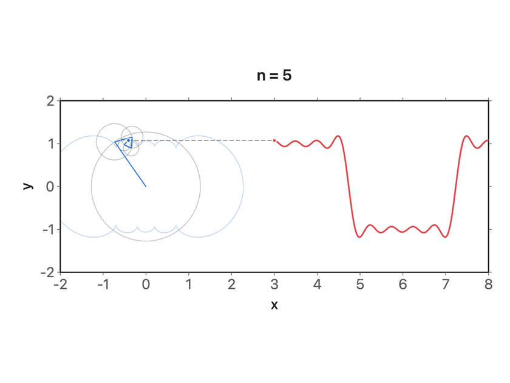
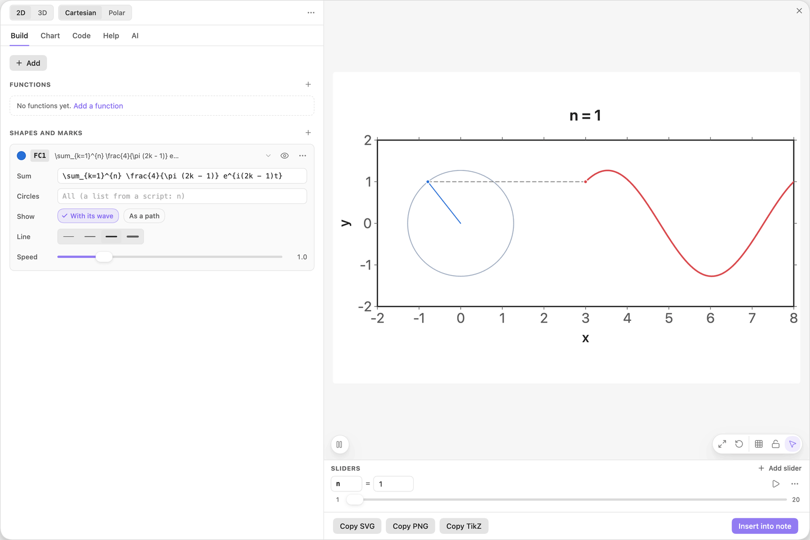
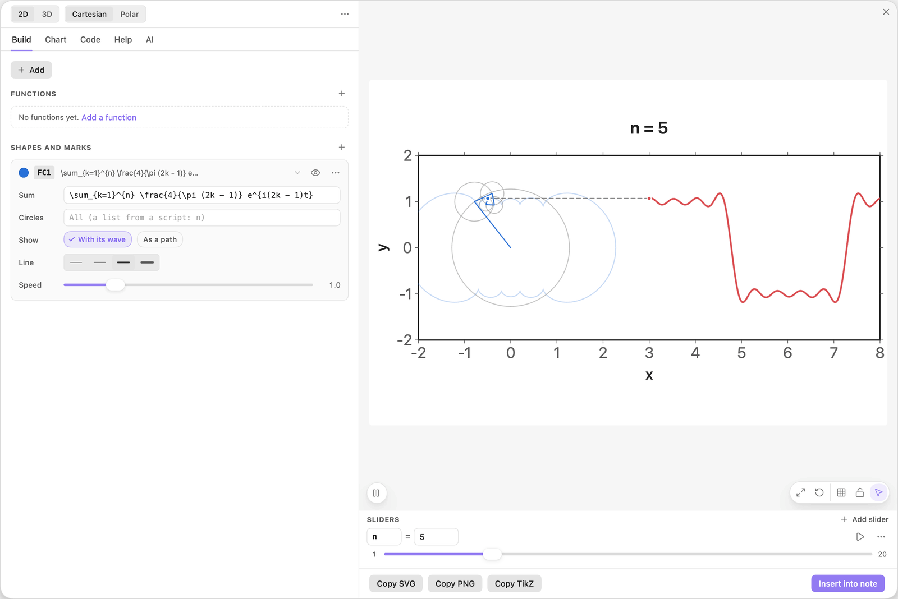
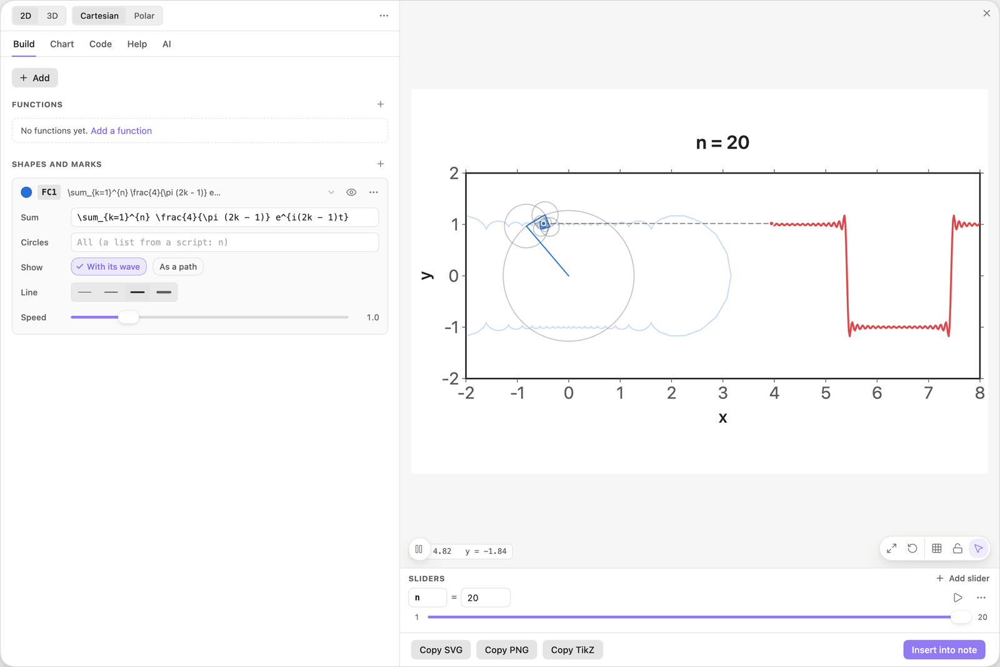
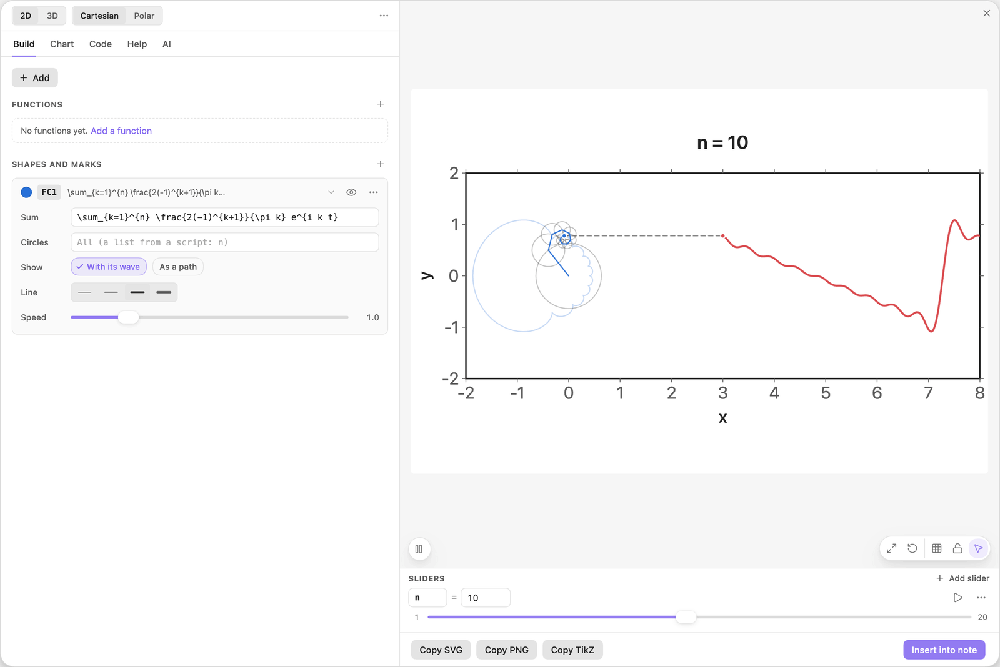

<!-- Generated by scripts/media/build-guides.mjs from src/guides. Do not edit. -->

# Circles that draw square and sawtooth waves

[All guides](README.md) · Showcase · Core · about 2 minutes

Circles turn on each other: the tip of the last draws a wave. More circles make it more square, other circles draw a sawtooth.

<p align="center"></p>

**What you can do afterwards**

- Draw the turning circles of a sum
- Draw the wave of the tip
- Add terms with a slider
- Change the sum for another wave

## 1. Turn one circle

With `n = 1` one circle turns, and the height of its tip draws a sine wave on the right.

The chart in words:

```easy-tikz
show x from -2 to 8 and y from -2 to 2
size 12 x 8
equal scale
title n = {n}
slider n from 1 to 20, in steps of 1
draw the circles of $\sum_{k=1}^{n} \frac{4}{\pi (2k - 1)} e^{i(2k - 1)t}$, with its wave
```



## 2. Add circles

Each new circle turns on the tip of the one before, faster and smaller. With five of them the wave gets corners.

The chart gets these lines:

```easy-tikz
slider n from 1 to 20, starting at 5, in steps of 1
```



## 3. Use twenty circles

Drag `n` to 20: the wave is nearly square, with small spikes at its corners.

The chart gets these lines:

```easy-tikz
slider n from 1 to 20, starting at 20, in steps of 1
```



## 4. Draw a sawtooth

Other circles, another wave: circle k turns k times as fast, with the radius 2/(πk) and its sign changing each time. The tip draws a sawtooth that climbs and drops.

The chart gets these lines:

```easy-tikz
slider n from 1 to 20, starting at 10, in steps of 1
draw the circles of $\sum_{k=1}^{n} \frac{2(-1)^{k+1}}{\pi k} e^{i k t}$, with its wave
```



## The finished chart

Paste this block into a note to get the finished chart of this guide. Click the chart in the note to open it in the editor.

<details>
<summary>The chart as an easy-tikz block</summary>

```easy-tikz
show x from -2 to 8 and y from -2 to 2
size 12 x 8
equal scale
title n = {n}
slider n from 1 to 20, starting at 5, in steps of 1
draw the circles of $\sum_{k=1}^{n} \frac{4}{\pi (2k - 1)} e^{i(2k - 1)t}$, with its wave
```

</details>

## Next guides

- [Sums: Taylor and Fourier series](sums-series.md): Write a sum with a slider in its bound: a Taylor polynomial hugs the sine, and turning circles draw a square wave.

[All guides](README.md)
