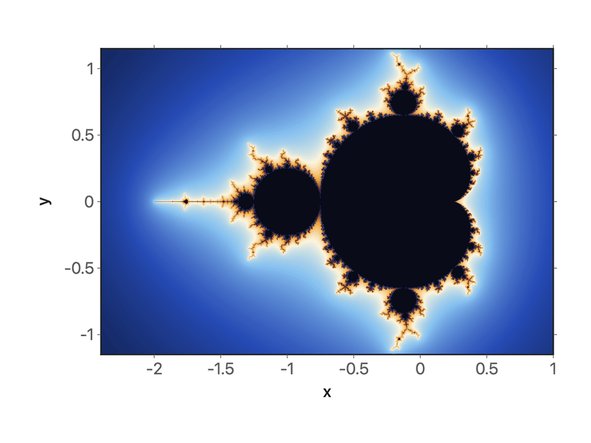
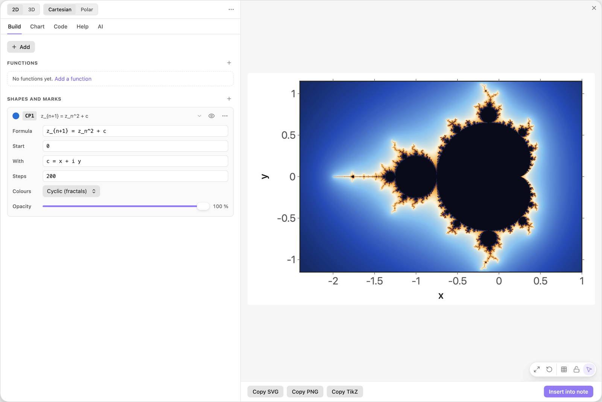
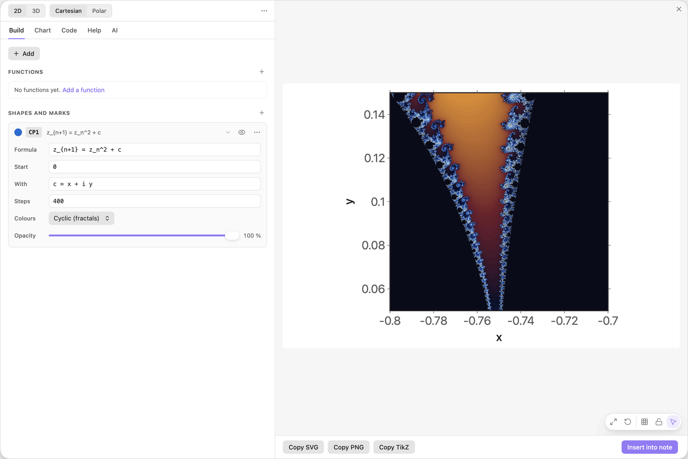
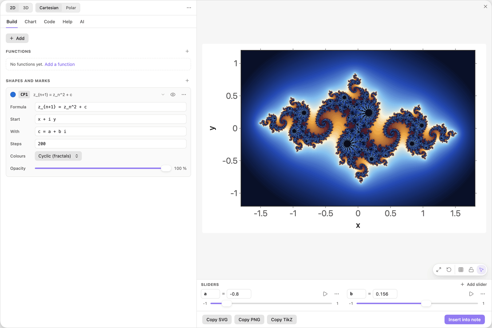
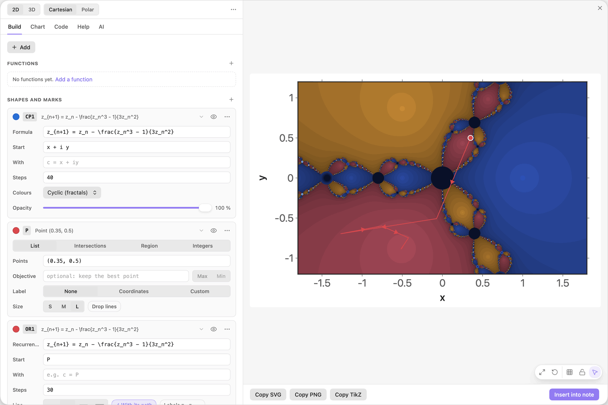

<!-- Generated by scripts/media/build-guides.mjs from src/guides. Do not edit. -->

# Fractals: Mandelbrot, Julia and Newton

[All guides](README.md) · Dynamics and fractals · Core · about 3 minutes

Colour every point of the plane by its orbit: the Mandelbrot set, Julia sets on sliders and the basins of Newton's method.

<p align="center"></p>

**What you can do afterwards**

- Colour the plane by a recurrence
- Zoom into the border of the set
- Put c of a Julia set on sliders
- Colour Newton's method by the root it finds

## 1. Colour the plane by a recurrence

With `$c = x + iy$` every point c runs the orbit of 0. Orbits that stay small are dark: the Mandelbrot set. The colour of the others says how fast they leave.

The chart in words:

```easy-tikz
show x from -2.4 to 1 and y from -1.15 to 1.15
size 12 x 8
equal scale
colour the plane by $z_{n+1} = z_n^2 + c$, $z_0 = 0$, $c = x + i y$, 200 steps
```



## 2. Zoom into its border

Write a smaller window, or zoom with the wheel in the editor. The picture paints again at every size; deep zooms need more steps, here 400.

The chart gets these lines:

```easy-tikz
show x from -0.8 to -0.7 and y from 0.05 to 0.15
colour the plane by $z_{n+1} = z_n^2 + c$, $z_0 = 0$, $c = x + i y$, 400 steps
```



> **Tip:** Past what the graphics card can tell apart, the plugin paints on the processor with 64-bit numbers.

## 3. Put a Julia set on sliders

Now every point is the start, `$z_0 = x + iy$`, and c is `a + bi` on two sliders. Each c gives another Julia set: drag `a` and `b`.

The chart gets these lines:

```easy-tikz
show x from -1.8 to 1.8 and y from -1.2 to 1.2
slider a from -1 to 1, starting at -0.8
slider b from -1 to 1, starting at 0.156
colour the plane by $z_{n+1} = z_n^2 + c$, $z_0 = x + i y$, $c = a + b i$, 200 steps
```



## 4. Colour Newton's method by its root

Newton's method for z³ - 1 runs from every point, and each point takes the colour of the root it reaches. The orbit from P shows the way to one of them.

The chart gets these lines:

```easy-tikz
colour the plane by $z_{n+1} = z_n - \frac{z_n^3 - 1}{3z_n^2}$, $z_0 = x + i y$, 40 steps
P: mark (0.35, 0.5), large
draw the orbit of $z_{n+1} = z_n - \frac{z_n^3 - 1}{3z_n^2}$, $z_0 = P$, 30 steps, as a path
```



## The finished chart

Paste this block into a note to get the finished chart of this guide. Click the chart in the note to open it in the editor.

<details>
<summary>The chart as an easy-tikz block</summary>

```easy-tikz
show x from -2.4 to 1 and y from -1.15 to 1.15
size 12 x 8
equal scale
colour the plane by $z_{n+1} = z_n^2 + c$, $z_0 = 0$, $c = x + i y$, 200 steps
```

</details>

## Next guides

- [The orbit of a point in the Mandelbrot set](mandelbrot-orbit.md): Move c with two sliders over the Mandelbrot set: its orbit goes round inside the set and flies off outside it.
- [Orbits, cobwebs and bifurcation](orbits-cobwebs.md): Follow x ↦ r x (1 - x) step by step on a cobweb, over time, and for every r at once in the bifurcation diagram.

[All guides](README.md)
