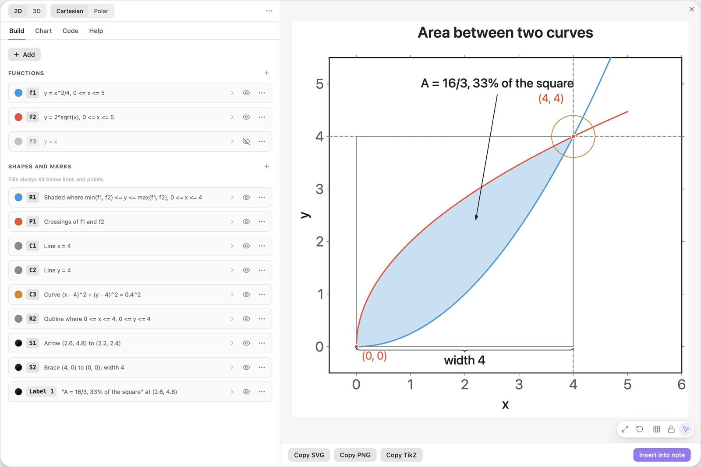
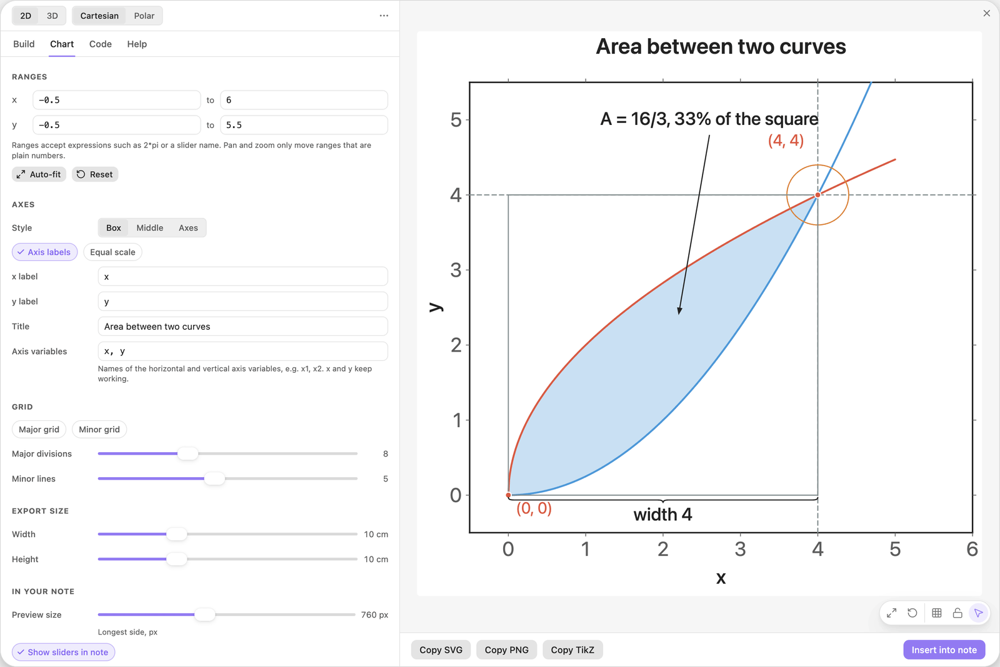
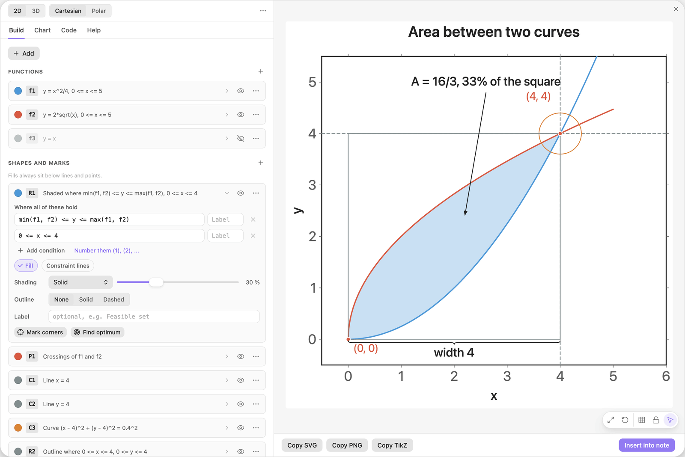
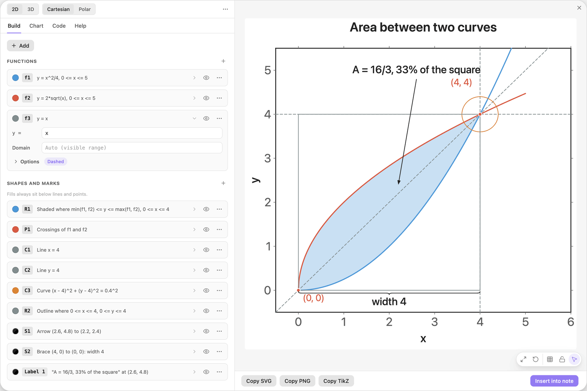
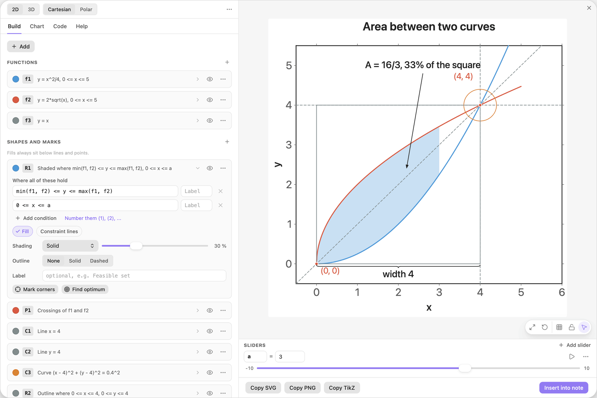

<!-- Generated by scripts/media/build-guides.mjs from src/guides. Do not edit. -->

# Coming from 3.x

[All guides](README.md) · Reference · Core · about 8 minutes

What happens to your old charts, where the eight tabs went, and which new tool replaces each old one.

<p align="center"></p>

**What you can do afterwards**

- Open and save 3.x charts without surprises
- Find every old tab and tool in the new editor
- Know the breaking changes before you save

## 1. Open an old chart

Click a chart you made with 3.x. It opens in the new editor and looks as it did before. The conversion happens in memory: the note is not touched until you click Save changes.

The chart of this guide is a typical 3.x picture after conversion: two functions with the area between them, their intersections, a vertical and a horizontal line, a circle, a rectangle, an arrow, a brace and a text label.



*A 3.x chart in the version 4 editor. Every old tool is a card in the Build tab.*

> **Tip:** Charts you only look at are never rewritten. A chart saved with version 4 carries `"v": 4`, and 3.19 can no longer draw it.

## 2. Find your old tabs

The eight tabs of 3.x are now four: Build, Chart, Code and Help.

- Functions, Tools and Annotations are the cards of the Build tab. An annotation is now called a text label.
- Axis and Grid are groups of the Chart tab: Ranges, Axes and Grid.
- Graph is split up. Title, width and height, preview size and the 3D angles are in the Chart tab. 3D mode and the coordinate system are the two switches in the header.
- Code is still Code. The old Use pgfplots switch is now Standalone document in that tab.
- Reference is now Help.



*The Chart tab holds what the Graph, Axis and Grid tabs held in 3.x.*

> **Tip:** Sliders are new and have their own place: the Sliders dock. It appears under the preview as soon as a chart has a slider and stays there in every tab.

## 3. Read the converted tools

Eleven special tools became five general ones. Each old tool is now a card with a formula you can read and change. The rows below are what the tools of this chart turned into.

- Area between two curves is a Region. The interval is a second condition.
- Intersection points is a Points card with Intersections selected.
- Vertical line and Horizontal line are Curves with the equations `x = c` and `y = c`.
- Circle is a Curve. A filled circle is a Region with `<=` in place of `=`.
- Rectangle is a Region with one condition for x and one for y.
- Line segment and Brace with label are Segments with a Path. In 3D, the point marker is a Points card and the plane is still a Plane.

| Where | Type |
| --- | --- |
| R1, condition 1 | `min(f1, f2) <= y <= max(f1, f2)` |
| R1, condition 2 | `0 <= x <= 4` |
| C1, Equation | `x = 4` |
| C3, Equation | `(x - 4)^2 + (y - 4)^2 = 0.4^2` |
| R2, condition 1 | `0 <= x <= 4` |
| S1, Path | `(2.6, 4.8); (2.2, 2.4)` |



*The old area between two curves is the region R1 with two conditions.*

> **Tip:** You rarely pick a tool by name. + Add lists the old tools in plain words (Area between two functions, Vertical line x = c, Circle, Rectangle, Brace with label) and fills in the card for you.

## 4. Show the functions 3.x skipped

Version 3 did not draw a function whose Domain was empty. Version 4 reads an empty domain as the visible x range, so such a function would suddenly appear in your picture. To prevent that, it is converted as hidden: the card f3 is dimmed and its eye is crossed out.

Click the eye on f3 to show it. The dashed line y = x appears, the mirror line between the two curves.



*The function f3 was hidden by the conversion. Its eye button shows it.*

> **Tip:** A hidden function still works by name. Other formulas can use `f3(2)` or `y <= f3` whether it is drawn or not.

## 5. Trade a number for a slider

This is what the general tools are for. On the card R1, change the second condition from `0 <= x <= 4` to the one below, click Add slider a under the field and drag a to 3.

The shaded area now ends at x = a and grows and shrinks with the slider. Any number in any field can become a slider in the same way.

| Where | Type |
| --- | --- |
| R1, condition 2 | `0 <= x <= a` |



*The right end of the area is now the slider a.*

> **Tip:** You can also drag shapes in the preview now. Drag the dashed line at x = 4 and the number in its equation follows.

## 6. Know what Save changes does

Save changes writes the block in the version 4 format. Before you save an old chart, know what is different:

- Version 3 cannot read the saved block. Keep 3.x charts unsaved if you still open the vault with 3.x somewhere.
- Label text is a template: `{` and `}` mark placeholders such as `{a}`. Converted labels are escaped for you. In new labels type `{{` and `}}` for a LaTeX group.
- `ax` is one name. Write `a x` or `a*x` for a product. `1/2x` means `(1/2)*x`.
- The exported LaTeX has a different shape: a complete standalone document, trigonometry in radians, shapes as coordinates and colours named `etBlue`, `etRed` and so on.

> **Tip:** If you post-process exported code with your own scripts or macros, compile one chart again and compare before you rely on it.

## The finished chart

Paste this block into a note to get the finished chart of this guide. Click the chart in the note to open it in the editor.

<details>
<summary>The chart as an easy-tikz block</summary>

```easy-tikz
{
  "v": 4,
  "dimension": false,
  "documentSetup": true,
  "title": "Area between two curves",
  "size_x_cm": 10,
  "size_y_cm": 10,
  "show_axis_label": true,
  "axis_label_x": "x",
  "axis_label_y": "y",
  "showAxis": true,
  "showLargeGrid": false,
  "showSmallGrid": false,
  "gridSize": 5,
  "majorTickNum": 8,
  "xmin": "-0.5",
  "xmax": "6",
  "ymin": "-0.5",
  "ymax": "5.5",
  "zmin": "-5",
  "zmax": "5",
  "axis_style": "box",
  "coordinateSystem": "cartesian",
  "axis_label_x_polar": "",
  "axis_label_y_polar": "",
  "axis_label_z": "z",
  "rotationX": 30,
  "rotationZ": 45,
  "zoom3D": 1,
  "boxAspect": "true",
  "previewSize": 760,
  "functions": [
    {
      "expression": "x^2/4",
      "domain": "0:5",
      "showLegend": false,
      "fill": false,
      "fillOpacity": 0.2,
      "fillPattern": "solid",
      "tangent": false,
      "color": "blue",
      "dashed": false,
      "tangentPoint": "",
      "extrema": false,
      "thickness": "thick",
      "parametric": false,
      "expressionY": "",
      "name": "f1"
    },
    {
      "expression": "2*sqrt(x)",
      "domain": "0:5",
      "showLegend": false,
      "fill": false,
      "fillOpacity": 0.2,
      "fillPattern": "solid",
      "tangent": false,
      "color": "red",
      "dashed": false,
      "tangentPoint": "",
      "extrema": false,
      "thickness": "thick",
      "parametric": false,
      "expressionY": "",
      "name": "f2"
    },
    {
      "expression": "x",
      "domain": "",
      "showLegend": false,
      "fill": false,
      "fillOpacity": 0.2,
      "fillPattern": "solid",
      "tangent": false,
      "color": "gray",
      "dashed": true,
      "tangentPoint": "",
      "extrema": false,
      "thickness": "thin",
      "parametric": false,
      "expressionY": "",
      "name": "f3"
    }
  ],
  "functions3D": [],
  "tools": [
    {
      "type": "region",
      "color": "blue",
      "conditions": [
        "min(f1, f2) <= y <= max(f1, f2)",
        "0 <= x <= a"
      ],
      "conditionLabels": [
        "",
        ""
      ],
      "fill": true,
      "fillOpacity": 0.3,
      "fillPattern": "solid",
      "outline": "none",
      "thickness": "thin",
      "constraintLines": false,
      "label": "",
      "id": "t0",
      "name": "R1"
    },
    {
      "type": "points",
      "color": "red",
      "dim": 2,
      "source": "intersections",
      "points": "",
      "ref1": "f1",
      "ref2": "f2",
      "regionName": "",
      "objective": "",
      "sense": "max",
      "label": "({x:2}, {y:2})",
      "dropLines": false,
      "size": "normal",
      "id": "t1",
      "name": "P1"
    },
    {
      "type": "curve",
      "color": "gray",
      "equation": "x = 4",
      "levels": "",
      "thickness": "thin",
      "dashed": true,
      "label": "",
      "id": "t2",
      "name": "C1"
    },
    {
      "type": "curve",
      "color": "gray",
      "equation": "y = 4",
      "levels": "",
      "thickness": "thin",
      "dashed": true,
      "label": "",
      "id": "t3",
      "name": "C2"
    },
    {
      "type": "curve",
      "color": "orange",
      "equation": "(x - 4)^2 + (y - 4)^2 = 0.4^2",
      "levels": "",
      "thickness": "thin",
      "dashed": false,
      "label": "",
      "id": "t4",
      "name": "C3"
    },
    {
      "type": "region",
      "color": "gray",
      "conditions": [
        "0 <= x <= 4",
        "0 <= y <= 4"
      ],
      "conditionLabels": [
        "",
        ""
      ],
      "fill": false,
      "fillOpacity": 0.2,
      "fillPattern": "solid",
      "outline": "solid",
      "thickness": "thin",
      "constraintLines": false,
      "label": "",
      "id": "t5",
      "name": "R2"
    },
    {
      "type": "segment",
      "color": "black",
      "dim": 2,
      "path": "(2.6, 4.8); (2.2, 2.4)",
      "closed": false,
      "style": "forward",
      "thickness": "thin",
      "dashed": false,
      "label": "",
      "id": "t6",
      "name": "S1"
    },
    {
      "type": "segment",
      "color": "black",
      "dim": 2,
      "path": "(4, 0); (0, 0)",
      "closed": false,
      "style": "brace",
      "thickness": "thin",
      "dashed": false,
      "label": "width 4",
      "id": "t7",
      "name": "S2"
    }
  ],
  "annotations": [
    {
      "x": "2.6",
      "y": "4.8",
      "text": "A = 16/3, 33% of the square",
      "color": "black",
      "size": "normal",
      "anchor": "above"
    }
  ],
  "parameters": [
    {
      "name": "a",
      "value": 3,
      "min": -10,
      "max": 10,
      "step": 0.1
    }
  ],
  "variables": "x, y",
  "equalScale": false,
  "showSlidersInNote": true
}
```

</details>

## Next guides

- [Your first chart](first-chart.md): From an empty editor to a chart in your note: type a formula, style it, set the ranges and insert it.
- [Shade a region with inequalities](regions.md): Shade the set where inequalities hold: one condition per row, chains, alternatives with or, and labels for the rows and the region.
- [Export to LaTeX](export-latex.md): Get pgfplots code that compiles with pdflatex: as a standalone document or as a snippet, at the size you need, in the colours of the preview.

[All guides](README.md)
