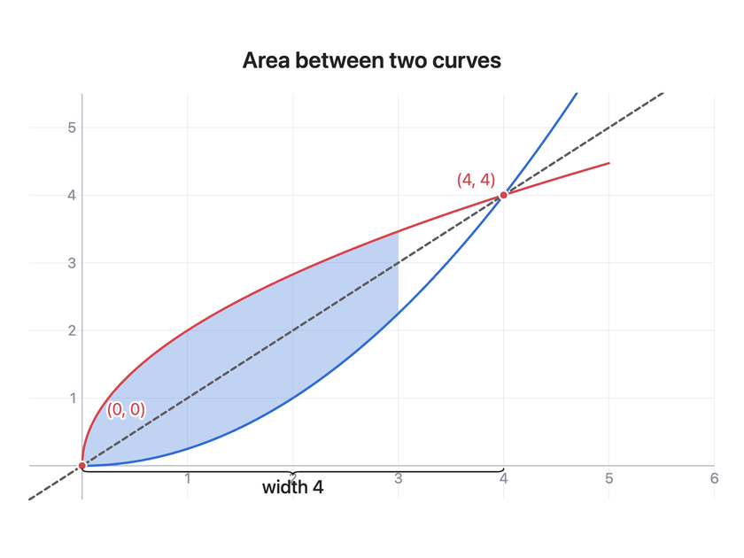
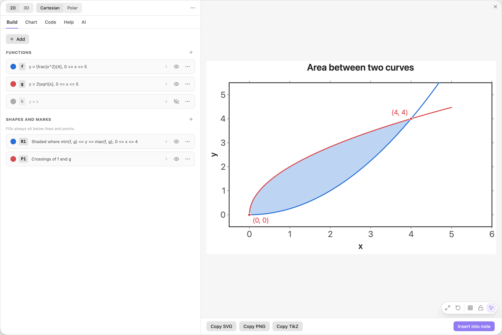
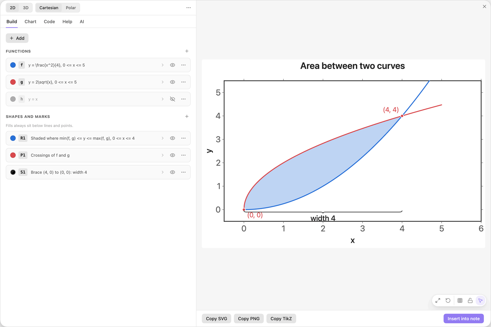
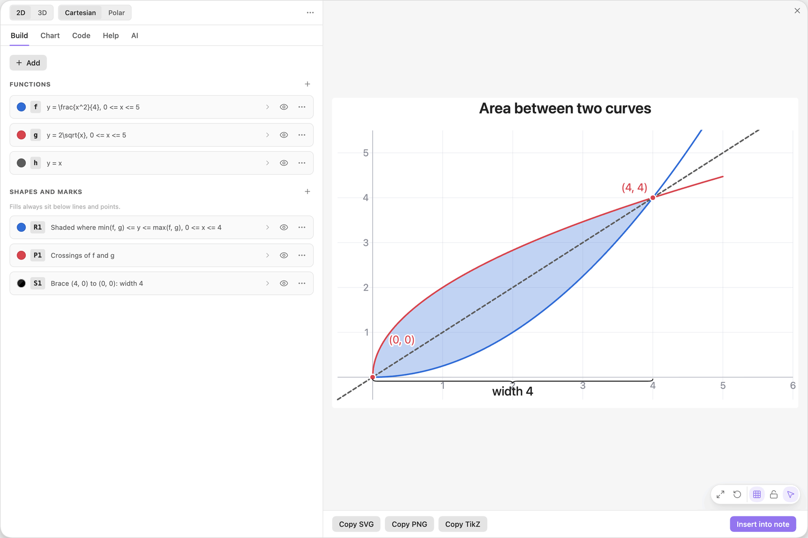
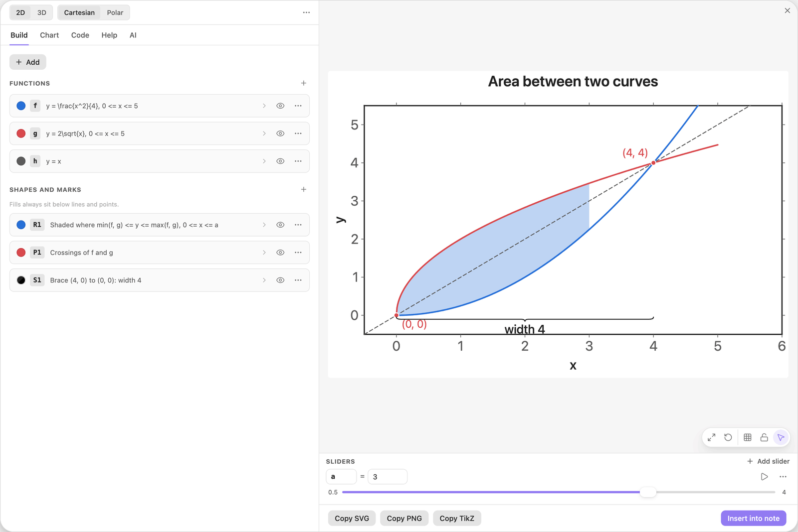

<!-- Generated by scripts/media/build-guides.mjs from src/guides. Do not edit. -->

# Coming from 3.x

[All guides](README.md) · Reference · Core · about 2 minutes

What happens to your 3.x charts, where the old tabs and tools went, and what sliders add.

<p align="center"></p>

**What you can do afterwards**

- Open 3.x charts and save them without surprises
- Find the old tabs and tools in the editor

## 1. Open an old chart

Click a chart you made with 3.x: it opens in the editor and draws as before. Nothing in the note changes until you click Save changes.

The chart in words:

```easy-tikz
show x from -0.5 to 6 and y from -0.5 to 5.5
size 12 x 8
title Area between two curves
plot $f(x) = \frac{x^2}{4}$ from x = 0 to 5 in blue, thick
plot $g(x) = 2\sqrt{x}$ from x = 0 to 5 in red, thick
plot h(x) = x in gray, dashed, hidden
shade between f and g from x = 0 to 4, opacity 0.3
mark where f and g cross, with coordinates
```



## 2. Find the old tabs and tools

The eight old tabs are now Build, Chart, Code and Help, next to the new AI tab. Each old tool is a card, and + Add names them in plain words, such as Brace with label.

The chart gets these lines:

```easy-tikz
draw a brace from (4, 0) to (0, 0), labelled "width 4"
```



## 3. Show the functions 3.x skipped

3.x did not draw a function with an empty domain, so such a function opens hidden. Click its eye to show it: here the line `y = x`.

The chart gets these lines:

```easy-tikz
plot h(x) = x in gray, dashed
```



## 4. Trade a number for a slider

Sliders are new, and any number can be one. Here the area ends at `x = a`: press play on `a` and it grows and shrinks.

The chart gets these lines:

```easy-tikz
slider a from 0.5 to 4, starting at 3
shade between f and g from x = 0 to a, opacity 0.3
```



> **Tip:** Save changes writes the format of version 4 and later, which 3.x cannot read.

## The finished chart

Paste this block into a note to get the finished chart of this guide. Click the chart in the note to open it in the editor.

<details>
<summary>The chart as an easy-tikz block</summary>

```easy-tikz
show x from -0.5 to 6 and y from -0.5 to 5.5
size 12 x 8
title Area between two curves
slider a from 0.5 to 4, starting at 3
plot $f(x) = \frac{x^2}{4}$ from x = 0 to 5 in blue, thick
plot $g(x) = 2\sqrt{x}$ from x = 0 to 5 in red, thick
plot h(x) = x in gray, dashed
shade between f and g from x = 0 to a, opacity 0.3
mark where f and g cross, with coordinates
draw a brace from (4, 0) to (0, 0), labelled "width 4"
```

</details>

## Next guides

- [Write a chart in words](chart-language.md): Build a linear program line by line: the window, a region, a slider, a moving line and the best point.
- [Keyboard shortcuts](shortcuts.md): The keys of the editor: insert, undo, move shapes and the view, and move between tabs.

[All guides](README.md)
