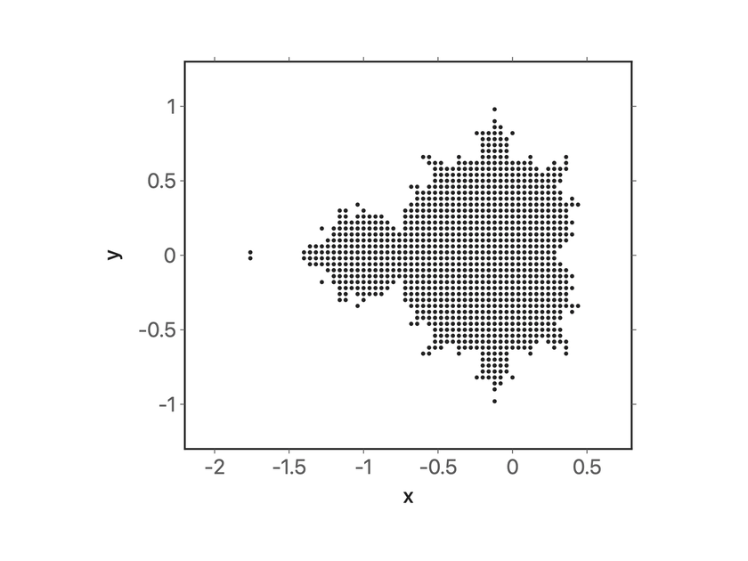
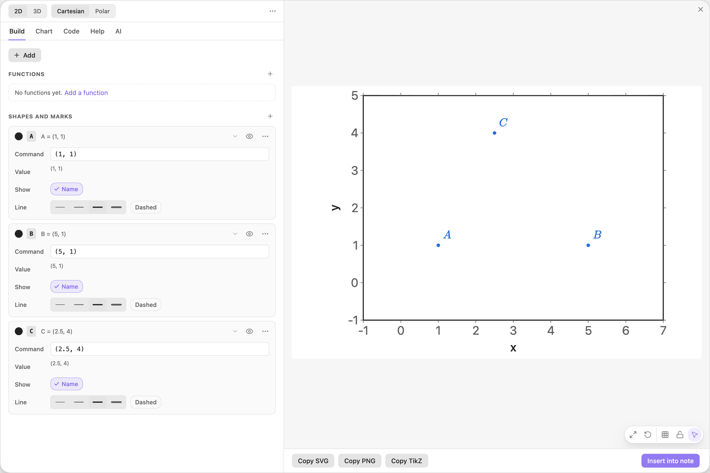
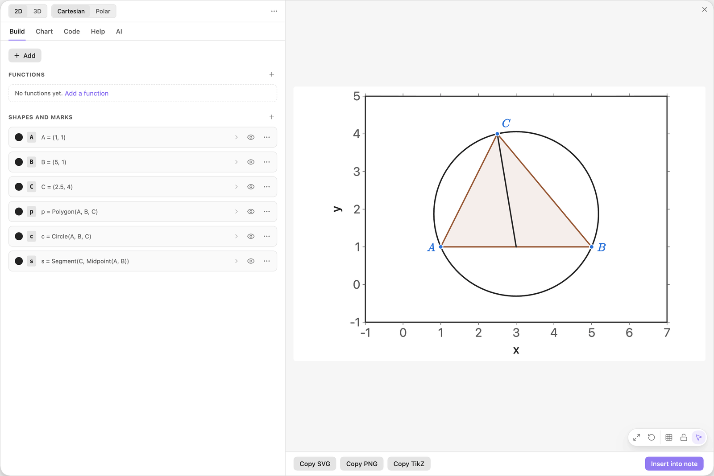
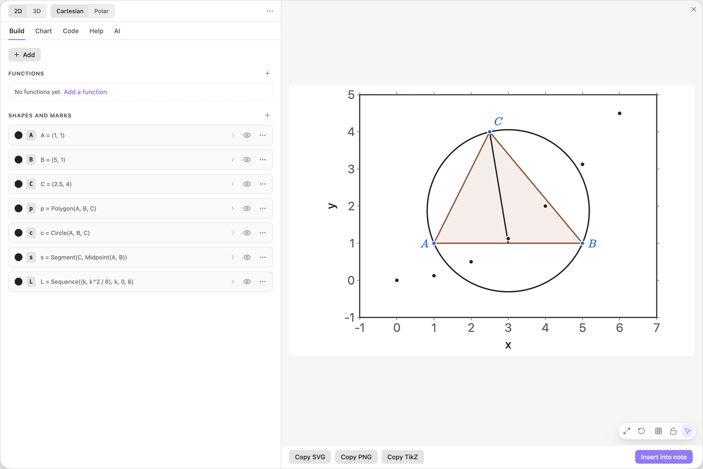
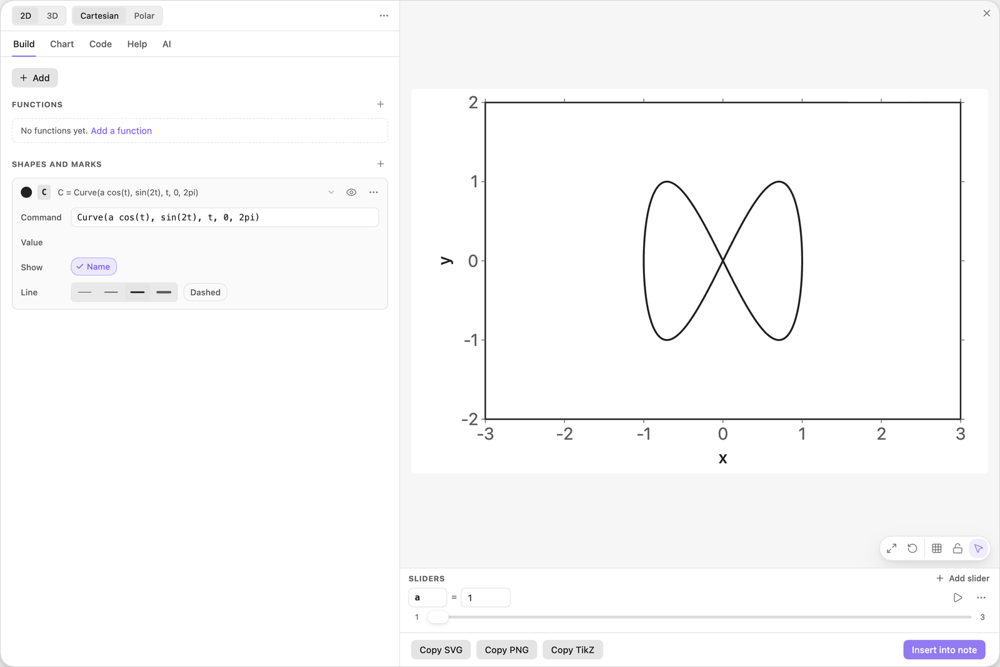
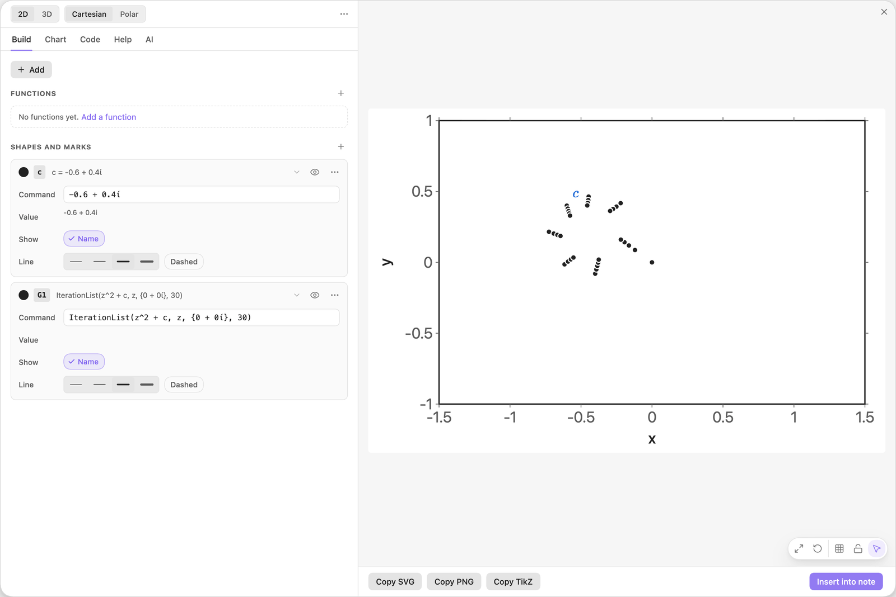
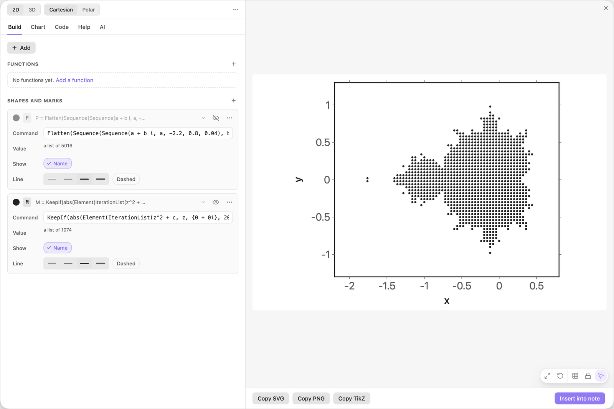

<!-- Generated by scripts/media/build-guides.mjs from src/guides. Do not edit. -->

# GeoGebra commands

[All guides](README.md) · Chart language · Core · about 4 minutes

Paste GeoGebra input lines as they are: points, circles and polygons, lists from Sequence, sliders, orbits and the Mandelbrot set.

<p align="center"></p>

**What you can do afterwards**

- Paste a GeoGebra construction into a chart
- Make lists with Sequence and KeepIf
- Iterate a formula with IterationList

**Read first:** [Write a chart in words](chart-language.md)

## 1. Paste points

Write a point as GeoGebra does: `A = (1, 1)`. Each line is one object, drawn in GeoGebra's look: free points blue, with their names.

The chart in words:

```easy-tikz
show x from -1 to 7 and y from -1 to 5
size 12 x 8
equal scale
A = (1, 1)
B = (5, 1)
C = (2.5, 4)
```



## 2. Draw objects with commands

Commands make objects from the points: `Polygon`, `Circle` through three points, `Segment` and `Midpoint`. Change `A` and everything follows.

The chart gets these lines:

```easy-tikz
p = Polygon(A, B, C)
c = Circle(A, B, C)
s = Segment(C, Midpoint(A, B))
```



> **Tip:** Options of the chart language go after a comma: `c = Circle(A, B, C), red, dashed`.

## 3. Make a list with Sequence

`Sequence((k, k^2 / 8), k, 0, 6)` is the list of the points for k = 0 to 6. Lists use braces, `{1, 2, 3}`, and count from 1: `Element(L, 2)` is the second point.

The chart gets these lines:

```easy-tikz
L = Sequence((k, k^2 / 8), k, 0, 6)
```



## 4. Add a slider

`a = Slider(1, 3)` is a slider from 1 to 3. Use it in any formula, here in `Curve`, which draws x(t) and y(t) for t from 0 to 2π. Drag `a`.

The chart gets these lines:

```easy-tikz
show x from -3 to 3 and y from -2 to 2
a = Slider(1, 3)
C = Curve(a cos(t), sin(2t), t, 0, 2pi)
```



## 5. Iterate a formula

`IterationList(z^2 + c, z, {0 + 0ί}, 30)` starts at 0 and applies z² + c thirty times: the orbit of 0, as points. `ί` and `i` are both the imaginary unit.

The chart gets these lines:

```easy-tikz
show x from -1.5 to 1.5 and y from -1 to 1
c = -0.6 + 0.4ί
IterationList(z^2 + c, z, {0 + 0ί}, 30)
```



## 6. Keep the points that stay

`P` is a grid of complex numbers, `hidden` so that only its use shows. `KeepIf` keeps each c whose 20th step is still within 2 of 0: the points of the Mandelbrot set.

The chart gets these lines:

```easy-tikz
show x from -2.2 to 0.8 and y from -1.3 to 1.3
P = Flatten(Sequence(Sequence(a + b ί, a, -2.2, 0.8, 0.04), b, -1.3, 1.3, 0.04)), hidden
M = KeepIf(abs(Element(IterationList(z^2 + c, z, {0 + 0ί}, 20), 21)) <= 2, c, P)
```



> **Tip:** For a sharp picture with colours, use `colour the plane by` (the guide Fractals).

## The finished chart

Paste this block into a note to get the finished chart of this guide. Click the chart in the note to open it in the editor.

<details>
<summary>The chart as an easy-tikz block</summary>

```easy-tikz
show x from -2.2 to 0.8 and y from -1.3 to 1.3
size 12 x 8
equal scale
P = Flatten(Sequence(Sequence(a + b ί, a, -2.2, 0.8, 0.04), b, -1.3, 1.3, 0.04)), hidden
M = KeepIf(abs(Element(IterationList(z^2 + c, z, {0 + 0ί}, 20), 21)) <= 2, c, P)
```

</details>

## Next guides

- [Fractals: Mandelbrot, Julia and Newton](fractals.md): Colour every point of the plane by its orbit: the Mandelbrot set, Julia sets on sliders and the basins of Newton's method.
- [Orbits, cobwebs and bifurcation](orbits-cobwebs.md): Follow x ↦ r x (1 - x) step by step on a cobweb, over time, and for every r at once in the bifurcation diagram.

[All guides](README.md)
