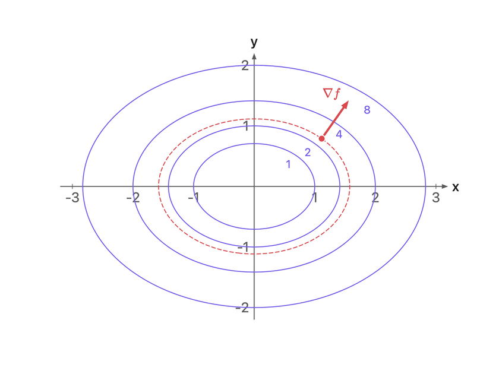
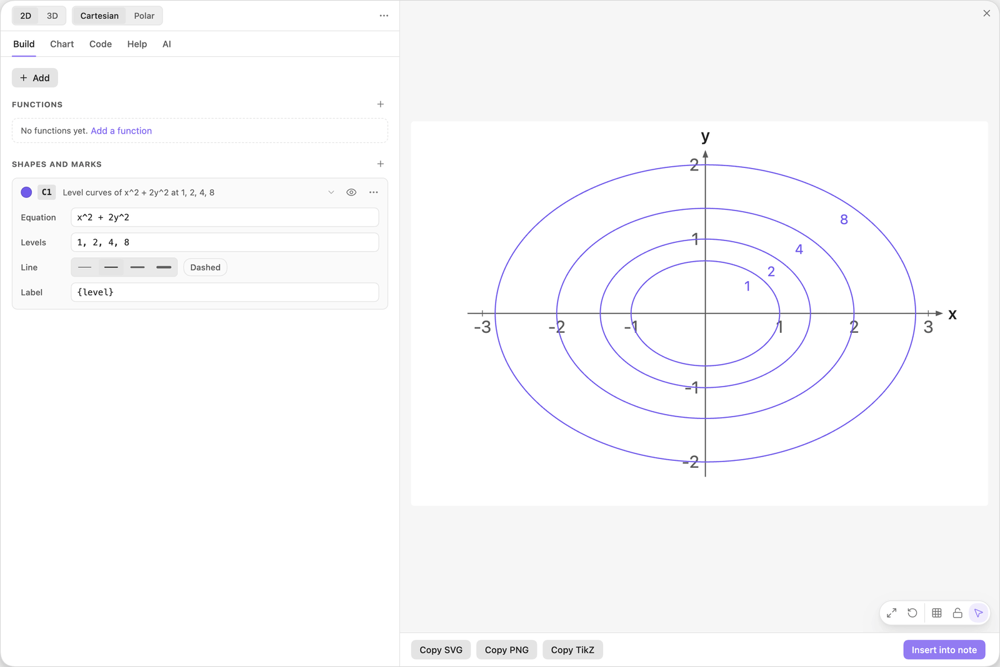
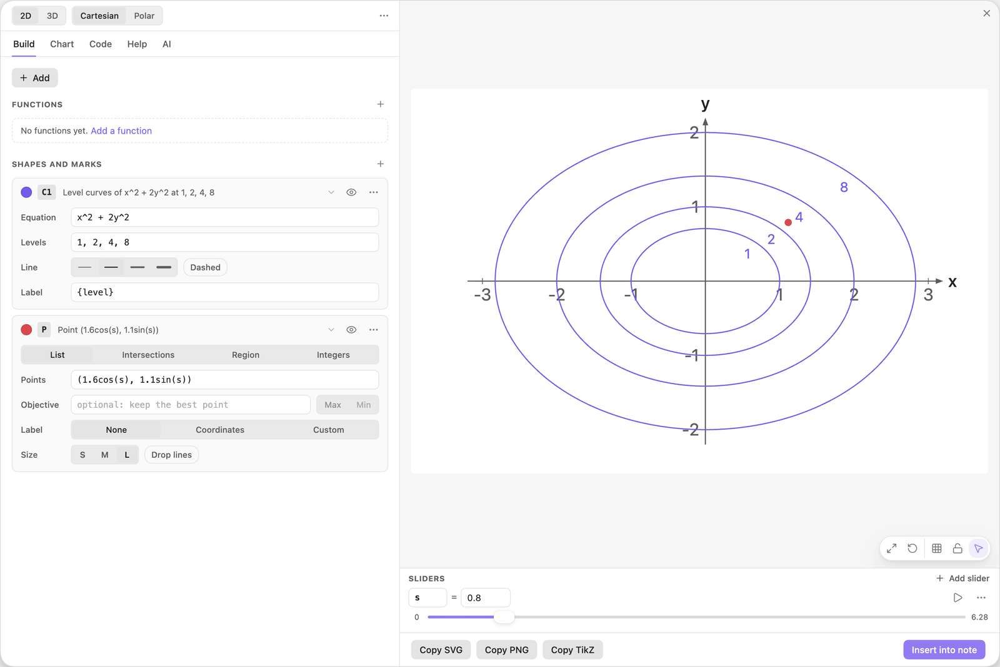
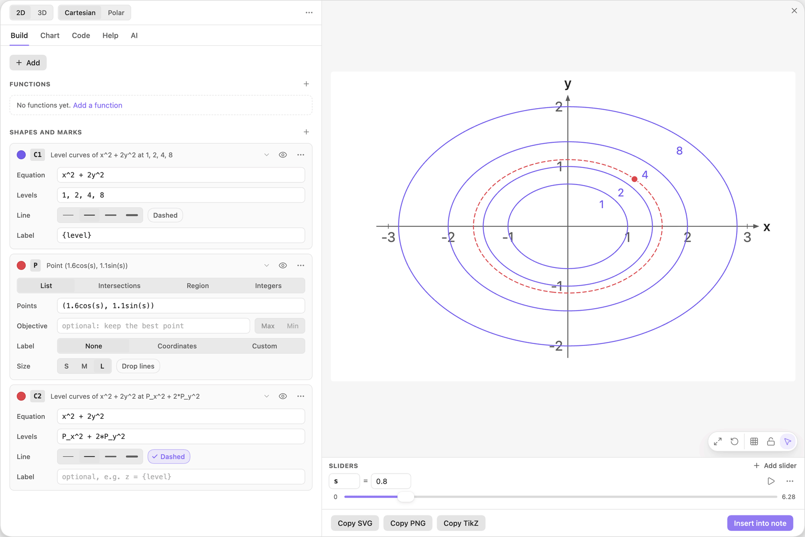
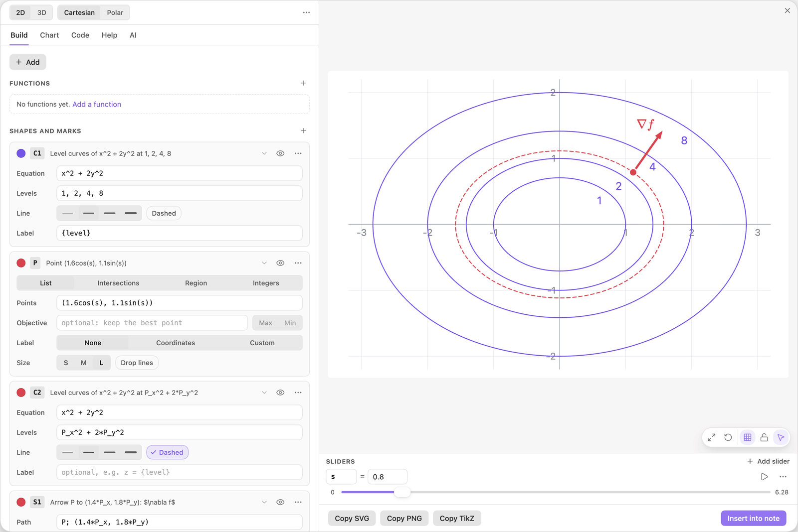

<!-- Generated by scripts/media/build-guides.mjs from src/guides. Do not edit. -->

# A gradient on level curves

[All guides](README.md) · Showcase · Advanced · about 3 minutes

A point moves around the level curves; the level through it and its gradient arrow move along.

<p align="center"></p>

**What you can do afterwards**

- Draw level curves of a function of x and y
- Use the coordinates of a point in other objects
- Draw a gradient arrow

## 1. Draw the level curves

The ellipses are where `x^2 + 2y^2` takes the values 1, 2, 4 and 8.

The chart in words:

```easy-tikz
show x from -3.2 to 3.2 and y from -2.2 to 2.2
size 12 x 8
equal scale
axes in the middle
draw the level curves of x^2 + 2y^2 at 1, 2, 4 and 8 in purple, labelled "{level}"
```



## 2. Move a point with a slider

P runs around an ellipse as `s` goes from 0 to 6.28.

The chart gets these lines:

```easy-tikz
slider s from 0 to 6.28, starting at 0.8, in steps of 0.01
P: mark (1.6cos(s), 1.1sin(s)), large
```



## 3. Draw the level through P

`P_x` and `P_y` are the coordinates of P. The dashed level curve uses them, so it always passes through P.

The chart gets these lines:

```easy-tikz
draw the level curves of x^2 + 2y^2 at P_x^2 + 2*P_y^2 in red, dashed
```



## 4. Add the gradient arrow

The gradient of `x^2 + 2y^2` is (2x, 4y). Its arrow stands at right angles to the dashed level, wherever P goes.

The chart gets these lines:

```easy-tikz
draw an arrow from P to (1.4*P_x, 1.8*P_y) in red, very thick, labelled "$\nabla f$"
```



## The finished chart

Paste this block into a note to get the finished chart of this guide. Click the chart in the note to open it in the editor.

<details>
<summary>The chart as an easy-tikz block</summary>

```easy-tikz
show x from -3.2 to 3.2 and y from -2.2 to 2.2
size 12 x 8
equal scale
axes in the middle
slider s from 0 to 6.28, starting at 0.8, in steps of 0.01
draw the level curves of x^2 + 2y^2 at 1, 2, 4 and 8 in purple, labelled "{level}"
P: mark (1.6cos(s), 1.1sin(s)), large
draw the level curves of x^2 + 2y^2 at P_x^2 + 2*P_y^2 in red, dashed
draw an arrow from P to (1.4*P_x, 1.8*P_y) in red, very thick, labelled "$\nabla f$"
```

</details>

## Next guides

- [Find a nonlinear optimum with level curves](level-curves.md): Circles of equal distance as level curves, and the closest point of a region, where one of them touches.

[All guides](README.md)
