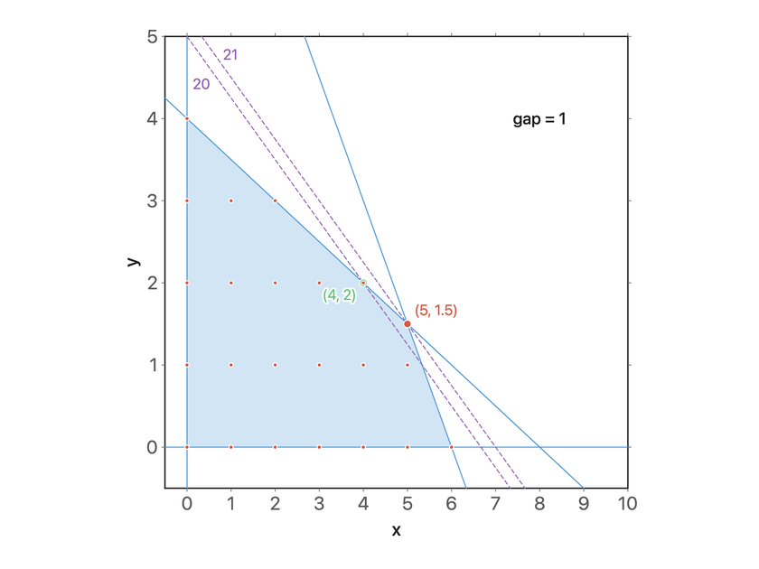
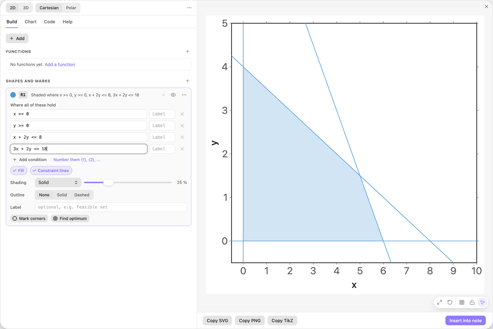
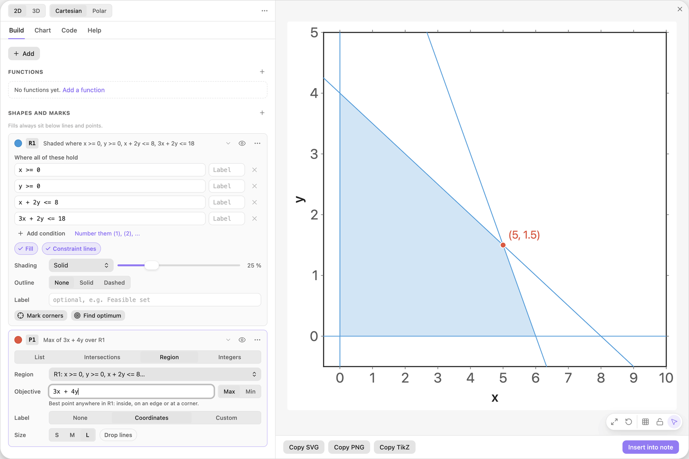
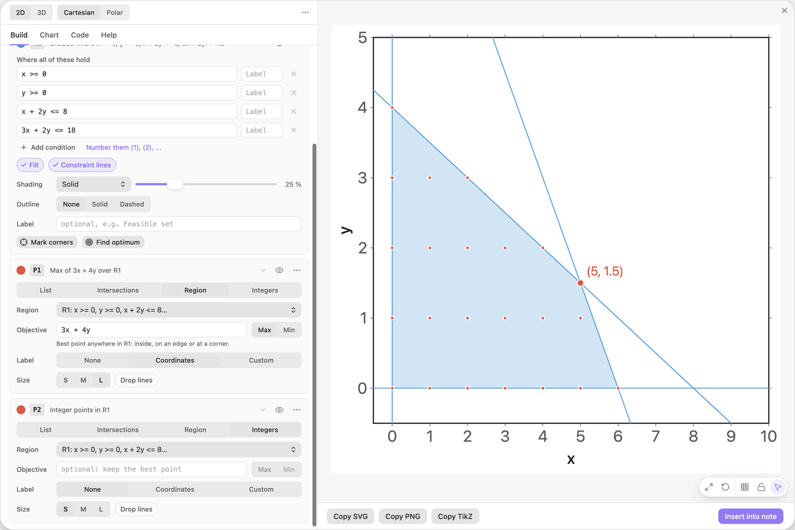
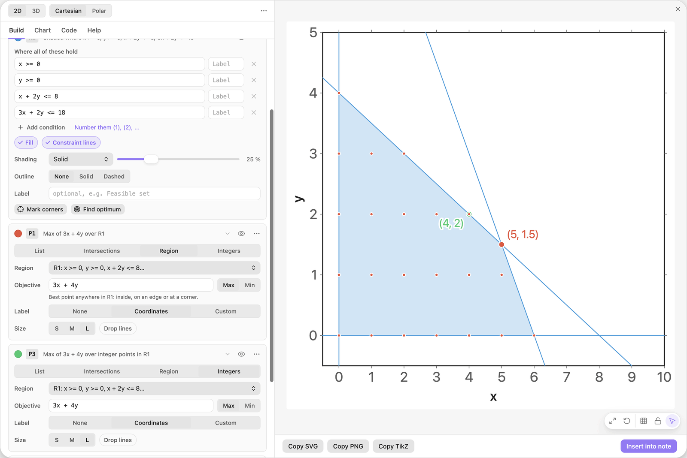
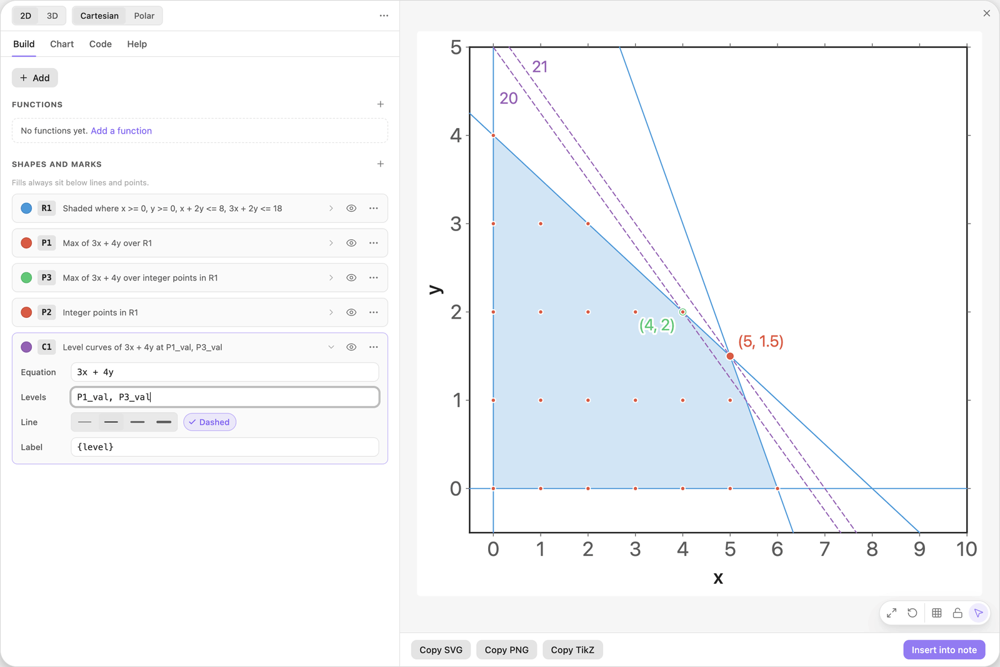
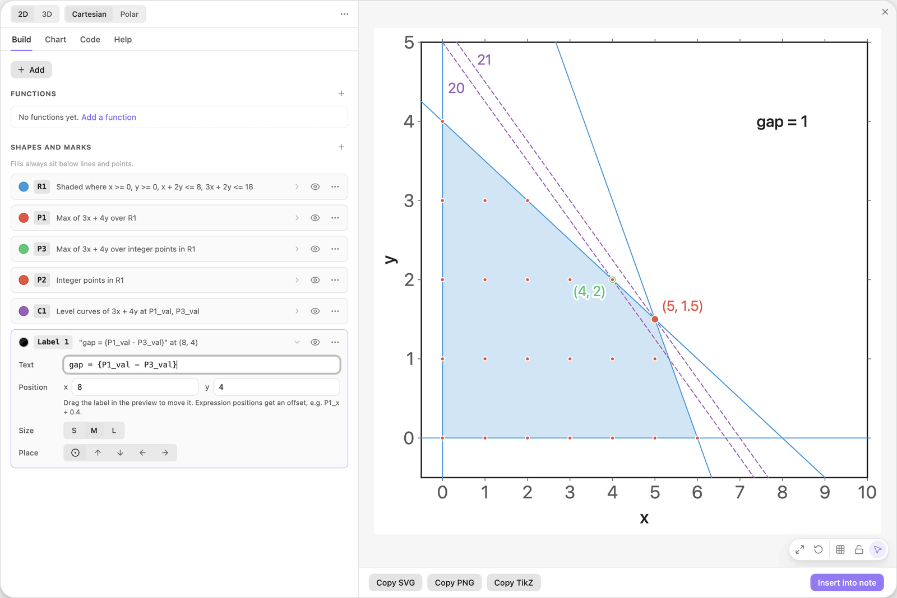

<!-- Generated by scripts/media/build-guides.mjs from src/guides. Do not edit. -->

# Compare an integer program with its relaxation

[All guides](README.md) · Regions and optimisation · Advanced · about 8 minutes

Integer points inside a feasible region, the best integer point, and how far it is from the optimum of the relaxed linear program.

<p align="center"></p>

**What you can do afterwards**

- Mark every integer point inside a region
- Find the best integer point for an objective
- Show the optimum of the relaxation next to it, with both objective lines and the gap

**Read first:** [Solve a linear program in a picture](linear-program.md)

## 1. Draw the feasible region

This guide solves: maximise z = 3x + 4y subject to x + 2y &lt;= 8, 3x + 2y &lt;= 18 and x, y \>= 0, once with any numbers and once with whole numbers only.

Start with a new chart. Click + Add and choose Feasible region (inequalities). Type the first constraint into the empty third row, press Enter and type the second one.

| Where | Type |
| --- | --- |
| R1, condition 3 | `x + 2y <= 8` |
| R1, condition 4 | `3x + 2y <= 18` |



*The feasible region of the relaxation: every point that satisfies the four conditions.*

> **Tip:** Enter in the last row adds the next one, so a whole model can be typed without touching the mouse.

## 2. Solve the relaxation

On the card R1 click Find optimum. The field Objective of the new card P1 holds the sample `2x + 3y`, already selected: type the objective below over it.

The marker lands on the corner (5, 1.5). That is the best point when fractions are allowed, the optimum of the relaxed linear program. Its y is not a whole number, so it is not a solution of the integer program.

| Where | Type |
| --- | --- |
| P1, Objective | `3x + 4y` |



*The optimum of the relaxation sits on a corner with a fractional coordinate.*

> **Tip:** With the source Region and an objective, a points card searches the whole region, its edges and its inside, not only the corners.

## 3. Show the integer points

Click + Add and choose Integer points in a region. The card P2 marks every point of R1 whose coordinates are both whole numbers, as small dots.

These 22 dots are the feasible set of the integer program. The optimum of the relaxation is not one of them.



*Source Integers: every point with whole-number coordinates inside R1.*

> **Tip:** With Region set to Whole view, the same card marks the integer points of the entire view.

## 4. Keep the best integer point

Open the ... menu on the card P1 and choose Duplicate. On the copy, P3, switch the source at the top of the card from Region to Integers, then click its colour swatch and pick green.

P3 keeps the objective of P1, but now searches the integer points only. Its marker lands on (4, 2). Rounding the relaxed optimum would not have found it: (5, 2) is infeasible, and (5, 1) is worse.



*The same objective over the integer points: the best one is (4, 2).*

> **Tip:** If several integer points share the best value, all of them are marked.

## 5. Draw both objective lines

Click + Add and choose Level curves of F(x, y). On the new card C1, replace Equation and Levels with the rows below and switch on the chip Dashed.

A curve with levels draws F = value once per value. Here the values are computed: `P1_val` is the objective at the relaxed optimum and `P3_val` at the best integer point. You get two parallel lines, each through its own optimum. The label `{level}`, which the recipe filled in, prints the value on each line: 21 and 20.

| Where | Type |
| --- | --- |
| C1, Equation | `3x + 4y` |
| C1, Levels | `P1_val, P3_val` |



*Two levels of the objective, taken from the two optima.*

> **Tip:** In a curve label, `{level}` is the value of the line it sits on. Write `z = {level}` for a longer label.

## 6. Print the gap

Click + Add and choose Text label. Replace its text with the template below, then drag the label in the preview to the free corner at the top right. Close to a grid point it snaps: let go on (8, 4).

The label reads gap = 1: insisting on whole numbers costs one unit of z in this model. Change a constraint and both optima, both lines and the gap are computed again.

| Where | Type |
| --- | --- |
| Label 1, Text | `gap = {P1_val - P3_val}` |



*A text label with a template prints the difference of the two optimal values.*

> **Tip:** Anything inside braces is a formula, so a label can do arithmetic with computed values.

## The finished chart

Paste this block into a note to get the finished chart of this guide. Click the chart in the note to open it in the editor.

<details>
<summary>The chart as an easy-tikz block</summary>

```easy-tikz
{
  "v": 4,
  "dimension": false,
  "documentSetup": true,
  "title": "",
  "size_x_cm": 10,
  "size_y_cm": 10,
  "show_axis_label": true,
  "axis_label_x": "x",
  "axis_label_y": "y",
  "showAxis": true,
  "showLargeGrid": false,
  "showSmallGrid": false,
  "gridSize": 5,
  "majorTickNum": 8,
  "xmin": "-0.5",
  "xmax": "10",
  "ymin": "-0.5",
  "ymax": "5",
  "zmin": "-5",
  "zmax": "5",
  "axis_style": "box",
  "coordinateSystem": "cartesian",
  "axis_label_x_polar": "",
  "axis_label_y_polar": "",
  "axis_label_z": "z",
  "rotationX": 30,
  "rotationZ": 45,
  "zoom3D": 1,
  "boxAspect": "true",
  "previewSize": 760,
  "functions": [],
  "functions3D": [],
  "tools": [
    {
      "type": "region",
      "color": "blue",
      "conditions": [
        "x >= 0",
        "y >= 0",
        "x + 2y <= 8",
        "3x + 2y <= 18"
      ],
      "conditionLabels": [
        "",
        "",
        "",
        ""
      ],
      "fill": true,
      "fillOpacity": 0.25,
      "fillPattern": "solid",
      "outline": "none",
      "thickness": "thin",
      "constraintLines": true,
      "label": "",
      "id": "t0",
      "name": "R1"
    },
    {
      "type": "points",
      "color": "red",
      "dim": 2,
      "source": "region",
      "points": "",
      "ref1": "",
      "ref2": "",
      "regionName": "R1",
      "objective": "3x + 4y",
      "sense": "max",
      "label": "({x:2}, {y:2})",
      "dropLines": false,
      "size": "large",
      "id": "t1",
      "name": "P1"
    },
    {
      "type": "points",
      "color": "green",
      "dim": 2,
      "source": "lattice",
      "points": "",
      "ref1": "",
      "ref2": "",
      "regionName": "R1",
      "objective": "3x + 4y",
      "sense": "max",
      "label": "({x:2}, {y:2})",
      "dropLines": false,
      "size": "large",
      "id": "t3",
      "name": "P3"
    },
    {
      "type": "points",
      "color": "red",
      "dim": 2,
      "source": "lattice",
      "points": "",
      "ref1": "",
      "ref2": "",
      "regionName": "R1",
      "objective": "",
      "sense": "max",
      "label": "",
      "dropLines": false,
      "size": "small",
      "id": "t2",
      "name": "P2"
    },
    {
      "type": "curve",
      "color": "purple",
      "equation": "3x + 4y",
      "levels": "P1_val, P3_val",
      "thickness": "thin",
      "dashed": true,
      "label": "{level}",
      "id": "t4",
      "name": "C1"
    }
  ],
  "annotations": [
    {
      "x": "8",
      "y": "4",
      "text": "gap = {P1_val - P3_val}",
      "color": "black",
      "size": "normal",
      "anchor": "center"
    }
  ],
  "parameters": [],
  "variables": "x, y",
  "equalScale": false,
  "showSlidersInNote": true
}
```

</details>

## Next guides

- [Find a nonlinear optimum with level curves](level-curves.md): Level curves of an objective, a constraint region, the best point on its edge, and the level curve that touches it there.
- [Points, intersections and live labels](points-labels.md): Mark points from a list, find where two curves cross, and print values that update when a slider moves.
- [Export to LaTeX](export-latex.md): Get pgfplots code that compiles with pdflatex: as a standalone document or as a snippet, at the size you need, in the colours of the preview.

[All guides](README.md)
