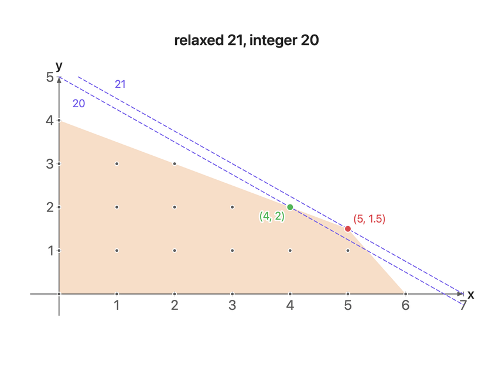
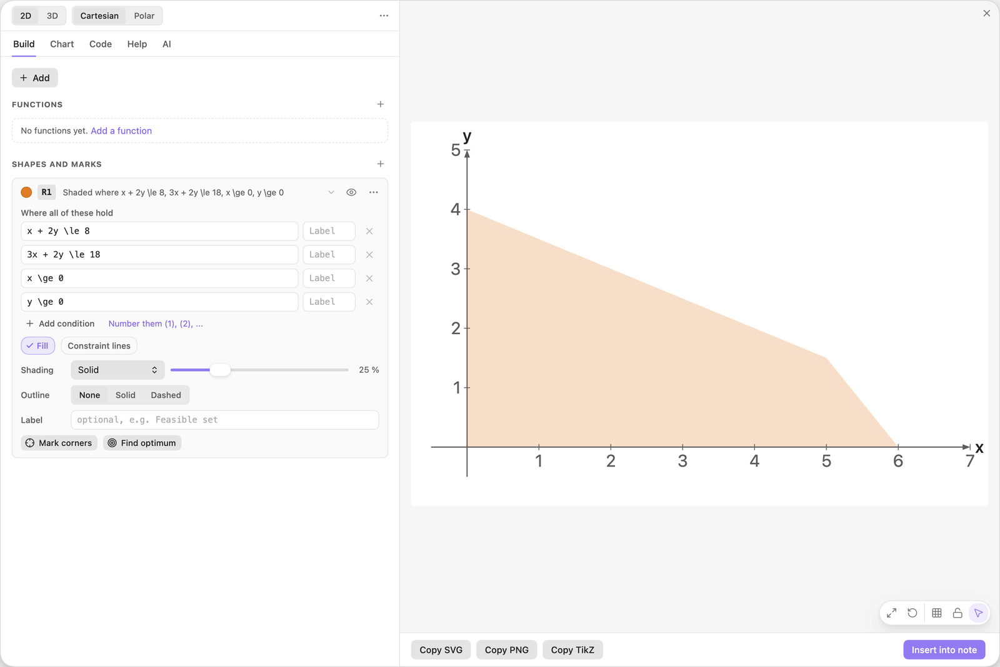
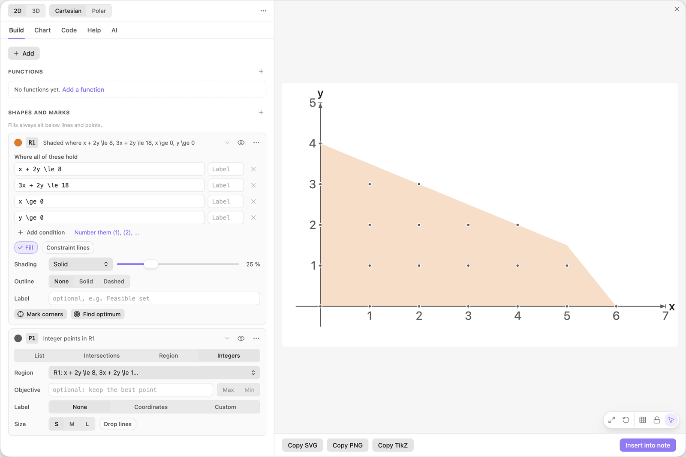
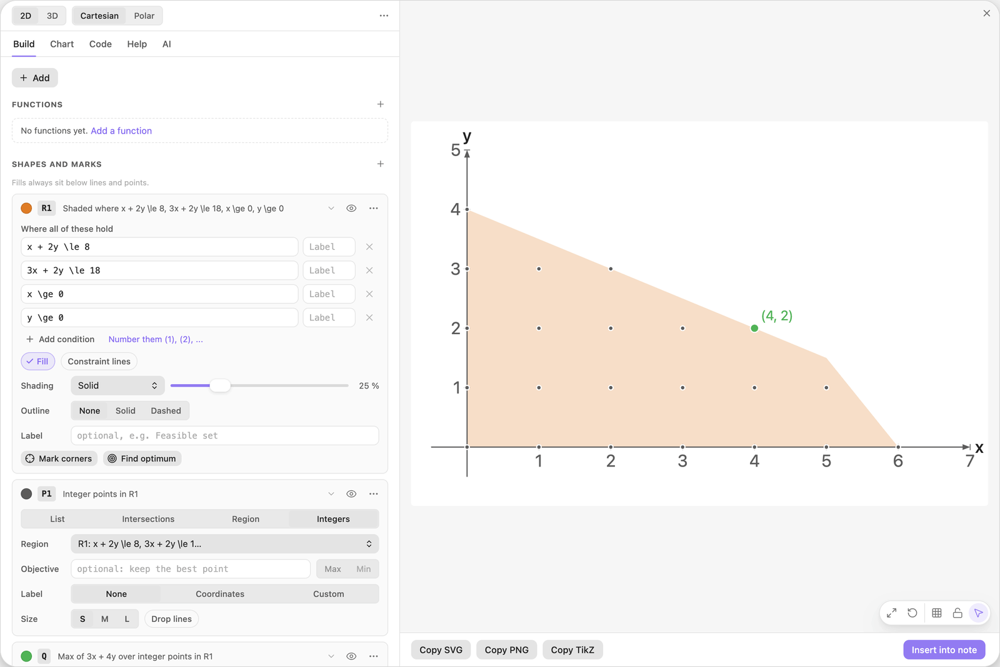
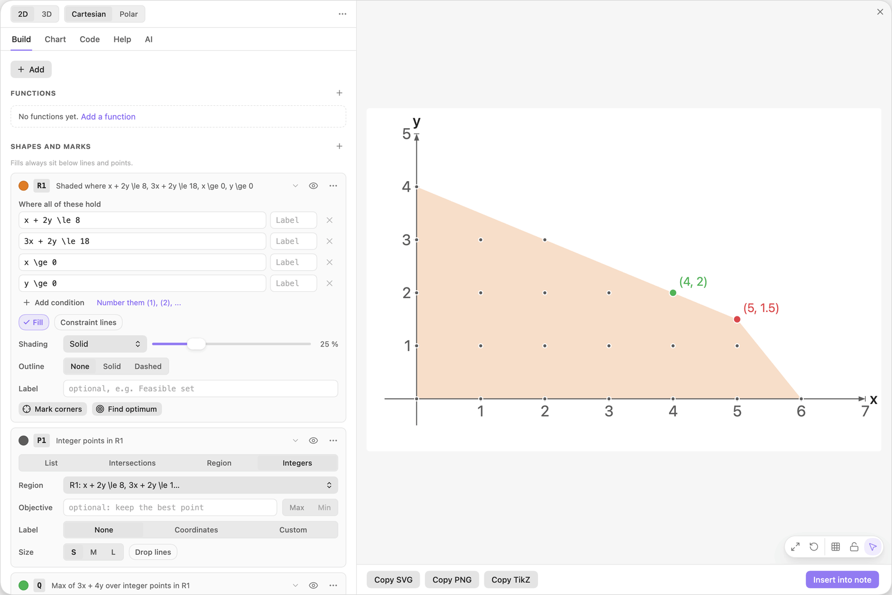
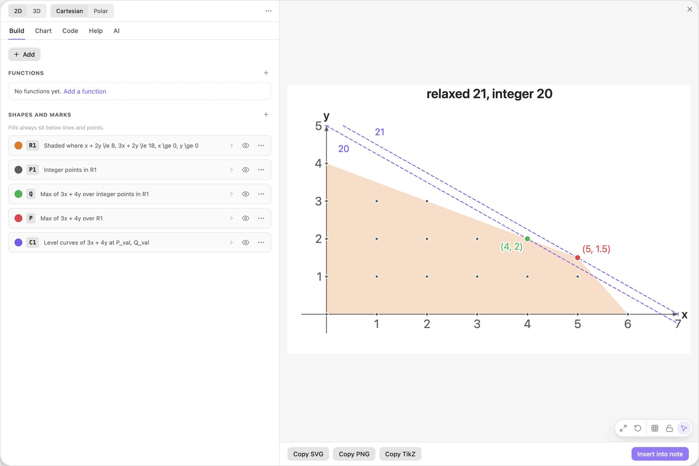

<!-- Generated by scripts/media/build-guides.mjs from src/guides. Do not edit. -->

# Compare an integer program with its relaxation

[All guides](README.md) · Regions and optimisation · Advanced · about 3 minutes

The integer points of a region, the best of them, and the gap to the optimum without whole numbers.

<p align="center"></p>

**What you can do afterwards**

- Mark every integer point of a region
- Find the best integer point for an objective
- Compare it with the optimum of the linear program

**Read first:** [Solve a linear program in a picture](linear-program.md)

## 1. Shade the region

Maximise `3x + 4y` where x and y must be whole numbers. First shade the region of the other conditions.

The chart in words:

```easy-tikz
show x from -0.5 to 7 and y from -0.5 to 5
size 12 x 8
axes in the middle
shade where $x + 2y \le 8$ and $3x + 2y \le 18$ and $x \ge 0$ and $y \ge 0$ in orange
```



## 2. Mark the integer points

`mark the integer points in the region` puts a dot on every point with whole coordinates. These 22 dots are all the choices left.

The chart gets these lines:

```easy-tikz
mark the integer points in the region, in gray, small
```



## 3. Find the best integer point

`mark the integer maximum` tries every dot and keeps the best: (4, 2), where `3x + 4y` is 20. `Q:` gives the point a name.

The chart gets these lines:

```easy-tikz
Q: mark the integer maximum of 3x + 4y in the region, in green, large, with coordinates
```



## 4. Compare it with the relaxation

Without whole numbers the best point is the corner (5, 1.5), with 21. Rounding it gives (5, 2), which lies outside the region.

The chart gets these lines:

```easy-tikz
P: mark the maximum of 3x + 4y in the region, large, with coordinates
```



## 5. Draw both objective lines

`P_val` and `Q_val` are the two best values. Level curves of `3x + 4y` at them draw a line through each point, and the title prints both.

The chart gets these lines:

```easy-tikz
title relaxed {P_val}, integer {Q_val}
draw the level curves of 3x + 4y at P_val and Q_val in purple, dashed, labelled "{level}"
```



> **Tip:** Anything in braces is a formula: `{P_val - Q_val}` prints the gap, 1.

## The finished chart

Paste this block into a note to get the finished chart of this guide. Click the chart in the note to open it in the editor.

<details>
<summary>The chart as an easy-tikz block</summary>

```easy-tikz
show x from -0.5 to 7 and y from -0.5 to 5
size 12 x 8
axes in the middle
title relaxed {P_val}, integer {Q_val}
shade where $x + 2y \le 8$ and $3x + 2y \le 18$ and $x \ge 0$ and $y \ge 0$ in orange
mark the integer points in the region, in gray, small
Q: mark the integer maximum of 3x + 4y in the region, in green, large, with coordinates
P: mark the maximum of 3x + 4y in the region, large, with coordinates
draw the level curves of 3x + 4y at P_val and Q_val in purple, dashed, labelled "{level}"
```

</details>

## Next guides

- [Find a nonlinear optimum with level curves](level-curves.md): Circles of equal distance as level curves, and the closest point of a region, where one of them touches.
- [Calculate with computed points](computed-values.md): Use what crossing points publish, their count and coordinates, in a title, a new point and an area.

[All guides](README.md)
