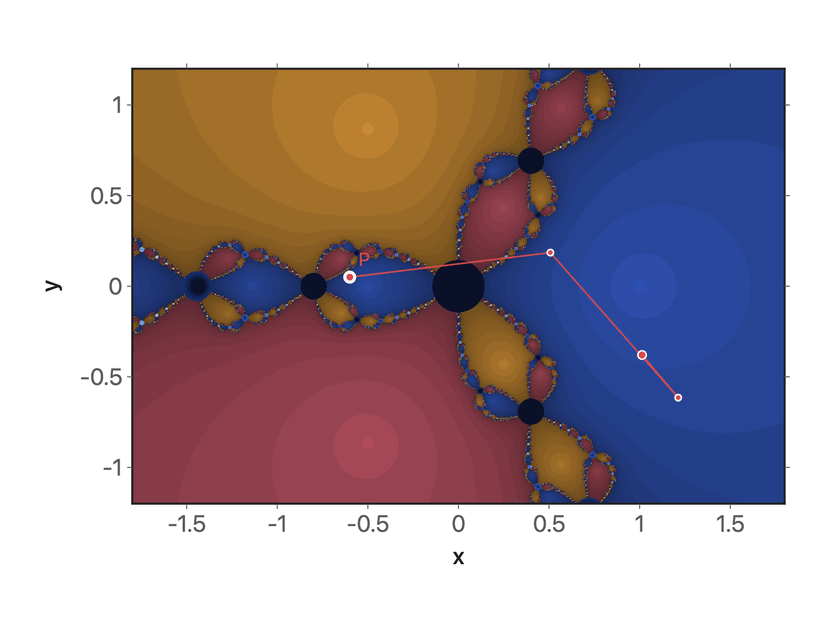
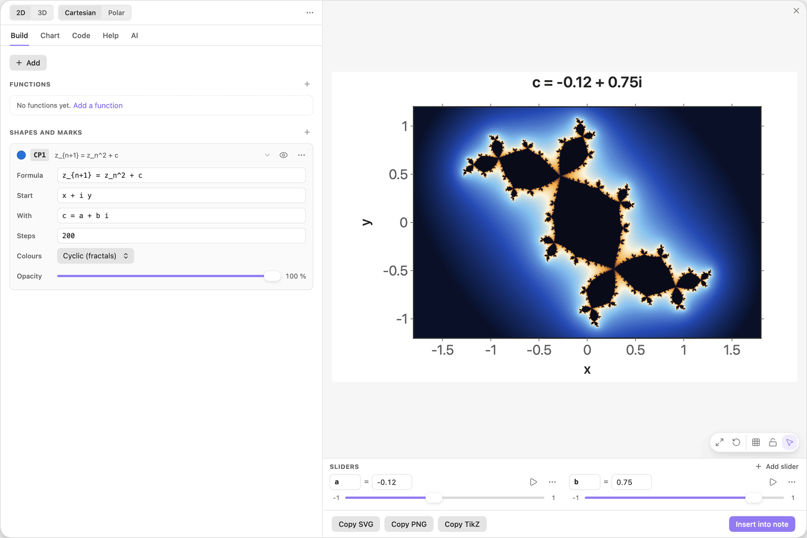
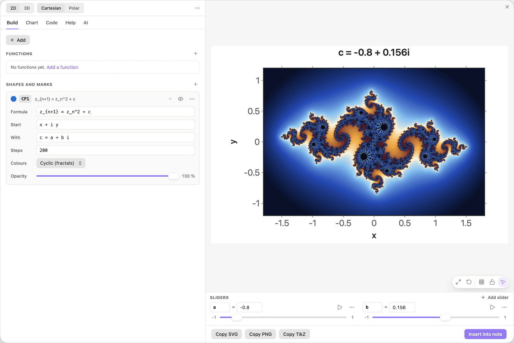
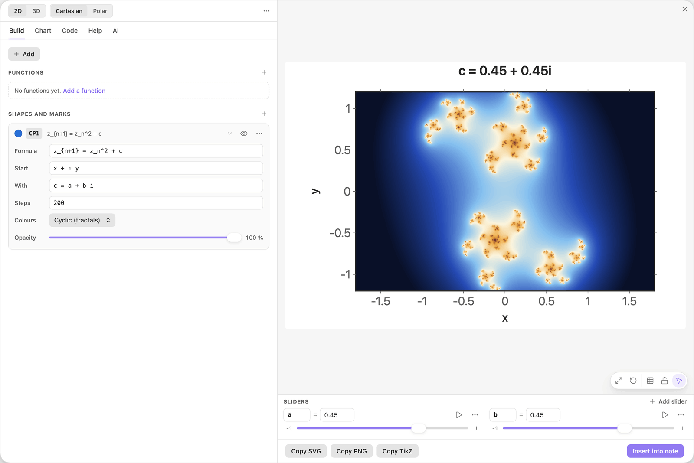
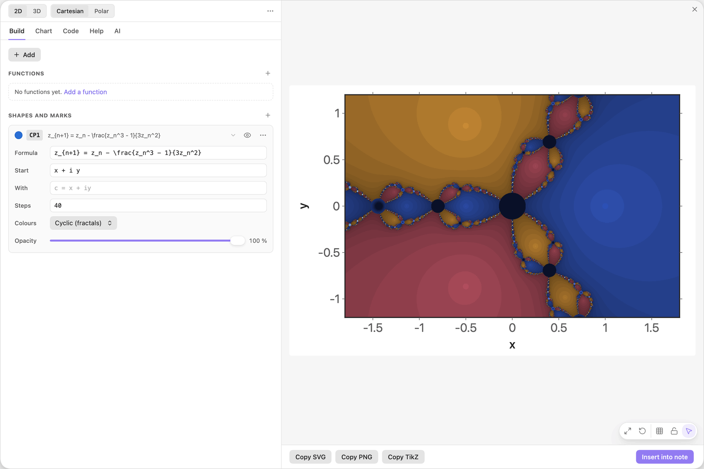
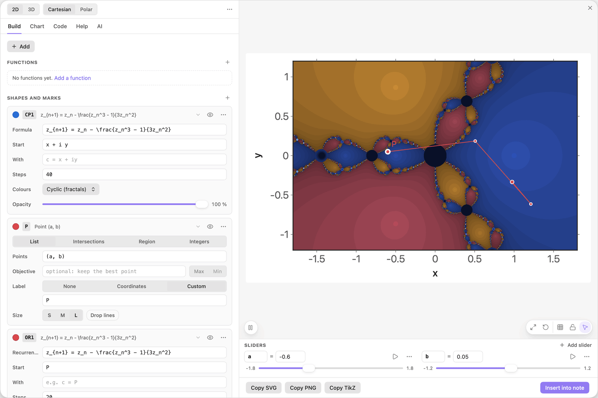

<!-- Generated by scripts/media/build-guides.mjs from src/guides. Do not edit. -->

# Julia sets and Newton basins

[All guides](README.md) · Showcase · Advanced · about 3 minutes

Put c of a Julia set on two sliders, then colour the plane by Newton's method and watch one point find its root.

<p align="center"></p>

**What you can do afterwards**

- Colour the plane by a Julia set on sliders
- Colour Newton's method by the root it reaches
- Trace the orbit of a point

## 1. Colour the plane by a Julia set

Every point is a start `$z_0 = x + iy$` of z² + c, and c = a + bi stays fixed. The dark points never escape. This c lies in the Mandelbrot set, so they hang together.

The chart in words:

```easy-tikz
show x from -1.8 to 1.8 and y from -1.2 to 1.2
size 12 x 8
equal scale
title c = {a} + {b}i
slider a from -1 to 1, starting at -0.12
slider b from -1 to 1, starting at 0.75
colour the plane by $z_{n+1} = z_n^2 + c$, $z_0 = x + i y$, $c = a + b i$, 200 steps
```



## 2. Move c with the sliders

Drag `a` and `b`: each c gives another set. At -0.8 + 0.156i, near the border of the Mandelbrot set, it turns into thin spirals.

The chart gets these lines:

```easy-tikz
slider a from -1 to 1, starting at -0.8
slider b from -1 to 1, starting at 0.156
```



## 3. Move c out of the Mandelbrot set

At 0.45 + 0.45i, c lies outside. The set falls apart into dust: nearly every orbit flies away.

The chart gets these lines:

```easy-tikz
slider a from -1 to 1, starting at 0.45
slider b from -1 to 1, starting at 0.45
```



## 4. Colour the plane by Newton's method

Newton's method for z³ - 1 runs from every point. Each point takes the colour of the root it reaches, darker the more steps it needs.

The chart gets these lines:

```easy-tikz
colour the plane by $z_{n+1} = z_n - \frac{z_n^3 - 1}{3z_n^2}$, $z_0 = x + i y$, 40 steps
```



## 5. Follow one point to its root

P sits at (a, b), and its orbit draws itself. From the border between the colours it jumps far across before it settles at the root 1.

The chart gets these lines:

```easy-tikz
slider a from -1.8 to 1.8, starting at -0.6, in steps of 0.01
slider b from -1.2 to 1.2, starting at 0.05, in steps of 0.01
P: mark (a, b), large, labelled "P"
draw the orbit of $z_{n+1} = z_n - \frac{z_n^3 - 1}{3z_n^2}$, $z_0 = P$, 20 steps, traced
```



> **Tip:** Drag `a` and `b`, or P in the editor: near a border every small move picks another root.

## The finished chart

Paste this block into a note to get the finished chart of this guide. Click the chart in the note to open it in the editor.

<details>
<summary>The chart as an easy-tikz block</summary>

```easy-tikz
show x from -1.8 to 1.8 and y from -1.2 to 1.2
size 12 x 8
equal scale
slider a from -1.8 to 1.8, starting at -0.6, in steps of 0.01
slider b from -1.2 to 1.2, starting at 0.05, in steps of 0.01
colour the plane by $z_{n+1} = z_n - \frac{z_n^3 - 1}{3z_n^2}$, $z_0 = x + i y$, 40 steps
P: mark (a, b), large, labelled "P"
draw the orbit of $z_{n+1} = z_n - \frac{z_n^3 - 1}{3z_n^2}$, $z_0 = P$, 20 steps, traced
```

</details>

## Next guides

- [The orbit of a point in the Mandelbrot set](mandelbrot-orbit.md): Move c with two sliders over the Mandelbrot set: its orbit goes round inside the set and flies off outside it.
- [Fractals: Mandelbrot, Julia and Newton](fractals.md): Colour every point of the plane by its orbit: the Mandelbrot set, Julia sets on sliders and the basins of Newton's method.

[All guides](README.md)
