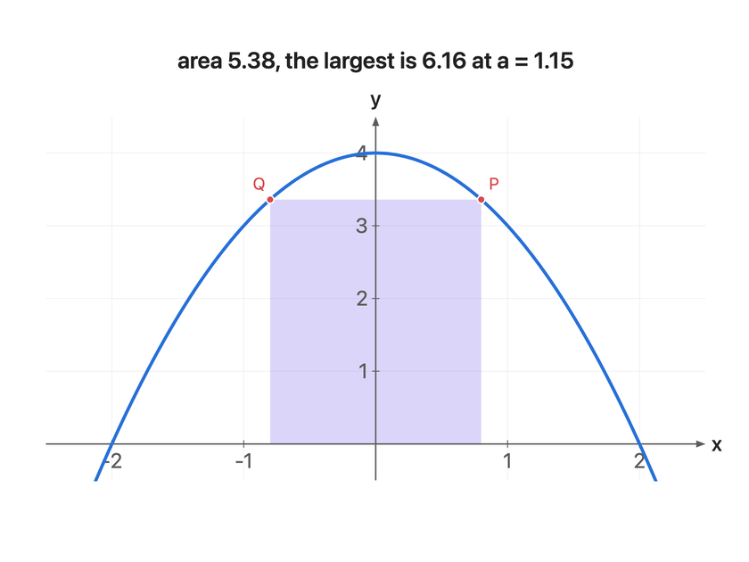
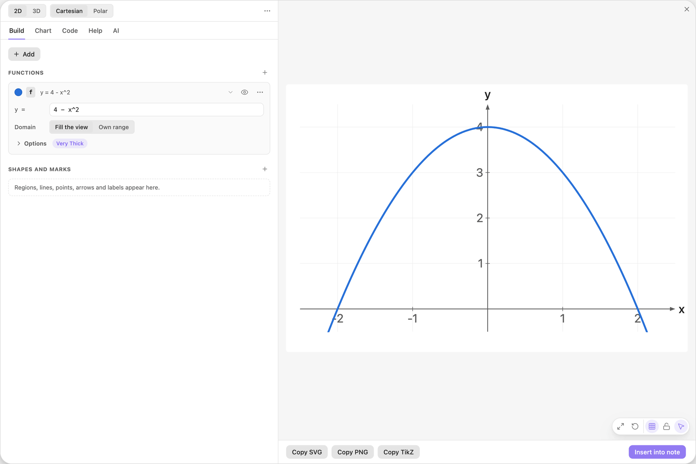
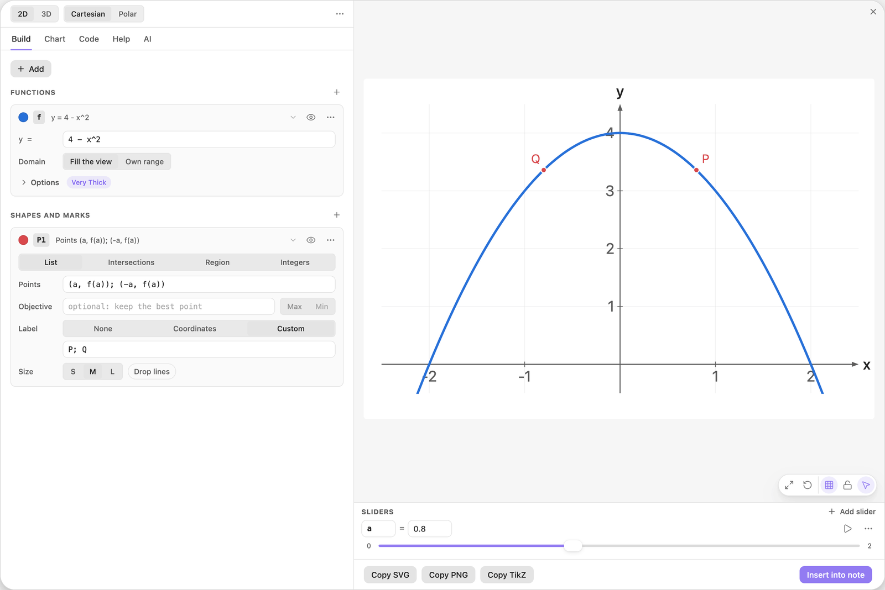
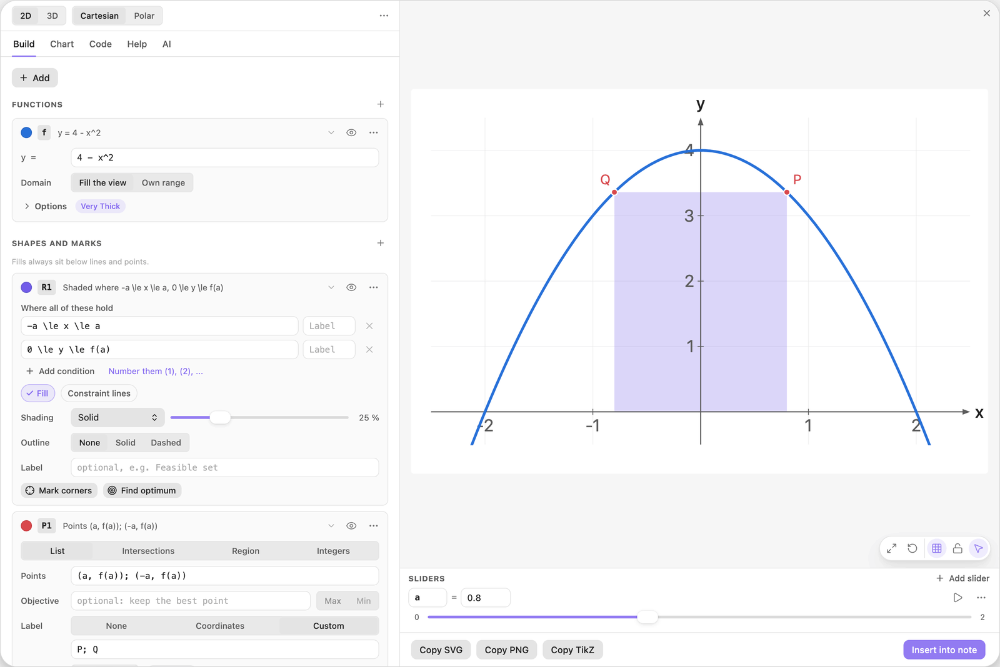
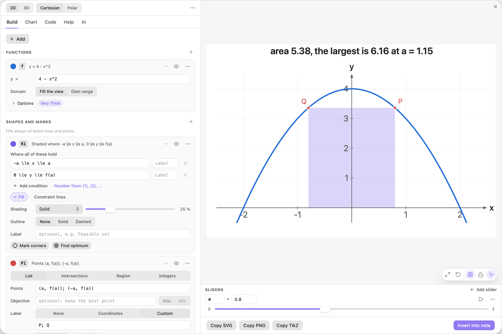

<!-- Generated by scripts/media/build-guides.mjs from src/guides. Do not edit. -->

# The largest rectangle under a parabola

[All guides](README.md) · Showcase · Core · about 2 minutes

A rectangle whose corners sit on the parabola: drag its corner and find where its area is largest.

<p align="center"></p>

**What you can do afterwards**

- Shade a region that follows a slider
- Mark points that depend on a slider
- Read an optimum off a live title

## 1. Plot the parabola

The rectangle will stand under `f(x) = 4 - x^2`.

The chart in words:

```easy-tikz
show x from -2.5 to 2.5 and y from -0.5 to 4.5
size 12 x 8
axes in the middle
with a grid
plot f(x) = 4 - x^2 in blue, very thick
```



## 2. Put the corners on a slider

P and Q sit on the curve at `a` and `-a`. Drag `a` and they slide along it.

The chart gets these lines:

```easy-tikz
slider a from 0 to 2, starting at 0.8, in steps of 0.01
mark (a, f(a)) and (-a, f(a)), labelled "P; Q"
```



## 3. Shade the rectangle

The conditions use `a` and `f(a)`, so the rectangle follows the corners.

The chart gets these lines:

```easy-tikz
shade where $-a \le x \le a$ and $0 \le y \le f(a)$ in purple
```



## 4. Find the largest area

The title prints the area for the `a` shown. Drag `a` until it reaches its largest value, at about 1.15.

The chart gets these lines:

```easy-tikz
title area {2*a*(4 - a^2):2}, the largest is {32/(3*sqrt(3)):2} at a = {2/sqrt(3):2}
```



## The finished chart

Paste this block into a note to get the finished chart of this guide. Click the chart in the note to open it in the editor.

<details>
<summary>The chart as an easy-tikz block</summary>

```easy-tikz
show x from -2.5 to 2.5 and y from -0.5 to 4.5
size 12 x 8
axes in the middle
with a grid
title area {2*a*(4 - a^2):2}, the largest is {32/(3*sqrt(3)):2} at a = {2/sqrt(3):2}
slider a from 0 to 2, starting at 0.8, in steps of 0.01
plot f(x) = 4 - x^2 in blue, very thick
shade where $-a \le x \le a$ and $0 \le y \le f(a)$ in purple
mark (a, f(a)) and (-a, f(a)), labelled "P; Q"
```

</details>

## Next guides

- [The mean value theorem](mean-value.md): Between A and B a tangent runs parallel to the secant; drag B and the point C follows.

[All guides](README.md)
