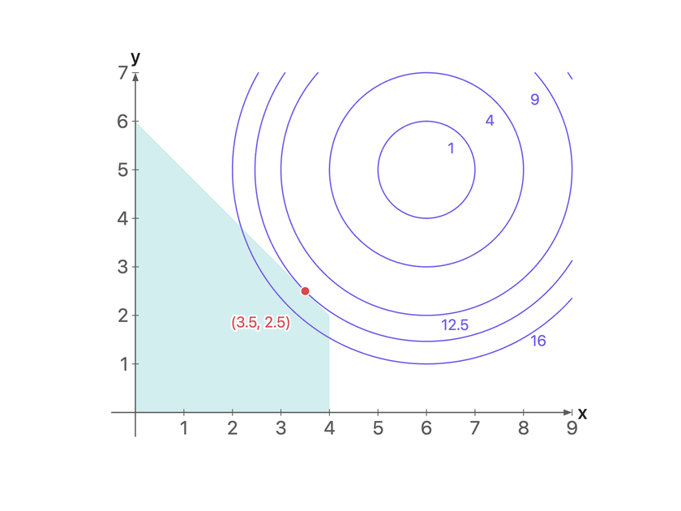
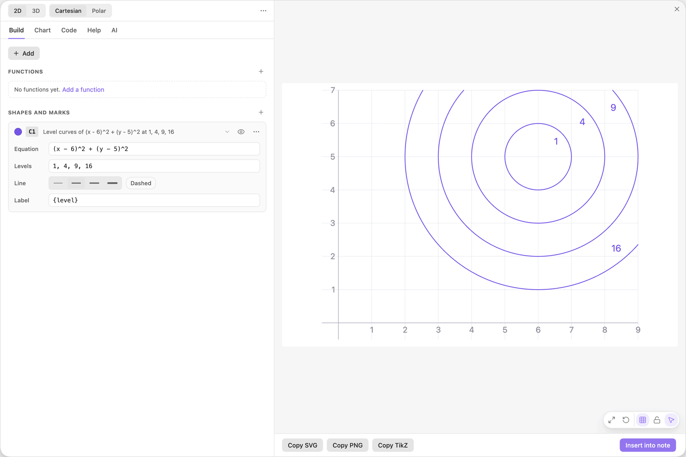
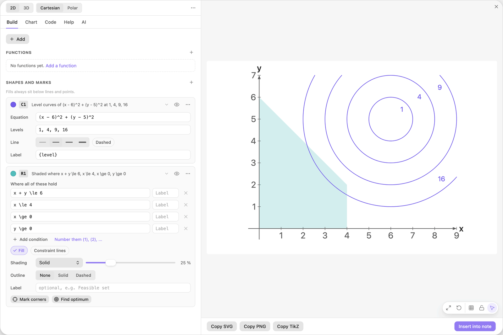
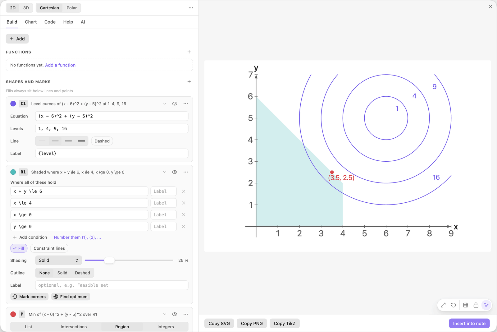
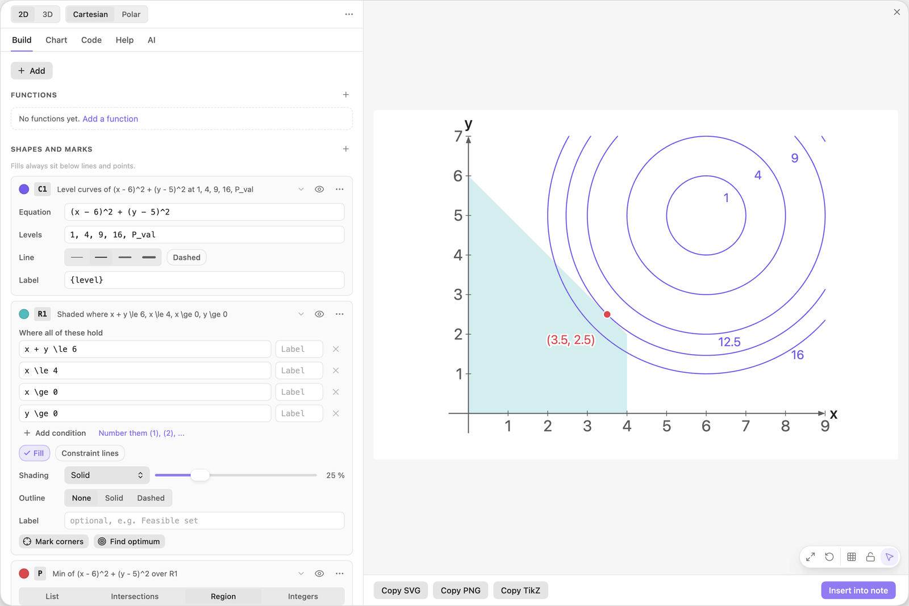
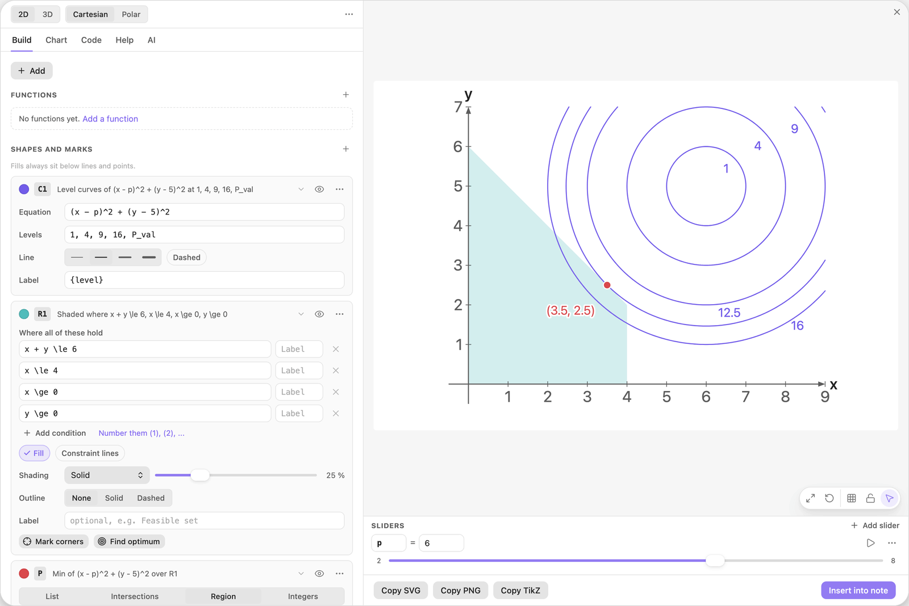

<!-- Generated by scripts/media/build-guides.mjs from src/guides. Do not edit. -->

# Find a nonlinear optimum with level curves

[All guides](README.md) · Regions and optimisation · Advanced · about 3 minutes

Circles of equal distance as level curves, and the closest point of a region, where one of them touches.

<p align="center"></p>

**What you can do afterwards**

- Draw the level curves of a formula in x and y
- Find a nonlinear minimum over a region
- Draw the level curve through the optimum

**Read first:** [Solve a linear program in a picture](linear-program.md)

## 1. Draw level curves

A level curve joins the points where a formula has one value. This formula is the squared distance from (6, 5), so its level curves are circles.

The chart in words:

```easy-tikz
show x from -0.5 to 9 and y from -0.5 to 7
size 12 x 8
equal scale
axes in the middle
draw the level curves of (x - 6)^2 + (y - 5)^2 at 1, 4, 9 and 16 in purple, labelled "{level}"
```



## 2. Add the region

Which point of the region lies closest to (6, 5)? It sits on the smallest circle that still reaches the region.

The chart gets these lines:

```easy-tikz
shade where $x + y \le 6$ and $x \le 4$ and $x \ge 0$ and $y \ge 0$ in teal
```



## 3. Mark the closest point

`mark the minimum` searches the whole region, inside and on the edges. Here the best point lies on an edge, between two corners.

The chart gets these lines:

```easy-tikz
P: mark the minimum of (x - 6)^2 + (y - 5)^2 in the region, large, with coordinates
```



## 4. Draw the circle through it

`P_val` is the value at P. Its level curve touches the edge at P without crossing it: that is what an optimum looks like.

The chart gets these lines:

```easy-tikz
draw the level curves of (x - 6)^2 + (y - 5)^2 at 1, 4, 9, 16 and P_val in purple, labelled "{level}"
```



## 5. Move the centre with a slider

Put a slider `p` in place of 6. Drag it: the point slides along the edge and, from `p = 7` on, stays at the corner (4, 2).

The chart gets these lines:

```easy-tikz
slider p from 2 to 8, starting at 6
draw the level curves of (x - p)^2 + (y - 5)^2 at 1, 4, 9, 16 and P_val in purple, labelled "{level}"
P: mark the minimum of (x - p)^2 + (y - 5)^2 in the region, large, with coordinates
```



> **Tip:** `mark the maximum` works the same way: the best point lies on the largest level curve that still reaches the region.

## The finished chart

Paste this block into a note to get the finished chart of this guide. Click the chart in the note to open it in the editor.

<details>
<summary>The chart as an easy-tikz block</summary>

```easy-tikz
show x from -0.5 to 9 and y from -0.5 to 7
size 12 x 8
equal scale
axes in the middle
slider p from 2 to 8, starting at 6
draw the level curves of (x - p)^2 + (y - 5)^2 at 1, 4, 9, 16 and P_val in purple, labelled "{level}"
shade where $x + y \le 6$ and $x \le 4$ and $x \ge 0$ and $y \ge 0$ in teal
P: mark the minimum of (x - p)^2 + (y - 5)^2 in the region, large, with coordinates
```

</details>

## Next guides

- [Draw a market with surplus areas](supply-demand.md): Demand and supply, the equilibrium with lines to the axes, and both surpluses following a demand slider.
- [Surfaces, planes and points in 3D](surfaces-3d.md): Plot a surface coloured by height in a cube, turn it, and cut it with a plane on a slider.

[All guides](README.md)
