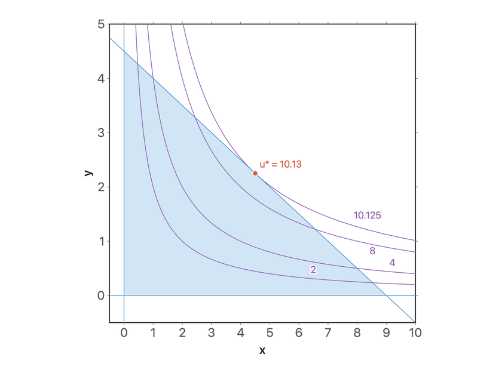
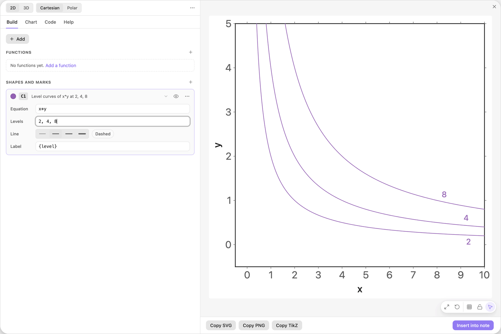
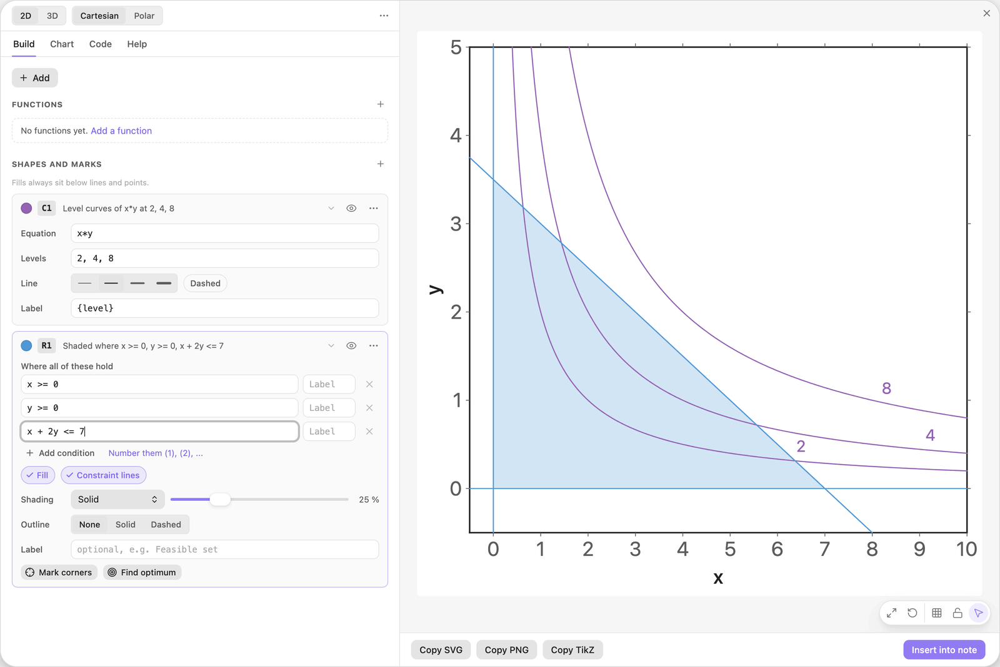
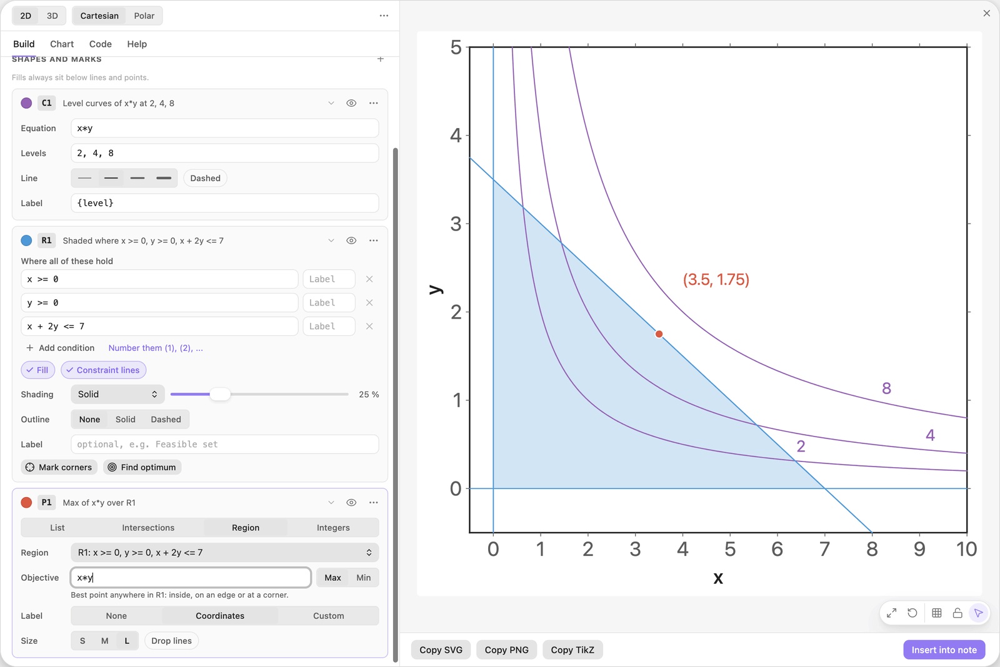
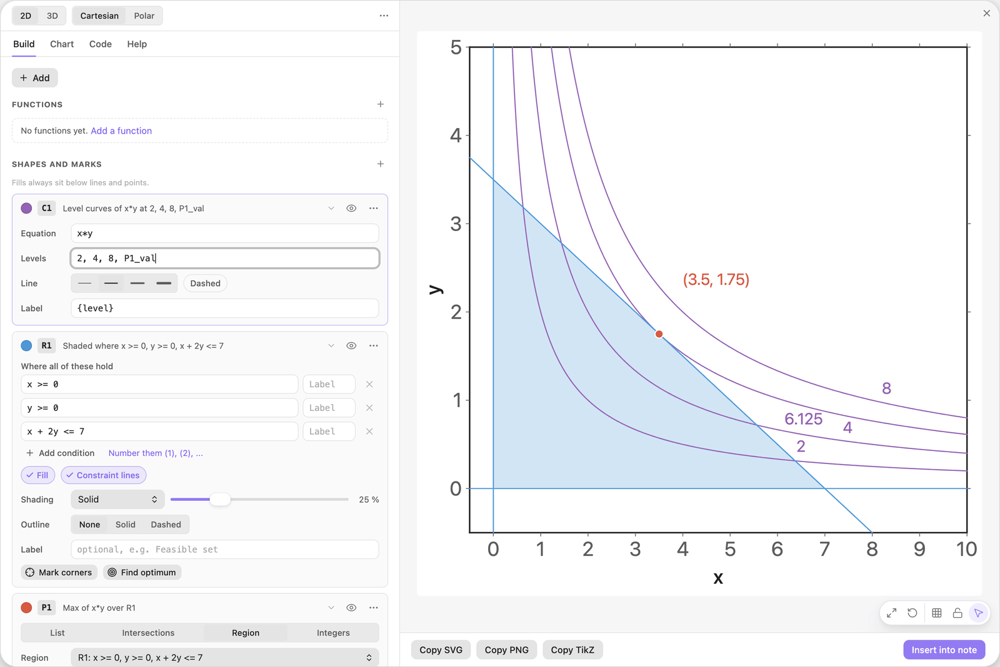
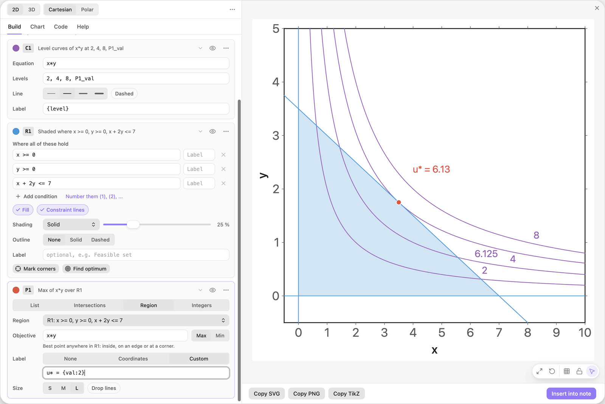
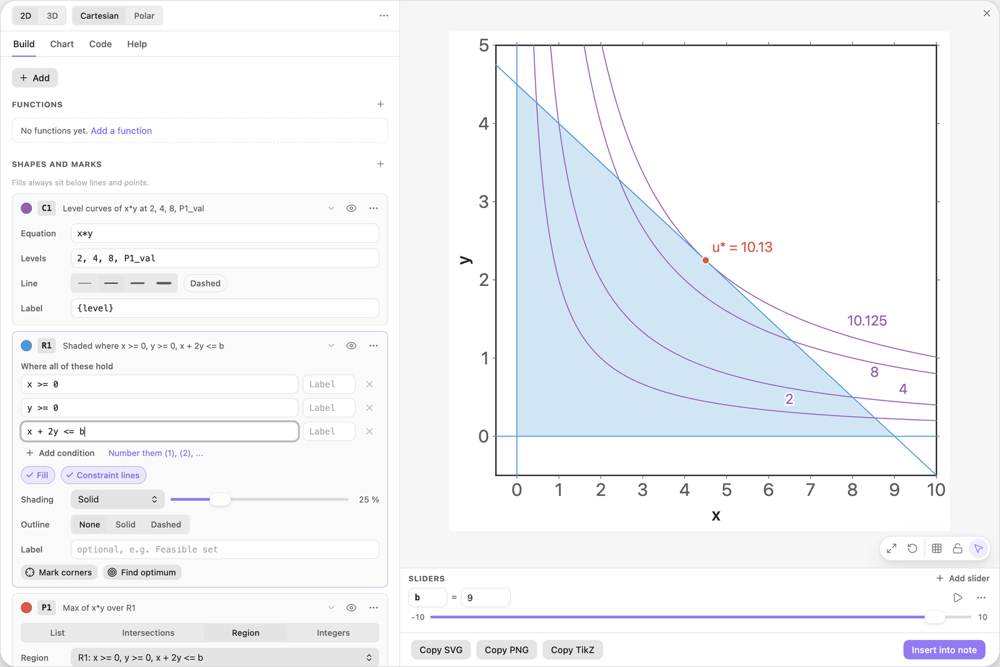

<!-- Generated by scripts/media/build-guides.mjs from src/guides. Do not edit. -->

# Find a nonlinear optimum with level curves

[All guides](README.md) · Regions and optimisation · Advanced · about 8 minutes

Level curves of an objective, a constraint region, the best point on its edge, and the level curve that touches it there.

<p align="center"></p>

**What you can do afterwards**

- Draw the level curves of a formula in x and y
- Find the optimum of a nonlinear objective over a region
- Draw the level curve through the optimum with a computed value
- Watch the solution follow a slider

**Read first:** [Solve a linear program in a picture](linear-program.md)

## 1. Add level curves

Start with a new chart. Click + Add and choose Level curves of F(x, y).

The card C1 holds the formula `x*y` in Equation and the list `2, 4, 8` in Levels. The preview draws one curve per level: all points where x times y equals 2, 4 or 8. Its Label, `{level}`, prints the value on each curve.

Read `x*y` as the objective of this guide, for example the utility of a bundle of two goods. Curves further out are better.



*One curve per entry of Levels. Without levels, the same card draws the single curve F = 0.*

> **Tip:** Write `x*y` or `x y`. Without the star or the space, `xy` is read as one name.

## 2. Add the constraint

Click + Add and choose Feasible region (inequalities). Type the condition below into the empty third row of the card R1.

The shaded triangle is the budget set: all bundles that cost at most 7 when x costs 1 and y costs 2. The curve 2 and the curve 4 pass through it. The curve 8 lies outside, out of reach.

| Where | Type |
| --- | --- |
| R1, condition 3 | `x + 2y <= 7` |



*The budget set and three level curves of the objective.*

> **Tip:** Fills always sit below lines and points, so the order of the cards does not hide the curves.

## 3. Find the best point

On the card R1 click Find optimum. The field Objective of the new card P1 holds the sample `2x + 3y`, already selected: type the formula below over it. Leave the switch on Max.

The marker lands at (3.5, 1.75), in the middle of the sloping edge. It is not a corner: for a nonlinear objective the best point can lie anywhere on the boundary or inside, and the points card searches all of it.

| Where | Type |
| --- | --- |
| P1, Objective | `x*y` |



*The maximum of x\*y over the budget set lies on the edge, between the corners.*

> **Tip:** The hint under Objective says what is searched: the best point anywhere in R1, inside, on an edge or at a corner.

## 4. Draw the curve through the optimum

On the card C1, add `P1_val` to the list in Levels so that it reads as below.

`P1_val` is the objective value at the point P1 found, here 6.125. The new curve touches the budget line in exactly that point and stays outside the region everywhere else. That tangency is the picture of an optimum under a constraint.

| Where | Type |
| --- | --- |
| C1, Levels | `2, 4, 8, P1_val` |



*The level P1\_val is the curve that just touches the budget line.*

> **Tip:** Levels can mix numbers, sliders and computed values, separated by commas.

## 5. Print the optimal value

On the card P1 set Label to Custom and replace the text with the template below.

The marker now shows the value of the objective instead of its coordinates: u\* = 6.13. The `:2` limits the number to two decimals.

| Where | Type |
| --- | --- |
| P1, Label | `u* = {val:2}` |



*A custom point label with the objective value.*

> **Tip:** To print both, write `({x}, {y}): u* = {val:2}`.

## 6. Put the budget on a slider

In the third row of R1, replace the 7 by the name `b`, so that the row reads as below. Click Add slider b under the field, then drag the new slider from 1 up to 9.

The triangle grows, the optimum slides outwards, and the touching level curve follows it. At b = 9 the best value is about 10.13, beyond the curve 8.

| Where | Type |
| --- | --- |
| R1, condition 3 | `x + 2y <= b` |



*With the budget on a slider, region, optimum and level curve are recomputed while you drag.*

> **Tip:** Before you press play on b, click the small number at the left end of the slider and type 1: a budget of 0 or less leaves nothing to shade.

## The finished chart

Paste this block into a note to get the finished chart of this guide. Click the chart in the note to open it in the editor.

<details>
<summary>The chart as an easy-tikz block</summary>

```easy-tikz
slider b from -10 to 10, starting at 9, in steps of 0.1
draw the level curves of x*y at 2, 4, 8 and P1_val in purple, labelled "{level}"
shade where x >= 0 and y >= 0 and x + 2y <= b, with constraint lines
P1: mark the maximum of x*y in the region, large, labelled "u* = {val:2}"
```

</details>

## Next guides

- [Draw a market with surplus areas](supply-demand.md): Demand and supply, their equilibrium with guide lines, and consumer and producer surplus that follow a slider.
- [Compare an integer program with its relaxation](integer-program.md): Integer points inside a feasible region, the best integer point, and how far it is from the optimum of the relaxed linear program.
- [Charts in your notes](charts-in-notes.md): Insert a chart into a note, play with its sliders there, set its width and alignment, and open it again to change it.

[All guides](README.md)
