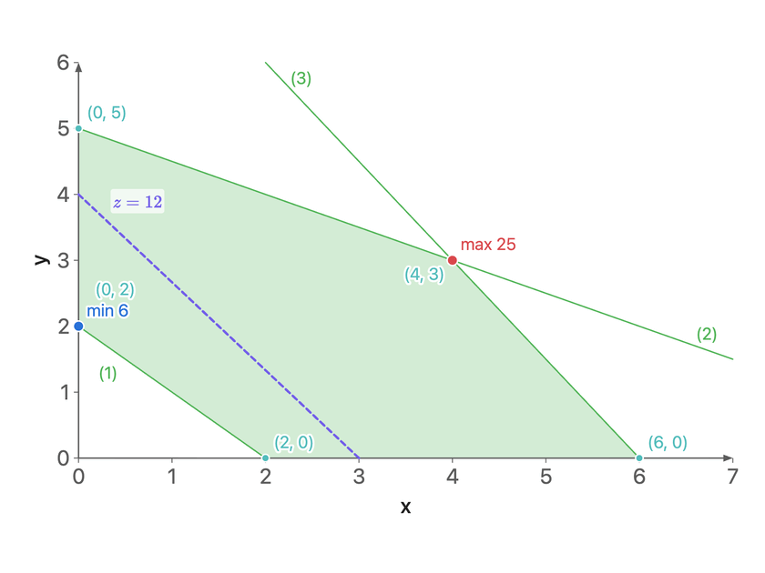
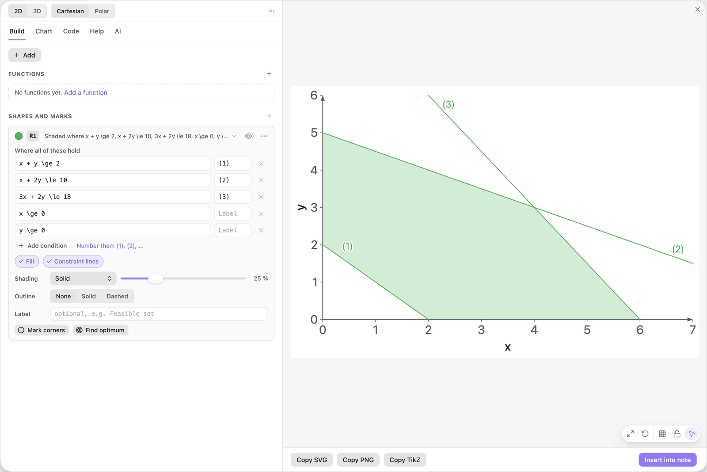
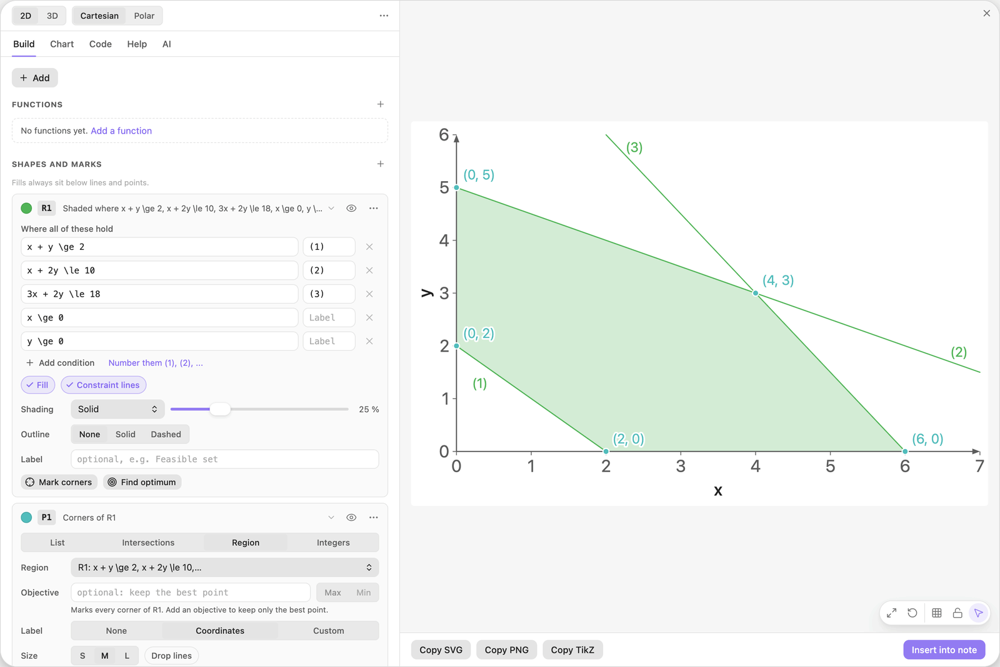
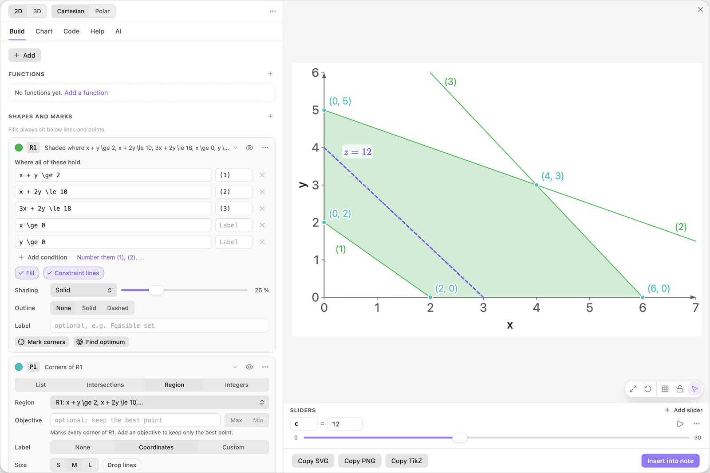
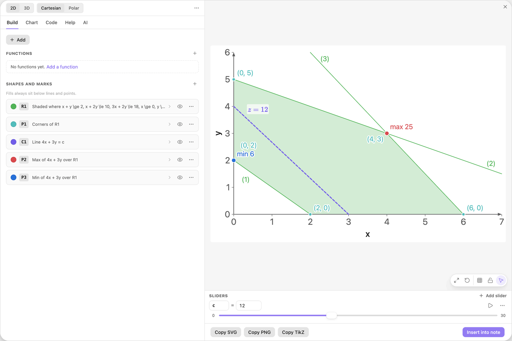

<!-- Generated by scripts/media/build-guides.mjs from src/guides. Do not edit. -->

# Solve a linear program in a picture

[All guides](README.md) · Regions and optimisation · Core · about 3 minutes

Constraint lines, the feasible region and its corners, an objective line on a slider, the maximum and the minimum.

<p align="center"></p>

**What you can do afterwards**

- Draw a linear program with numbered constraint lines
- Slide the objective line across the region
- Let the chart find the maximum and the minimum

**Read first:** [Write a chart in words](chart-language.md)

## 1. Draw the constraints

Write each condition of the model in `shade where`: the shaded part is the feasible region. `with constraint lines` draws every condition as a line, and `numbered` numbers them.

The chart in words:

```easy-tikz
show x from 0 to 7 and y from 0 to 6
size 12 x 8
axes on the edges
shade where $x + y \ge 2$ and $x + 2y \le 10$ and $3x + 2y \le 18$ and $x \ge 0$ and $y \ge 0$ in green, numbered, with constraint lines
```



> **Tip:** Use `\ge` for at least: `$x + y \ge 2$` keeps the region away from the origin.

## 2. Mark the corners

An optimum of a linear program lies on a corner. `mark the corners of the region` finds all five, and `with coordinates` labels them.

The chart gets these lines:

```easy-tikz
mark the corners of the region in teal, with coordinates
```



## 3. Add the objective line

The objective `4x + 3y` has the same value `c` all along the line `4x + 3y = c`. Drag `c` and the line slides across the region.

The chart gets these lines:

```easy-tikz
slider c from 0 to 30, starting at 12
draw 4x + 3y = c in purple, thick, dashed, labelled "$z = {c}$"
```



## 4. Mark the maximum

The chart finds the best point by itself: the last corner the line touches. In the label, `{val}` prints the value of `4x + 3y` there.

The chart gets these lines:

```easy-tikz
mark the maximum of 4x + 3y in the region, large, labelled "max {val}"
```


## 5. Mark the minimum too

`mark the minimum` finds the first corner the line touches. Drag `c` from 6 to 25: the line enters the region at the minimum and leaves it at the maximum.

The chart gets these lines:

```easy-tikz
mark the minimum of 4x + 3y in the region, in blue, large, labelled "min {val}"
```



> **Tip:** Open the chart in the editor and drag a constraint line: the region, its corners and both optima follow.

## The finished chart

Paste this block into a note to get the finished chart of this guide. Click the chart in the note to open it in the editor.

<details>
<summary>The chart as an easy-tikz block</summary>

```easy-tikz
show x from 0 to 7 and y from 0 to 6
size 12 x 8
axes on the edges
slider c from 0 to 30, starting at 12
shade where $x + y \ge 2$ and $x + 2y \le 10$ and $3x + 2y \le 18$ and $x \ge 0$ and $y \ge 0$ in green, numbered, with constraint lines
mark the corners of the region in teal, with coordinates
draw 4x + 3y = c in purple, thick, dashed, labelled "$z = {c}$"
mark the maximum of 4x + 3y in the region, large, labelled "max {val}"
mark the minimum of 4x + 3y in the region, in blue, large, labelled "min {val}"
```

</details>

## Next guides

- [Compare an integer program with its relaxation](integer-program.md): The integer points of a region, the best of them, and the gap to the optimum without whole numbers.
- [Find a nonlinear optimum with level curves](level-curves.md): Circles of equal distance as level curves, and the closest point of a region, where one of them touches.

[All guides](README.md)
