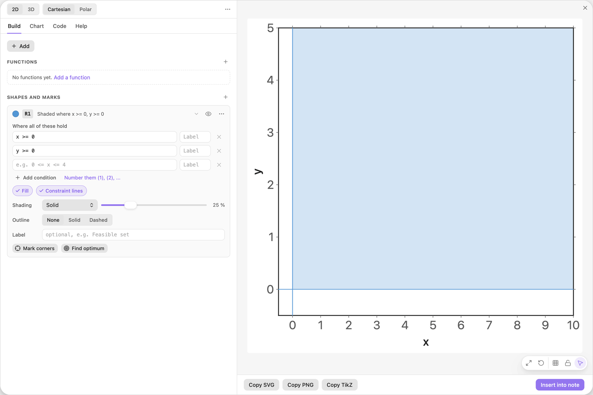
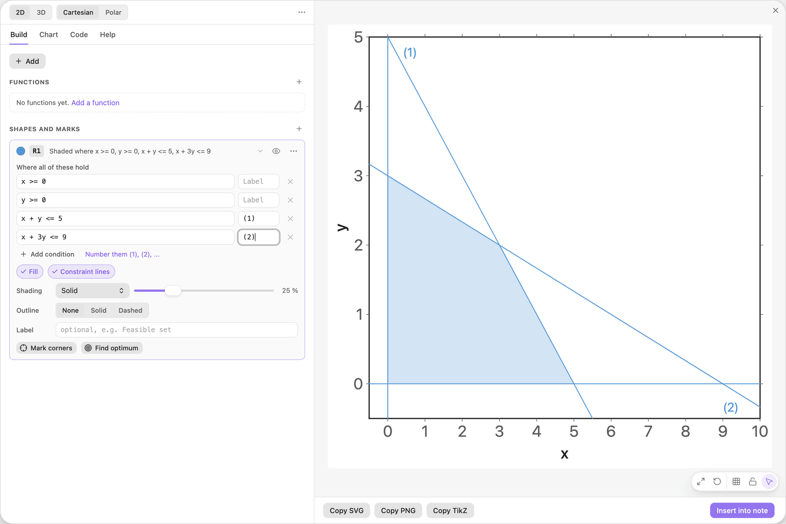
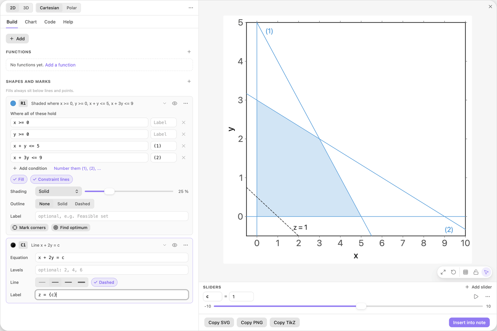
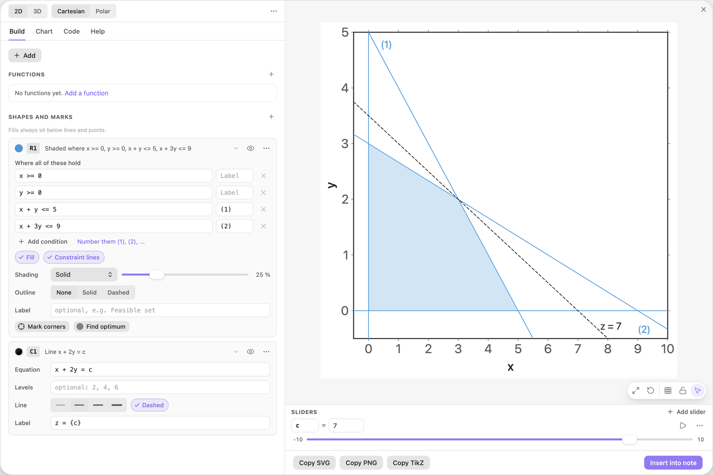
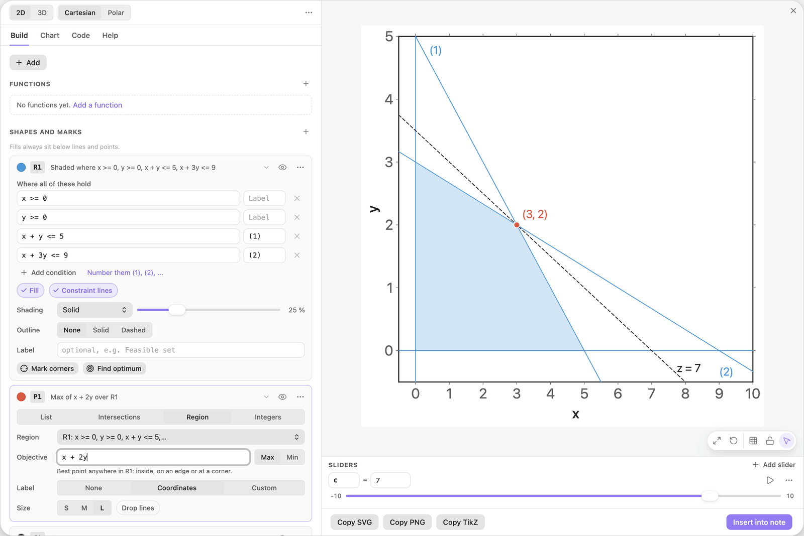
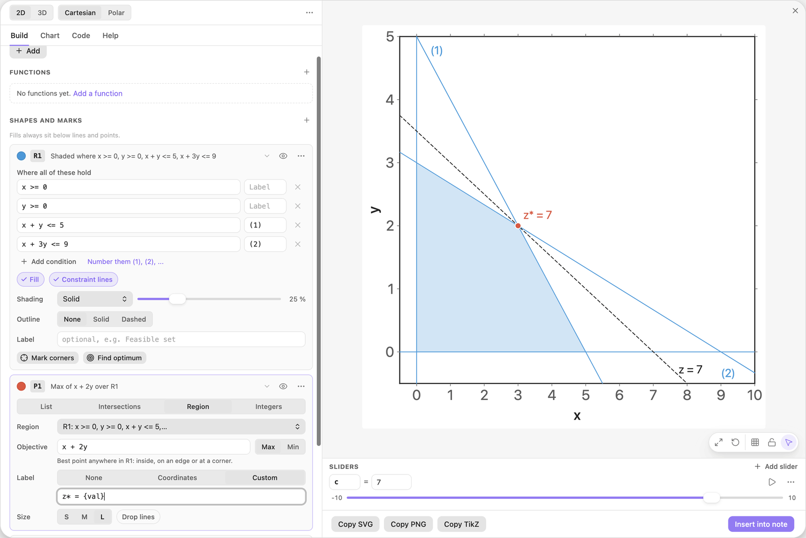
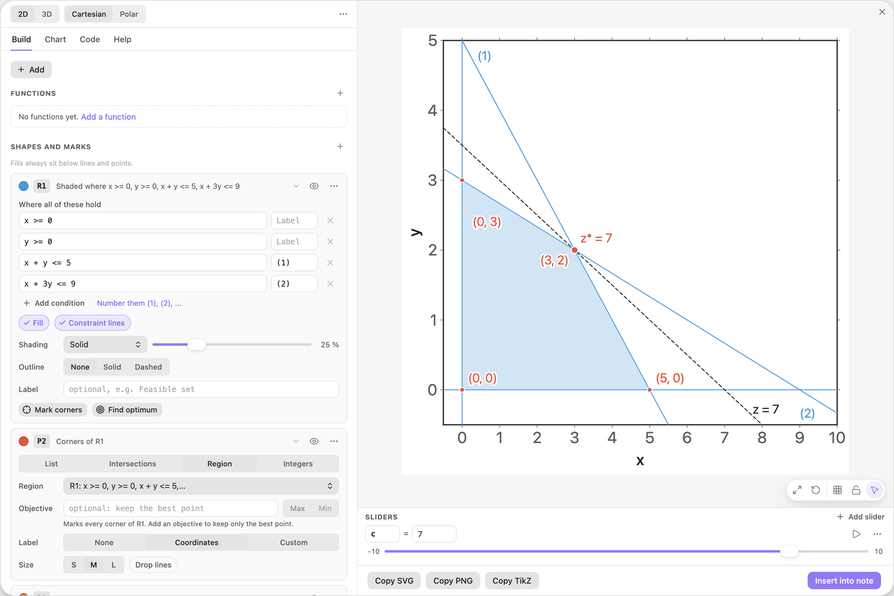
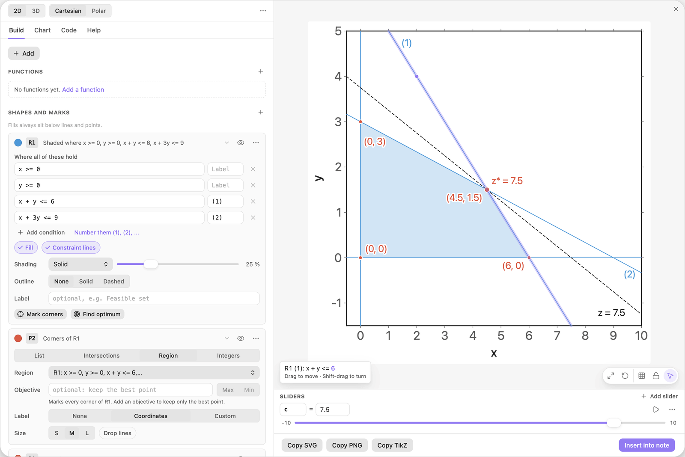

<!-- Generated by scripts/media/build-guides.mjs from src/guides. Do not edit. -->

# Solve a linear program in a picture

[All guides](README.md) · Regions and optimisation · Core · about 10 minutes

Feasible region, labelled constraint lines, an objective line on a slider, the optimum, the corners, and a sensitivity test by dragging.

<p align="center"></p>

**What you can do afterwards**

- Draw the feasible region of a linear program with labelled constraint lines
- Move the objective line with a slider and let the chart find the optimum
- Mark every corner with its coordinates
- Drag a constraint to see how the optimum reacts

**Read first:** [Shade a region with inequalities](regions.md), [Sliders that move the picture](sliders.md)

## 1. Add a feasible region

This guide solves: maximise z = x + 2y subject to x + y &lt;= 5, x + 3y &lt;= 9 and x, y \>= 0.

Start with a new chart. Click + Add and choose Feasible region (inequalities). The card R1 arrives with the two sign conditions `x >= 0` and `y >= 0` filled in, an empty third row, and the chip Constraint lines switched on.



*The recipe starts with the two sign conditions. The shading shows where both hold.*

> **Tip:** This model fits the default view. For larger numbers set Chart \> Ranges first: a region is only computed inside the view.

## 2. Type and label the constraints

Type the first constraint into the empty third row and `(1)` into the small Label box next to it. Click Add condition (or press Enter in the condition field) for a fourth row and enter the second constraint with the label `(2)`.

The region shrinks to a quadrilateral. Each constraint line runs across the whole view and carries its number at one end.

| Where | Type |
| --- | --- |
| R1, condition 3 | `x + y <= 5` |
| R1, Label box of row 3 | `(1)` |
| R1, condition 4 | `x + 3y <= 9` |
| R1, Label box of row 4 | `(2)` |



*One row per constraint, with its label in the box on the right.*

> **Tip:** The link Number them (1), (2), ... labels every row at once, the sign conditions included.

## 3. Add the objective line

Click + Add and choose Line from an equation. Replace the equation of the new card C1 with the first row below. The name `c` is unknown, so a button Add slider c appears under the field. Click it. Then fill in the field Label and switch on the chip Dashed, so the line does not look like a constraint.

The line shows every point with the same objective value z = c. The slider starts at 1, so the line sits near the origin, and its label prints the current value.

| Where | Type |
| --- | --- |
| C1, Equation | `x + 2y = c` |
| C1, Label | `z = {c}` |



*The objective line x + 2y = c. Braces in a label print a value: z = {c} shows z = 1.*

> **Tip:** A new slider runs from -10 to 10. Type a value outside that range into its value field and the range widens.

## 4. Slide the line across the region

Drag the slider c in the Sliders dock under the preview to the right, or press its play button.

The line moves parallel to itself, and z grows as it moves up. Stop at the last position where it still touches the region: c = 7. There the line meets the region in a single corner. That corner is the optimum, and 7 is the largest value z can take.



*At c = 7 the objective line touches the region in one corner only.*

> **Tip:** You can also drag the line itself in the preview. Easy TikZ changes sliders first, so c follows the pointer.

## 5. Let the chart find the optimum

On the card R1 click Find optimum. A points card P1 is added right below R1, with the cursor in its field Objective. The field holds the sample `2x + 3y`, already selected: type the objective of this model over it and leave the switch on Max.

A large marker appears at (3, 2), exactly where the line touches the region. P1 searches the whole region, so you get the optimum without sliding anything.

| Where | Type |
| --- | --- |
| P1, Objective | `x + 2y` |



*Find optimum adds a points card that keeps the best point of R1.*

> **Tip:** Set the switch to Min for a minimisation. If the objective can grow without limit inside the view, the status chip says it is unbounded.

## 6. Show the optimal value

On the card P1 set Label to Custom and replace the text with the template below.

Inside a points label, `{val}` is the objective value at the point, and `{x}` and `{y}` are its coordinates. The marker now reads z\* = 7. The same number is available to every other field as `P1_val`.

| Where | Type |
| --- | --- |
| P1, Label | `z* = {val}` |



*A custom label prints the objective value at the optimum.*

> **Tip:** Write the objective line as `x + 2y = P1_val` and it follows the optimum by itself, without a slider.

## 7. Mark the corners

Back on the card R1, click Mark corners. A second points card P2 is added. It has no objective, so it marks every corner of the region and labels each with its coordinates.

The picture now holds the complete graphical solution: the region, its four corners, the objective line and the optimum.



*Mark corners lists every corner point of the feasible region.*

> **Tip:** Corners and optimum are computed, so they cannot be dragged. Drag the lines that define them instead.

## 8. Drag a constraint to test it

In the preview, drag line (1) to the right until its row on the card reads `x + y <= 6`. Rest the pointer on the line first: a tip shows which number will change.

The region grows, the corners move, and the optimum jumps to (4.5, 1.5) with z\* = 7.5. The objective line stays behind at z = 7, so slide c to 7.5 to bring it back. One more unit of constraint (1) raised z by 0.5: that is what a unit of this constraint is worth.

The label z = 7.5 now sits on the lower border of the chart. Give the labels room: open the Chart tab and, under Ranges, let y start at -1.5.

| Where | Type |
| --- | --- |
| Chart \> Ranges, y from | `-1.5` |



*After the drag, condition (1) reads x + y &lt;= 6 and the optimum has moved to (4.5, 1.5).*

> **Tip:** The bar that appears after the drag offers Undo and Make slider. Make slider turns the 6 into a slider, so you can play the constraint.

## The finished chart

Paste this block into a note to get the finished chart of this guide. Click the chart in the note to open it in the editor.

<details>
<summary>The chart as an easy-tikz block</summary>

```easy-tikz
show x from -0.5 to 10 and y from -1.5 to 5
slider c from -10 to 10, starting at 7.5, in steps of 0.1
shade where x >= 0 and y >= 0 and x + y <= 6 and x + 3y <= 9, numbered, with constraint lines
P2: mark the corners of the region, labelled "({x}, {y})"
mark the maximum of x + 2y in the region, large, labelled "z* = {val}"
draw x + 2y = c, dashed, labelled "z = {c}"
```

</details>

## Next guides

- [Compare an integer program with its relaxation](integer-program.md): Integer points inside a feasible region, the best integer point, and how far it is from the optimum of the relaxed linear program.
- [Find a nonlinear optimum with level curves](level-curves.md): Level curves of an objective, a constraint region, the best point on its edge, and the level curve that touches it there.
- [Drag shapes to edit them](drag-to-edit.md): Grab a line or a curve in the preview and its numbers follow: move, turn, stretch, undo.

[All guides](README.md)
