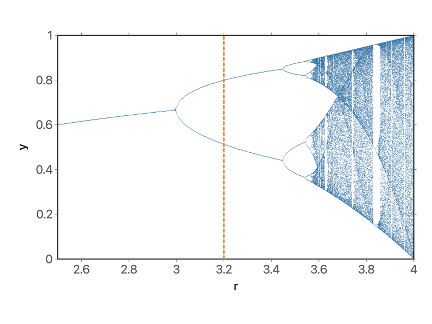
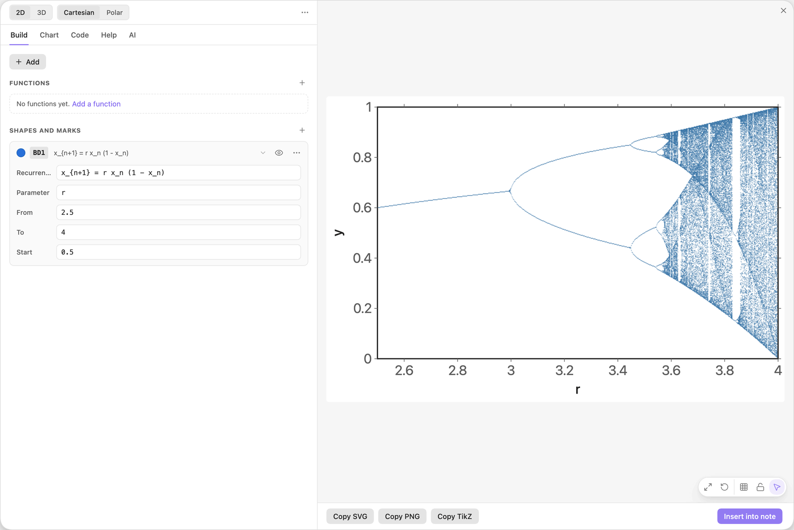
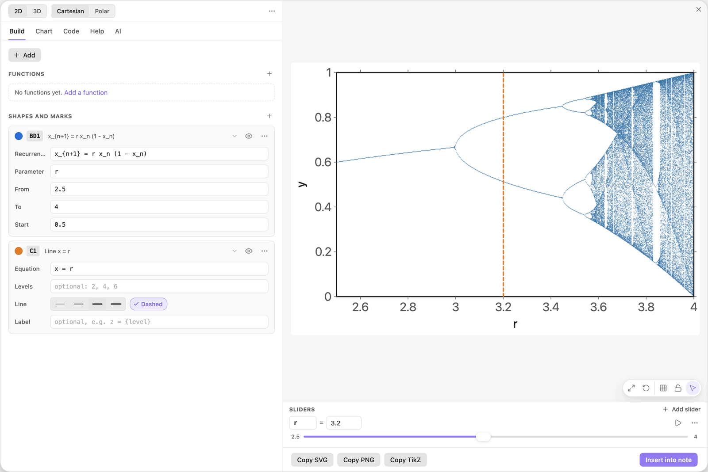
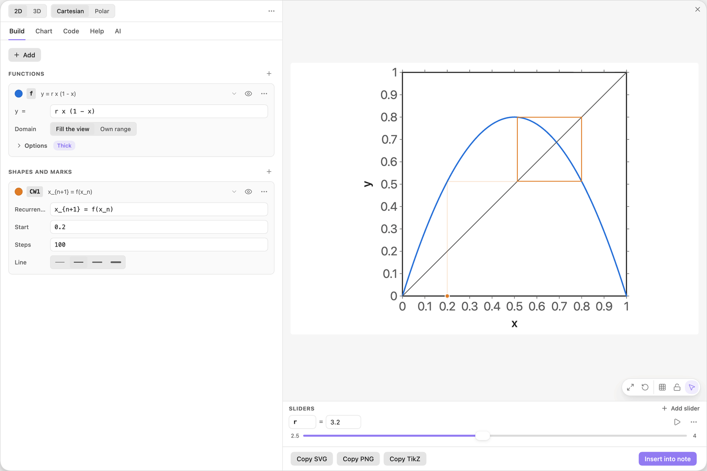
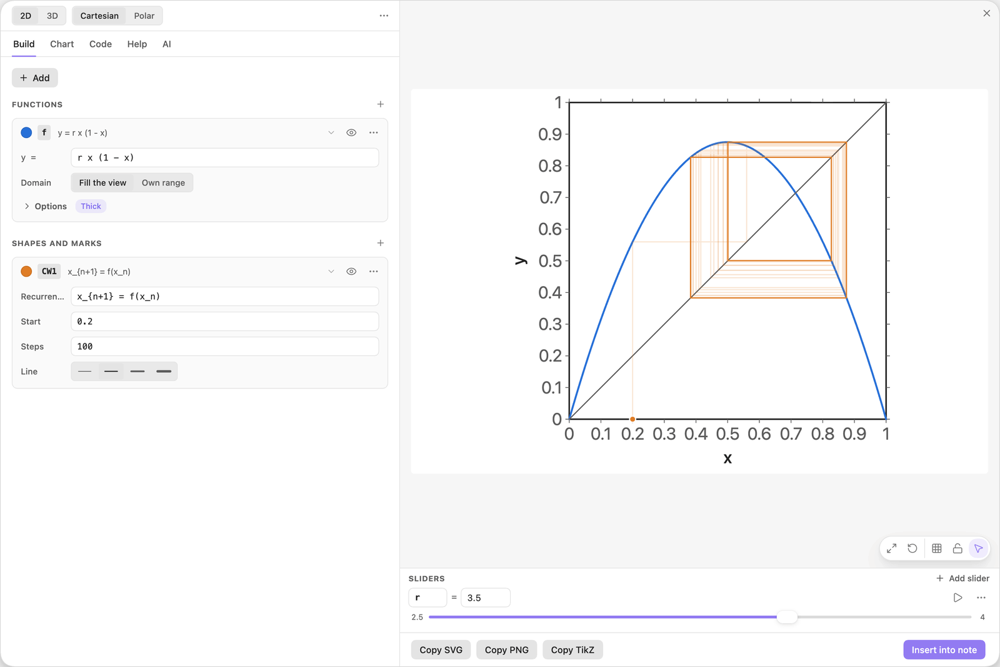
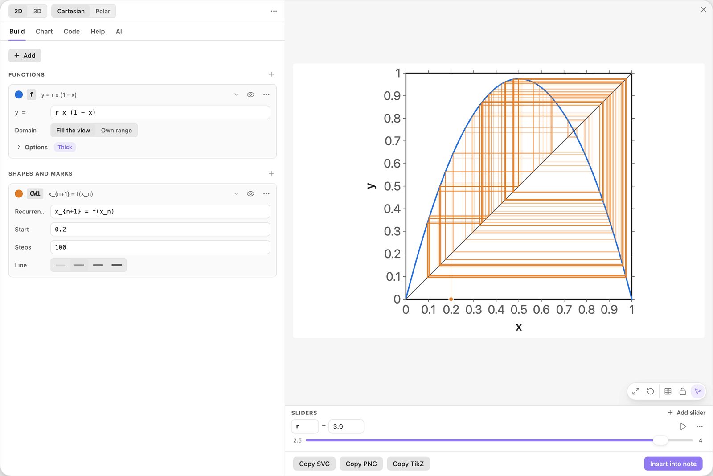

<!-- Generated by scripts/media/build-guides.mjs from src/guides. Do not edit. -->

# The logistic map: bifurcation and cobweb

[All guides](README.md) · Showcase · Advanced · about 3 minutes

x ↦ r x (1 - x) for every r at once, then for one r on a slider: it settles, swaps between two values, four, and turns chaotic.

<p align="center"></p>

**What you can do afterwards**

- Draw a bifurcation diagram
- Mark the r of a slider in it
- Follow one r on a cobweb

## 1. Draw the bifurcation diagram

For each r from 2.5 to 4 the diagram marks where x ↦ r x (1 - x) settles: one value, then two, four, eight, then chaos past r = 3.57.

The chart in words:

```easy-tikz
show x from 2.5 to 4 and y from 0 to 1
size 12 x 8
xlabel r
draw the bifurcation diagram of $x_{n+1} = r x_n (1 - x_n)$ for r from 2.5 to 4
```



## 2. Put r on a slider

The dashed line is `x = r`. At r = 3.2 it crosses two branches: the map swaps between two values for ever. Drag `r` along the diagram.

The chart gets these lines:

```easy-tikz
slider r from 2.5 to 4, starting at 3.2
draw x = r in orange, thick, dashed
```



## 3. Follow r = 3.2 on a cobweb

The cobweb runs the map from 0.2: up to the graph, across to the line y = x, up again. It closes into a square: the same two values.

The chart gets these lines:

```easy-tikz
show x from 0 to 1 and y from 0 to 1
equal scale
plot f(x) = r x (1 - x) in blue, thick
draw the cobweb of $x_{n+1} = f(x_n)$ from 0.2, 100 steps
```



## 4. Split the values again

At r = 3.5 the square splits: the path visits four values. Drag `r` slowly up and they double faster and faster.

The chart gets these lines:

```easy-tikz
slider r from 2.5 to 4, starting at 3.5
```



## 5. Find chaos

At r = 3.9 the path never settles: it fills a whole band, as the cloud in the diagram does.

The chart gets these lines:

```easy-tikz
slider r from 2.5 to 4, starting at 3.9
```



## The finished chart

Paste this block into a note to get the finished chart of this guide. Click the chart in the note to open it in the editor.

<details>
<summary>The chart as an easy-tikz block</summary>

```easy-tikz
show x from 2.5 to 4 and y from 0 to 1
size 12 x 8
xlabel r
slider r from 2.5 to 4, starting at 3.2
draw the bifurcation diagram of $x_{n+1} = r x_n (1 - x_n)$ for r from 2.5 to 4
draw x = r in orange, thick, dashed
```

</details>

## Next guides

- [Orbits, cobwebs and bifurcation](orbits-cobwebs.md): Follow x ↦ r x (1 - x) step by step on a cobweb, over time, and for every r at once in the bifurcation diagram.

[All guides](README.md)
